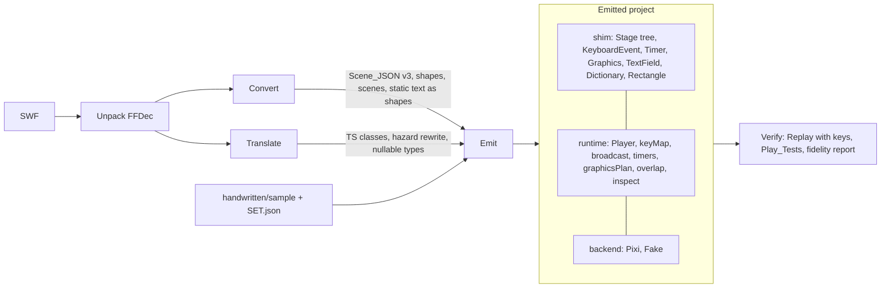
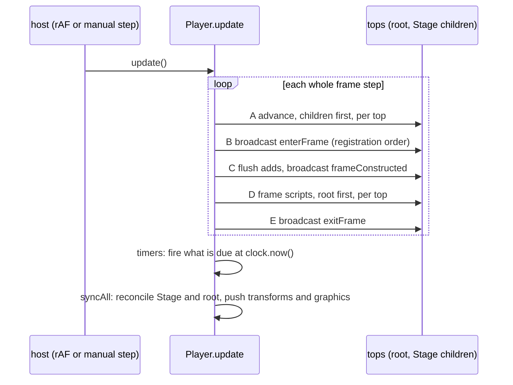

# Design Document

## Overview

This design makes `entity_game` and `spacer` play. It records decisions and the reason for each, not the analysis again. Terms are those of `requirements.md`.

Evidence comes from four sources: the swf-inspector tools on the two SWFs, the repository source, a Chromium run of the real `spacer` output, and the Ruffle source at commit `4a8d39661ed8aec97afee1504a4e33080da2efd0` (fetched with `git fetch` into the gitignored `.work/ruffle-src`). Each Ruffle result below names its file.

Four findings change the plan. Each is in "Findings".

1. `spacer` fails at **page load**, before any frame (cause of the render timeout, Requirement 27.7). A module import cycle throws `Class extends value undefined`. Blocks A to C do not fix this.
2. `Stage` children must be advanced in the same phases as the root, and Ruffle delivers `enterFrame`, `frameConstructed` and `exitFrame` in **registration order**, not tree order.
3. Making every reference type `T | null` under `strictNullChecks` would raise TS18047 on every dereference. The design emits `T | null` and turns `strictNullChecks` off for the emitted project and the gate.
4. Static text of `spacer` needs no new runtime concept. The existing text-to-shape path resolves `<use>` glyphs already.

### Decisions at a glance

| Question | Decision | Why |
|---|---|---|
| `Signal` (entity_game) | Translator route | The rules it needs (Requirements 11, 12, 13) are required anyway. Hand-written is the fallback. |
| `KeyObject` (spacer) | Hand-written | A Shim `Proxy` stub would silently ignore `flash_proxy` overrides (Requirement 20.1). |
| `PhysicEngine` (spacer) | Hand-written, one runtime helper `pixelsOverlap` | The Flash route needs `BitmapData.draw`, blend modes and colour transforms. |
| Handwritten_Set | 2 classes: `KeyObject`, `PhysicEngine` | `Signal` leaves the set. Requirement 33.7 still holds. |
| Scene_JSON | `formatVersion` 3 (scenes). Reader accepts 2 and 3. | Block D adds no field (decision D12). |
| `spacer` licence | Hand-written spacer files are GPL-3.0 derivatives | Needs an owner decision before the first commit of them (Open_Item O1). |

## Findings that changed the plan

| # | Finding | Evidence | Effect |
|---|---|---|---|
| F1 | `spacer` page throws `TypeError: Class extends value undefined` while importing translated modules, so `window.__swfResurrect` is never set and `waitForFunction` times out after 10 s. | Built `.work/design-spacer`, loaded in Chromium with a `pageerror` listener. Failing site: `Fly extends Sprite`. Node check: bundling `src/classes.ts` fails; after changing one line it loads. | New work item D13. Needs a new requirement (R-new-1). |
| F2 | The cycle has one cause: `private var levelScene:* = LevelScene;` in `Sprite.as` is emitted as a value use, which adds the edge `Sprite -> LevelScene -> Fly -> Sprite`. | Replacing `= LevelScene` with `= undefined` in the emitted `Sprite.ts` made the bundle load. `entity_game` has no import-time failure: all 23 classes load one by one in Node. | The fix is a general hazard rule, not a `spacer` rule. |
| F3 | `main.ts` returns without setting `__swfResurrect` when `loadScene` fails, and a module-evaluation error cannot reach `main.ts` at all. | `template/src/main.ts`, `template/src/timelineOnly.ts`. | Install an error listener in `index.html` before the module script. |
| F4 | The analysis said the Stage `enterFrame` order was unknown. Ruffle fires it in the order of first `addEventListener`, for any display object including the Stage, whether or not it is on the display list. | `core/src/avm2.rs` `register_broadcast_listener`, `broadcast_event`; `core/src/avm2/globals/flash/events/event_dispatcher.rs`; `core/src/display_object/stage.rs` `enter_frame`; `core/src/frame_lifecycle.rs`. | D6. Requirement 7.5 needs an amendment (R-new-3). |
| F5 | `Timer` has a 10 ms floor and a catch-up loop of up to 10 firings per update. | `core/src/timer.rs` (`MIN_INTERVAL`, `MAX_TICKS`). | Requirement 22.10 as written is wrong (R-new-4). |
| F6 | A packaged override path exists in Emit (`a/b/Cls.ts` is class `a.b.Cls`) but `pipeline/cli.ts` lists only top-level `.ts` names. The report would not mark a packaged override. | `src/emit/emit.ts` `loadHandwritten`; `src/pipeline/cli.ts` `handwrittenClasses`. | Fix is needed only if `Signal` falls back to hand-written. |
| F7 | The 13 `DefineEditText` texts are static (`wasStatic="true"`, `readOnly="true"`, `useOutlines="true"`). FFDec already exports their SVG with `<use>` glyphs, and `svgToShape.ts` resolves `<use>` to `<defs>`. The placements are dropped only because the tag kind is listed as unsupported. | `swf_find_tags` on `spacer`; `.work/gaps/work-spacer/texts/2.svg`; `src/convert/ffdecXml.ts`, `src/convert/svgToShape.ts:371`. | Block D is a Convert change, not a runtime change (D12). |
| F8 | Neither game calls `trace()`. | Search of both decompiled trees. | The Reference_Trace is empty for both. Requirement 26 reduces to `not-compared: empty-reference-trace`. |
| F9 | `entity_game` has one root frame and draws everything by code, so FFDec's Reference_Frame is blank. | `swf_summary`: 1 frame, 30 fps, no shape, text or bitmap tag. | Overall_Match for it is measured on one frame and cannot see code-drawn shapes (Requirement 27.1, Open_Item O6). |

Analysis claims that were wrong or open, now settled:

| Analysis claim | Result |
|---|---|
| Spacer render timeout cause "not verified" | Found (F1). |
| Stage `enterFrame` order "not verified" | Read (F4). |
| `Timer` zero-delay "not verified in Ruffle" | Read (F5). RangeError rule confirmed: `!isFinite(delay) \|\| delay < 0`. |
| `getBounds` of an empty clip "(0,0,0,0) not verified" | Confirmed: `get_dobj_bounds` returns `Rectangle::ZERO` for invalid bounds. |
| "Pixi ignores `<use>`, so text needs `<use>` expansion" | True of Pixi `svg()`. Convert has its own resolver, so no work is needed there. |
| Hand-written `Signal` is the shorter route | Not once Requirements 11 to 13 are counted as required work. |

## Architecture



### Player tick



Timers run after the frame loop and use the clock, not the frame accumulator. This is Ruffle's `Player::tick` (`update_timers(dt)` follows the `run_frame` loop in `core/src/player.rs`).

## Components and Interfaces

### Component map

| Area | Files (new or changed) | Requirements |
|---|---|---|
| Translator | `rewrite.ts` (Vector call, Dictionary, `is Array`/`is Class`, `delete`, `super(...)` args), `memberTables.ts` (lookup order), `shimNames.ts` (now generated), `importPlan.ts`, `types.ts`/`emitTs.ts` (null), `typeCheckGate.ts` (options), new `initHazards.ts` | 2, 3, 9, 10, 11, 13, 19, 20, D13 |
| Shim | `Stage.ts`, `events.ts` (+`KeyboardEvent`, `TimerEvent`, priority), `Keyboard.ts`, `Graphics.ts`, `TextField.ts`, `Dictionary.ts`, `errors.ts`, `utils.ts` (`getTimer`, `getQualifiedClassName`, `getDefinitionByName`), `Timer.ts`, `Rectangle.ts`, `filters.ts`, `InteractiveObject` (in `Sprite.ts`), `MovieClip.ts`, `DisplayObject.ts` | 4, 6, 7, 8, 12 to 17, 21, 22, 23 |
| Runtime | `player.ts`, new `keyMap.ts`, `broadcast.ts`, `timers.ts`, `graphicsPlan.ts`, `overlap.ts`, `inspect.ts`; `hitTest.ts`, `backend.ts`, `pixi/pixiBackend.ts`, `scene.ts`, `loader.ts` | 5, 7, 14, 15, 21, 22, 23, 25 |
| Convert | `convertModel.ts` (scenes, static edit text), `ffdecXml.ts` | 21.6, 29 |
| Verify | `replayPlan.ts` (key entries), `replayRunner.ts`, `report.ts` (hand-written, named limits) | 24, 33 |
| Pipeline and samples | `cli.ts`, `src/samples/fetchedSample.ts`, `scripts/fetch-spacer.ts`, `handwritten/SET.json`, `handwritten/spacer/*`, `samples/entity_game/*`, `samples/spacer/*` | 18, 28, 33 |
| Tests | `test/support/playScenarios.ts`, `playScript.ts`; unit, property, e2e files named in Testing Strategy | 25 |

### Block A: shared

| # | Decision | Reason | Rejected alternative |
|---|---|---|---|
| D1 | `SHIM_AS3_NAMES` is generated by `gen:shim-members` from the exports of `template/shim/index.ts`. The import scan reads type annotations as well as expressions. | The hand list lacks `Stage`, which is the cause of the missing import. One source stops the lists from drifting (Requirement 2.3). | Add `Stage` to the list by hand: fixes one name only. |
| D2 | Emit `T \| null` for every reference type (Requirement 3.1). Set `strictNullChecks: false` in the emitted `tsconfig.json` and in the gate options. All other `strict` flags stay on. | With `strictNullChecks` on, every `this.player.x` on a nullable field raises TS18047, hundreds of false errors that hide real ones. AS3 reference types are nullable by definition, so the flag matches the source language. The annotation text still follows Requirement 3.5. | `T \| null` with the flag on: unusable noise. Relax the flag and emit plain `T`: breaks Requirement 3.5. |
| D3 | `KeyboardEvent`, `Keyboard` (constants 38, 40, 37, 39, 13, 27, 32 from the `flash.ui.Keyboard` documentation) exported from the Shim. The import binding shadows the DOM global of the same name. | Same mechanism as `Event` and `MouseEvent`. | Rename the DOM use: the translator would need a deny list. |
| D4 | Keyboard path: see "Keyboard path". | | |
| D5 | `addEventListener(type, listener, useCapture=false, priority=0, useWeakReference=false)`. Dispatch order: descending `priority`, insertion order inside one priority. A listener already present at any priority is ignored. | Read in Ruffle `core/src/avm2/events.rs`: `DispatchList` is a `BTreeMap<i32, Vec<EventHandler>>`, iterated with `.rev()` over priorities, and `add_event_listener` returns early when the handler exists at any priority. | Ignore `priority` (analysis): changes order for any game that uses it. |
| D6 | Stage as the real top of the tree: see "Stage as a real tree". | | |

### Block B: `entity_game`

| # | Decision | Reason | Rejected alternative |
|---|---|---|---|
| D7 | Member lookup in an instance context is two passes: every **instance** member along the chain (translated classes, then Shim chain), then the statics. Static context is unchanged. | AVM2 searches the innermost scope first, and `this` is pushed above the class scope (read: `core/src/avm2/scope.rs` `ScopeChain::find` iterates `scopes.iter().skip(1).rev()`; that `this` is on the scope stack is AVM2 convention, not read, Open_Item O4). Today `lookupMember` tries instance then static per class, so own static `stage` beats the inherited instance `stage`. | Special-case `Game.stage`: forbidden by decision 3 of the requirements. |
| D8 | `Vector.<T>(x)` becomes `Array.from(x)`; for `int`/`uint` each element goes through the existing int coercion. | Smallest rule that covers Requirement 10. | |
| D9 | `Signal`: translator route. Work: `is Array` to `Array.isArray`, `is Class` to `typeof === "function"`, `delete` on an object to JS `delete`, Dictionary index rewrite (D10), error classes, `getQualifiedClassName`. | Size from the decompiled sources: `Signal.as` 176 lines (+ `SignalBinding` 148, `SignalBindingList` 194, which translate as they are once nullable types land). A hand-written `Signal` is about 60 lines but also needs the packaged-override fix (F6) and an extra report entry. The extra rules are required by Requirements 11 to 13 anyway, so the marginal cost is near zero. Fallback: hand-written `handwritten/entity_game/org/osflash/signals/Signal.ts` plus the fix in `cli.ts`. | |
| D10 | `Dictionary` is a class over `Map` (identity for objects and functions, value for strings and numbers). The translator rewrites `d[k]`, `d[k] = v`, `k in d`, `delete d[k]` when the receiver's declared type is `Dictionary`: a field (member table), a parameter or a local. Otherwise the index syntax stays and the site goes to the Translation_Report (Requirement 13.6). | A JS `Proxy` cannot work: `d[fn]` stringifies `fn` before any trap runs. `Signal` declares `protected var existing:Dictionary`, so the field type is known. | Proxy-backed Dictionary: all function keys collide. |
| D11 | `Graphics`, `TextField`, `filters`: see "Graphics" and "TextField and filters". | | |

### Block C: `spacer`

| # | Decision | Reason | Rejected alternative |
|---|---|---|---|
| D14 | `this.field` in `super(...)` arguments: evaluate the field initialiser into a local before `super`, assign the field from the same local after `super`. A field with no initialiser passes the type's default and records a Named_Limit if the body assigns it first. | JS forbids `this` before `super`; AVM2 has run the field initialisers by then. Four sites in `spacer`, general rule. | Hoist all initialisers: changes order for every class. |
| D15 | `KeyObject`: hand-written (about 45 lines against 61 in AS3). Reason string: "`extends flash.utils.Proxy`; Shim has no Proxy and a stub would ignore `flash_proxy` overrides without saying so". | Requirement 20.1 keeps `Proxy` unsupported. The only override (`getProperty`) is dead code in `spacer`. The translator route would be shorter only by adding a silent stub. | Shim `Proxy` stub: silent wrong behaviour for any other AS3 game. |
| D16 | `PhysicEngine`: hand-written. It is the AS3 class with `areaOfCollision` (lines 174 to 214) replaced by `pixelsOverlap(a, b)`, so about 175 of 214 lines are copied. | The Flash route (`BitmapData.draw` with `ColorTransform` and `BlendMode.DIFFERENCE`, `getColorBoundsRect`, `concatenatedMatrix`) needs a rasteriser in the Shim. Product scope lists BitmapData manipulation as out of scope. | Shim `BitmapData`: large and out of scope. |
| D17 | `MovieClip.currentLabel` returns the nearest label at or before `currentFrame`, else null. Scenes: see "Scenes". | Ruffle `get_current_label` uses `current_label()` (nearest label), unlike `currentFrameLabel`, which is exact. `Bullet.as:71` depends on the nearest-label behaviour. | Exact-frame label: the death animation never ends. |
| D18 | `Timer`: see "Timer". | | |
| D19 | `Rectangle` (Requirement 23.5) and `DisplayObject.getBounds(target)` are provided. `Matrix`, `hitTestObject`, `transform.concatenatedMatrix`, `BitmapData`, `ColorTransform`, `BlendMode` are not. | The chosen collision route needs none of them. `getBounds` serves `pixelsOverlap` and Block D. Requirement 23.10 says "whenever the chosen route needs them". | All of them: no game needs them. |

### Block D (optional)

| # | Decision | Reason |
|---|---|---|
| D12 | Static texts: Convert treats a `DefineEditTextTag` with `wasStatic="true"` and `readOnly="true"` like `DefineTextTag`: export the FFDec text SVG, convert with `svgToShapeJson(..., 'text')`, emit a shape symbol. No `texts` field in Scene_JSON, no device font, no `StaticText` runtime. | F7. Glyph outlines come from the embedded `DefineFont3`, so the result is exact where a device font would not be. Requirement 29.1, 29.2, 29.4 and 29.5 are replaced by this (R-new-5). Requirement 29.6 and 29.7 hold. A `DropShadowFilter` on the "Pause" placement stays a Named_Limit. |
| D20 | `width`/`height` = size of `contentBounds(obj, self)` after the object's own scale and rotation. `contentBounds` is the one internal function behind `getBounds`, `pixelsOverlap` and Block D. | One bounds routine, tested once (Requirement 30.5). |

### Stage as a real tree

The Stage stays a non-DisplayObject with no transform. It gains the container methods by delegating to shared functions in `Sprite.ts`. Making `Stage` extend `DisplayObjectContainer` was rejected: it adds `x`, `y`, `name` and a `_parent` chain to a class the whole runtime tests with `isStage`.

| Part | Design |
|---|---|
| Children | `stage._children[0]` is the root. `addChild`, `removeChild`, `getChildAt`, `getChildByName`, `numChildren` share the container code. `removeChild` of a non-child throws `ArgumentError` (new class). `announceAdded` and `announceRemoved` treat a parent chain that ends at the Stage as on stage: `_onStage()` becomes true when the chain reaches a Stage, not only a root with `_isStageRoot`. Without this, Stage children never get `addedToStage`. |
| Tops | `tops = [root, ...stage._children.slice(1)]`, snapshot at the start of each frame step. Clips added during a step are not stepped (as today). |
| Phases | `Sprite._step` is generalised to `stepTops(tops)` in `shim/internal.ts`; `_step()` stays as `stepTops([this])`. A: advance, post-order per top. B: broadcast `enterFrame`. C: flush adds per top, broadcast `frameConstructed`. D: frame scripts, pre-order per top, root top first. E: broadcast `exitFrame`. |
| Broadcast | New `runtime/broadcast.ts`. `EventDispatcher.addEventListener` registers the object in an ordered list for `enterFrame`, `frameConstructed`, `exitFrame` on first registration (Ruffle `register_broadcast_listener`). Delivery walks the list, skips objects with no listener, and prunes those. Ruffle keeps the position until the object is collected; pruning moves a re-registered object to the end (Open_Item O3). Only `DisplayObject` instances and the Stage take part (Ruffle `on_type`). |
| Guard | Existing samples must keep Overall_Match and Trace_Score. Their children register first (constructors run children first), so registration order equals today's post-order there. If a floor drops, keep post-order for objects under the root and put the Stage and Stage children in registration order among themselves. |
| Nodes | `Player.stageNode` is a backend container holding the root node and the Stage children. `rootNode` stays for `timelineOnly` and tests. `syncAll` walks from the Stage. `reconcile` takes a `ParentNode`. `main.ts` adds `stageNode` to the Pixi stage. |
| Hit test | One hit view per top. Tops are tried from the highest index down, root last. `resolveHitTarget` gains a `rootClip` argument so that only the root clip is never a target (Ruffle: the loader root); a Stage child can be a target. A TextField hit counts as a hit of an interactive leaf (`selfHit`). |
| Script-created symbols | Already supported (`installScriptConstruction`, D39 of the breadth spec). A linked class added to the Stage binds its named children before its constructor body. |
| Members | `mouseX`/`mouseY` from `getPointerPosition()`. `frameRate` from `Scene_JSON.stage.frameRate`. `scaleMode` stored, no effect (Named_Limit). `focus` defaults to null, accepts any object including the Stage. |

### Keyboard path

```
browser keydown/keyup (window) -> keyMap.flashKeyCode(event) -> Player.dispatchKey(type, code)
   -> target = stage.focus if on stage, else Stage -> KeyboardEvent (bubbles) -> listeners
```

| Part | Design |
|---|---|
| `keyMap.ts` (pure) | `flashKeyCode({ code, keyCode }): number \| null` reads `event.code` first (`KeyA`..`KeyZ` to 65..90, `Digit0`..`Digit9` to 48..57, arrows 37 to 40, `Enter` 13, `Escape` 27, `Space` 32), then `keyCode` when `code` is unknown, else null. `preventsDefault(code)` is true for 37 to 40 and 32. Physical `code` keeps WASD where the player expects it on any layout. |
| Measurement (Requirement 5.10) | One Chromium test presses each of the 14 required keys with Playwright and checks that `keyCode` equals the table value. That proves browser to Flash numbers on a US layout only; other layouts are Open_Item O7. |
| Listener | `window` in the emitted page, not the canvas. `pointerdown` calls `window.focus()`. Repeats pass through as further `keyDown` events (Requirement 5.6). |
| iframe (Requirement 5.7) | The web UI runs the project in `sandbox="allow-scripts"` (`web/server/http.ts`). The parent calls `iframe.focus()` on `load` and when the user clicks the frame. One small change in `web/client/src/result.ts`; checked by hand with the playwright MCP. |
| `Player.dispatchKey` | Calls `syncAll()` afterwards, like pointer methods. Used by the browser listener, the Replay runner and the Play_Tests, so there is one dispatch function (Requirement 24.2). |
| Ruffle repeat | The Ruffle test injector sends one `KeyDown` per entry and no repeat (`tests/input-format/src/format.rs`). Both games are idempotent per key, so the difference is not a Named_Limit. |

### Input_Script extension

Ruffle's entry format, read in `tests/input-format/src/format.rs` and `tests/framework/src/runner/automation.rs`: `{"type":"KeyDown","key":{"Char":"a"}}` or `{"type":"KeyDown","key":"ArrowUp"}`. The key is a name, not a code. A tick is one group of entries between `Wait` entries.

| Part | Design |
|---|---|
| Plan | `replayPlan.ts` classifies `KeyDown`/`KeyUp` and adds `keys: PlannedKey[]` (`tick`, `kind`, `keyCode`, `index`). Mapping `automatedKeyToFlashCode` is a pure table: `Char(c)` letters and digits to ASCII upper case, `ArrowUp` 38, `ArrowDown` 40, `ArrowLeft` 37, `ArrowRight` 39, `Enter` 13, `Escape` 27, `Space` 32. Anything else is `unsupported-input` as today. |
| Run | `replayRunner.ts` calls `player.dispatchKey` after that tick's update. |
| Serialise | `planToEntries(plan)` produces canonical entries (lower-case `Char`), so a generated list parses, plans and serialises back to itself. |
| One script per game | `samples/<name>/reference/input.json` is both the recorder script and the Play_Test script. A test builder (`test/support/playScript.ts`) writes it; a unit test checks the committed file equals the builder output. |

### Graphics

| Part | Design |
|---|---|
| Shim | `Sprite.graphics` and `Shape.graphics` return one `Graphics` that records **primitives**: `lineStyle(thickness, color)`, `beginFill(color)`, `endFill()`, `drawCircle`, `moveTo`, `lineTo`, `clear()`. `drawPath(commands, data, winding)` expands into `moveTo`/`lineTo` at record time (command 1 and 2, two values each). An unknown command skips its data and calls `namedLimit('drawPath-command')`. Extra `lineStyle` arguments are ignored with `namedLimit('lineStyle-args')`. `GraphicsPathWinding` holds the two strings. A `version` counter increments on each call. |
| Plan | `runtime/graphicsPlan.ts` (pure) turns the primitive list into draw operations: `circle`, `polyline`, each with an optional fill and stroke. A fill still open at the end of the list is applied (Flash fills at render, Requirement 14.6). A `drawPath` with a stroke and no fill stays an open stroke. |
| Backends | `RenderBackend.setGraphics(node, ops \| null)`. The FakeBackend stores the ops (Requirement 14.10). The Pixi backend keeps a lazily created `Graphics` at index 0 of the container node and offsets `addChildAt` indices by one when it exists, so graphics are drawn below children (Requirement 14.7). Strokes live in local space inside the scaled container, so they scale with it (Requirement 14.8). |
| Redraw | `NodeRegistry` compares `version` per node each `syncAll` and pushes only changed graphics (Requirement 14.13). |

### TextField and filters

| Part | Design |
|---|---|
| Class | `InteractiveObject` is added between `DisplayObject` and `DisplayObjectContainer` and takes `mouseEnabled`. `TextField extends InteractiveObject`. Defaults per Requirement 15.4. `width` sets the box, not `scaleX`. |
| Measure | Injected function `(text, font) => number`. The Pixi page uses canvas `measureText` with `12px "Times New Roman"`; tests use a fixed width per character. `textWidth` is computed in the `text` setter, so it is valid at once (`AsteroidsGame.as:71`). |
| Draw | `RenderBackend.setText(node, { text, color, width, height } \| null)`; Pixi uses a `Text` child. One line, no wrap. |
| Not provided | `htmlText`, `autoSize`, `defaultTextFormat`, `multiline` are named in the Translation_Report (Requirement 15.8). |
| filters | `DisplayObject.filters` copies on set and on get. `GlowFilter` stores its five values. Setting a non-empty list calls `namedLimit('filter-not-drawn:GlowFilter')`. Pixi 8.22 has no glow and `pixi-filters` would be a new dependency, so the glow is not drawn. |

### Timer

Read in `core/src/timer.rs`, `core/src/avm2/globals/flash/utils/Timer.as` and `timer.rs`, `core/src/player.rs`:

| Ruffle behaviour | Design |
|---|---|
| `new Timer(delay, repeatCount)` throws `RangeError` (error 2066) when `!isFinite(delay)` or `delay < 0` | Same. |
| `add_timer` clamps the interval to at least 10 ms (`MIN_INTERVAL`) | Same. `delay` reads back unchanged. |
| A timer fires when `tick_time < cur_time` (strictly), and the next `tick_time += interval`. At most 10 firings per update (`MAX_TICKS`). | Same. Delay 0 fires up to `floor(dt / 10)` times per update. |
| `update_timers(dt)` runs after the frame loop in `tick` | `Player.update` runs due timers after the frame steps, at `clock.now()`. |
| `start()` on a stopped timer schedules a full interval. `start()` when `currentCount >= repeatCount` fires once, then completes. | Same. |
| `TIMER_COMPLETE` is dispatched after `running` is already false | Same. |

State model (also the test model): `{ running, count, repeat, interval, due, now }`. `start` when not running sets `due = now + interval`. `advance(t)` sets `now = t` and loops while `running && due < now` and fewer than 10 firings: `count++`, emit `TIMER`; if `repeat != 0 && count >= repeat` then `running = false`, emit `TIMER_COMPLETE`, stop; else `due += interval`. `stop` clears `running`. `reset` sets `count = 0` and stops. `getTimer()` is `floor(clock.now() - startTime)` with the start time read when the Player is constructed. Timers belong to the Player clock, not to the display list (Requirement 22.7).

### Scenes

| Part | Design |
|---|---|
| Source | `DefineSceneAndFrameLabelDataTag` holds `sceneOffsets` (0-based) and `sceneNames` (checked in `.work/gaps/work-spacer/structure.xml`: offsets 0 and 1, names "Szene 1" and "Szene 2"). Labels stay in `FrameLabelTag`; `frameNums` and `frameNames` are empty. |
| Scene_JSON v3 | `SpriteSymbol.scenes?: Array<{ name: string; firstFrame: number }>` on the root, 1-based. Written whenever the SWF has the tag, and a single scene at frame 1 otherwise. |
| `currentFrame` | Scene-relative: `frame - firstFrame + 1` (Ruffle `get_current_frame`). One scene at frame 1 gives the old value. `totalFrames` is unchanged. |
| `gotoAndStop(frame, scene?)` | Ruffle `goto_frame`: a number is added to the start of the **named scene, or of the current scene when none is named**, so `gotoAndStop(1)` in scene 2 goes to global frame 2. A label is global. An unknown scene throws `ArgumentError`. |
| Reader | Accepts versions 2 and 3. A version 2 file has no scenes, so one scene. The writer always writes 3, and the commit regenerates goldens (as Requirement 3.6 does for translations). |

### Collision helper

`pixelsOverlap(a, b)` in `runtime/overlap.ts`. It samples the pixel centres in the intersection of the two stage-space `contentBounds`, and returns true on the first centre inside both shapes. A shape is tested from its Shape_JSON contours, flattened and transformed by the concatenated transform, with the fill rule of the path. Needs: `LoadedScene` keeps the parsed `ShapeJson` per symbol and `ShapeObject` exposes it.

| Choice | Reason | Rejected |
|---|---|---|
| Geometry on the CPU | Runs identically in Node (Replay, FakeBackend) and in the browser. Hitboxes are small, so a scan with early exit is cheap. | Pixi `extract` readback: a GPU readback per test per frame, and no pixels in the Replay. |
| Ignore `visible` of the source and its ancestors | Ruffle `BitmapData.draw` calls `render_with_options` on the source, and `render_base` has no visibility test (`core/src/bitmap/operations.rs`, `core/src/display_object.rs`). Whether children are skipped when invisible was not read (Open_Item O5). | |
| Count a pixel when its centre is in both shapes | Flash matches only exact cyan, so antialiased edge pixels never count. Centre sampling differs by about one pixel at edges. Named_Limit `collision-coverage-mask` (Requirement 23.4). | |

`getBounds(target)`: `contentBounds` of the object, then, when `target` is another object, the AABB of the transformed AABB (Ruffle: "doesn't produce as tight of an AABB ... matches Flash's behavior"). An invalid or empty result is the zero rectangle (`get_dobj_bounds`).

### Play_Tests

| Part | Design |
|---|---|
| Inspection hook | `Player.inspect()` returns plain copies: `tick`, `find(className)` and `stageChildren()` giving `{ className, name, x, y, rotation, visible, frame, label, children }`, and `timers()` giving `{ delay, running, currentCount }`. It exposes no setter. It is documented in the header of `runtime/inspect.ts` and listed in `structure.md`. |
| Driver | `PlayDriver { step(n), key(type, code), inspect() }`. Two implementations: Node (Player + FakeBackend + ManualClock, built like the Replay runner) and Chromium (`?play=1`). With `?play=1`, `main.ts` creates a `ManualClock`, skips the `requestAnimationFrame` loop, and installs `window.__swfPlay = { step, key, inspect, errors }`; `step(n)` advances `frameIntervalMs` and updates n times and renders every 60 steps. |
| Time (Requirement 25.7) | Both layers use the manual clock. 30 s is 900 steps for `entity_game` (30 fps) and 1800 for `spacer` (60 fps). Wall time is used only to wait for page load. |
| Scenarios | One function per game over `PlayDriver`. The same assertions run in both layers, so Node finds logic faults fast and Chromium proves the Pixi path. |
| Errors | `onCaughtError` collects into `errors`. A test asserts it is empty, that the type-check gate reported no failed class (read from `translation-report.json`), and that no page error occurred. |
| Skip | The `spacer` test skips with a message when `.work/samples/spacer/test.swf` or `handwritten/spacer/` is absent. |
| Resources | The Chromium layer takes a `chromium` slot (`test/support/slots.ts`, limit 3). Each game reuses its Shared_Run_Cache output; the extra cost per game is one Vite build and one page. |

### Fetched sample (spacer)

Modelled on `scripts/fetch-static-text.ts` and `src/samples/fetchedSample.ts`, which already take a source argument.

| Part | Design |
|---|---|
| Script | `npm run fetch:spacer` runs `scripts/fetch-spacer.ts`. `fetchStaticText(deps, source)` is reused under the name `fetchSample`. A path argument (`npm run fetch:spacer -- .work/games/spacer/test.swf`) copies a local file after the hash check (Requirement 28.5). |
| Target | `.work/samples/spacer/test.swf`. The default handwritten directory resolves from the SWF's parent folder name, so `handwritten/spacer` is found with no flag. |
| Hash | SHA-256 `368926f94eb4de93918df9d06655ea2a4dd0ff28a06df725e61751c92552a50a` (computed from `.work/games/spacer/test.swf`, 85334 bytes). A mismatch writes nothing and exits 1. Download failure exits 2. An unreadable local path exits 3. The `.part` file is renamed only after the check. |
| `entity_game` | SHA-256 `688ffa8e030c567559e65ff515e845d88f6b3c0f5f6fc7360eb1bff2e5c9d0c0` (12607 bytes), committed as `samples/entity_game/test.swf`. |
| Upstream URLs | Not in the repository. The download default needs the owner's URL and commit (Open_Item O2). Until then the script requires the path argument and says so. |
| Reference | Neither game calls `trace()` (F8), so no `output.txt` exists to commit. `samples/spacer/reference/input.json` and `test.toml` are our own script and may be committed. Trace_Score is `not-compared` with `empty-reference-trace`. Requirement 26.5 is moot. |

### Hand-written classes in the reports

| Part | Design |
|---|---|
| Source of truth | `handwritten/SET.json`: `[{ sample, className, reason }]`. Generic code reads it; no class or sample name is in `src/`. |
| Pipeline | After loading overrides, each override is looked up in the set by sample (parent folder of the SWF) and class. Present: the Translation_Report lists it with its reason and marks the translated class replaced (Requirement 33.4). Absent: `problems` gets `handwritten-not-in-set` and the CLI prints a warning (Requirement 33.5). |
| Fidelity_Report | The verify stage receives the list and writes `handwritten: [{ className, reason }]` next to `behaviour`. The HTML shows it. |
| Test | One unit test over `handwritten/`: every `.ts` file is in the set and every set entry has a file. One report test (Requirement 33.7) over the committed samples' shared runs. |

### Module-cycle hazards (new work item D13)

`src/translate/initHazards.ts` (pure). Input: the value-import graph of the emitted classes, the `extends` edges, and for each import whether any use is in an `extends` clause, a static initialiser or top-level code.

1. For every class `C` with translated base `S`, a hazard exists when `S` reaches `C` through value imports.
2. Choose the cut: the lexicographically first import of `S` on a shortest path from `S` to `C` whose uses are all inside method bodies or instance field initialisers.
3. Rewrite those uses to `getDefinitionByName('<Qualified.Name>')` and drop the import. The Shim function reads a registry that `classes.ts` fills with every emitted class (not only linked ones) before the Player is constructed.
4. If no import on any path can be cut, record `import-cycle` in the Translation_Report with the path. Never silent.

For `spacer` this changes one line (`levelScene: any = getDefinitionByName('LevelScene')`). Type-only imports are already erased by esbuild, so only real value uses count. Rejected: reordering imports (the entry into the cycle decides, and the base cannot be made to finish first), and routing every cross-class reference through the registry (unreadable output, large golden churn).

`index.html` also gets a first inline script that sets `window.__swfResurrect = { ready: false, error }` on `error` and `unhandledrejection`, so a failure that cannot reach `main.ts` reports its reason instead of timing out (F3). `renderFrames.ts` already reports `outcome.error`.

## Data Models

```ts
// Scene_JSON v3 (template/runtime/scene.ts)
interface SceneJson { formatVersion: 2 | 3; /* writer emits 3 */ stage; rootSymbolId; symbols }
interface SpriteSymbol { /* existing */ scenes?: Array<{ name: string; firstFrame: number }> } // root only, 1-based

// Graphics (shim records, runtime plans)
type GfxPrim =
  | { op: 'lineStyle'; thickness: number; color: number }
  | { op: 'beginFill'; color: number } | { op: 'endFill' }
  | { op: 'circle'; x: number; y: number; r: number }
  | { op: 'moveTo'; x: number; y: number } | { op: 'lineTo'; x: number; y: number };
type GfxDraw =
  | { kind: 'circle'; x: number; y: number; r: number; fill: number | null; stroke: { w: number; color: number } | null }
  | { kind: 'polyline'; pts: Array<[number, number]>; fill: number | null; stroke: { w: number; color: number } | null };

// Keys
interface PlannedKey { tick: number; kind: 'down' | 'up'; keyCode: number; index: number }
interface ReplayPlan { /* existing */ keys: PlannedKey[] }

// Timer model
interface TimerModel { running: boolean; count: number; repeat: number; interval: number; due: number; now: number }

// Inspection
interface InspectNode { className: string; name: string; x: number; y: number; rotation: number; visible: boolean; frame: number | null; label: string | null; children: number }

// Reports
interface HandwrittenEntry { sample: string; className: string; reason: string }          // handwritten/SET.json
interface NamedLimitHit { id: string; detail: string }                                       // Player.namedLimits(), merged into fidelity report behaviour.namedLimits
```

Named_Limits found while running (`drawPath-command`, `lineStyle-args`, `filter-not-drawn:*`, `wheel-not-dispatched`, `useCapture-ignored`, `scaleMode-no-effect`) go through one sink, `namedLimit(id, detail)` (shim internal). The Replay and Play_Tests return what the sink collected; the Fidelity_Report lists it. Limits known without running (skew, collision method, device font for `TextField`) come from the scene and the translation facts.

## Correctness Properties

*A property is a characteristic or behavior that should hold true across all valid executions of a system-essentially, a formal statement about what the system should do. Properties serve as the bridge between human-readable specifications and machine-verifiable correctness guarantees.*

Reflection: the three Stage list criteria (7.1 to 7.4) are one property. The key map totality and `preventDefault` rule are one property. Requirements 24.7 and 24.8 are one property. Requirements 30.6 and 30.7 are one property. Requirements 21.3 to 21.5 are one property. Requirement 18.8 is dropped while `Signal` is translated.

### Property 1: Shim classes in type positions are imported once

For any Fixture_Class that names a Shim class in a type annotation, in an expression, or both, the emitted TypeScript contains exactly one import of that name.

**Validates: Requirements 2.1, 2.2, 2.3, 2.4**

### Property 2: Null admission follows the type kind

For any AS3 type drawn from the primitive set (`int`, `uint`, `Number`, `Boolean`) and the reference set (classes, interfaces, `Object`, `Array`, `Function`, `String`), the emitted type text admits `null` if and only if the AS3 type is a reference type.

**Validates: Requirements 3.1, 3.2, 3.5**

### Property 3: Key mapping is total and consistent

For any `{ code, keyCode }` pair, `flashKeyCode` returns a number or null and never throws. For each of the 14 required key codes some `code` value maps to it. `preventsDefault` is true exactly for 37, 38, 39, 40 and 32.

**Validates: Requirements 5.5, 5.8**

### Property 4: Key events reach the right target

For any key code, any focus state (null, an object on the stage, an object off the stage) and any number of repeats, each dispatch delivers one `KeyboardEvent` of the requested type to the focus object when it is on the stage and to the Stage otherwise, and the Stage's listener sees it by bubbling.

**Validates: Requirements 5.1, 5.2, 5.3, 5.4, 5.6**

### Property 5: Listener order follows priority

For any sequence of `addEventListener` calls with random priorities and any duplicates, dispatch calls the distinct listeners in descending priority and in insertion order inside one priority, and a listener added twice is called once.

**Validates: Requirements 6.3, 6.5**

### Property 6: Stage children obey container laws

For any sequence of `addChild`, `removeChild` and `getChildAt` calls on the Stage, the root stays at index 0, a removal of a non-child throws `ArgumentError` and leaves the list unchanged, and the FakeBackend node order equals the child order.

**Validates: Requirements 7.1, 7.2, 7.3, 7.4**

### Property 7: Broadcast events follow registration order

For any generated tree under the root and the Stage with listeners registered in a random order, each of `enterFrame`, `frameConstructed` and `exitFrame` is delivered once per frame step to each registered listener, in the order of first registration.

**Validates: Requirements 7.5, 7.8, 7.9**

### Property 8: Hit target over Stage children

For any set of hits across the root subtree and Stage children, the target is the topmost interactive object, a Stage child can be the target, and the root clip never is (the Stage is the target when nothing else qualifies).

**Validates: Requirements 7.6**

### Property 9: frameRate comes from the scene

For any positive frame rate in a generated Scene_JSON, `Stage.frameRate` equals it.

**Validates: Requirements 8.2, 8.7**

### Property 10: Inherited instance members win over statics

For any class names, member names and `extends` depth, when an instance member of the chain and a static of the same name exist, the statement `S.name = name` in an instance method emits `S.name = this.name`; in a static method it resolves to the static.

**Validates: Requirements 9.1, 9.2, 9.5**

### Property 11: Vector conversion copies

For any array `x`, the emitted copy for a non-integer `T` has the same length and elements and is a different object; for `int` and `uint` every element is coerced.

**Validates: Requirements 10.1, 10.2, 10.4**

### Property 12: Qualified class names come from the registry

For any registered class name, `getQualifiedClassName` of an instance and of the class returns the registered name; for an unregistered class it returns the function name.

**Validates: Requirements 12.2, 12.3**

### Property 13: getTimer sums the clock

For any sequence of manual clock advances, `getTimer()` is non-decreasing and equals the truncated sum of the advances.

**Validates: Requirements 12.4, 12.5, 12.6**

### Property 14: Dictionary agrees with an identity model

For any sequence of set, get, has and delete over keys drawn from functions, objects, strings and numbers, `Dictionary` agrees with a list of pairs compared by `Object.is`, and a typed receiver's index syntax is rewritten while an untyped receiver is left and named.

**Validates: Requirements 13.1, 13.2, 13.3, 13.5, 13.6**

### Property 15: Graphics plan replays what was issued

For any sequence of `lineStyle`, `beginFill`, `endFill`, `drawCircle`, `moveTo`, `lineTo`, `drawPath` and `clear` calls, the draw operations on the FakeBackend equal the plan computed from the issued calls, `drawPath` consumes two values per command, and unknown commands are skipped.

**Validates: Requirements 14.1, 14.3, 14.9, 14.11**

### Property 16: textWidth grows with the text

For any two strings where one is a prefix of the other, `textWidth` of the longer is at least that of the shorter under the fixed-width measure.

**Validates: Requirements 15.10**

### Property 17: filters are copied

For any array assigned to `filters`, the getter returns an equal array that is not the same object, and changing the returned array does not change the stored list.

**Validates: Requirements 16.1, 16.4, 16.5**

### Property 18: Fields passed to super are the same object

For any field initialiser kind, a class whose constructor passes that field to `super(...)` constructs without `ReferenceError`, and the argument the base received is strictly equal to the field afterwards.

**Validates: Requirements 19.1, 19.2, 19.5**

### Property 19: currentLabel is the nearest label

For any strictly increasing label frames and any `currentFrame` in range, `currentLabel` is the label with the largest frame at or before `currentFrame`, and null when `currentFrame` is before the first label.

**Validates: Requirements 21.1, 21.2, 21.10**

### Property 20: Scene goto and scene round trip

For any scene list, writing it to Scene_JSON and reading it back gives an equal list, and a version 2 file reads as one scene at frame 1. For any scene and in-range frame, `gotoAndStop(frame, scene)` lands on `firstFrame + frame - 1`; a number without a scene is relative to the current scene; an unknown scene throws `ArgumentError`.

**Validates: Requirements 21.3, 21.4, 21.5, 21.7, 21.11**

### Property 21: Timer agrees with the model

For any sequence of `start`, `stop`, `reset` and clock advances at frame rates 30 and 60, `running`, `currentCount` and the counts of `TIMER` and `TIMER_COMPLETE` events equal those of `TimerModel`, including the 10 ms floor and the cap of 10 firings per update.

**Validates: Requirements 22.1, 22.3, 22.4, 22.5, 22.6, 22.8, 22.10, 22.12, 22.13**

### Property 22: pixelsOverlap is symmetric and bounded

For any two generated shapes, `pixelsOverlap(a, b)` equals `pixelsOverlap(b, a)`, is false when their stage-space bounds are disjoint, and is true when a pixel centre lies inside both.

**Validates: Requirements 23.2, 23.3**

### Property 23: Rectangle algebra

For any rectangles `a` and `b`, `intersection` is commutative, lies inside both when non-empty, has an area at most the smaller operand's, and is the zero rectangle when they do not overlap; `offset(dx, dy)` then `offset(-dx, -dy)` restores the rectangle.

**Validates: Requirements 23.6, 23.8, 23.9**

### Property 24: Input_Script keys round trip and keep order

For any generated list of `KeyDown`, `KeyUp` and `Wait` entries from the supported key set, parse, plan and serialise gives an equal list; each key entry gets the tick of its group and entries inside a group keep their order.

**Validates: Requirements 24.1, 24.7, 24.8**

### Property 25: A wrong hash writes nothing

For any bytes whose SHA-256 differs from the expected value, the fetch function returns the mismatch outcome and writes no target file; bytes with the expected hash are written once.

**Validates: Requirements 28.4**

### Property 26: Rotated bounds contain the corners

For any rectangle and rotation, the rotated bounds contain the four rotated corners, a rotation of 90 degrees swaps width and height, and a rotation of 360 degrees equals 0 within 1e-6.

**Validates: Requirements 30.1, 30.6, 30.7**

### Property 27: Overrides outside the set are reported

For any generated set of overrides and any generated `SET.json`, the pipeline warns for exactly the overrides that are not listed and lists the others with their reason.

**Validates: Requirements 33.3, 33.4, 33.5**

## Error Handling

| Situation | Behaviour |
|---|---|
| Module import fails in the page | `index.html` listener sets `__swfResurrect.error`; the reason appears in the report instead of a timeout (F3). |
| Import cycle with no cuttable edge | `import-cycle` problem in the Translation_Report with the path. The class stays. |
| `Stage.removeChild` of a non-child | Throws `ArgumentError` (Requirement 7.3). |
| `gotoAndStop` with an unknown scene | Throws `ArgumentError`. |
| `new Timer` with a bad delay | Throws `RangeError` (Ruffle error 2066). |
| Listener, frame script or constructor throws | Existing rule: reported to the error sink, play continues (steering `flash-behaviour`). |
| `drawPath` unknown command, extra `lineStyle` arguments, filters assigned | Named_Limit through the sink, once per project; drawing continues. |
| Unsupported key in an Input_Script | `unsupported-input` problem, as for unsupported mouse buttons. |
| Dictionary receiver type not known | Index syntax left, site named in the Translation_Report. |
| Hand-written class not in `SET.json` | Warning in the CLI and a problem in the report; tests fail on committed samples. |
| `spacer` SWF absent or hash differs | Tests skip with the fetch command (absent) or fail naming both hashes (differs), as `static_text` does. |
| `fetch:spacer` has no download URL | Exit 2 with a message asking for the path argument. |

## Testing Strategy

Property-based testing applies: most of the work is pure (translator rewrites, key mapping, timer model, graphics plan, scene round trip, Rectangle, bounds). It does not apply to Pixi drawing, the web iframe focus, or the two games end to end; those use example tests, one Chromium measurement and the Play_Tests. Library: `fast-check` (already a dependency), minimum 100 runs per property, one test per property, tagged `Feature: as3-coverage, Property N: <title>`.

| Layer | What | Where |
|---|---|---|
| Unit | Constants, defaults, name resolution (`KeyboardEvent`), `getBounds` of an empty clip, empty `Rectangle` intersection, `DefineSceneAndFrameLabelData` parse, hash check outcomes, `SET.json` consistency, committed `input.json` equals builder output | `test/unit/` |
| Property | Properties 1 to 27, using Fixture_Classes and generated timelines; no test names a sample | `test/property/` |
| Shim and Player | FakeBackend and `ManualClock`, no browser (Requirements 5.9, 14.10, 22.13) | `test/unit/` |
| E2E | One Chromium measurement of the 14 key codes; Play_Test per game in two layers; `overallMatch` and trace tests gain `entity_game` and, when fetched, `spacer`; empty-trace report test | `test/e2e/` |
| Regression | Existing floors: `test/unit/clickgotoReplay.test.ts`, `test/e2e/overallMatch.e2e.test.ts`. Run when anything under `template/` changes (git-workflow steering). | existing |

Suite time (Requirement 36.1, target about 150 s warm):

1. Each sample has one Shared_Run_Cache run, reused by the report tests, `overallMatch` and the Play_Tests. `entity_game` adds one run; `spacer` adds one only when fetched.
2. The Node layer carries the 30 s of play; it takes seconds. The Chromium layer adds one Vite build and one page per game, in the existing 3-browser limit.
3. Property tests stay pure and in memory. Expected addition: about 10 s for unit and property, about 25 s for e2e.
4. Each Checkpoint reports the measured warm time. No timeout is raised; if the budget is exceeded the slowest new test is made cheaper (smaller generated sizes) or the scenario shortened and the reason recorded.

Flash behaviour added to the Shim or Runtime goes into `.kiro/steering/flash-behaviour.md` with its evidence in the same commit (Requirement 36.7). Items to add: broadcast registration order, Timer floor and cap, nearest-label `currentLabel`, scene-relative `currentFrame` and `goto`, empty `getBounds`, equal-priority listener order.

## Open_Items

| # | Item | Effect on the games | Action |
|---|---|---|---|
| O1 | Licence of `handwritten/spacer/*`: about 175 lines of GPL-3.0 code adapted from the decompiled source, in an MIT repository (`LICENSE` is MIT). | None on play. Matters for publication. | Owner decides before the first commit of those files. Recommended: commit them under GPL-3.0 with a `handwritten/spacer/LICENSE` and a header, and state it in `PROVENANCE.md` and About. Alternative: keep them local and skip the `spacer` tests when absent. |
| O2 | Upstream URL and commit of `spacer` and `entity_game`. | None. | Owner supplies them for `PROVENANCE.md` and the download default. |
| O3 | Ruffle keeps broadcast-list position until the object is collected; the design prunes an object with no listener. | A re-registered listener moves to the end. Neither game removes and re-adds `enterFrame` listeners in a way the analysis found. | Measured by the existing floors; note in the commit. |
| O4 | That `this` is pushed on the method scope stack (so it sits above the class scope) is AVM2 convention, not read in Ruffle. Only the search order was read. | Decides `Game.stage = stage`. | Confirmed in practice by the `entity_game` Play_Test. |
| O5 | Whether Ruffle skips invisible **children** when drawing a source (`BitmapData.draw` of a hitbox clip). Only the source root was read. | `pixelsOverlap` follows the root rule. A hitbox with an invisible child could differ. | Check hitbox symbols for `visible=false` children during the helper task. |
| O6 | Overall_Match of `entity_game` is a single blank frame. Code-drawn shapes are not compared. | Visual fidelity of `entity_game` is shown by screenshots in the Play_Test and not scored. | Record in the Fidelity_Report as a named limit. |
| O7 | Browser `keyCode` against Flash on non-US layouts. | None for US layouts. | The table reads `event.code`, so physical keys map the same on any layout. |
| O8 | Mask threshold for `pixelsOverlap`: fills in the shapes checked (10, 49, 88, 91) have alpha 1, but which shapes are hitboxes was not matched. | A hitbox with partial alpha would not count in Flash. | Check the hitbox symbols (`mc_FlyHitbox` and others) in the helper task. |
| O9 | Ruffle running each game headlessly. | None (no trace). | Try once with `@ruffle-rs/ruffle` in Playwright and report in Checkpoint 2 and 3 (Requirement 26.4); not committed. |
| O10 | `test/web/publicHost.e2e.test.ts` rate-limit case failed once under full-suite load after 13.8 s and passed alone and in later runs. | None. | Recorded, not changed (Requirement 1.5). If it fails again, rerun alone and report the duration (Requirement 1.6). |
| O11 | `enterFrame` registration order against the existing post-order. | Could move an existing sample's score. | Guard in "Stage as a real tree": floors decide; fallback described there. |

## Proposed requirement amendments

The requirements file was not edited. These need the owner's agreement before the tasks are written.

| # | Amendment | Reason |
|---|---|---|
| R-new-1 | Add: the emitted project loads without an import-time error. Cycle hazards are detected, cut where possible and named otherwise. The page always reports a load failure. | F1, F2, F3. Without it `spacer` cannot play. |
| R-new-2 | Requirement 3: keep `T \| null` annotations, and state that the emitted `tsconfig` and the gate set `strictNullChecks` off. | D2. |
| R-new-3 | Requirement 7.5: `enterFrame`, `frameConstructed` and `exitFrame` are delivered in registration order. Children still advance first. | F4. |
| R-new-4 | Requirement 22.10: a delay below 10 ms is treated as 10 ms; at most 10 firings per update. | F5. |
| R-new-5 | Requirement 29.1 to 29.5: static edit text becomes a shape symbol through the existing text path. No `texts` entries, no device font. | D12. |
| R-new-6 | Requirement 18 and the Handwritten_Set: `Signal` is translated; the set holds `KeyObject` and `PhysicEngine`. | D9. |
| R-new-7 | Requirement 23.5 and 23.10: provide `Rectangle` and `getBounds`; do not provide `Matrix`, `hitTestObject`, `concatenatedMatrix`. | D19. |
| R-new-8 | Requirement 25.1: both layers run on the manual clock; Chromium is driven through `?play=1`. | Play_Tests design. |
| R-new-9 | Requirement 28.8: the new `spacer` and `entity_game` licence texts and the GPL treatment of hand-written spacer files. | O1. |

## Evidence index

| Topic | Source |
|---|---|
| Broadcast order, Stage `enterFrame` | Ruffle `core/src/avm2.rs`, `core/src/frame_lifecycle.rs`, `core/src/display_object/stage.rs`, `core/src/avm2/globals/flash/events/event_dispatcher.rs` |
| Equal-priority order | Ruffle `core/src/avm2/events.rs` |
| Timer | Ruffle `core/src/timer.rs`, `core/src/player.rs`, `core/src/avm2/globals/flash/utils/Timer.as`, `timer.rs` |
| Key entry format | Ruffle `tests/input-format/src/format.rs`, `tests/framework/src/runner/automation.rs`, `tests/tests/swfs/avm1/button_key_events/input.json` |
| Scenes, `currentFrame`, `currentLabel`, goto | Ruffle `core/src/avm2/globals/flash/display/movie_clip.rs` |
| `getBounds` | Ruffle `core/src/avm2/globals/flash/display/display_object.rs` (`get_dobj_bounds`) |
| `BitmapData.draw` and visibility | Ruffle `core/src/bitmap/operations.rs`, `core/src/display_object.rs` (`render_base`) |
| Scope order | Ruffle `core/src/avm2/scope.rs` (`ScopeChain::find`) |
| SWF facts | `swf_summary` and `swf_find_tags` on both SWFs; `.work/gaps/work-spacer/structure.xml` for scene offsets and names |
| Spacer load failure | `.work/design-spacer` build, `.work/diag-spacer.ts` (Chromium `pageerror`), `.work/diag-bundle.mjs` (Node bundle check) |
| Steering constraints used | `flash-behaviour` (read Ruffle before changing behaviour; floors only go up), `tech` (deterministic transpile, no `npm install` in the gate), `structure` (shim list, `ADDED_APIS.md`, `handwritten/` rule), `git-workflow` (one commit per top-level task, template changes rerun the floor tests) |
