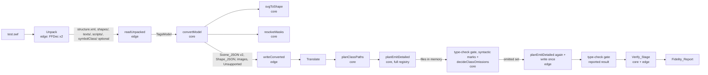
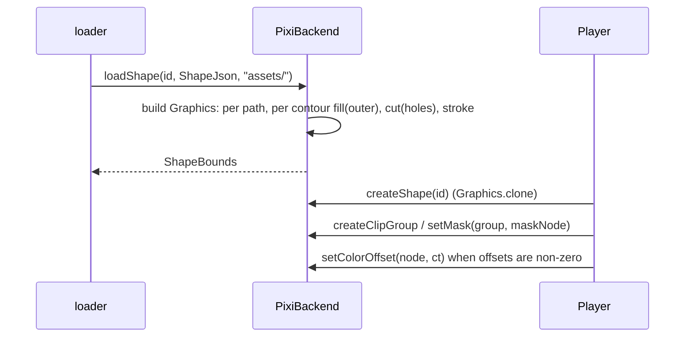
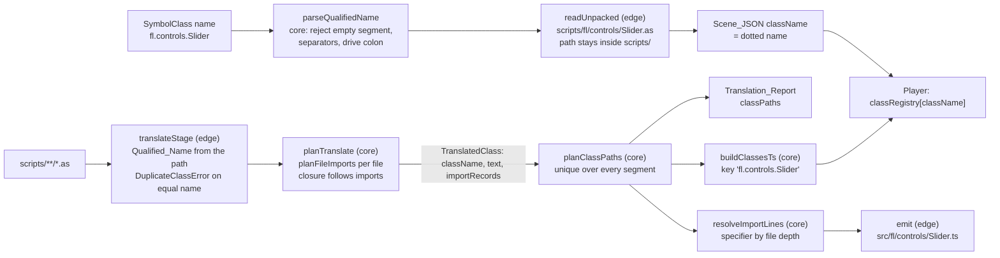

# Design Document: breadth

## Overview

The `breadth` spec makes the Pipeline convert the richer content of the eight Approved_Sample_List SWFs (gradients, bitmap fills, static text, masks, colour offsets, strokes, pointer input) and measures every change against FFDec Reference_Frames with the unchanged Verify_Tolerance. The design follows the structure of the verify spec: a pure Core, a thin Edge, explicit module lists, data models, properties and an error table.

Every number in this document was measured while the design was written (2026-11-12), by throwaway scripts under `.work/breadth/` that call the project's own `compareImages`, `exportReferenceFrames`, `readUnpacked` and `convertModel`. The scripts and all downloads were deleted afterwards (Requirement 7.5); the values stay here. Section "Measurements and re-checks" holds all numbers, with RE-RUN or NOT RE-RUN marks.

Second pass (2026-11-12, same day, after the requirements were updated). The requirements gained Requirements 18 to 21 and changed 3, 6, 10, 13, 14 and Appendix A.6, A.7, A.11. This pass adds sections 14 to 17 (package-qualified classes, Stage_Object, fetched sample, residual attribution), rewrites section 8 (class paths over packages), and updates sections 7, 9, 10, 11 and 12, the findings, the properties (P8, P10, P11, P15, P17 changed; P20 to P30 new), the testing strategy and the traceability table. Everything measured in the first pass is kept as it was. New measurements are in the section "Measurements and re-checks, second pass"; they ran under `.work/d2/` (downloads from the Candidate_Source, FFDec outputs, SWF variants, scripts, pipeline output), all deleted afterwards, nothing committed, no production code changed, no LLM call, no secret read. The user approved the Shape_JSON_Path: D1 below is marked as approved.

Third pass (2026-11-12, after the requirements gained Requirements 22 and 23 and changed 1, 2.8, 2.9, 13.13, 14.12 to 14.23, 15, 16, 18.4, 19.5, 20.8 and Appendix A.6 and A.7). This pass adds sections 18 (implicit this resolution), 19 (class failure fallback) and 20 (empty-input Replay and a Replay that throws), the subsection "Fills before they are drawn" of section 2, and the decisions D16 to D21. It replaces the narrow rule for the bare names `stage`, `mouseX` and `mouseY` (D11, section 14.3 item 7, Property 30) by the general resolution of section 18, marks the findings F11 to F18 as DECIDED (the "needs the user" framing is gone; F18 is confirmed), adds the Properties 31 to 42, and refreshes the traceability table (Requirements 1 to 23), the module map, the repository layout, the error table and the testing strategy. Everything measured in the first two passes is kept. The new measurements are in "Measurements and re-checks, third pass"; they ran under `.work/d3/` and `.work/local/` (downloads from the Candidate_Source at the pinned commit, FFDec exports, a prototype of the resolver and of the omission decision, pipeline output), were deleted afterwards, and nothing was committed. No production file was changed, no LLM call was made, and no secret was read. What the third pass could not decide was listed as open items O1 to O8 (O9 was found in the third pass too); the fourth pass below records the user's decisions on all of them.

Fourth pass (2026-11-12, after the requirements changed 1.11, 3.7, 6.6, 14.2, 14.15, 14.23, 14.24, 15.5, 15.14, 16.2, 22 (22.1, 22.4, 22.7, 22.8, 22.13), 23 (all), the glossary entries Class_Failure, Loose_Class and Empty_Reference_Trace, and Appendix A.6 items 24 to 33). This pass rewrites sections 18 and 19, extends sections 20 and 12, and updates the decisions D16, D18, D19 and D20 (D22 and D23 are new), the properties (P30, P33, P34, P38, P39, P40 changed; P43 and P44 new), the testing strategy, the traceability table, the module map, the repository layout, the error table and the findings. Decisions applied: O1 (inherited statics resolve to `Declaring.x`, one walk of the chain, nearest class wins), O3 (method values are bound, Requirement 22.13), O4 (a class is omitted only when it cannot load; type-error classes are Loose_Classes), O9 (an Empty_Reference_Trace is `not-compared`, no score); O2, O5, O6 and O7 stay as the design defaults and O8 (the Shim_Member_Table drift test joins the floor list, with no steering edit) is applied in the Testing Strategy. The new measurements are in "Measurements and re-checks, fourth pass"; they ran under `.work/d4/` (a download of `slider_component` and `mask_reapply` from the Candidate_Source at the pinned commit, FFDec exports, a prototype of the resolver, a throwaway copy of the type-check gate with the change of section 19.3, pipeline output), were deleted afterwards, and nothing was committed. No production file was changed, no LLM call was made, and no secret was read. Contradictions with the requirements that this pass found are flagged as F19 to F21 in "Findings and decisions" and are not resolved silently.
Fifth pass (2026-11-13, after Checkpoint 9, requirements 24 to 31 added and 16.5, 22.13, 23 amended). This pass adds section 21 (the robustness group: Construction_Bind, method-value method-value binds (constructor form by default, field form for a class whose field initialiser reads a method), Caught_Errors, the Bundler_Guard and the survival rules, AS3 interfaces, instance printing, the mouse flags and the Hit_Target rule, three translator fixes), the decisions D24 to D37, the properties P45 to P56, rows in the error table, the testing strategy and the traceability table, and the module list of 21.9. It amends in place, each marked "Amended after Checkpoint 9": the Known limit of section 10, the "not added" paragraph of section 11, 19.1, 19.2 (reasons and rules), 19.6 and the findings caution (a registered class that throws no longer stops the movie), and the D18 and P44 wording (default constructor form, field form for the exceptional class). Amended after the user's review of the group (read and measured on 2026-11-14, noted at the end of the fifth-pass measurements): D25, D30, D33, 21.1, 21.2, 21.4, 21.5, P44 to P46, P49, P50, and D38 to D40 added. The new measurements are in "Measurements and re-checks, fifth pass": Ruffle sources at the pinned commit read through HTTPS (not stored), a nine-case probe of the pinned Vite and Rolldown, and the `click_block` placement order from an FFDec `-swf2xml` dump; all scratch files were deleted, nothing was committed, no production file was changed, no LLM call was made and no secret was read. Items that rest on something not read are marked **not verified** and collected for the checkpoint of Requirement 31.7: the Flash Player column of 21.3, the position of the AS3 field initialisers against the slot binding (21.1; the order of the binding itself is now read from Ruffle), numbering for script-created objects (21.6), the Ruffle propagation target for a disabled object (21.7), and the `as` limit D33.
### Facts checked in the repository

- `template/runtime/pixi/pixiBackend.ts` loads a shape with `new Graphics().svg(flattenSvgWrapper(svg))` and sets colour with `tint` and alpha only. `template/runtime/hitTest.ts` uses `ShapeBounds` only (a rectangle in shape-origin space); the browser gets bounds from `Graphics.getLocalBounds()`, the Replay from the SVG `width`/`height` attributes through `src/verify/core/svgBounds.ts`. No render path of this design changes `hitTest.ts`.
- `validateScene` (`template/runtime/scene.ts`) requires `formatVersion === 1` and `sym.file === "<id>.svg"` for a shape, and ignores unknown fields on entries.
- `convertModel` drops a placement only when `UnsupportedObservation.characterId` is set, and `parseStructure` never sets it for text, button, sound or video tags (`ffdecXml.ts`, `unsupportedKinds` branch). `resolveTimeline` drops every placement with `clipDepth` as kind `mask`.
- `planEmitDetailed` writes `src/<ClassName>.ts` for every translated class next to the template files `src/main.ts`, `src/classes.ts`, `src/timelineOnly.ts`. The generated sibling imports (`src/translate/rewrite.ts` line 124) have the exact form `import { X } from './X';`.
- `planReplay` ends an Input_Group at every `Wait` and at every unsupported entry, treats `MouseMove` as unsupported, and pairs `MouseDown`/`MouseUp` by position. `parseNumFrames` reads only `num_frames`. `replayRunner.ts` calls `player.dispatchClick`. The Player has `dispatchClick` as its only pointer entry (`player.ts` lines 165 to 173).
- Unpack runs `-export shape,script,symbolClass`. For a SWF without a SymbolClass tag FFDec writes `shapes/` and an empty `scripts/` but no `symbolClass/` (checked on `acid-color-2`, 2026-11-12); `MissingExportError(['symbolClass/symbols.csv'])` is what stops these files today.
- Package-qualified SymbolClass names exist in the approved samples. Read from `symbolClass/symbols.csv` of the real Unpack on 2026-11-12: `3_joystick` has `0;"code.Interactivity3"`; `click_block` has `0;"test_fla.MainTimeline"`; `slider_component` has twelve entries, eight unnamed-package skins (`focusRectSkin`, `SliderTrack_skin`, `SliderTick_skin`, `SliderTrack_disabledSkin`, `SliderThumb_disabledSkin`, `SliderThumb_downSkin`, `SliderThumb_overSkin`, `SliderThumb_upSkin`) and four dotted names (`fl.controls.Button` id 21, `fl.controls.Slider` id 20, `fl.core.ComponentShim` id 3, `slider1_fla.MainTimeline` id 0). `static_text` is assumed to use `test_fla.MainTimeline` like `click_block` (not read: the SWF was not downloaded in this pass). `translateStage` names each class by the file stem (`basename(p, '.as')`), `planTranslate` looks classes up by the SymbolClass name, and `readUnpacked` reads `scripts/<className>.as`, so none of the dotted names matches. Decided in F1 (Requirement 18), designed in section 14.
- Translate (read in the third pass): `ExprRewriter.qualifies` writes `this.` only before a name followed by `(` that is in the 13-name `SHIM_MOVIECLIP_MEMBERS` or is an own non-static method; `ctx.locals` is the parameters plus every `var`/`const` of the function body (`collectLocals`, emitTs.ts), which is hoisting; the scanner marks `try`, `switch`, `with`, `delete`, `namespace`, `use`, `include`, `function` and labels as unsupported, so no catch variable or nested function name reaches the rewriter; `findValueReferencedMethods` binds only methods named as `this.name` without a call. Section 18.1.
- Emit and Player (read in the third pass): `emit()` plans, cleans and writes all files in one pass; the type-check gate runs afterwards on the files read back from disk and takes a `Map<path, text>`; `buildClassesTs(scene, names)` registers the linked classes found in `names`; `Player.createClip` instantiates `MovieClip` and logs a warning for a `className` that is not in `classRegistry`; the emitted project builds with `vite build` (no type-check); the Replay imports `src/classes.ts` of the project. Section 19.1.
- Verify (read in the third pass): `runBehaviour` returns `not-compared` for a missing `input.json` and for a Replay that failed with no captured line and no tick (`failedOutright`); `ReplayResult` does not tell a thrown error from a child that crashed; `compareTraces` scores two empty traces 100 and `splitTraceLines('')` gives no lines. Section 20.1.

### Key design decisions

| # | Decision | Rationale |
|---|----------|-----------|
| D1 | Chosen_Render_Path is the **Shape_JSON_Path (b)**. **Approved by the user** (Requirement 7.12). Where (b) scores lower than another path on a probe, the difference is stated here as Requirement 7.12 asks: `gradients` 99.41 against 99.50 for (c) (1302 against 1092 differing pixels), `3_joystick` 98.85 against 99.29 (1241 against 767), `acid-color-0` 98.11 against 98.12; (a) is lower everywhere. The reason for those differences was not examined (it is the work of Requirement 21: the 1,302 and 1,241 pixels get a cause before their floors are set); the choice stays, as approved, because (c) cannot be an Exact_Render under the colour filter (3 differing pixels against 0), cannot run in the FakeBackend and depends on the browser's SVG rasteriser. | Scored 100 / 99.41 / 100 / 100 / 98.85 on the five probe frames at 1x, 99.99 to 100 under 2x scale and 30 degrees, the only path that is an Exact_Render with a `ColorMatrixFilter` on `acid-color-2` (0 differing pixels, path c leaves 3), deterministic and independent of the browser SVG rasteriser. Section "Render path selection". |
| D2 | Scene_JSON becomes `formatVersion` **2**: shape `file` is `<id>.shape.json`, a shape carries its `size`, a mask placement carries `clipDepth`. | The shape asset is no longer an SVG, so the `<id>.svg` rule of `validateScene` cannot stay; a new field must not be read by an old validator as a visible shape (Requirement 12.4). |
| D3 | Static text is a **shape symbol** built from `texts/<id>.svg` by the same Shape_Function. | `<use>` and nested transforms are baked into path commands in Core; measured 100 percent (b) on `static_text`. |
| D4 | Masks are drawn with Pixi `Container.mask` through a **clip group**: the masked placements are children of one group container whose single `mask` is the mask node, the mask node stays a visible sibling in the scene graph. | Measured: a mask outside the scene graph ignores its transform; `visible=false` or `renderable=false` on the mask clips everything away; one mask shared by two sibling targets goes stale when it moves. |
| D5 | Colour offsets use `ColorMatrixFilter` and are **built**. Only placements with non-zero offsets get the filter; the `tint`/alpha path stays for multiplier-only colour transforms. | Exact_Render on `acid-color-2` (0 of 220000 pixels). `clickgoto` and `tweendemo` keep their path, so their floors cannot move. |
| D6 | Pointer input is replayed as separate events through three Player entry points; `MouseMove` never ends an Input_Group; the tick count is `num_frames`, else `num_ticks`; `tick_rate` makes the behaviour `not-compared` and stops the implementer. | Requirement 14 and Appendix A.8, A.9; an unpaired `MouseUp` was checked in the Ruffle source (below). |
| D7 | Class file paths are chosen by a pure planner; a colliding class gets the suffix `.class` (then `.class2`, ...), and generated sibling imports are rewritten to the chosen path. | Case-insensitive uniqueness, determinism, and the Boot_File name stays `src/main.ts`. |
| D8 | Gradient fills are drawn from a Pixi `FillGradient` whose public `transform` is replaced by the FFDec `gradientTransform` composition, and radial gradients get their own canvas texture. | Pixi pre-fills the radial canvas with the last stop colour (`FillGradient.mjs:152`), which is wrong for stops with alpha (3_joystick, measured). |
| D9 | Hole detection (even-odd) is done once in Convert and stored as `contours` in Shape_JSON; the runtime fills each outer contour and calls `cut()` for its holes. | Pixi's Graphics API has no even-odd flag; measured: without holes the letter counters of `acid-color-2` fill (1071 differing pixels), with them 0. |
| D10 | A class is identified everywhere by its **Qualified_Name** (dotted). Its canonical file is `src/<pkg segments>/<Cls>.ts`; Emit may change one colliding segment (suffix `_class` for a directory, `.class` for a file). Imports are computed from the canonical paths in Translate and re-resolved by Emit from line records, not by text patterns. | Requirements 6, 18. Section 8 and section 14. |
| D11 | `DisplayObject.stage` returns a **Stage_Object** that is a separate `DisplayObjectContainer` and the parent of the root; it is set as the root's parent from the construction context, so it exists in the root constructor. The bare names `stage`, `mouseX` and `mouseY` reach it through the general implicit-this resolution (D16, rule 4), with no rule of their own. | Requirements 19, 22.1; `Interactivity3.as:39` calls bare `stage.addEventListener` in a constructor. Sections 15 and 18. |
| D12 | The Fetched_Sample is handled by one Edge script (`scripts/fetch-static-text.ts`) over a Core module (`src/samples/fetchedSample.ts`) holding the URL builder, the SHA-256 check and the floor-test decision. | Requirement 20. Section 16. |
| D13 | Residual causes live in a committed per-sample register `samples/<name>/residual-causes.json` (data, validated by Core); the Verify_Stage clusters the differing pixels into regions (Core) and matches them to the register; an unmatched region is reported as `unattributed-region` and fails the floor test. | Requirement 21. Section 17. |
| D14 | A filtered or blend-mode placement is kept and drawn without the filter; the Named_Limit kinds are `filter` and `blend-mode`. | Requirement 13.3, decided F2. Section 7. |
| D15 | A release on another target than the press dispatches no `click`; the Replay records a `release-outside` note, copied into `behaviour.replay.inputNotes` of the Fidelity_Report. | Requirement 14.20, 14.21, decided F4. Sections 9, 10. |
| D16 | A bare identifier in a class body is resolved by a Core module (`implicitThis.ts` over `memberTables.ts`) with the rules of Requirement 22.1 in order, applied as one walk of the `extends` chain (nearest declaring class wins, instance before static in one class): own instance, own static, inherited static of a translated superclass (`Declaring.x`, import added), inherited instance of a translated superclass, Shim class (generated table). Locals, parameters, globals, class names and import bindings are never members; an unresolved name stays as written with an `unresolved-identifier` Diagnostic. | Requirement 22, decided F11. Prototype over five sample sources (section "Measurements, third pass"): once `stage`, `mouseX` and `mouseY` are in the Shim, every bare member name of `clickgoto`, `tweendemo`, `Interactivity3` and `test_fla.MainTimeline` resolves, and 801 of 821 in `slider_component` (794 against today's Shim). Fourth pass (O1 DECIDED): inherited statics resolve one more name, `LabelButton.as:58` `mergeStyles` to `UIComponent.mergeStyles`, so 802 of 821 and 19 of the 20 that stay unresolved (section "Measurements, fourth pass"). Section 18. |
| D17 | The Shim_Member_Table is generated from `template/shim/*.ts` by a Core extractor (`shimMembers.ts`, a hand-written declaration scanner, no TypeScript compiler), an Edge script (`npm run gen:shim-members`), a committed `shimMembers.generated.ts` and a drift test. | Requirement 22.5, 15.1. The extractor agreed with the TypeScript compiler on all 38 member slots of the current Shim (0 differences) after one fix (constructor parameter properties). Section 18.6. |
| D18 | (**Amended after Checkpoint 9 and after the review of the group, final form in D25 and Requirement 22.13:** the text below is the DEFAULT, the constructor form, and it holds as written, the forwarding constructor included; only a class in which an instance field initialiser reads a method value takes the field form `__binds_<ClassName>`, for that class alone. Both forms give one bound function per method per instance.) A value reference to an instance method of a translated class (rule 1 or 3, bare or `this.m`; not a call, not static, not a Shim member) makes the constructor of the referencing class bind it once, after `super`, in declaration order (own methods first, then nearest base first) (`this.m = this.m.bind(this);`); a class without a constructor gets a forwarding constructor typed with `ConstructorParameters<typeof Base>`. | A resolved `this.dragPressHandler` passed to `addEventListener` loses `this`; 3 such references in `Interactivity3`, 56 in `slider_component`. O3 DECIDED: Requirement 22.13, no longer an extra. Measured: the forwarding form type-checks, `...args: any[]` gives TS2556. Section 18.5. |
| D19 | A class is left out of the registry only when it cannot load (no source and no override, a syntax error or no file, an unresolved relative import), with propagation along `extends` and imports; a class with only type errors stays registered as a Loose_Class. The decision reads the type-check gate on the planned files in memory, using a new `syntactic` mark and `specifier` on `GateError`; the final `src/classes.ts` is planned again only when something other than a missing source was omitted; the project is written once; the reported gate runs on that project (the first gate result is reused when nothing was omitted). | Requirements 23.1 to 23.3, 23.10; O4 DECIDED. The code range of a syntax error is not usable: TS1155 is a checker error (measured). The gate on a full registry that holds a broken class can show a `src/main.ts` error that the final project does not have (measured on `slider_component` in the third pass). One gate run in the common case. Section 19. |
| D20 | A Reference_Trace with no `input.json` is replayed with the input `[]` for the tick count of `test.toml` (`num_frames ?? num_ticks`; neither: `not-compared`, the implementer stops); a Replay that throws is `compared` on the lines it captured and names the failure in `problems`; a child process that crashes or times out stays `not-compared: replay-failed` (O5, design default). | Requirements 14.22, 14.23, 1.7, 1.10; decided F12, F13. Section 20. |
| D22 | A Reference_Trace that is an Empty_Reference_Trace gives behaviour `not-compared` with the reason `empty-reference-trace`, no Trace_Score and no floor; `decideBehaviour` decides it first; the Replay may still run so that a throw is recorded in `problems`. | Requirement 14.24, 3.7, 1.11; O9 DECIDED. Replaces the vacuous 100 of `radial`, `gradients` and `acid-color-2`. `compareTraces` itself is unchanged. Section 20.4. |
| D23 | `GateError` gains `syntactic: boolean` (membership in `program.getSyntacticDiagnostics()`) and `specifier` (a string or null: the module specifier of a 2307 or 2792 error); `decideClassOmissions` reads these and no code range. | Requirement 23.2. Measured on a throwaway copy of the gate. Section 19.3. |
| D21 | The Shape_Function takes the drawn-fill capabilities as a parameter whose default is the single constant `DRAWN_FILLS` that the backend also reads. Every gradient or bitmap fill whose flag is false is left out of the Shape_JSON and returned as exactly one `gradient-fill` / `bitmap-fill` Named_Limit with a per-fill message; the drawing tasks flip their flag. | Requirement 2.8, 2.9. Section 2, "Fills before they are drawn". |
| D24 | The frame-1 build and the binding of named children move into the Shim `Sprite` constructor, which `MovieClip` inherits (a Player hook `constructFrameOne`), so they run before every TypeScript field initialiser and every statement of a derived constructor body (Ruffle binds them inside the `Sprite` super constructor, after the AS3 field initialisers and before the rest of the constructor body, 21.1); `createClip` stops calling `_renderFrame` after `new Cls()`. | Requirement 24. Section 21.1. JavaScript cannot allocate without running the chain; the end of the base constructor is the earliest point after `super()`. The base is `Sprite`, as in Ruffle, so a linked class that extends `Sprite` is bound too (21.3 prerequisite, user-approved). |
| D25 | Method-value binds keep the constructor form of 8.6 by default (`this.m = this.m.bind(this);` after `super`, declaration order, Shim exclusion; a forwarding constructor only when the class has none), so the goldens of `clickgoto` and `tweendemo`, which hold such binds, stay byte-identical. A class in which an instance field initialiser reads a method value takes the field form instead, for that class alone: the first instance field `__binds_<ClassName>` holds the same statements, and its constructor holds none. Chosen over a bind placed before the reading field (order would depend on field order), a lazy getter (code in every class, own-property shape changes) and a bind at the reading site (breaks identity). Identity: one bound function per method per instance on the property `m`, in both forms. | Requirement 22.13 (a) to (c), 24.6. Section 21.2. The first amendment (all classes use the field) was based on the claim that the goldens hold no method value; they do (`LeftButton.ts.txt` lines 7 to 9 and the others). |
| D26 | A caught error follows Ruffle's behaviour as read at the pinned commit: a frame script or a listener is abandoned alone, a timeline constructor that throws leaves the partially constructed instance on the display list. The Flash Player column is the user's guidance, listed as not verified. | Requirement 25. Section 21.3. Ruffle source is the only readable model. |
| D27 | `ConstructionContext.instance` is set by the `MovieClip` constructor before the Construction_Bind; `createClip` keeps it after a throw and re-instantiates a plain `MovieClip` only when it is null. | Requirement 25.3. Section 21.3. |
| D28 | The error sink is module-level state in the Shim's `internal.ts` (like the trace sink); the Replay installs one that records `{ tick, site, message }`; Problems of kind `runtime-error` are built by a Core function, capped at 100. | Requirement 25.5, 25.7. Section 21.3. The dispatcher has no Player reference. |
| D29 | The Bundler_Guard is `transformWithOxc` followed by `parseAst(code, { lang: 'js', showSemanticErrors: true })`, both exported by the pinned `vite`; it runs in the Edge on the planned final text and returns a Bundler_Check; `rolldown` is not imported directly and no dependency is added. | Requirement 26.1, 26.8. Section 21.4. Reproduces `vite build` on nine measured cases. |
| D30 | `classOmissions.ts` stays Core and takes the Bundler_Check as an input; unresolved-import, missing-export and imports-omitted apply only to Surviving_Imports; the Bundler_Guard is the only authority on parse and transform while it runs: a syntactic TypeScript diagnostic never omits a class by itself, for any code (no special case for octal literals); when the guard cannot run the Requirement 23 rules apply and the syntactic diagnostic omits again; reason `bundler-parse` is added; a handwritten class is omitted for a failing check, loudly (D40). | Requirement 26.2 to 26.7, 26.10, 26.13. Section 21.4. |
| D31 | A translated AS3 interface exports a TypeScript interface and an Interface_Token of the same name; a class gets `declareImplements(Cls, ...)` after its declaration; the registry is a module-level `WeakMap` keyed by the class. | Requirement 27.1, 27.2. Section 21.5. |
| D32 | The token carries `[Symbol.hasInstance]`, so the existing `x is I` to `x instanceof I` rewrite works for an interface with no rewrite change and no helper call. | Requirement 27.3, 27.4. Section 21.5. |
| D33 | `x as I` stays a TypeScript cast, as `x as Class` is today. **This is silent wrong behaviour**: AS3 `as` yields `null` when the value is not of the type, and a cast neither checks nor yields `null`, so a later `if (x)` or `x == null` test takes the wrong branch. Kept for now on the user's instruction; the checkpoint counts the `as` uses per sample and carries "AS3 `as` returns null on mismatch" in its candidate list (Requirement 31.9). | Requirement 27.3 (known difference). Section 21.5. |
| D34 | Display objects print through `toString` using class names from a registration (`registerClassName`, filled by the Shim and by the Player from the registry keys), never `constructor.name`. | Requirement 28.1. Section 21.6. Minification safe. |
| D35 | Default instance names come from one Player-wide counter starting at 0, taken at the start of the `MovieClip` constructor for an unnamed placement (the root included), so numbering is depth-first; named placements take none. Script-created objects take a number at construction (not verified). | Requirement 28.2, 28.3. Section 21.6. Derived from Ruffle's `set_default_instance_name` and checked on `click_block` (`instance2`). |
| D36 | The Hit_Target is `resolveHitTarget(hitTestAll(...), stage)`, a port of Ruffle's `mouse_pick_avm2` and `combine_with_parent`: per container the interactive children first, then the shapes, each in z-order; results combined with `mouseEnabled` and `mouseChildren` on the way up; the root clip is never a target (the Stage_Object instead). Amended in Task 26.2 (the first wording was a z-order-only reading). | Requirement 29.2. Section 21.7. Ruffle `movie_clip.rs` and `interactive.rs` at the pinned commit. |
| D37 | Three translator fixes, each its own commit: dotted types through `resolveClassName`, `selfKey` without the stray parenthesis, and a mark on the forced-import list that the statement rollback truncates. | Requirement 30. Section 21.8. |
| D38 | A field that shares the name of a frame-1 child of the class's linked symbol cannot overwrite the bound child: no initialiser gives `declare` (as today), the initialiser `null` or `undefined` is dropped and the field is emitted with `declare`, any other initialiser stays with a `child-field-initialiser` Diagnostic. The names come from Scene_JSON through the Pipeline as an input to Translate. | Requirement 24.5, 24.10. Section 21.1. In Flash the child is assigned after the AS3 initialiser and wins; under ES2022 class-field semantics the initialiser would run after the binding and win. |
| D39 | `new Cls()` from script finds its symbol by a constructor-to-symbol map that the Player builds from `classRegistry` and Scene_JSON; the lookup walks `new.target` and its prototype chain to the first constructor in the map, as Ruffle's allocator walks superclasses. | Requirement 24.11. Section 21.1. |
| D40 | A handwritten override that fails the guard is omitted and the omission is loud: a Problem `handwritten-override-unparsable` with path, parser message, line and column in the Translation_Report and a `warn [emit]:` line on the CLI. | Requirement 26.10, 26.13. Section 21.4. |
| D41 | A non-syntactic gate error of any code in Module_Evaluation_Code of a translated class (static initialisers, static blocks, top-level statements, heritage expressions, decorators, computed member names) omits the class with the reason `load-time-error` (code, line, exact name); errors in methods, accessors, constructors and instance initialisers leave a Loose_Class. The ranges are computed by the type-check gate from the syntax tree it already builds and are passed to the Core as data (`GateResult.moduleEval`, `OmissionClass.moduleEval`). The rule runs with or without the Bundler_Guard and propagates through the existing rules. | Requirement 23.1 (f). Sections 19.2 and 21.4. User decision at Task 24.4 (`slider_component` died at module load on `new TextFormat(...)` in a static initialiser of `UIComponent`). |

## Architecture



### Repository layout (new and changed)

```
src/unpack/unpack.ts              CHANGED  second FFDec call adds `-format text:svg` and `text`; symbols.csv optional
src/convert/ffdecXml.ts           CHANGED  character ids of text/button tags, DefineBits* ids, hasSymbolClassTag, clipDepth kept
src/convert/model.ts              CHANGED  UnsupportedKind gets the new kinds; TagsModel gets bitmapIds, textAssets
src/convert/readUnpacked.ts       CHANGED  reads texts/<id>.svg, tolerates a missing symbols.csv
src/convert/pathData.ts           NEW core  parsePathD, bakeCmds, cmdsToD (path command helpers)
src/convert/svgToShape.ts         NEW core  Shape_Function: FFDec SVG -> ShapeBuild { shape, images, limits }; `caps` parameter, `gradient-fill` / `bitmap-fill` limits per undrawn fill
src/convert/evenOdd.ts            NEW core  groupContours (even-odd nesting)
src/convert/masks.ts              NEW core  classifyMask, resolveMasks
src/convert/resolveTimeline.ts    CHANGED  keeps clipDepth on the entry instead of dropping the placement
src/convert/convertModel.ts       CHANGED  builds Shape_JSON, text shapes, mask pass, new Named_Limits
src/convert/writeConverted.ts     CHANGED  writes <id>.shape.json and images/<bitmapId>.<ext>
src/emit/classPaths.ts            NEW core  planClassPaths, resolveImportLines, buildBindings (section 8)
src/emit/planEmit.ts, emit.ts     CHANGED  use planClassPaths; nested class files; recursive override lookup; copy images; no <id>.svg; `omitted` set for the registry and a gate hook (section 19)
src/convert/qualifiedName.ts      NEW core  parseQualifiedName, scriptRelPath, qualifiedFromScriptPath, canonicalClassPath, relativeSpecifier, shimSpecifier
src/convert/readUnpacked.ts       CHANGED  (also) reads scripts/<pkg>/<Cls>.as after the name check (section 14)
src/translate/translateStage.ts   CHANGED  Qualified_Name from the path, DuplicateClassError on equal Qualified_Name
src/translate/planTranslate.ts    CHANGED  ScriptSource.className is the Qualified_Name; closure follows imports; TranslatedClass carries importRecords
src/translate/importPlan.ts       NEW core  planFileImports (scoping, aliases, ambiguity Diagnostics; `forced` targets for inherited statics, section 18.5)
src/translate/rewrite.ts          CHANGED  createImportLines from the plan; FQ expressions to bindings; implicit-this resolution replaces `qualifies`; value references to methods are bound
src/translate/shimMembers.ts      NEW core  extractShimMembers, renderShimMembersTs, parseShimMembersTs (section 18.6)
src/translate/shimMembers.generated.ts NEW generated  SHIM_MEMBER_TABLE, committed, written by `npm run gen:shim-members`
src/translate/memberTables.ts     NEW core  buildMemberTables, lookupMember (one walk, nearest class wins), lookupStatic (returns the declaring class), chainEnd (section 18.2)
src/translate/implicitThis.ts     NEW core  resolveIdentifier, collectFunctionLocals, isReference, AS3_GLOBALS (section 18.2)
src/translate/shimNames.ts        CHANGED  SHIM_MOVIECLIP_MEMBERS removed (the Shim_Member_Table replaces it)
src/translate/emitTs.ts, translate.ts, planTranslate.ts, types.ts, report.ts   CHANGED  member context in RewriteContext, tables built in a first pass, two-step import plan, method-value binding and forwarding constructor, DiagnosticKind `unresolved-identifier` and `class-omitted`, Translation_Report `omittedClasses` and `classes[].loose`
scripts/gen-shim-members.ts       NEW edge  `npm run gen:shim-members`
src/emit/classOmissions.ts        NEW core  decideClassOmissions (reasons missing-source, emit-failed, syntax-error, unresolved-import, extends-omitted, imports-omitted), looseClasses, omissionMessage, isEmittedSpecifier (section 19.2)
src/translate/typeCheckGate.ts     CHANGED  GateError gains `syntactic` and `specifier`; marks from program.getSyntacticDiagnostics (section 19.3)
src/pipeline/pipeline.ts          CHANGED  class-omitted entries and Diagnostics, `loose` class entries, reuse of the first gate result when nothing was omitted, gate hook for Emit (section 19.4)
src/verify/core/replayOutcome.ts  NEW core  decideBehaviour (section 20.3; the empty-reference-trace rule first, section 20.4)
src/verify/core/report.ts, html.ts CHANGED  behaviour reason `empty-reference-trace` and its HTML text (section 20.4)
src/verify/edge/verifyStage.ts, replay.ts   CHANGED  empty-input Replay, childFailure, inputSource, ticksRun (section 20)
src/translate/report.ts           CHANGED  ReportClassInput.path; Translation_Report classPaths
src/samples/fetchedSample.ts      NEW core  STATIC_TEXT_SOURCE, candidateUrl, verifySha256, decideFloorTest, classifySampleDir
scripts/fetch-static-text.ts      NEW edge  fetchStaticText(deps), main()
src/verify/core/regions.ts        NEW core  clusterDiffRegions, regionTable
src/verify/core/residual.ts       NEW core  validateResidualRegister, attributeRegions, residualLimits
template/shim/Stage.ts            NEW       Stage_Object (section 15)
src/verify/core/replayPlan.ts     CHANGED  pointer entries, num_ticks, tick_rate
src/verify/core/limits.ts         CHANGED  new kinds, colour-offset narrowed, text-metrics rule
src/verify/core/svgBounds.ts      REMOVED  bounds come from Scene_JSON `size`
src/verify/edge/replayRunner.ts   CHANGED  pointer loop, bounds from Scene_JSON
src/verify/edge/fakeBackend.ts    CHANGED  setMask, setColorOffset, loadShape(ShapeJson)
template/runtime/scene.ts         CHANGED  v2 types and validation
template/runtime/shapeJson.ts     NEW      Shape_JSON types, validate, parse, print, DRAWN_FILLS, fillIsDrawn (browser-safe)
template/runtime/colourMatrix.ts  NEW      colourMatrix(ct) -> 20 numbers
template/runtime/clipLayout.ts    NEW      computeClipLayout (mask range -> groups)
template/runtime/backend.ts       CHANGED  loadShape(ShapeJson), setMask, setColorOffset
template/runtime/pixi/pixiBackend.ts CHANGED  draws Shape_JSON, filter, mask
template/runtime/player.ts        CHANGED  pointer entry points, clip groups, colour offsets
template/runtime/loader.ts        CHANGED  loads <id>.shape.json
template/runtime/svgFlatten.ts    KEPT     used by the Shape_Function for the wrapper, not by the backend
template/shim/events.ts, DisplayObject.ts, internal.ts, MovieClip.ts   CHANGED  see Shim section
template/src/main.ts             CHANGED  pointermove/down/up wiring; hasColorOffsets removed
```

### Load and draw sequence of the chosen path



## Components and Interfaces

### 1. Render path selection (Requirement 7)

Method: the harness called the project's `readUnpacked` and `convertModel` on the FFDec output, exported the Reference_Frame with `exportReferenceFrames`, drew the scene in headless Chromium with PixiJS 8.22.0 (`dist/pixi.min.js`, `antialias: true`, resolution 1, the same settings as `timelineOnly.ts`) once per path, and scored with `compareImages(reference, rendered, background)` under the unchanged `AA_TOLERANCE`. "Region" scores crop both images to the union of the non-background bounding boxes and run the same comparison. For scale and rotation, FFDec re-rendered a SWF variant whose root placement matrix was edited in the swf2xml dump and rebuilt with `-xml2swf` (so the reference is FFDec's, not Chromium's). Chromium's native SVG rendering takes part only as path (c), which is scored against the FFDec frame like the others; it is not an acceptance reference anywhere in this design (Requirement 7.6).

Paths:

- (a0) today: `flattenSvgWrapper` plus `Graphics.svg()`.
- (a1) best SVG rewrite: gradient transforms baked into `x1 y1 x2 y2` / `cx cy r` (exact for a similarity transform), `<use>` glyphs inlined as `<path>` with baked matrices, then `Graphics.svg()`.
- (b) Shape_JSON drawn with the Graphics API (`moveTo`, `lineTo`, `quadraticCurveTo`, `bezierCurveTo`, `fill`, `cut`, `stroke`), `FillGradient`, `FillPattern`.
- (c) the raw FFDec SVG rasterised by Chromium into a canvas and drawn as a `Sprite` texture.

Probe_Shapes and frames: Gradient_Fill `visual/simple_shapes/gradients/radial` (one radial) and `.../gradients` (two linear, one `spreadMethod="reflect"`); Bitmap_Fill `avm2/click_block` (shape 6, two bitmap fills in the scene, scored in the crop 423,17 to 534,115 where the bitmap is) and the local smoke `bitmapbuttons` (24 fills, 12 non-smoothed); Static_Text `avm2/static_text`; round-capped strokes in `3_joystick` (open paths, 1 to 2 px) and in a 10 px variant of `radial`. All Reference_Frames are frame 1.

Scores (matchPercent, full 550x400 frames unless stated; differing pixels in brackets):

| Probe | (a0) today | (a1) rewrite | (b) Shape_JSON | (c) raster x1 |
|-------|-----------|--------------|----------------|---------------|
| radial (Gradient_Fill) | 5.10 (208778) | 58.60 (91070) | **100** (0) | **100** (0) |
| gradients (linear pad + reflect) | 50.67 (108536) | 88.36 (25616) | 99.41 (1302) | 99.50 (1092) |
| static_text (Static_Text) | 99.68 (709) | 99.99 (5) | **100** (0) | 99.99 (3) |
| click_block, bitmap crop 111x98 | 0.90 (10780 of 10878) | 0.90 | **100** (0 of 10878) | **100** (0) |
| click_block, full frame | 89.56 | 89.56 | 94.46 | 94.46 |
| bitmapbuttons (24 fills) | 0.37 (205733) | 0.37 | 98.24 (3641) | 98.24 (3641) |
| 3_joystick (gradients with alpha stops, strokes, unmasked) | 15.82 (90813) | 46.08 (58172) | 98.85 (1241) | 99.29 (767) |
| acid-color-0 (local smoke, 1024x1024) | 84.52 | n/a | 98.11 (19812) | 98.12 (19662) |

Remaining differences in `click_block` and `bitmapbuttons` have equal pixel counts in (b) and (c), so they come from content no path draws (dropped morph shape, edit text, buttons), not from the render path. In `3_joystick` the remaining 1241 pixels are a thin band along the top of the right panel and arcs around the ball; they are unchanged when the mask is applied (see Masks), and their cause was not examined further. Path (a) cannot draw `<pattern>`/`<image>` or `<use>` (Pixi warns `[SVG parser] <pattern> elements unsupported`, `<image>`, `<use>`, `SVGParser.mjs:181`), cannot read `gradientTransform` or `spreadMethod` (`parseSVGDefinitions.mjs:46-75` read only `x1 y1 x2 y2 cx cy r fx fy fr gradientUnits` and the stops), and cannot read the stroke cap and join (`parseSVGStyle.mjs:65-102` handles `stroke`, `stroke-width`, `fill`, the two opacities and `opacity` only, although the table at lines 18 to 22 lists `stroke-linecap`/`stroke-linejoin`). A radial gradient with non-uniform scale (radial: 0.1056 x 0.4114) cannot be expressed in its attributes at all: the rewrite had to use a circle (58.60).

Behaviour under scale and rotation (FFDec variants with scale 2, and scale 2 plus rotation 30 degrees; (c) is shown rasterised at 1x and re-rasterised at the scale):

| Variant | (a0) | (a1) | (b) | (c) x1 | (c) x2 |
|---------|------|------|-----|--------|--------|
| radial, scale 2 | 4.40 | 29.79 | **100** | 100 | 100 |
| radial, scale 2 + 30 deg | 51.31 | 68.32 | **100** | 99.99 (14) | 100 |
| gradients, scale 2 | 11.44 | 66.84 | **100** | 99.78 (474) | 100 |
| gradients, scale 2 + 30 deg | 73.06 | 81.98 | 99.99 (5) | 99.95 (114) | 99.99 (5) |
| static_text, scale 2 | 98.74 | 99.99 | **100** | 99.80 (431; region 98.57) | 99.99 (12) |
| static_text, scale 2 + 30 deg | 98.68 | 99.99 | **100** | 99.82 (403) | 99.99 (29) |

Path (b) is resolution independent: it is vector geometry, so scale changes need no work. Path (c) is blurry unless the texture is re-rasterised at the scale in use, which a tween that animates scale does every frame (cost not measured: NOT MEASURED).

Colour offsets (Requirement 13) discriminate the paths: on `acid-color-2` with `ColorMatrixFilter`, (b) gives 100 (0 differing pixels), (c) 99.99 (3 differing pixels); with the current `tint` path the frame scores 95.19 (b) / 95.20 (c).

Hit testing: all three paths keep the `ShapeBounds` rectangle that `hitTest.ts` uses and add no per-pixel test. Bounds as reported by Pixi: radial (b) `2.1, 0.55, 545.75 x 397.8` (equal to the FFDec `width`/`height` attributes), (a0) `1.89, 0.34, 546.16 x 398.21` (Pixi widens the box by half the stroke), (c) `2.1, 0.55, 546 x 398` (texture pixels rounded up); `static_text` (a0) `0, 0, 0, 0` (nothing drawn), (b) `9.26, 2.68, 125.27 x 58.48` (ink box), (c) `9.35, 0.4, 134 x 62`. The Replay already takes the SVG `width`/`height`; this design stores that `size` in Scene_JSON, so the browser and the Replay agree.

Effort:

| Path | Files and functions |
|------|---------------------|
| (a) | A rewrite module for gradients, `<use>` and a second one for what `svg()` cannot read; bitmap fill, radial ellipse, spread, caps and joins remain impossible, so each needs a Named_Limit or a second path. Not enough on its own. |
| (b) | New: `shapeJson.ts` (types, validate, parse, print), `svgToShape.ts`, `pathData.ts`, `evenOdd.ts`, `colourMatrix.ts`. Changed: `convertModel`, `writeConverted`, `scene.ts`, `loader.ts`, `backend.ts`, `pixiBackend.ts` (about 120 lines), `fakeBackend.ts`, `replayRunner.ts`, emit asset copying. |
| (c) | A rasteriser in `pixiBackend.ts` (about 60 lines) plus a per-scale cache; no Core function. Cannot be an Exact_Render for colour offsets, cannot run in the Replay's FakeBackend, depends on the browser's SVG renderer. |

Decision: **(b)**. It is the only path that is exact on the probes where the others are exact, exact under the colour filter, vector at any scale, and implementable without depending on a browser SVG rasteriser. Its price is the Core code above and four Pixi workarounds, all measured (Gradients, Holes, Masks).

Requirement 7.11 (clickgoto and tweendemo at their floors): both contain only solid rectangles; path (b) draws a solid fill exactly as `svg()` did. Not measured here; the task that switches the backend runs both end-to-end floor tests before its commit.

### 2. Shape_JSON and the Shape_Function (`template/runtime/shapeJson.ts`, `src/convert/svgToShape.ts`)

```ts
// template/runtime/shapeJson.ts (browser-safe: no node:*)
export type Mat6 = [number, number, number, number, number, number];
export type PathCmd =
  | ['M', number, number] | ['L', number, number]
  | ['Q', number, number, number, number]
  | ['C', number, number, number, number, number, number]
  | ['Z'];
export interface GradientStop { offset: number; color: string; alpha: number }   // color '#rrggbb'
export type ShapeFill =
  | { kind: 'solid'; color: string; alpha: number }
  | { kind: 'gradient'; type: 'linear' | 'radial'; matrix: Mat6; stops: GradientStop[];
      spread: 'pad' | 'reflect' | 'repeat'; focal?: { x: number; y: number } }
  | { kind: 'bitmap'; image: string; matrix: Mat6; smooth: boolean };   // image: 'images/5.png'
export interface ShapeStroke {
  color: string; alpha: number; width: number;
  cap: 'butt' | 'round' | 'square'; join: 'miter' | 'round' | 'bevel'; miterLimit: number;
}
export interface Contour { outer: PathCmd[]; holes: PathCmd[][] }
export interface ShapePath { contours: Contour[]; fill: ShapeFill | null; stroke: ShapeStroke | null }
export interface ShapeJson { formatVersion: 1; paths: ShapePath[] }

export class ShapeJsonError extends Error {}                 // message starts with the failing field path
export function validateShapeJson(x: unknown): asserts x is ShapeJson;
export function parseShapeJson(text: string): ShapeJson;      // JSON.parse + validate
export function printShapeJson(s: ShapeJson): string;         // canonical key order, no -0
```

Rules checked by `validateShapeJson`: numbers finite and not `-0`; colours match `/^#[0-9a-f]{6}$/`; alpha in 0..1; stops sorted by `offset` in 0..1 with at least two; every path has a fill or a stroke; `miterLimit >= 1`; `width >= 0`; commands start with `M`; `image` matches `/^images\/[0-9]+\.(png|jpg)$/`. An error message is `<path>: <problem>`, for example `paths[2].fill.stops[1].offset: must be in 0..1`.

```ts
// src/convert/svgToShape.ts (core)
export interface ShapeBuild {
  shape: ShapeJson;
  images: Array<{ bitmapId: number; ext: 'png' | 'jpg'; bytes: Uint8Array }>;   // sorted by bitmapId, deduplicated
  limits: ShapeLimit[];                                                         // sorted, see Named_Limits
}
export interface ShapeLimit { kind: ShapeLimitKind; message: string }
export function svgToShapeJson(svg: string, kind: 'shape' | 'text'): ShapeBuild;
```

Behaviour:

- The first `<g transform>` wrapper is the shape origin and is not applied (the project flattens it today; `svgFlatten.ts` stays and the origin stays in Scene_JSON). Nested `<g transform>` (static text lines) and `<use transform>` compose into one matrix; path commands are baked with it (`bakeCmds`). `<use xlink:href="#font_...">` resolves to the `<g id>` in `<defs>`; its paths take `fill` from the `<use>`.
- A `<path>` with a `fill` and a `stroke` attribute yields one `ShapePath` with both; FFDec writes them as separate elements and the builder keeps that order (fill first, stroke last, as in the SVG).
- Fill `url(#gradientN)` becomes a gradient with `gradientTransform` as `matrix`, `spreadMethod` as `spread`, `stop-opacity` as `alpha` (a stop without it has alpha 1), `fx`/`fy` as `focal` when present. Fill `style="fill:url(#PatternID_s_n)"` becomes a bitmap: the `<pattern>` (a child of the shape `<g>`, not of `<defs>`; verified on FFDec 26.4.0 for `click_block` shape 6) supplies `patternTransform` and the base64 `data:image/PNG|JPEG;base64` bytes; `ffdec:fill-bitmapId` names the asset; the style `image-rendering:optimizeSpeed;image-rendering:pixelated` gives `smooth: false`, `optimizeQuality` gives `true`. Mime `jpeg`, `jpg` and `JPEG` map to `jpg`.
- `stroke-linecap` and `stroke-linejoin` map to `cap`, `join`; FFDec writes `miter-clip` for a miter join (checked: `stroke-linejoin="miter-clip"` on a SWF variant), which Pixi's `LineJoin` type (`pixi.js.d.ts:25460`: `"round" | "bevel" | "miter"`) does not have; it maps to `miter` and records a `stroke-style` limit. `stroke-miterlimit` maps to `miterLimit` (default 4, the SVG initial value is 4; GraphicsContext uses 10 at `GraphicsContext.mjs:827`, so the value is always written explicitly).
- A stroke with `url(...)` paint (seen in the local smoke `acid-color-0`, not in an approved sample) is kept as no stroke and records a `stroke-style` limit "gradient stroke is not drawn".
- Holes: for a path with a fill, `groupContours` splits the subpaths at each `M`, takes the nesting depth of every subpath (point-in-polygon on the on-curve points, bounding boxes first), makes even depths outer contours and odd depths holes of the smallest enclosing outer contour. A path without a fill keeps every subpath as its own outer contour. `fill-rule="evenodd"` is what FFDec writes on every filled path observed; a `nonzero` fill is treated the same and records nothing, since no observed export uses it (to verify at implementation).
- Output is deterministic: no `Map` iteration order, no locale, numbers printed with their shortest round-trip form, `-0` normalised to `0`.

Named_Limits produced here (`ShapeLimitKind`): `gradient-fill` and `bitmap-fill` for every gradient or bitmap fill that the committed drawing code does not draw yet (next subsection), `gradient-spread` (radial gradient with `spread` other than `pad`; the radial texture is a finite square, `FillGradient.mjs:129-165`, and `addressMode` at line 162 would repeat the square, not the rings), `gradient-focal` (radial with a focal point; drawn through the canvas focal circle but unmeasured, so recorded as `approximated`), `bitmap-fill` (also: image bytes missing or the pattern unresolved), `bitmap-smoothing` (an `image-rendering` value other than the three seen), `stroke-style` (`miter-clip`, gradient stroke, a dash array), `text-metrics` (one per Static_Text character, see Known_Visual_Limits). Linear gradients with `reflect` or `repeat` are drawn (the `wrapMode` option, `FillGradient.mjs:32` and `:96-98`) and produce no limit; measured on `gradients` (99.41).

#### Fills before they are drawn (Requirements 2.8, 2.9, decided: no silent-wrong window)

The task that introduces the Shape_Function also switches the backend from `Graphics.svg()` to Shape_JSON (path (b)). From that commit no Gradient_Fill and no Bitmap_Fill may be drawn wrongly or skipped with only a `console.warn` (today `svg()` draws gradients without `gradientTransform` and draws nothing for a `<pattern>`, both measured). Mechanism, chosen between two candidates:

- **(A) A `capabilities` parameter with one constant (chosen).** `template/runtime/shapeJson.ts` exports

```ts
export interface DrawnFills { gradientLinear: boolean; gradientRadial: boolean; bitmap: boolean }
/** What the committed drawing code in pixiBackend.ts draws. Starts all false; the drawing tasks flip their flag in the commit that adds the drawing code and its tests. */
export const DRAWN_FILLS: DrawnFills = { gradientLinear: false, gradientRadial: false, bitmap: false };
export function fillIsDrawn(fill: ShapeFill, caps: DrawnFills): boolean;   // solid: always; gradient: by type; bitmap: caps.bitmap
```

`svgToShapeJson(svg, kind, caps = DRAWN_FILLS)` stays a pure function of its three inputs. For every Gradient_Fill or Bitmap_Fill that it converts and for which `fillIsDrawn` is false it (1) leaves the fill out of the Shape_JSON (a `ShapePath` whose only paint was that fill is dropped; one that also has a stroke keeps the stroke), and (2) returns exactly one `ShapeLimit` of kind `gradient-fill` or `bitmap-fill`, whose message names the fill and the shape: `gradient fill 2 of shape 7 is not drawn (linear, 3 stops)`, `bitmap fill 1 of shape 9 is not drawn (image 5)`. The ordinal is the 1-based position of the fill among the fills of that shape, so two undrawn fills of one shape give two different messages and the `(kind, id, message)` de-duplication of `knownVisualLimits` cannot merge them. `convertModel` adds the shape's symbol id to each limit, as for the other kinds, and writes them to the Unsupported_Feature_List; `limits.ts` turns them into `visual.knownVisualLimits` entries of the same kind. A drawn fill produces no `gradient-fill`/`bitmap-fill` limit; the finer limits (`gradient-spread`, `gradient-focal`, `bitmap-smoothing`) and `bitmap-fill` for an unresolved pattern or missing bytes remain as listed above, so after Requirement 9 `bitmap-fill` means "image bytes missing or pattern unresolved" and before it means "not drawn yet".

- **(B) A Core function inside Convert that asks the backend.** Rejected: Convert (Node) cannot import the Pixi backend, and a second copy of the answer in Convert would drift from the drawing code.

The drawing tasks: Requirement 8 sets `gradientLinear` and `gradientRadial` (or one of them) to `true` in the same commit as the `FillGradient` code, the Core matrix test and the Chromium render test; Requirement 9 sets `bitmap`. A task that sets a flag also removes the limit only for the cases it draws, which is automatic because the Shape_Function reads the flag.

**The backend never skips a fill silently.** The Shape_Function never emits a fill whose flag is false, so a Shape_JSON written by this pipeline cannot hold one. If one reaches `loadShape` anyway (a hand-made file, an old scene), `PixiBackend.drawFill` checks `fillIsDrawn(fill, DRAWN_FILLS)` and throws `ShapeJsonError('<path>: fill kind not drawn: <kind>')`; `loadScene` shows the error and does not start playback (as for any invalid Shape_JSON, Error Handling table). The `FakeBackend` applies the same check, so the Replay and the browser agree. Property 42 covers the Shape_Function side for every capability set; a Chromium test per flag (`render.e2e.test.ts`) covers "flag true means the fill is drawn" with a pixel read-back, and a unit test pins the initial state of `DRAWN_FILLS` (all false) in the introducing commit.
### 3. Drawing Shape_JSON in Pixi (`template/runtime/pixi/pixiBackend.ts`)

```ts
interface RenderBackend {
  loadShape(symbolId: number, shape: ShapeJson, assetBase: string): Promise<ShapeBounds>;
  createContainer(): NodeHandle;
  createShape(symbolId: number): NodeHandle;
  createClipGroup(): NodeHandle;                       // plain container used as the mask target
  setMask(group: NodeHandle, mask: NodeHandle | null): void;
  setColorOffset(node: NodeHandle, ct: ColorTransform8 | null): void;
  // addChildAt, removeChild, setTransform, setAlpha, setVisible, setColorMultiplier, destroyNode, showError: unchanged
  // warnColorOffsetsUnsupported: removed
}
```

Drawing rules measured in the harness, each with the Pixi source that causes it:

- **Gradient matrix.** Build `new FillGradient({ type, start/end or center/outerCenter, textureSpace: 'global', colorStops, wrapMode })` with the FFDec gradient square (`x` from -819.2 to 819.2, `r = 819.2`), call `buildGradient()`, then set `grad.transform = new Matrix(...fill.matrix).append(grad.transform)`. `texture` and `transform` are public members (`pixi.js.d.ts:25662` and `:25664`). The order matters: Pixi's `Matrix.append(m)` computes `this x m`, so the FFDec matrix must be the receiver (a first attempt with the other order drew black, 71.89 percent on radial; measured and fixed). `style.matrix` is the inverse texture matrix (`generateTextureFillMatrix.mjs:10`), and `handleFillGradient` copies `value.transform` at fill time (`convertFillInputToFillStyle.mjs:38-46`), so the replacement must happen before `g.fill(grad)`.
- **Radial texture.** `FillGradient.buildRadialGradient` fills the 256x256 canvas with the last stop colour first (`FillGradient.mjs:152`) and then paints the gradient over it with source-over, so a first stop with alpha 0 shows the last colour. `3_joystick` shape 8 has such stops (`stop-opacity="0.0"` to `0.298`); with Pixi's texture the red ball is drawn too dark (94.54), with an own canvas gradient without the pre-fill, assigned to `grad.texture`, 98.85. The own texture is 256x256, `createRadialGradient(128 + fx*k, 128 + fy*k, 0, 128, 128, 128)` with `k = 128 / 819.2`, address mode `clamp-to-edge`.
- **Bitmap fill.** `new FillPattern(texture, 'repeat')`, `setTransform(new Matrix(...fill.matrix))` (the pattern transform maps texture pixels to shape space), texture `scaleMode = 'nearest'` when `smooth` is false. The image is loaded from `assetBase + fill.image` through an `HTMLImageElement`.
- **Holes.** Per contour: draw `outer`, `g.fill(style)`, then for each hole draw it and call `g.cut()`; `cut()` attaches the active path as a hole to the last fill or stroke instruction (`GraphicsContext.mjs:200`). Without this, letter counters fill (measured on `acid-color-2`: 1071 differing pixels, then 0).
- **Strokes.** `g.stroke({ width, color, alpha, cap, join, miterLimit })` (`GraphicsContext.mjs:827-831` default `miterLimit 10`, `cap 'butt'`, `join 'miter'`). Measured on a 10 px closed stroke (`radial` variant): forced `butt`/`miter` differs from the Reference_Frame in 20 pixels (round join) and 50 pixels (bevel join); drawn with the file's cap and join the round and bevel variants have 0. `miter-clip` mapped to `miter` leaves 50 pixels (0.02 percent): hence the `stroke-style` limit (decided F8: the Shape_Function maps `miter-clip` to `miter` and keeps `stroke-miterlimit`, and the stroke limit message is `approximated: miter-clip join is drawn as miter (shape N)`, Requirement 13.11). Second-pass check on an open 10 px path with joinStyle miter (`stroke-linejoin="miter-clip"`, `stroke-miterlimit="2.0"`): with all corners below the limit 0 differing pixels; with a 7 degree corner above the limit 89 differing pixels (99.96 percent), against 0 for a bevel join and 33 for a round join at the same corner. So the limit is real only above the miter limit, and the message names the shape, not the corner. On the 1 to 2 px strokes of `3_joystick` the forced defaults give the identical 1241 pixels, so caps and joins there stay inside the tolerance. Caps on a wide open stroke were **not measured in the first pass** (the attempt to widen the stroke of `3_joystick` through the swf2xml dump changed nothing: its strokes are hairlines, `ffdec:original-stroke-width="0.05"`). **Measured in the second pass (F8, Requirement 13.12), record in "Measurements and re-checks, second pass", Strokes:** open stroked paths of 10 px and 20 px with cap `none`, `round` and `square` drawn with the cap that FFDec writes into the SVG (`stroke-linecap` `butt`, `round`, `square`) are **100 percent, 0 differing pixels** in all six cases, against 76 to 399 differing pixels when the cap is forced to the wrong value. Pixi's `LineCap` (`pixi.js.d.ts:25449`) has `butt`, `round`, `square`, which are all three FFDec cap values, so no `stroke-style` limit is recorded for a cap. The stroke task keeps this measurement as its own pre-floor check on the real samples (Requirement 13.12 says it measures before it sets a floor), using the same swf2xml variant method.
- **Bounds.** `loadShape` returns `getLocalBounds()` as today; Scene_JSON `size` supplies the same rectangle to the Replay.
- **Undrawn fills.** `drawFill` throws `ShapeJsonError` for a fill whose `DRAWN_FILLS` flag is false; it never skips a fill (section 2, "Fills before they are drawn").

### 4. Colour offsets (Requirement 13.5 to 13.7)

```ts
// template/runtime/colourMatrix.ts (core, browser-safe)
/** Row-major 4x5 ColorMatrixFilter matrix for rMul gMul bMul aMul rAdd gAdd bAdd aAdd (adds in 0..255). */
export function colourMatrix(ct: Readonly<ColorTransform8>): number[]   // 20 numbers
export function hasOffsets(ct: Readonly<ColorTransform8>): boolean
```

Rows: `[rMul,0,0,0,rAdd/255, 0,gMul,0,0,gAdd/255, 0,0,bMul,0,bAdd/255, 0,0,0,aMul,aAdd/255]`. `PixiBackend.setColorOffset(node, ct)` sets `node.filters = [filter]` with that matrix and resets `tint` to white and the colour alpha to 1; `null` removes the filter. The Player calls it instead of `setColorMultiplier` when `hasOffsets(ct)`.

Measurement on `acid-color-2` (three placed sprites with `redAddTerm=255`, `greenAddTerm=255`, `blueAddTerm=248`, no multipliers), Reference_Frame 1, 550x400: path (b) with the filter, **0 differing pixels, matchPercent 100: Exact_Render**. Path (c) with the filter 3 differing pixels (99.99); the `tint` baseline 94.65 (11763 differing). Verdict: **build** (Requirement 13.6). An earlier run without the hole handling had 1071 differing pixels, all inside the letter counters, so the filter itself was never the cause. The alpha add term (`alphaAddTerm`) is nonzero in no approved sample and was not covered by the first-pass measurement. **Measured in the second pass (Requirement 13.13), record in "Measurements and re-checks, second pass", Alpha add term:** with the matrix above a non-zero `alphaAddTerm` is **not an Exact_Render**. On a swf2xml variant of `acid-color-2` with `alphaAddTerm=100` the filter gives 7389 differing pixels (96.64 percent), all inside the three sprite boxes; with `alphaMultTerm=128` and `alphaAddTerm=64` 8335; with `alphaMultTerm=0` and `alphaAddTerm=255` 10194. The control variants are exact: the original file 0 differing pixels, and `alphaMultTerm=128` with no add term 0. Cause (examined): the filter runs over the whole bounding box of the container and the alpha row turns the fully transparent pixels around the glyphs into visible pixels (a sampled pixel is `102,153,153` in the FFDec frame, the background, and `162,93,93` in the filtered render), while FFDec applies the transform to the fills only. So `ColorMatrixFilter` is used for the RGB offsets and the alpha multiplier, and a placement whose colour transform has a non-zero `alphaAddTerm` keeps the Named_Limit: `limits.ts` produces `colour-offset` for it with the message `approximated: alpha add term (alphaAddTerm N) is not drawn exactly` (Requirement 13.13, 2.4), and the Player builds the matrix from `stripAlphaAdd(ct)` (a Core one-liner next to `colourMatrix` that returns the transform with the alpha add term replaced by 0), so the box is not painted; the drawn alpha is then the multiplier-only alpha, a stated approximation. `colourMatrix` itself keeps the full Flash formula (P8). Decided (F16, Requirement 13.13): the Named_Limit of kind `colour-offset` that names the alpha add term is the outcome, and the measured differing pixels above are the record. An alternative that applies the transform to the fill colours in Core was not evaluated and is not part of this spec.

### 5. Masks (Requirement 12)

**Scene_JSON.** `DisplayListEntry` gets an optional `clipDepth: number` on the mask placement (an integer greater than or equal to the entry `depth`). `formatVersion` becomes **2** together with the Shape_JSON file change (Data Models). The mask entry stays in its frame list, so the existing `depth` ordering rules of `validateScene` still apply and `MovieClip` keeps creating a child for it.

**Convert.**

```ts
// src/convert/masks.ts (core)
export type MaskClass = { trivial: true } | { trivial: false; reason: string };
export function classifyMask(symbolId: number, symbols: Readonly<Record<string, ShapeSymbol | SpriteSymbol>>): MaskClass;
export function resolveMasks(
  spriteId: number,
  frames: readonly DisplayListEntry[][],
  symbols: Readonly<Record<string, ShapeSymbol | SpriteSymbol>>,
): { frames: DisplayListEntry[][]; dropped: DroppedPlacement[] };
```

`classifyMask` is trivial for a shape symbol, and for a sprite symbol whose every frame holds only shape entries with an identity colour transform and no `clipDepth` (any matrix). `resolveMasks` removes the mask entry (kind `mask`, recorded in `dropped`, so the Unsupported entry says the masked content is drawn without the mask) when it is not trivial, and keeps it with `clipDepth` otherwise. `resolveTimeline` stops dropping `clipDepth` placements itself: it keeps `clipDepth` on the resolved entry, and `convertModel` runs `resolveMasks` after all timelines exist (the classification needs the symbol graph). A mask is a character whose frames do not change the classification, so one decision per placement is enough.

**Runtime.**

```ts
// template/runtime/clipLayout.ts (core)
export interface ClipGroup { maskIndex: number; memberIndices: number[] }
/** Children in ascending depth; returns the groups and the indices that stay ungrouped. */
export function computeClipLayout(items: ReadonlyArray<{ depth: number; clipDepth?: number }>):
  { groups: ClipGroup[]; mask: ReadonlySet<number> };
```

An item with `clipDepth` masks every later item with `depth <= clipDepth`; a mask placement inside another mask's range is not masked by it and starts its own range at its own depth (the model the property test uses; not verified against Flash, and no approved sample nests masks). `Player.reconcile(parent)` builds the layout from the parent's current-frame entries (looked up through a `WeakMap<DisplayObject, DisplayListEntry>` the Player keeps, updated by a new `ClipHooks.entryUpdated`), creates one `createClipGroup()` container per group, adds the members to it in depth order and calls `backend.setMask(group, maskNode)`. The mask node is added to the parent like any other child and is never hidden. A mask whose range holds no placement still has its node and is never drawn by Pixi.

Measured in Pixi 8.22 (page script, 300x300 canvas, red 300x300 target, blue 100x100 mask; `mask` is set in `effectsMixin.mjs:34-44`):

| Case | Result |
|------|--------|
| Mask not added to the scene graph, positioned at (50,50) | clips to (0,0)-(100,100): **own transform ignored** |
| Mask as sibling in the scene graph at (50,50) | clips to (50,50)-(150,150); the mask itself is **not drawn** (0 blue pixels) |
| Mask `visible = false` or `renderable = false`, or a hidden parent | clips **everything** away (0 red pixels) |
| Mask `alpha = 0`, or inside a parent with `alpha = 0` | clips correctly (50,50)-(150,150) |
| Moving the mask (position, then 30 degrees and scale 1.5, then back), one target | follows each matrix; the rotated square gave the expected box |
| Container as target and Container as mask | correct (100,100)-(200,200) |
| Mask inside a parent scaled by 2 | correct (50,50)-(250,250) |
| **One mask shared by two sibling targets, then moved** | **stale**: second render gave the union of old and new box (50,50)-(150,120) instead of (150,20)-(250,120) |
| One mask on one group container holding the two targets, then moved | correct after each move |

The last two rows are the reason for the clip group (D4). Mask scores with groups, in the harness: `clipDepth` smoke frames 1 to 4: 100, 100, 100, 100 (Overall_Match 100; masks off: 84.09 on frame 1); `mask_reapply`: 99.99 (2 differing pixels) against 20.00 with the mask off; `3_joystick`: 98.85 with and without the mask (its mask is `depth 16 clipDepth 33` over sprite 15; why the score does not change was not examined). The mask of `mask_reapply` and `clipDepth` is a sprite (character 2) whose frame holds shapes, so it is a Trivial_Mask by sprite; the `3_joystick` mask is a shape.

Not covered, recorded as design limits: hit testing ignores masks (a click on a masked-out area still hits the masked content, and the hidden mask shape is excluded from `buildHitView` because Flash does not make a mask layer a target; to verify at implementation: today's `buildHitView` includes it); `DisplayObject.mask` assigned by script (`mask_reapply` `Main.as:20, 21`) is not supported (Requirement 12.7).

### 6. Unpack (`src/unpack/unpack.ts`, `src/convert/ffdecXml.ts`)

```ts
export interface UnpackResult {
  workDir: string; shapesDir: string; textsDir: string; structureDumpPath: string;
  symbolClassPath: string | null;     // null: no SymbolClassTag in the dump and no symbols.csv
  scriptsDir: string; header: SwfHeader; xmlVersion: XmlVersion;
}
/** True when the swf2xml dump holds an item of type SymbolClassTag. Pure. */
export function hasSymbolClassTag(xmlText: string): boolean;
```

- The second FFDec call becomes `-format text:svg -export shape,script,symbolClass,text <workDir> <swf>` (the same call with `-format text:svg` first; checked on `static_text` and `acid-color-2`: `shapes/`, `scripts/`, `texts/` are written, `symbolClass/` only when the SWF has a SymbolClass tag). The first call is unchanged.
- Expected exports: `shapes`, `structure.xml`, `scripts`, `texts`. `symbolClass/symbols.csv` is expected when `hasSymbolClassTag(dump)`; when it is missing and the dump holds no such tag, `symbolClassPath` is `null` (Requirement 4.1); with the tag present it is `MissingExportError(['symbolClass/symbols.csv'])` (4.2); any other missing export, or a non-zero exit, is unchanged (4.3).
- `readUnpacked` passes `[]` to `parseSymbolsCsv` when the path is `null`, so `classSources` is empty; `translateStage` already returns an empty set for an empty `scripts/`; Emit writes `export const classRegistry: Record<string, never> = {};`; the Translation_Report has `classes: []` (4.4).
- Checked 2026-11-12 on `radial`, `gradients`, `acid-color-2` and `acid-color-0`: no `symbolClass/` directory. `acid-gradient` (Requirement 4.5) was not downloaded, it is not on the approved list: NOT RE-RUN, covered by the smoke run of the task.

### 7. Convert (`ffdecXml.ts`, `model.ts`, `readUnpacked.ts`, `convertModel.ts`)

Names observed on FFDec 26.4.0 in the approved samples and the local smoke files (2026-11-12), to be recorded in `FFDEC_XML` (an observed name loses its `UNVERIFIED` mark; an unobserved one keeps it):

| Tag | Id attribute | Seen in |
|-----|--------------|---------|
| `DefineTextTag` | `characterID` | `static_text` |
| `DefineEditTextTag` | `characterID` (and `fontId`) | `click_block` |
| `DefineButton2Tag` | `buttonId` | `bitmapbuttons` (smoke) |
| `DefineBitsTag`, `DefineBitsJPEG3Tag`, `DefineBitsLosslessTag`, `DefineBitsLossless2Tag` | `characterID` | `bitmapbuttons`, `acid-color-0` (smoke), `click_block` |
| `DefineShapeTag`, `DefineShape2Tag`, `DefineShape3Tag` | `shapeId` | `3_joystick` |
| `DefineMorphShape2Tag` | `characterId` | `click_block` |
| `PlaceObject3Tag` | `characterId`, `placeFlagHasFilterList`, `placeFlagHasBlendMode` (flag names) | `bitmapbuttons` (smoke) |
| `DefineText2Tag`, `DefineButtonTag`, `DefineSoundTag`, `SoundStreamHeadTag`, `SoundStreamHead2Tag`, `DefineVideoStreamTag` | not observed | stay `UNVERIFIED`; the id is read with the same attribute name, and the task that would need them to be exact stops (git workflow) |

The blend mode value attribute of `PlaceObject3Tag`, the name of the flag `placeFlagHasBlendMode` as `true`, and `placeFlagHasFilterList="true"` with its filter list element were not seen in a placement that uses them (the flags were `false` in the only placement inspected): NOT OBSERVED in this pass, by decision (the instruction for this pass was to leave them to the task). Requirement 13.4 gives them to the filter task, which is the task named "Observe the XML names" (sub-task 24.1 in the current `tasks.md`, to be renumbered when `tasks.md` is refreshed): it downloads `visual/blend_modes/add/test.swf` into `.work/`, runs `-swf2xml`, records the attribute names in `FFDEC_XML`, removes the `UNVERIFIED` mark from the names it saw and stops (git workflow) if the dump contradicts the names assumed here. Only that observation unblocks the sub-task "Keep the character and record the limit" (24.2). `hasBlendMode` is read from the flag; the blend mode value is not needed (the limit names the character, not the mode), so the value attribute is recorded for the Named_Limit message only if the dump shows it.

Changes:

- `parseStructure` reads the id of every text and button tag and sets `characterId` on the observation. Static text (`DefineTextTag`, `DefineText2Tag`) goes to `staticTextIds`; `DefineEditTextTag` records `{ kind: 'text', characterId }` with message `dynamic text (DefineEditText) is not rendered` (11.1); button and sound/video keep their kinds. `DefineBits*` tags go to `bitmapIds` and record no unsupported observation (5.7). Font definition tags (`DefineFont*`, `DefineFontName`, `DefineFontAlignZones`) are ignored definitions.
- `readUnpacked` reads `texts/<id>.svg` for each id in `staticTextIds`. If the file is missing, empty or not XML-valid, the character is recorded as `{ kind: 'text' }` with the id and the placements are dropped with a Named_Limit (10.4). `TagsModel` gets `staticTextIds: number[]`, `bitmapIds: number[]`, `textAssets: ShapeAssetModel[]`. For `DefineEditTextTag` the `text:svg` export also writes a `texts/<id>.svg` holding an empty group (`click_block` `texts/10.svg`, 314 bytes); it is not read.
- `convertModel`: a static-text asset becomes a `shape` symbol exactly like a shape (D3). `svgToShapeJson(raw, kind)` runs for every asset; `ShapeBuild.limits` are added to `unsupported` with the shape id; `size` comes from the SVG `width`/`height` (the value `svgShapeBounds` reads today). `ShapeSymbol.file` is `<id>.shape.json`. `images` are collected by `bitmapId` across shapes; two shapes with the same `ffdec:fill-bitmapId` share one asset.
- A placement whose character is in `unsupportedChars` of kind `text`, `sound`, `button` or `video` is dropped with the kind, sprite id, frame and depth (5.3). A placement of a `bitmapIds` character is dropped with kind `bitmap-fill` and the message `DefineBits character placed directly` (9.6). `UnknownSymbolError` stays for an id nobody defines (5.4). **Filtered and blend-mode placements (decided F2, Requirement 13.3):** `resolveTimeline.ts` lines 146 to 149 today call `drop(depth, 'filter')` and `continue` for every `PlaceObject3Tag` with `placeFlagHasFilterList`, which loses the character. The new rule keeps the placement and processes it exactly like an unfiltered one (place, move, replace); it adds one entry to a new output list `keptWithLimit: KeptPlacementLimit[]`:

```ts
// src/convert/resolveTimeline.ts (core)
export interface KeptPlacementLimit {
  spriteId: number; frame: number; depth: number;
  characterId: number;                 // the placed character; for a move without character, the character at that depth
  kind: 'filter' | 'blend-mode';
}
export interface ResolvedTimeline { /* as before */ keptWithLimit: KeptPlacementLimit[] }
```

`PlaceOp` (`model.ts`) gets `hasBlendMode?: boolean` next to `hasFilters`. An op with both flags yields two entries (kinds sort `blend-mode` before `filter`). `convertModel` turns each entry into an Unsupported entry `{ kind, id: characterId, message, context: { spriteId, frame, depth } }` with the messages `filter list is not drawn; the character is drawn without it (character N)` and `blend mode is not drawn; the character is drawn normally (character N)`. The Runtime needs no change: the Scene_JSON entry carries no filter data, so the character is drawn as a plain placement. The `drop()` call for kind `filter` is removed; `DroppedPlacement.kind` loses `'filter'` (the type comment at `resolveTimeline.ts:23`). `UnsupportedKind` gets `blend-mode` (it already has `filter`); `limits.ts` keeps mapping `filter` to an `unsupported-feature` limit (existing rule) and maps `blend-mode` to a limit of its own kind `blend-mode` (section 12), both with the message above, so they appear in `visual.knownVisualLimits` (Requirement 2.2). The accounting property P10 includes filtered placements: they never count as drops.
- Text characters: one `text-metrics` entry per static-text shape with the id, message `glyph shapes come from the embedded font outlines; the original font hinting is not reproduced`.
- Convert keeps shapes, `texts/` and image assets deterministic: shapes and images sorted by numeric id, images written from the base64 bytes (no re-encoding).

UnsupportedKind additions: `gradient-spread`, `gradient-focal`, `bitmap-fill`, `bitmap-smoothing`, `text-metrics`, `stroke-style`, `blend-mode`. `compareUnsupported` is unchanged (it orders by kind then the other fields), so Requirement 2.7 holds.

### 8. Emit class paths over packages (`src/emit/classPaths.ts`, `planEmit.ts`, `emit.ts`; Requirements 6 and 18.7, 18.8, 18.15)

Replaces the first-pass flat rule (`Main` becomes `Main.class.ts`). The flat rule is the special case of a class in the unnamed package.

```ts
// src/emit/classPaths.ts (core)
export interface ClassPathChoice {
  className: string;       // Qualified_Name
  originalPath: string;    // canonical path 'src/a/b/Cls.ts' (canonicalClassPath)
  path: string;            // chosen path, same directory depth as originalPath
  renamed: boolean;        // path !== originalPath
}
/**
 * Deterministic and independent of the order of `classNames`. `reserved` are the other emitted paths
 * (template files such as 'src/main.ts', 'src/classes.ts', 'src/timelineOnly.ts', 'package.json', assets).
 */
export function planClassPaths(classNames: readonly string[], reserved: readonly string[]): ClassPathChoice[];

/** Replaces the generated import lines of one translated class (by recorded line number) with lines whose specifiers resolve to the chosen paths. */
export function resolveImportLines(
  text: string,
  records: readonly ImportRecord[],           // from TranslatedClass.importRecords
  fromPath: string,                           // chosen path of this class
  chosen: ReadonlyMap<string, string>,        // Qualified_Name -> chosen path
): string;

/** Binding names for src/classes.ts: unique, deterministic, unnamed-package classes keep their simple name. */
export function buildBindings(classNames: readonly string[]): ReadonlyMap<string, string>;
```

Rules (all over lower-cased segments, which is the Case_Collision test of the Glossary):

1. Input: unique Qualified_Names sorted by UTF-16 code unit. Each name is `parseQualifiedName`d into `pkg` segments and `simple`. The canonical path is `src/` + `pkg.join('/')` + `/` + `simple` + `.ts` (no directory for the unnamed package).
2. `taken` is a map from a lower-cased parent directory to the set of lower-cased entry names already used there. It is seeded from every `reserved` path (each file name and each directory prefix).
3. Directories, one depth level at a time, shallowest first. For depth k, take the distinct pairs `(chosen parent path, original segment)` of all names, sorted by code unit of `(lower-cased parent, segment)`. For each pair in order: if `lower(segment)` is not in `taken[parent]` the chosen directory name is `segment`; otherwise try `segment + '_class'`, `segment + '_class2'`, `segment + '_class3'`, ... and take the first whose lower-cased form is not in `taken[parent]`. Add the choice to `taken[parent]`. Two spellings that differ only in case therefore resolve in a fixed order: the spelling that sorts first in code-unit order (an upper-case letter sorts before the same lower-case letter, so `Foo` before `foo`) keeps its name, the other one gets the suffix. Equal spellings share one choice, so a package keeps its directory for all its classes.
4. Files: for each chosen directory, the pairs `(directory, simple)` sorted in the same way get `simple + '.ts'` or, on a collision with `taken`, `simple + '.class.ts'`, `simple + '.class2.ts'`, ...
5. Only the colliding segment changes. A class that does not collide keeps its canonical path exactly, so for the unnamed package every non-colliding class stays `src/<Cls>.ts` and a class named `Main` becomes `src/Main.class.ts` next to the Boot_File `src/main.ts` (Requirement 18.15 for `clickgoto` and `tweendemo`: no class collides there, nothing changes).
6. The suffix characters `_class` for directories and `.class` for files keep the result a valid module path (no dot inside a directory name, which would make the specifier ambiguous with a file extension).

`buildBindings`: sort names by code unit; unnamed-package names first get binding = simple name (unique, because Qualified_Names are unique); then each dotted name gets `pkg segments joined by '_' + '_' + simple` (`fl_controls_Slider`); on a clash with an earlier binding or with `classRegistry`, append `_2`, `_3`, ... in order. `buildClassesTs` writes `import { Slider as fl_controls_Slider } from './fl/controls/Slider';` when the binding differs from the exported name, `import { Main } from './Main.class';` otherwise, and the registry stays `{"fl.controls.Slider": fl_controls_Slider, ...}`: **the key is the dotted Qualified_Name** (Requirement 18.8), the same string as `className` in Scene_JSON.

Wiring:

- `planEmitDetailed` gets the planner's result for the emit closure (all translated classes after override merge). Its output files are `chosen path -> text`, with `resolveImportLines` applied to translated (not handwritten) text.
- `TranslatedClass` (section 14) carries `importRecords`: for every import line the Translate stage generated, its 1-based line in `text`, the imported names with aliases and either the target Qualified_Name or the Shim. The Translate stage already wrote the specifier from the canonical paths (valid as it stands when nothing collides, so Translate output can be type-checked by itself); Emit replaces exactly those lines, never matching text patterns, so a user string that looks like an import is never touched. This replaces the first-pass `rewriteSiblingImports`.
- `EmitResult` and the Translation_Report get `classPaths: Array<{ className; originalPath; path }>` for every emitted class, sorted by `className` (Requirement 6.2); `renamed` is `path !== originalPath`.
- `buildReport` maps type-check errors to classes by `ReportClassInput.path` (default `src/<className>.ts` for the unnamed package), which fixes the lookup `byFile.set('src/${c.className}.ts', c)` of `report.ts` for nested and renamed files.
- Handwritten overrides: `loadHandwritten` walks `handwritten/<sample>/` recursively; `a/b/Cls.ts` has Qualified_Name `a.b.Cls` (Requirement 6.4); the override replaces the translated class of that name, is emitted at the chosen path, and its text is not import-rewritten (an override is the author's file). An override whose name matches no emitted or linked class is ignored with the existing warning.
- The Boot_File keeps its name (`index.html` and the Glossary fix `src/main.ts`).

The `Main` collision is measured only as a failure (Appendix A.3: TS 1261 and 2305 on Windows); the fix is not run here. Requirement 6.6 (`typeCheck: ran`, zero `otherErrors` on `mask_reapply`, `Main` registered): fourth-pass throwaway run, section 19.6. `Main` stays registered (the errors of `maskee1.mask = mask1` are semantic), but an emulated gate run shows one `otherErrors` entry, `src/main.ts:60` TS2322, because `Main` extends `Sprite`: finding F19, a contradiction with the "zero `otherErrors`" part of 6.6.

**Imports and omitted classes (F15 decided; section 19).** Translate writes every import with the specifier computed from the canonical paths (Requirement 18.4, first sentence) and records it as an `ImportRecord`; Emit rewrites, by recorded line, the specifier of each import whose target path Emit changed (`resolveImportLines`), so that every import of the Emitted_Project resolves to the final path, and Translate never learns the final path. `planEmitDetailed` also gets `omitted: ReadonlySet<QualifiedName>`: the files of omitted classes are written at their chosen paths as before, and `buildClassesTs(scene, names)` receives `names` without them, so `src/classes.ts` holds no import and no entry for an omitted class or for a class that extends or imports one (`decideClassOmissions` already closed the set, section 19.2). `buildBindings` is called with the registered names only.
### 9. Replay planning (`src/verify/core/replayPlan.ts`, `src/verify/edge/replayRunner.ts`)

```ts
export type PointerKind = 'move' | 'down' | 'up';   // MouseMove | MouseDown | MouseUp
export interface PlannedPointer {
  tick: number; kind: PointerKind; x: number; y: number;
  index: number;                        // index of the Reference_Input entry
  unpaired: boolean;                    // true for a MouseUp with the button up and a MouseDown with the button down (14.9)
}
export type PlanProblem =
  | { kind: 'unpaired-mouse-event'; index: number }
  | { kind: 'unsupported-input'; index: number; detail: string }
  | { kind: 'unused-input'; index: number };
export interface ReplayPlan {
  tickCount: number;
  tickSource: 'num_frames' | 'num_ticks' | 'input-groups';
  pointers: PlannedPointer[];           // array order; replaces `clicks`
  pressReleasePairs: number;            // MouseUp entries that followed a MouseDown (report field `clicks`)
  problems: PlanProblem[];
}
export interface TickOptions { numFrames: number | null; numTicks: number | null; tickRate: number | null }
export function parseTickOptions(tomlText: string | null): TickOptions;
export function parseNumFrames(tomlText: string | null): number | null;      // numFrames ?? numTicks
export function planReplay(inputJson: string, tickCount: number | null): ReplayPlan | { error: string };
```

- `parseTickOptions` reads top-level integer keys `num_frames`, `num_ticks` and the numeric key `tick_rate`; a line starting with `[` ends the top level (a key inside `[player_options]` is not a Ruffle top-level option; the options struct denies unknown keys, `options.rs:96`); comments and `\r` are ignored. `parseNumFrames` returns `numFrames ?? numTicks` (Ruffle `num_frames.or(num_ticks)`, A.8). The clickgoto value stays 32 (`num_frames = 32`), so its tick count is unchanged (Requirement 1.7). Values read today: `3_joystick` 21 (the old Input_Group fallback gave 19), `slider_component` 10 (old: 13, because `MouseMove` ended groups), `mask_reapply` 1.
- **tick_rate.** When `tickRate !== null` the stage does not plan: `verifyStage` returns behaviour `not-compared` with the new reason `tick-rate` and a `replay-error`-free problem list, and the implementing task, on meeting a sample whose `test.toml` sets it, stops and asks (Requirement 14.14). Ruffle then runs `floor(accumulated / frame_duration)` frames per tick (`player.rs:554-602`), which the fixed-step ManualClock cannot represent. Appendix A.8 states that none of the nine `test.toml` files sets it; re-read here for `acid-color-2` and `slider_component` only, the other seven are NOT RE-RUN.
- **Entries.** `Wait` ends the Input_Group. `MouseMove` needs a numeric `pos` pair and no `btn`; `MouseDown`/`MouseUp` need `btn: "Left"` and `pos`. Any other type, a non-`Left` button or a malformed `pos` is `unsupported-input` and acts as `Wait` (14.11). A `MouseMove` never ends or changes a group (14.9).
- **Pointer list.** Every valid pointer entry is emitted in array order with the tick of its group and with its own kind (`move`, `down`, `up`). A small state machine tracks whether the button is down. A `MouseUp` with the button up (a) and a `MouseDown` with the button already down (b) are emitted unchanged with `unpaired: true` and each records one `unpaired-mouse-event` naming the entry index. **Decided (F4, Requirement 14.9):** both cases are recorded, the user accepted that. The event is still delivered to the Player in array order; the Player's own button state turns it into a position update only (next bullet and section 10), which is Ruffle's behaviour. The first-pass design emitted these entries as `move`; that is dropped, so the Replay no longer decides in the planner what the Player does.
- **Ruffle check required by 14.9 (done).** `input.rs:274-278` adds the button key on `MouseDown` and removes it on `MouseUp` without testing the prior state; `player.rs:1109-1112` and `:1728-1731` act only on buttons whose state changed (`symmetric_difference`). So a `MouseUp` without a prior `MouseDown` (and a second `MouseDown`) changes no button, dispatches only the position update (`MouseMoveInside` when the position changed, `player.rs:1520-1525`) and no `mouseUp`, no `click`. Not checked: the initial pointer position of Ruffle (the design starts at (0,0)); a press on empty stage (`player.rs:1748-1749` dispatches `Press` at the stage, the later release rule for a stage press was not read).
- **Runner.** `replayRunner.ts` loops ticks as before; after `update()` it applies every pointer of that tick in order through `player.dispatchMouseMove|Down|Up` (14.3). Shape bounds come from `scene.symbols[id].size` and `origin` (no SVG read); `svgBounds.ts` is deleted with its test rows moved to the Scene_JSON `size` test.
- **Report.** `replay: { ticks, inputGroups, clicks }` keeps its fields (`clicks` = `pressReleasePairs`) and gains `pointerEvents` and `inputNotes` (additive; `FORMAT_VERSION` of the Fidelity_Report stays 1). `verifyStage` currently computes `inputGroups` by planning with `numFrames = null`; it keeps doing so, which now counts groups with `MouseMove` not ending them.
- **Empty input and a Replay that throws (decided F12, F13).** Section 20 specifies how `runBehaviour` treats an absent `input.json` (empty input for the tick count of `test.toml`) and a Replay that throws (compared on the captured lines, `replay-error` in `problems`, `childFailure` for a crashed child). `planReplay`, `parseTickOptions` and `parseNumFrames` are used as they are specified above; `replay` in the Fidelity_Report gains `inputSource` and `ticksRun`.
- **Replay_Result and `release-outside` (decided F4, Requirements 14.20 and 14.21).** The child process result gains the entries the Player observed:

```ts
// src/verify/edge/replayRunner.ts (edge types, serialisable)
export interface ReleaseOutsideNote {
  upIndex: number;       // Reference_Input index of the MouseUp
  downIndex: number;     // Reference_Input index of the MouseDown that set the Pressed_Target
  pressed: string;       // describeTarget(Pressed_Target)
  hit: string;           // describeTarget(Hit_Target at release)
  tick: number;
}
export interface ReplayRunnerResult {
  lines: Array<{ tick: number; text: string }>;
  ticksRun: number;
  error: { tick: number; message: string } | null;
  releaseOutside: ReleaseOutsideNote[];          // NEW, in array order of upIndex
}
// src/verify/core/inputNotes.ts (core)
export type InputNote =
  | { kind: 'unsupported-input'; index: number; detail: string }
  | { kind: 'unpaired-mouse-event'; index: number }
  | { kind: 'release-outside'; index: number; downIndex: number; pressed: string; hit: string };
export function buildInputNotes(problems: readonly PlanProblem[], released: readonly ReleaseOutsideNote[]): InputNote[];
export function formatInputNotes(notes: readonly InputNote[]): string[];   // e.g. 'release-outside at entry 21 (pressed root1.joystick, released over stage; MouseDown at entry 17)'
```

`describeTarget(obj)` is a Core function in `template/runtime/stageTree.ts`: `stage` for the Stage_Object, otherwise the `name` chain from the root down, `root1.beetle`, with `#<child index>` for an empty name, deterministic. The runner keeps `downIndex` of the last applied valid `down` entry and calls `player.dispatchMouseUp`, whose return value tells it that the release landed elsewhere than the press (section 10). `buildInputNotes` merges the planner's `unsupported-input` and `unpaired-mouse-event` problems and the runner's `release-outside` notes, sorted by `(index, kind)`; `verifyStage` copies the result into `behaviour.replay.inputNotes` (Requirement 14.21) and keeps pushing the first two kinds to `problems` as today (so the Problems table of the HTML does not change). `release-outside` is **not** a `Problem` kind: it is not a defect of the run, it explains a missing `click`. `html.ts` prints `inputNotes` as one table in the behaviour section, and the CLI prints the `formatInputNotes` lines under its `[verify]` line, together with the `missing` and `extra` counts, when the Trace_Score is below 100; that is the text a task summary copies (Requirement 14.21). The Trace_Score of a sample whose `click` is missing for this reason is explained by the note, not changed by it.

### 10. Player pointer entry points (`template/runtime/player.ts`)

```ts
class Player {
  readonly stage: Stage;                          // the Stage_Object (section 15); root.parent === stage
  dispatchMouseMove(x: number, y: number): void;
  dispatchMouseDown(x: number, y: number): void;
  dispatchMouseUp(x: number, y: number): PointerOutcome;
  dispatchClick(x: number, y: number): void;      // kept: down then up at the same point
  get pointer(): { x: number; y: number };        // starts at (0, 0)
}
export interface PointerOutcome {
  /** Set when a Pressed_Target existed and the Hit_Target at release was another object (14.7, 14.20). */
  releaseOutside: { pressed: DisplayObject; hit: DisplayObject } | null;
}
```

One hit test per entry, as Ruffle computes the hovered object once per input event (`player.rs:1493-1880`): `hit = hitTest(buildHitView(root), x, y)?.source`, then `target` = the nearest ancestor-or-self of `hit` that is a `DisplayObjectContainer` (Sprite/MovieClip), else `this.stage`. The Shim has no `InteractiveObject` class and no `SimpleButton` or `TextField`, so `instanceof DisplayObjectContainer` is the most faithful existing check, and no class is added. A `ShapeObject` is therefore never a target: a clip that swaps its shape child between press and release (`clickgoto` `l_button`) keeps one Hit_Target, so `click` fires. The Hit_Target of the Glossary (the Stage_Object when nothing is hit, Requirement 19.4) is a real object that events can be dispatched at. Then:

1. Position changed (`x !== px || y !== py`): store it, publish it to the Shim (`setPointerPosition`), dispatch a bubbling `mouseMove` at `target` (14.4).
2. `dispatchMouseDown`: if the button is already down, stop after step 1 (no event; Ruffle changes no button for a repeated press, section 9). Else mark it down, `pressed = target`, dispatch a bubbling `mouseDown` at `target` (14.5).
3. `dispatchMouseUp`: if the button is up, stop after step 1 and return `{ releaseOutside: null }`. Else mark it up, dispatch bubbling `mouseUp` at `target`; if `pressed === target` dispatch bubbling `click` at `pressed`, otherwise dispatch nothing more and return `{ releaseOutside: { pressed, hit: target } }`; clear `pressed` (14.6, 14.7, 14.20). The Player dispatches no `releaseOutside` event (Requirement 14.8 (c)); the return value is how the Replay records the case by name. A press and a release on empty stage have `pressed === target === stage`, so a `click` is dispatched at the Stage_Object; Ruffle's rule for a press on the empty stage was not read (A.9), so this follows the text of Requirement 14.7 only.
4. `syncAll()` after every entry.

~~Known limit: `mouseEnabled` and `mouseChildren` do not exist in the Shim~~ (**Amended after Checkpoint 9, Requirement 29:** the limit is removed. The Shim gains both flags and the Hit_Target rule of section 21.7 honours them: `mouseChildren = false` makes the ancestor the target, `mouseEnabled = false` skips the object and propagates to the nearest enabled container. With every flag at its default the rule equals Ruffle's, Requirement 29.2, as amended in Task 26.2.)

`dispatchClick(x, y)` keeps its signature and calls `dispatchMouseDown(x, y)` then `dispatchMouseUp(x, y)`. Its first-pass behaviour (no event when nothing is hit) changes to the Hit_Target rule above; `clickgoto` is unaffected because the Stage_Object has no listener there (section 15, checked by the Requirement 19.9 condition).

`template/src/main.ts` wires `pointermove`, `pointerdown`, `pointerup` on the canvas through the existing canvas-to-stage conversion, replacing the `pointerdown` to `dispatchClick` call. The conversion becomes the small exported pure function `canvasToStage(ev, rect, stage)` so it can be tested.

### 11. Shim additions (`template/shim/`, `template/shim/ADDED_APIS.md`)

Each addition is needed by a fixture line, read in the original sources on 2026-11-12; none is added without one (14.10, 14.17). `startDrag` and `stopDrag` occur in no approved source (searched in `3_joystick`, `slider_component`, `click_block`, `mask_reapply`, `static_text`, `clipDepth`): **not added**.

| Addition | Fixture line that needs it |
|----------|----------------------------|
| `MouseEvent.MOUSE_DOWN` (`'mouseDown'`) | `Interactivity3.as:37`; `BaseButton.as:127, 134`; `Slider.as:388` |
| `MouseEvent.MOUSE_UP` (`'mouseUp'`) | `Interactivity3.as:38`; `BaseButton.as:128, 139`; `Slider.as:327, 335` |
| `MouseEvent.MOUSE_MOVE` (`'mouseMove'`) | `Slider.as:326, 334` |
| `Event` default `bubbles` true for `mouseDown`, `mouseUp`, `mouseMove` (as `click`) | the same lines (Requirement 14.4 to 14.6) |
| `DisplayObject.mouseX`, `mouseY` (local pointer position through the parent chain; 0 when a scale is 0) | `Interactivity3.as:62, 68`; `Slider.as:318, 342`; `MainTimeline.as:42` (`click_block`) |
| `internal.setPointerPosition`, `internal.globalToLocal` | support for `mouseX`/`mouseY` |
| `ClipHooks.entryUpdated` and its call in `MovieClip._renderFrame` | support for clip groups: a retained entry may gain or lose `clipDepth` without a matrix change |
| `Stage` (the Stage_Object class; its event dispatcher members `addEventListener`, `removeEventListener`, `hasEventListener`, `dispatchEvent` are the ones the lines call) | `Interactivity3.as:39` (`stage.addEventListener(MouseEvent.MOUSE_UP, dragReleaseHandler)`), `MainTimeline.as:47` (`this.click_mc.stage.addEventListener(MouseEvent.CLICK, this.clickHandler)`). **Decided F5 (Requirement 19): not an alias of the root.** Section 15. |
| `DisplayObject.stage` (the Stage_Object while the object is on the stage, else `null`) | the same two lines |
| Bare `stage`, `mouseX`, `mouseY` and every other bare member name | **No Shim API and no `ADDED_APIS.md` row.** The names `stage`, `mouseX` and `mouseY` reach the Shim members above through the general implicit-this resolution (rule 4, section 18); `Interactivity3.as:39` writes a bare `stage`, `MainTimeline.as:42` a bare `mouseX` and `mouseY` (translated today as bare names: TS error 2552/2304, measured in the second pass). The table of section 18.6 is generated from the Shim, so each member added above is picked up by `npm run gen:shim-members` and a missing regeneration fails the drift test. |

Not added although a line uses it: `MouseEvent.ROLL_OVER`/`ROLL_OUT` (`BaseButton.as:126, 129`), `FocusEvent`, `Timer`, `fl.*` component classes. They lie outside the fixture-line rule or outside this spec's scope. (**Amended after Checkpoint 9:** `toString()` giving `[object MovieClip]` and the Flash auto-names `instanceN` (`click_block` reference output) are now built, section 21.6, Requirement 28; `mouseEnabled`, `mouseChildren`, `buttonMode`, `useHandCursor` and `Event.formatToString` are added with their fixture lines `BaseButton.as:46, 47, 48, 68`, `Slider.as:393`, `ComponentEvent.as:29`, `SliderEvent.as:55`, section 21.7; `defineInterface` and `declareImplements` are added with the `implements` lines `Button.as:9`, `LabelButton.as:16`, `Slider.as:17`, `FocusManager.as:19`, section 21.5.) `DisplayObject.mask` is not added (12.7).

### 12. Limits, report and Pipeline glue
'unsupported-feature' | 'gradient-fill' | 'gradient-spread' | 'gradient-focal'
- `limits.ts`: `VisualLimit.kind` becomes `'colour-offset' | 'skewed-matrix' | 'unsupported-feature' | 'gradient-spread' | 'gradient-focal' | 'bitmap-fill' | 'bitmap-smoothing' | 'text-metrics' | 'stroke-style' | 'blend-mode' | 'residual-difference'`. `residual-difference` is produced from the residual register (section 17), never from an Unsupported entry. An Unsupported entry of one of the eight new kinds (`gradient-fill`, `gradient-spread`, `gradient-focal`, `bitmap-fill`, `bitmap-smoothing`, `text-metrics`, `stroke-style`, `blend-mode`) becomes a limit of the same kind (id, message kept). `class-omitted` is an Unsupported_Feature_List kind and is **not** a visually relevant kind: an omitted class costs no visual score by construction (section 19). `text`, `button`, `filter`, `mask`, `video`, `morph-shape` stay `unsupported-feature`. `colour-offset` is produced only for a non-zero alpha add term (D5, measured not exact in the second pass). The signature gains `opts: { allComparedFramesExact: boolean }`; when it is true every `text-metrics` entry is omitted (10.5: the sample shows no difference). `verifyStage` computes it from the frame outcomes before building the report (the limits are built after the comparison already). Dedupe and order are unchanged: `(kind, id, message)`.
- `report.ts`: Translation_Report gains `classPaths` and `omittedClasses` (section 19.4), its class entries may carry Diagnostics of the kinds `unresolved-identifier` (section 18) and `class-omitted`, gain `loose: boolean` (a Loose_Class: registered, translated, with gate errors in its own file; **not** the existing `status: 'loose'`, which means a `loose-type` Diagnostic) and `omitted: boolean`, and `otherErrors` entries carry the `GateError` fields `syntactic` and `specifier` (section 19.3); behaviour `not-compared` reasons gain `tick-rate` and `empty-reference-trace` (section 20.4); `replay` gains `pointerEvents`, `inputSource` and `ticksRun` (section 20); the `translation.classes[]` entries copied into the Fidelity_Report gain `omitted: boolean`. All additive; `formatVersion` stays 1 in both reports. `html.ts` prints the new reason and the new kinds from the report object without a code change per kind (verify the generic rendering of `kind`).
- `pipeline.ts`: passes `classPaths` and `omissions` to `reportOf`; adds the `class-omitted` entries to the Unsupported_Feature_List; injects the gate into `emit()` and reuses its first result when no class was omitted for anything but a missing source (section 19.4); `unpack` result carries `textsDir`; nothing else changes.

### 13. Module map, Core/Edge split and import restrictions

| Module | Side | May import | Must not import or use |
|--------|------|------------|------------------------|
| `src/convert/pathData.ts`, `evenOdd.ts`, `svgToShape.ts`, `masks.ts` | Core | `fast-xml-parser` (as `ffdecXml.ts` does), `template/runtime/shapeJson`, `scene` types, `svgFlatten` | `node:*`, `playwright`, `pngjs`, `Date`, `Math.random`, `localeCompare`, `toLocale*` |
| `src/convert/ffdecXml.ts`, `model.ts`, `resolveTimeline.ts`, `convertModel.ts` | Core | as today | same |
| `src/emit/classPaths.ts`, `planEmit.ts` | Core | `buildClassesTs`, types, `src/convert/qualifiedName.ts` | `node:*`, clock, randomness |
| `src/convert/qualifiedName.ts`, `src/translate/importPlan.ts` | Core | each other's types, `src/translate/types.ts` | `node:*` (including `node:path`: segment joins and relative specifiers are string functions), `Date`, `Math.random`, `localeCompare` |
| `src/translate/shimMembers.ts`, `memberTables.ts`, `implicitThis.ts` | Core | the scanner and tokenizer types, `qualifiedName.ts`, `importPlan.ts`, the data of `shimMembers.generated.ts` | `node:*`, regular expressions, `typescript-js` (only `tsSyntaxCheck.ts` and `typeCheckGate.ts` import it, `.kiro/steering/tech.md`), `Date`, `Math.random`, `localeCompare` |
| `src/translate/shimMembers.generated.ts` | generated data | a type import of `ShimMemberTable` | everything else |
| `scripts/gen-shim-members.ts` | Edge | `node:fs/promises`, `node:path`, `src/translate/shimMembers.ts` | decision logic (it lives in Core) |
| `src/emit/classOmissions.ts` | Core | `qualifiedName.ts`; the type `GateError` through `import type` only (the value module imports `typescript-js` when loaded) | `node:*`, any value import of `typeCheckGate.ts`, clock, randomness |
| `src/verify/core/replayOutcome.ts` | Core | `traceCompare.ts`, `report.ts` types, `sanitize.ts` | `node:*`, `Date`, `Math.random`, `localeCompare` |
| `src/samples/fetchedSample.ts`, `src/verify/core/regions.ts`, `residual.ts`, `inputNotes.ts` | Core | types; `globalThis.crypto.subtle` for SHA-256 only in `fetchedSample.ts` | `node:*`, `Date`, `Math.random`, `localeCompare` |
| `template/shim/Stage.ts` | runtime (no I/O) | `./Sprite`, `./events` | `pixi.js`, `node:*` |
| `scripts/fetch-static-text.ts` | Edge | `node:fs/promises`, `node:path`, the Node `fetch`, `src/samples/fetchedSample.ts` | decision logic (it lives in Core) |
| `src/verify/core/replayPlan.ts`, `limits.ts`, `report.ts` | Core | as today | same |
| `template/runtime/shapeJson.ts`, `colourMatrix.ts`, `clipLayout.ts`, `scene.ts`, `hitTest.ts` | Core, browser-safe | nothing from Node or `pixi.js` | `node:*`, `pixi.js`, DOM globals |
| `template/runtime/pixi/pixiBackend.ts`, `template/src/main.ts` | Edge (browser) | `pixi.js`, the Core above | Node modules |
| `template/runtime/player.ts`, `template/shim/*` | runtime (no I/O) | Core above, backend interface | `pixi.js`, `node:*` |
| `src/unpack/unpack.ts`, `src/convert/readUnpacked.ts`, `writeConverted.ts`, `src/emit/emit.ts`, `src/verify/edge/*`, `src/pipeline/*` | Edge | `node:*`, Core | decision logic (it lives in Core) |

`template/runtime/shapeJson.ts` sits under `template/` because the emitted runtime loads and validates Shape_JSON; Verify_Core already imports from `template/runtime` (`limits.ts` imports `stageTree`), so the direction of the dependency is unchanged. The existing static test that greps `src/verify/core/*.ts` for forbidden imports is extended to the new Core files (Requirement 15.2).

### 14. Package-qualified classes: Unpack, Convert and Translate (Requirement 18; Emit is section 8)

Decided F1: package-qualified classes are supported end to end before any sample is admitted, and no Trace_Score floor of 0 stands in for the work (Requirement 18.13). The design reads the real code of every stage on the path (`symbolsCsv.ts`, `readUnpacked.ts`, `translateStage.ts`, `planTranslate.ts`, `translate.ts`, `rewrite.ts`, `emitTs.ts`, `scanner.ts`, `planEmit.ts`, `emit.ts`, `report.ts`, `pipeline.ts`, `typeCheckGate.ts`) and changes only what a dotted name needs.



#### 14.1 Module signatures

```ts
// src/convert/qualifiedName.ts (core; no node:* import, no node:path)
export type QualifiedName = string;                           // 'a.b.Cls'; 'Cls' in the unnamed package
export interface QualifiedParts { pkg: readonly string[]; simple: string }
export class InvalidClassNameError extends PipelineError {    // message: `invalid class name "<name>": <reason>`
  readonly code = 'INVALID_CLASS_NAME';
  constructor(readonly className: string, readonly reason: string, readonly stage: 'unpack' | 'convert');
}
/** A segment is safe when it is non-empty, is not '.' or '..', has no '/', '\\', ':', '*', '?', '"', '<', '>', '|' and no code unit below 0x20. */
export function isSafeSegment(segment: string): boolean;
export function parseQualifiedName(name: string, stage?: 'unpack' | 'convert'): QualifiedParts;   // throws InvalidClassNameError
export function scriptRelPath(name: QualifiedName): string;               // 'fl/controls/Slider.as'
export function qualifiedFromScriptPath(relPosix: string): QualifiedName | null;   // 'fl/controls/Slider.as' -> 'fl.controls.Slider'; null for an unsafe segment, a stem with a dot, or a non-.as file
export function canonicalClassPath(name: QualifiedName): string;          // 'src/fl/controls/Slider.ts'
export function relativeSpecifier(fromPath: string, toPath: string): string;   // './Slider', '../core/UIComponent' (no extension)
export function shimSpecifier(fromPath: string): string;                  // '../shim' from 'src/X.ts'; '../../shim' from 'src/a/X.ts'
```

```ts
// src/translate/importPlan.ts (core)
export interface ImportDecl { path: string; wildcard: boolean }          // from the scanner's ImportNode
export interface ImportPlanInput {
  selfQualified: QualifiedName;
  declared: ReadonlySet<string>;                // simple names declared in the file
  shimNames: ReadonlySet<string>;
  known: ReadonlySet<QualifiedName>;            // Qualified_Names of every other class with a source
  imports: readonly ImportDecl[];
  bare: ReadonlyMap<string, number>;            // identifier not preceded by '.', or an extends/implements name -> first line
  chains: ReadonlyArray<{ text: string; qn: QualifiedName; line: number }>;   // dotted expressions that equal a known Qualified_Name, in source order
}
export interface PlannedImport { target: QualifiedName; binding: string; aliased: boolean }
export interface ImportPlan {
  imports: PlannedImport[];                     // sorted by (target, binding) in code-unit order
  bindingOfBare: ReadonlyMap<string, QualifiedName>;
  bindingOfChain: ReadonlyMap<string, string>;  // chain text -> binding used at that expression
  diagnostics: Diagnostic[];                    // ambiguities, sorted (line, message)
}
export function planFileImports(input: ImportPlanInput): ImportPlan;
```

```ts
// src/translate/planTranslate.ts (core), changed types
export interface ScriptSource { className: QualifiedName; source: string }
export interface ImportRecord {
  line: number;                                 // 1-based line of the generated import in `text`
  kind: 'shim' | 'class';
  names: Array<{ name: string; alias?: string }>;
  target?: QualifiedName;                       // kind 'class'
}
export interface TranslatedClass {
  className: QualifiedName;
  fileName: string;                             // '<simple>.ts', no directory (kept for overrides and messages)
  text: string;                                 // imports use the canonical paths
  diagnostics: Diagnostic[]; spans: LineSpan[];
  extendsName: string | null;                   // as written
  extendsQualified: QualifiedName | null;       // resolved through the import plan, null when it has no source
  importRecords: ImportRecord[];
}
// src/translate/types.ts
export interface TranslateOptions {
  /* as before, except that `shimMembers` is removed (section 18) */
  selfQualified: QualifiedName; siblingClasses: ReadonlySet<QualifiedName>;
  tables: MemberTables;                          // section 18.2; built once by planTranslate
}
export interface TranslateResult { /* as before */ importRecords: ImportRecord[] }   // ClassInfo gains extendsQualified
```

`siblingClasses` keeps its name and now holds the Qualified_Names of all other classes with a source (it held file stems). `RewriteOptions` gets `plan: ImportPlan`, `selfPath`, `tables: MemberTables` and `self: QualifiedName` (section 18.5) and loses `shimMembers`.

Core/Edge split: every function above is Core. Edge stays `symbolsCsv` consumers (`readUnpacked`, `unpack`), `translateStage` (directory walk and file reads), `emit` (file writes) and `pipeline`.

#### 14.2 Unpack and Convert (Requirement 18.1, 18.2)

- `parseSymbolsCsv` keeps the quoted string unchanged; the dotted name already survives it (checked on the three real `symbols.csv` files, table in 14.4). It now also calls `parseQualifiedName(className, 'convert')` on every entry and throws `InvalidClassNameError`, so a hostile or damaged name never reaches a path join. `unpack.ts` reads `symbols.csv` after the FFDec call (it only checks that the file exists today), runs the same validation with stage `unpack`, and fails with the same error, so Requirement 18.2 holds in both stages.
- `readUnpacked`: `scripts/<className>.as` becomes `join(scriptsDir, ...parts.pkg, parts.simple + '.as')`, followed by an edge-side check that `resolve(file)` starts with `resolve(scriptsDir) + sep`; a failure throws `InvalidClassNameError(..., 'resolves outside the scripts directory', 'convert')` and no file is read. A missing file keeps `properties: null` (today's behaviour).
- Scene_JSON `className` is the dotted name (already true for `ClassSourceModel.className` and `SpriteSymbol.className`). Nothing else in Convert changes. `classProps.ts` is path-independent.

#### 14.3 Translate (Requirement 18.3 to 18.6, 18.9)

1. **Keying.** `translateStage` lists `.as` files as today and computes `qualifiedFromScriptPath(relative(dir, p))` for each. A file for which it returns `null` is skipped and listed in a new `TranslateArtifact.skippedScripts: string[]` (sorted; the Pipeline prints one warning line). `DuplicateClassError` is raised only when two files give the same Qualified_Name (two classes with the same simple name in different packages are different keys), with `className` set to the Qualified_Name. The declared package is read from the translation: `TranslateResult` gets `packageName: string | null` (the scanner's `PackageNode.name` with whitespace removed) and `planTranslate` compares `packageName ?? ''` and `ClassInfo.name` with the path-derived name; a mismatch does not change the key (FFDec's tree is what the SymbolClass list was resolved against) and adds the Diagnostic `package declaration "x" does not match the path; the path name "y" is used` at line 1 (kind `unsupported-construct`, so the class is reported as `unsupported`, never hidden).
2. **Import plan per file.** `translateCore` builds the plan once (new step between `scan` and `createRewriter`) from the file's `ImportNode`s (`path`, `wildcard`), the declared class names, the bare identifiers (the loop `createImportLines` already runs over `visitRanges`) and the dotted chains. The plan is shared by the rewriter and by `createImportLines`.
3. **Scoping order** for a bare name `X` that is not declared in the file: (a) explicit `import a.b.X;` whose target is a known class; (b) a known class in the same package; (c) wildcard imports `a.b.*` containing a known class `a.b.X`; (d) a Shim name (today's rule). Two different known classes at the same level are an ambiguity: no import is emitted for `X` and one Diagnostic names both Qualified_Names (`"X" is ambiguous between a.X and b.X; neither is imported`, Requirement 18.5, second alternative). A class at a lower level than the winner is not bound to `X`; it is still reachable through its dotted form.
4. **Dotted expressions.** A chain `a.b.Cls` that equals a known Qualified_Name and whose first identifier is not a local, a parameter or a declared member is rewritten to its binding. The binding is the simple name `Cls` (Requirement 18.4) unless that name is already bound in the file to another class, declared, or a Shim name; then the alias is the Qualified_Name with dots replaced by underscores (`b_X`; `b_X_2`, ... if that is taken), the import line is `import { X as b_X } from '../b/X';` and the chain is rewritten to `b_X` (Requirement 18.5, first alternative). `extends a.b.Cls` and `implements` names go through the same step, because `visitRanges` already visits `extendsRange`.
5. **Lines.** `createImportLines(plan, selfPath, shimNames)` writes the Shim line first (`import { A, B } from '<shimSpecifier(selfPath)>';`, names sorted, as today) and then one line per planned import, sorted by specifier then binding, with `relativeSpecifier(selfPath, canonicalClassPath(target))`. Requirement 18.6: the Shim specifier follows the depth (`'../shim'` for `src/X.ts`, `'../../shim'` for `src/a/X.ts`). The translator returns the same lines as `ImportRecord`s (`line` is the 1-based index of the line in `text`: the hook output starts at line 1).
6. **Unresolvable references.** A name that no rule resolves gets no import and is not renamed; the existing diagnostics apply (TS 2304 from the gate, the `untranslated-class` entry from `pipeline.ts`, the loose-type notes). A `flash.*` import is dropped as today; its binding is the Shim name if the Shim has one, else the bare name stays unresolved (Requirement 18.9).
7. **Bare member names (D11, D16; supersedes the second-pass rule for `stage`, `mouseX` and `mouseY`).** Translate has no separate rule for these three names. They are Shim members, so the resolution of section 18 (rule 4, inherited member of a Shim class, read from the generated Shim_Member_Table) writes `this.stage`, `this.mouseX` and `this.mouseY` for the bare uses that are not locals, parameters or members of an earlier rule. The constant `SHIM_MOVIECLIP_PROPERTIES` and its test are not created; the tests of Requirement 22.10 translate the three fixture lines through the general path. Own fields and methods (`initx = joystick.x`, `addEventListener(MouseEvent.MOUSE_DOWN, dragPressHandler)` in `Interactivity3`) are rule 1 of the same resolution (decided F11).
8. **Emit closure.** `planTranslate` keeps the classes reachable from the scene's linked Qualified_Names through `extendsQualified` (as today, keyed by Qualified_Name) **and through every `ImportRecord` of kind `class`**, transitively. Reason: an emitted import must resolve to an emitted file (Requirement 18.10), and the first-pass closure covered only the base chain, which is enough for `clickgoto` (checked: its three imports are all linked or base classes) but not for a component library. For the unnamed package nothing changes for `clickgoto` and `tweendemo` (Requirement 18.15).
9. **Unnamed-package classes** keep every property: `selfQualified` has no dot, `canonicalClassPath` is `src/<Cls>.ts`, the Shim specifier is `'../shim'`, a sibling is `'./X'`.

Fixture for the example tests (Requirement 18.11), written as strings in the test (no new SWF): package `app` with `Main` (document class, `import lib.util.Helper;`, uses `new Helper()` and the dotted form `lib.util.Helper`), package `lib.util` with `Helper extends Base` and `Base` in the same package without an import, a class `Other` in package `app.sub` that imports `app.Main`, and the document class `test_fla.MainTimeline` extending `app.Main`. The test runs `planTranslate`, `planEmitDetailed` and the type-check gate on the emitted file map and expects zero gate errors in those files.

#### 14.4 What happens today, measured (2026-11-12, real Pipeline, local copies under `.work/d2/`, deleted afterwards)

`npm run pipeline -- <swf> <out> --force --verify --work-dir <dir>` with the Reference_Trace, `input.json` and `test.toml` of each sample next to the SWF under `reference/` (the Pipeline reads `<swf dir>/reference`). The downloads came from `raw.githubusercontent.com` at commit `4a8d39661ed8aec97afee1504a4e33080da2efd0`; file sizes equal Appendix A.2 (6579, 1690, 18996 bytes).

| Sample | SymbolClass strings (`symbols.csv`) | Result today |
|--------|-------------------------------------|--------------|
| `3_joystick` | `0;"code.Interactivity3"`; `scripts/code/Interactivity3.as` exists | Completes. `[translate] ok (0 classes)`, one `untranslated-class` entry for `code.Interactivity3`, type-check 0 errors (no class emitted), Overall_Match 15.82, Trace_Score 0.00 |
| `click_block` | `0;"test_fla.MainTimeline"`; `scripts/test_fla/MainTimeline.as` exists | `error [convert]: Unknown symbol 10 placed in sprite 0, frame 1, depth 8` (DefineEditText, Requirement 5). The class problem is hidden behind it: it appears once Requirement 5 is done |
| `slider_component` | 8 unnamed-package skins; `21;"fl.controls.Button"`, `20;"fl.controls.Slider"`, `3;"fl.core.ComponentShim"`, `0;"slider1_fla.MainTimeline"`; 27 `.as` files in `scripts/` (8 at the top, 19 under `fl/` and `slider1_fla/`) | Completes. `[translate] ok (8 classes: 8 clean)`, 4 `untranslated-class` entries (the four dotted names), type-check 0 errors, Overall_Match 99.93, Trace_Score 0.00 |

No two `.as` files share a simple name in these three samples (`dups []` in all three), so `DuplicateClassError` does not fire today; the Qualified_Name rule matters for correctness of keys, not for these three.

#### 14.5 `slider_component`: which classes translate (Requirement 18.14, 16.2), measured as a flat approximation

Method (throwaway, not implementation): `translate()` of the real code on all 27 exported scripts with the file stems standing in for Qualified_Names (no stem is duplicated), written as `src/<stem>.ts` into the file map of the Emitted_Project of the run above, and checked with the real `typeCheckProject`. Imports therefore resolve as they will after Requirement 18, while the nested paths and the dotted keys are not exercised; the numbers approximate the final result and are re-measured at the checkpoint of Requirement 16.2. "Unsupported" is the number of `unsupported-construct` Diagnostics, "type errors" the gate errors in that file.

| Class (Qualified_Name) | Unsupported | Loose | Type errors |
|------------------------|-------------|-------|-------------|
| `focusRectSkin`, `SliderThumb_disabledSkin`, `SliderThumb_downSkin`, `SliderThumb_overSkin`, `SliderThumb_upSkin`, `SliderTick_skin`, `SliderTrack_disabledSkin`, `SliderTrack_skin`, `fl.core.ComponentShim` | 0 | 0 | 0 each (9 classes: translate and type-check clean) |
| `fl.controls.BaseButton` | 0 | 0 | 70 (2417, 2304, 2663, 2662, 2339, 2554) |
| `fl.controls.Button` | 0 | 1 | 38 |
| `fl.controls.LabelButton` | 0 | 0 | 139 |
| `fl.controls.Slider` | 0 | 0 | 157 |
| `fl.events.SliderEvent`, `fl.events.ComponentEvent` | 0 | 0 | 15 and 5 |
| `fl.controls.ButtonLabelPlacement`, `fl.controls.SliderDirection`, `fl.core.InvalidationType`, `fl.events.InteractionInputType`, `fl.events.SliderEventClickTarget` | 0 | 0 | 1 each (2335, `super` in a class without a base) |
| `fl.core.UIComponent` | 12 (`try`, `delete`) | 5 | 196 |
| `fl.managers.FocusManager` | 14 (`try`, `delete`) | 1 | 280 |
| `fl.managers.StyleManager` | 3 (`try`, `delete`) | 1 | 60 |
| `fl.managers.IFocusManager`, `IFocusManagerComponent`, `IFocusManagerGroup` | 1 each (interface declaration) | 0 | 0 |
| `slider1_fla.MainTimeline` | 4 (`try`) | 0 | 1 (2345) |

Reading: of 27 classes, 20 translate without an unsupported construct and 9 also type-check clean (the 8 skins and `ComponentShim`); 7 contain unsupported constructs (`UIComponent`, `FocusManager`, `StyleManager`, the three focus interfaces, `MainTimeline`), which are reported with their lines and commented out, never hidden. The type errors are mostly the same four causes: names of `flash.*` classes the Shim does not have (2304), bare references to own fields and methods (2663/2662, resolved by Requirement 22, section 18), members of the Shim classes that do not exist (2339), and `super()` in a class without a base (2335, a translator gap seen on every constant holder). None of the 157 errors in `Slider` is a package problem. **Risk (decided F14, Requirement 23):** once `fl.controls.Slider`, `Button` and `ComponentShim` are linked to translated classes, their constructors run in the Replay and in the browser, and a throwing constructor stops the Player. The decision is that a class with type errors never reaches the registry (section 19): in the flat approximation above the omitted set is `BaseButton`, `Button`, `LabelButton`, `MainTimeline`, `Slider` and `UIComponent`, so the registry would hold the 8 skins and `ComponentShim`, and the Overall_Match measured with that registry is 99.93 (section "Measurements, third pass"). The effect of the real translation, after Requirements 18 and 22 have removed many of these errors, is not measured; the first task that links the `fl.*` classes measures it with the local copy of section 19.5, and the checkpoint of Requirement 16.2 lists which classes translated, which were left out and why. The same flat approximation gave for `Interactivity3` (`code.Interactivity3`): 1 unsupported (`with`, line 58), 1 loose, 13 type errors, of which 10 are bare field and method names (2663), 2 are `MouseEvent.MOUSE_DOWN` / `MOUSE_UP` (Requirement 14.10) and 1 is the bare `stage` (Requirements 19 and 22). For `test_fla.MainTimeline` of `click_block`: 0 unsupported, 1 loose, 3 type errors (bare `mouseX`, `mouseY`, and `.stage`), all addressed by Requirements 14.10, 19 and 22. With Requirement 22 the 10 bare members of `Interactivity3` are no longer the reason for a low Trace_Score of `3_joystick`; its remaining causes (the `with` at line 58, the missing `MouseEvent` constants until Requirement 14.10, the unsupported `MouseMove` handling until Requirement 14.3) are named at the checkpoint of Requirement 16.2 (Requirement 22.11). The Trace_Score after the work is not measured here.

### 15. Stage_Object (Requirement 19, decided F5)

Decision F5: `DisplayObject.stage` is a **Stage_Object**, a separate object and the parent of the root clip, not an alias of the root. The fixture lines are `Interactivity3.as:39` (`stage.addEventListener(MouseEvent.MOUSE_UP, dragReleaseHandler)`, a bare `stage` in the constructor) and `MainTimeline.as:47` (`this.click_mc.stage.addEventListener(MouseEvent.CLICK, this.clickHandler)`, in `frame1`). Read from the real sources: the handlers read `e.target` (`click_block`) or nothing (`3_joystick`); neither prints `currentTarget`; and the reference traces show no line that differs between the stage and the root (A.11).

Which members: the two lines need exactly the event-dispatcher members of `stage` (`addEventListener` at both; `Interactivity3.as:39` is the upstream line, the FFDec-decompiled `scripts/code/Interactivity3.as` has it at line 38). `removeEventListener`, `hasEventListener` and `dispatchEvent` are named by Requirement 19.5 and cost nothing because the Stage_Object is an `EventDispatcher`. Searched in this pass (`grep` for `stage`, `stageWidth`, `stageHeight` over `scripts/**/*.as` of the unpacked `3_joystick`, `click_block` and `slider_component`): no `stageWidth` or `stageHeight`; `stage.addEventListener` at the two lines above; and, in the `fl.*` library classes of `slider_component`, `stage.focus` (`UIComponent.as:420, 428`; `FocusManager.as:448, 603, 838, 850`), `stage.invalidate()` (`UIComponent.as:603, 627`), `stage.getChildAt(0)` (`UIComponent.as:743`), `stage.addEventListener(Event.RENDER, ...)` (`UIComponent.as:602, 626`) and `stage.addEventListener(FocusEvent..., Event.ACTIVATE, ...)` (`FocusManager.as:338 to 341`). **Those library lines are fixture lines too, and Requirement 19.5 names only the dispatcher members:** `focus`, `invalidate` and `getChildAt` are therefore not added now; the `slider_component` admission task decides under Requirement 14.17 whether any of them is needed for its Trace_Score and, if so, adds it with its row (recorded under Requirement 14.17). The sources of `static_text` (not downloaded in this pass), `mask_reapply` and `radial`, `gradients`, `acid-color-2` (no SymbolClass, empty `scripts/`) were not searched again; the first pass read `mask_reapply`'s `Main.as`.

```ts
// template/shim/Stage.ts
import { EventDispatcher } from './events';
import type { DisplayObject } from './DisplayObject';
/** The Stage_Object. Only the dispatcher members are part of the AS3 surface (ADDED_APIS.md). */
export class Stage extends EventDispatcher {
  readonly _isStage = true;                      // duck flag: DisplayObject cannot instanceof Stage (circular import)
  _parent: null = null;                          // ends every parent walk
  _children: DisplayObject[] = [];               // [root] once the Player has attached it
}
// template/shim/DisplayObject.ts (changes)
//   get stage(): Stage | null    // first ancestor (this included) with _isStage, else null
//   _parent: ParentNode | null   // ParentNode = DisplayObjectContainer | Stage
//   get parent(): ParentNode | null
// template/shim/internal.ts
//   ConstructionContext.rootParent?: Stage       // set by the Player for the root only
//   attachRoot(stage: Stage, root: MovieClip): void   // used by the Player and by tests: root._parent = stage; stage._children = [root]
```

The ancestor walks in `DisplayObject` (`dispatchEvent`, `_onStage`, the cycle checks in `Sprite.ts` and `internal.attachChild`) are typed over `{ _parent: ParentNode | null; _deliver(e): void }`; their logic does not change. `Event.target` and `currentTarget` stay typed `EventDispatcher | null`, which already accepts a Stage. `parent` of the root now returns the Stage_Object, typed `ParentNode | null`; translated code that reads `.parent.<member>` is cast to `any` by the rewriter (`parentChain` in `rewrite.ts`), so the wider type costs nothing there. Stage-specific behaviour: `stage.addChild` and the other container members do not exist (a call is a TypeScript error 2339 in translated code, which is the intended signal).

How the Player builds the path: `Player` creates `readonly stage = new Stage()`. The root clip is constructed with `ctx.rootParent = stage`, and the `MovieClip` constructor, which already reads the context (`MovieClip.ts:43`), sets `this._parent = ctx.rootParent` when it is present. That makes `stage` and `root.parent` available inside the root class constructor (Requirement 19.2: the reference trace of `3_joystick` shows the constructor running past its `stage.addEventListener` line). After construction `createClip` keeps setting `_isStageRoot = true` and calls `attachRoot`, so `_onStage()` and every `addedToStage` rule are unchanged. No backend node exists for the Stage_Object and `buildHitView(root)` still starts at the root, so rendering, hit testing and `syncAll` are untouched.

Bubbling: `DisplayObject.dispatchEvent` already collects `p = this._parent; p !== null; p = p._parent` and delivers with `eventPhase = 3`. With the Stage_Object as the root's parent that path is: target (phase 2), each ancestor up to the root (phase 3), then the Stage_Object (phase 3, `currentTarget = stage`, `target` unchanged). A non-bubbling event reaches only its target. For an event dispatched at the root itself the Stage_Object is the only ancestor. `Event.toString` prints the same fields as before. Existing traces are unaffected because no existing class listens on the Stage_Object (`clickgoto`: `EventWatcher` listens on `this`); the Requirement 19.9 condition is checked by the existing floors (`clickgotoReplay`, `overallMatch.e2e`) in the Stage_Object task, which states Trace_Score and tick count before and after (they must stay 100 and 32).

Hit_Target when nothing is hit: `Player.dispatchMouse*` falls back to `this.stage` (section 10), so a listener on the Stage_Object receives the event and a root listener does not (the root is below the stage, and bubbling only goes up). The Player's click path is `dispatchMouseDown`/`dispatchMouseUp` at the stage in that case.

`ADDED_APIS.md` rows (Requirement 19.5, the file's format `| API | Needed by |`):

| API | Needed by |
| --- | --- |
| `Stage` (class with `addEventListener`, `removeEventListener`, `hasEventListener`, `dispatchEvent` only) | `Interactivity3.as:39`, `MainTimeline.as:47` |
| `DisplayObject.stage` | `Interactivity3.as:39` (bare `stage` in the root constructor), `MainTimeline.as:47` (`click_mc.stage`) |
| `ConstructionContext.rootParent`, `internal.attachRoot` | Support `DisplayObject.stage` inside the root constructor (`Interactivity3.as:39`) |

Unit-test level coverage of the stage-versus-root difference (no reference trace shows it, A.11; Requirement 19.7 and 19.8), in `test/unit/stage.test.ts` plus property P23: (1) `stage` is `null` for a detached `MovieClip` and the Stage_Object for one in the tree; (2) `root.parent === player.stage` and `player.stage !== player.root`; (3) a bubbling `click` dispatched at a child reaches a Stage_Object listener with `currentTarget === stage`, `target === child`, `eventPhase === 3`; (4) `dispatchMouseDown` over empty space reaches the Stage_Object listener and not a root listener; (5) an event dispatched at the Stage_Object does not reach the root; (6) `stage` is readable in the constructor of a root class registered in `classRegistry`. The task states in its summary that it re-checked `Interactivity3.as`, `MainTimeline.as` and the two `output.txt` files in `.work/` and found no line that shows the difference (Requirement 19.6; A.11 found none).

### 16. Fetched sample: `static_text` (Requirement 20, decided F9 and F10)

```ts
// src/samples/fetchedSample.ts (core: no node:*; SHA-256 through globalThis.crypto.subtle, which is deterministic and not a node module)
export const STATIC_TEXT_SOURCE = {
  repo: 'ruffle-rs/ruffle',
  commit: '4a8d39661ed8aec97afee1504a4e33080da2efd0',
  repoPath: 'tests/tests/swfs/avm2/static_text/test.swf',
  sha256: 'b16194d9913a94b90a733841e8f19cd72fae38e223bc92e5e1040c368f33997e',
  targetPath: '.work/samples/static_text/test.swf',
} as const;
export function candidateUrl(repo: string, commit: string, repoPath: string): string;   // https://raw.githubusercontent.com/<repo>/<commit>/<repoPath>
export type Sha256Check = { ok: true } | { ok: false; actual: string; expected: string };
export function sha256Hex(bytes: Uint8Array): Promise<string>;
export function verifySha256(bytes: Uint8Array, expectedHex: string): Promise<Sha256Check>;   // case-insensitive on the expected value
export type FloorDecision =
  | { action: 'run' }
  | { action: 'skip'; message: string }
  | { action: 'fail'; message: string };
/** present=false -> skip naming `npm run fetch:static-text`; present with another hash -> fail naming both values. */
export function decideFloorTest(file: { present: boolean; sha256: string | null }, expectedHex: string): FloorDecision;
export type SampleDirKind = 'committed' | 'fetched' | 'invalid';
/** A directory with test.swf is committed; one with PROVENANCE.md and no .swf is fetched; anything else is invalid. */
export function classifySampleDir(entries: readonly string[]): SampleDirKind;
```

```ts
// scripts/fetch-static-text.ts (edge)
export interface FetchDeps {
  fetchBytes(url: string): Promise<Uint8Array>;          // Node fetch; rejects on non-2xx
  writeFile(path: string, bytes: Uint8Array): Promise<void>;
  rename(from: string, to: string): Promise<void>;
  removeFile(path: string): Promise<void>;               // ignores a missing file
  readFileIfPresent(path: string): Promise<Uint8Array | null>;
  mkdirp(path: string): Promise<void>;
  out(line: string): void; err(line: string): void;
}
export type FetchOutcome = 'fetched' | 'already-present' | 'sha-mismatch' | 'download-failed';
export async function fetchStaticText(deps: FetchDeps, source = STATIC_TEXT_SOURCE): Promise<FetchOutcome>;
export async function main(argv: string[]): Promise<number>;   // wires the real deps; 0 for fetched/already-present, 1 for sha-mismatch, 2 for download-failed
```

Behaviour of `fetchStaticText`: (1) if the target exists and `verifySha256` is ok, print `already present` and return without network; (2) otherwise `fetchBytes(candidateUrl(...))`; (3) `verifySha256`; on a mismatch print both values (`expected` and `actual`), write nothing, remove `<target>.part` if it exists and return `sha-mismatch` (a pre-existing target is left alone and reported as it is: Requirement 20.2 forbids writing, not deleting someone else's file); (4) on a match `mkdirp`, write `<target>.part`, `rename` to the target, return `fetched`. A thrown download error returns `download-failed` after removing `.part`. The package.json entry is `"fetch:static-text": "tsx scripts/fetch-static-text.ts"` (the only npm script that runs it; no test, no Pipeline stage and no other script calls it; a static test greps `package.json`, `src/` and `test/` for the script path). `tsconfig.json` `include` gains `scripts/**/*.ts` so `npm run typecheck` covers it. The script imports nothing from `src/` except `src/samples/fetchedSample.ts`. No New_Dependency (`fetch` of the Node runtime, `crypto.subtle`).

Tests: `test/property/fetchedSample.property.test.ts` (P27, P28) and `test/unit/fetchedSample.test.ts` (the empty array's known SHA-256, `decideFloorTest` messages, `classifySampleDir` cases); `test/unit/fetchStaticText.test.ts` drives `fetchStaticText` with stub `FetchDeps` for the four outcomes and asserts that on `sha-mismatch` neither `writeFile` nor `rename` was called (no network in any test, Requirement 15.9).

Floor tests (Requirement 20.3, 10.6, 20.8): `test/e2e/staticText.e2e.test.ts` computes `decideFloorTest({ present, sha256 }, STATIC_TEXT_SOURCE.sha256)` once in a `beforeAll`-free way (read the file synchronously at collection time, as `skipReason()` does in `overallMatch.e2e.test.ts`) and uses `describe.skipIf(decision.action === 'skip')` with the skip message in the suite title; when the action is `fail` the first test throws the message (both SHA-256 values). The suite runs the Pipeline on `.work/samples/static_text/test.swf` and asserts the Overall_Match floor and the Trace_Score floor. The Pipeline finds the committed reference files through a new option `--reference-dir <dir>` (`PipelineArgs.referenceDir: string | null`; default `<swf dir>/reference`, which is how `pipeline.ts:224` reads it today); the test passes `samples/static_text/reference`. This is the one production change that the fetched sample needs outside `scripts/` and `src/samples/`; without it the SWF under `.work/` cannot see the committed `reference/`. Tests that enumerate `samples/` use `classifySampleDir` and skip SHA checks for `fetched`; a test asserts that `samples/static_text/test.swf` does not exist (Requirement 3.1, 16).

`samples/static_text/PROVENANCE.md` is a note, not a sample directory file list: it carries the Requirement 20.4 fields in the `| Field | Value |` format that `validateProvenance` parses (author, source URL pinned to the commit, `MIT OR Apache-2.0`, SHA-256, a modification line, and the extra rows: "Not in the Repository", "Fetch command", "Target path", "Embedded fonts"); `validateProvenance` needs no change because its fields are the same, and a new test checks the extra rows' presence for a `fetched` directory. The embedded-font list is the Requirement 3.20 list from the dump generated under `.work/samples/static_text/` (`DefineFont3Tag` id 1 `Times New Roman`, 17 glyphs, `DefineFontNameTag` id 1 with the Monotype copyright text, A.10).

How the report lists the `Error #2012` lines as missing (Requirement 20.8, 14.19). The comparison is the existing `compareTraces(referenceLines, capturedLines)`: the three reference lines (`Caught error: ArgumentError: Error #2012: StaticText$ class cannot be instantiated.`, `e.errorID: 2012`, `Child: [object StaticText]`) are in `output.txt` and the Shim cannot produce them, so they land in `behaviour.missing` with their line numbers and in the HTML table of missing lines; nothing filters them. Two preconditions that the current code does not meet are **decided** (F12, F13) and designed in section 20:

- **F12 (decided, Requirement 14.23):** `static_text` has no `input.json` (also `mask_reapply`, `radial`, `gradients`, `acid-color-2`). An absent `input.json` with a present `output.txt` is replayed with the input `[]` for the tick count of `test.toml` (`num_frames = 1` for `static_text`). It is the third Approved_Measurement_Change under the condition of Requirement 1.7: `clickgoto` and `tweendemo` do not move. The `static_text` and `mask_reapply` tasks do not stop for this; they stop only when `test.toml` holds neither key (Requirement 14.23).
- **F13 (decided, Requirement 14.22):** if the root class of `static_text` throws before any line is captured, the behaviour is `compared` with zero captured lines (the three lines are `missing`, Trace_Score 0) and the failure is a `replay-error` problem; it is no longer `not-compared: replay-failed`.

### 17. Residual attribution (Requirement 21)

Goal: every differing region of a Diff_Image of an admitted sample below 100 percent gets a named cause, fixed or recorded, and the floor is set only afterwards. The design makes the rule checkable by a test, not only by a summary.

```ts
// src/verify/core/regions.ts (core)
export interface Bbox { x0: number; y0: number; x1: number; y1: number }          // inclusive pixel coordinates
export interface DiffRegion { id: number; bbox: Bbox; pixels: number; first: { x: number; y: number } }
/**
 * 8-connected components of a 0/1 mask (1 = differing, as FrameDiff.mask). Ids are 1..n in the raster order
 * (row-major) of each region's first pixel, which makes the list canonical. Pure; O(width * height);
 * throws RangeError when mask.length !== width * height.
 */
export function clusterDiffRegions(mask: Uint8Array, width: number, height: number): DiffRegion[];
/** At most maxRows rows in id order and one aggregate for the rest, so the pixel counts always add up. */
export function regionTable(regions: readonly DiffRegion[], maxRows: number):
  { rows: DiffRegion[]; omitted: { regions: number; pixels: number } };
```

The input is the `mask` of `compareImages` (`FrameDiff.mask`), not the Diff_Image PNG: a reference pixel that is magenta cannot be confused with a mark (the unmarked pixels of the Diff_Image are halved, so a mark has red 255 and nothing else does, but the mask makes the question moot).

```ts
// src/verify/core/residual.ts (core)
export interface ResidualEntry { frame: number; bbox: Bbox; kind: string; message: string }   // kind: /^[a-z][a-z0-9-]*$/
export interface ResidualRegister { formatVersion: 1; sample: string; entries: ResidualEntry[] }
export class ResidualRegisterError extends Error {}                                          // message starts with the failing field path
export function validateResidualRegister(x: unknown): asserts x is ResidualRegister;
export interface Attribution { frame: number; region: DiffRegion; entry: ResidualEntry | null }
/** Entry = the containing entry of the same frame with the smallest bbox area; ties by (kind, message) in code-unit order. Independent of the register's order. */
export function attributeRegions(frame: number, regions: readonly DiffRegion[], register: ResidualRegister | null): Attribution[];
export function residualLimits(attributions: readonly Attribution[]): VisualLimit[];            // kind 'residual-difference', one per used entry
```

Where a cause that Core cannot derive is stored (Requirement 21.2, decided D13): a committed data file `samples/<name>/residual-causes.json`, written by the admission task by hand, validated by `validateResidualRegister` (kind pattern, bbox inside the stage, `message` non-empty and not one of `unknown`, `not examined`, `todo`, `tbd`, case-insensitive: a guard against the forbidden outcome, not a proof of examination). It is data, not code, so it is reviewable in the diff and cannot drift into `limits.ts`. The Verify_Stage (edge) reads it from `dirname(referenceDir)` when present; a sample with no register has only exact frames or is not an admitted sample.

Flow in `verifyStage` (edge): after `compareImages` for frame `n`, `clusterDiffRegions(v.mask, w, h)`; `attributeRegions(n, regions, register)`; `visual.frames[n].regions` gets `regionTable(regions, 200)` (additive field; `formatVersion` of the Fidelity_Report stays 1); `knownVisualLimits` is extended with `residualLimits(attributions)` and re-sorted by the shared comparator; each unattributed region becomes a `Problem` of the new kind `unattributed-region` (`frame`, `index` = region id, `detail` = `bbox x0,y0-x1,y1; N px`; at most 50 per report, then one summary problem with the remaining count and pixels) **only when a register exists**; the report's `visual` gets `residual: { regions: number; attributed: number; unattributed: number }`. The HTML prints the regions table per frame and the three counts. The floor test of every admitted sample below 100 (`test/e2e/residual.e2e.test.ts`, one `it.each`) asserts `unattributed === 0`, so Requirement 21.3 and 21.7 are enforced at the same place as the floor: a floor cannot be committed while a region has no cause. Regions that were fixed disappear from the list; they appear in the task summary table (Requirement 21.4: bounding box, pixel count, cause, outcome `fixed` or `recorded`, pixel counts adding up to the frame's differing pixels, which the property P26 and `regionTable` guarantee).

Throwaway runs (Requirement 21.5, 21.6), honest status (details in "Measurements and re-checks, second pass", Residual attribution):

| Set | Run | Regions | Causes |
|-----|-----|---------|--------|
| `3_joystick`, 1,241 px (path (b), first pass) | **not reproducible now**: path (b) is not implemented and the first-pass renderer was deleted | NOT examined | NOT examined |
| `gradients`, 1,302 px (path (b), first pass) | **not reproducible now**, same reason; the Pipeline also stops at Unpack on this file until Requirement 4 is done | NOT examined | NOT examined |
| `slider_component`, 165 px (current Pipeline) | clustered | 6 | two 1 px-wide vertical lines (79 and 78 px) at x 178 and 175, y 110 to 188 on the reflected, 90 degree `bSlider` instance (matrix `0,1,1,0`) of the track scaled 0.136 in one axis; two 3 px marks at x 18 and x 321, y 20 to 22 and two single pixels: cause of each NOT examined, hypothesis only (anti-aliasing of a thin non-uniformly scaled edge) |
| `3_joystick`, 90,815 px (current Pipeline, svg path) | clustered | 25 | one region of 82,082 px (bbox 1,0 to 464,231) is the panel of wrongly drawn gradients and the dropped mask (known causes from the render-path table: Requirements 8, 12; not examined region by region); the next seven regions have 4,757, 1,840, 521, 434, 408, 354 and 147 px; not examined |

The two sets that Requirement 21.5 names stay with the admission tasks, which run after the backend draws Shape_JSON; the tool they use is the one specified here, and the register is the place the result goes.

### 18. Implicit this resolution (Requirement 22, decided F11)

Decision F11, with O1 and O3 DECIDED: a bare identifier inside a class body resolves, in this order, to an own instance member (`this.x`), an own static member (`Cls.x`), an **inherited static member of a translated superclass** (`Declaring.x`, with `Declaring` the class of the `extends` chain that declares it, imported by Qualified_Name when the file does not import it yet), an inherited instance member of a translated superclass (`this.x`) and an inherited member of a Shim class (`this.x`), with the Shim members read from a generated table. The order is applied as **one walk of the `extends` chain**: the nearest class that declares the name, as an instance or as a static member, decides, and where one class declares both kinds the instance member wins. A method used as a value is bound in the constructor of the referencing class (Requirement 22.13, no longer an extra). It replaces the narrow rule for bare `stage`, `mouseX` and `mouseY` of the second pass (D11, section 14.3 item 7, Property 30), and it removes the hand-written `SHIM_MOVIECLIP_MEMBERS`. It is part of the package work: the Qualified_Names of Requirement 18 are what lets rule 3 follow an `extends` chain across packages.

#### 18.1 What the code does today (read 2026-11-12)

- `ExprRewriter.step` (`rewrite.ts`) qualifies an identifier only when the next token is `(`, the name is in the 13-name `SHIM_MOVIECLIP_MEMBERS` set or is the name of an own non-static method (`collectOwnMethods`; accessors and the constructor are excluded), the name is not in `ctx.locals`, and the previous token is not `function` or `new`. Fields, statics, bare Shim properties and bare method references that are not calls are left as written.
- `ctx.locals` is built per function in `emitTs.ts` (`functionNode`): the parameter names plus `collectLocals`, which walks `statement` nodes and their `body` and `elseBody` and collects every `var`/`const` declarator, including `for` initialisers and `for-in` declarations. That is hoisting to function scope. Field initialisers and class-level code get no `locals` (`this.fn` is null).
- The scanner marks `try`, `switch`, `with`, `delete`, `namespace`, `use`, `include` and `function` as unsupported (`UNSUPPORTED_KEYWORDS`, `scanner.ts:208`), and `ownUnsupported` rejects a statement that holds `..`, `@`, `::`, `.(`, `XML`, `XMLList`, `function` or `delete` (`scanner.ts:334-348`); labels are unsupported too. An unsupported node is emitted as `// AS3:` comments and the rewriter never sees it. So no catch variable, no nested function name, no label and no `with` scope reaches the rewriter today.
- `findValueReferencedMethods` finds the methods that the class names as `this.name` without a following `(` and the constructor hook emits `this.name = this.name.bind(this);` for them (design 1.7). It reads source tokens, so a bare `dragPressHandler` passed to `addEventListener` is not seen.

#### 18.2 Modules and signatures

```ts
// src/translate/shimMembers.ts (core: no node:*, no regular expressions, no typescript-js)
export interface ShimSource { path: string; text: string }               // posix path inside template/shim/, e.g. 'DisplayObject.ts'
export type ShimMemberKind = 'method' | 'property';
export interface ShimClassMembers { extends: string | null; members: ReadonlyArray<{ name: string; kind: ShimMemberKind }> }
export type ShimMemberTable = Readonly<Record<string, ShimClassMembers>>;  // key: class name; keys and members sorted by code unit
export class ShimDeclarationError extends Error {}                         // message `<path>:<line>: <problem>`
/** Classes exported by index.ts and every class their extends chains reach; own members only. */
export function extractShimMembers(files: readonly ShimSource[]): ShimMemberTable;
export function renderShimMembersTs(table: ShimMemberTable): string;       // the text of shimMembers.generated.ts
export function parseShimMembersTs(text: string): ShimMemberTable;         // inverse of render, for the round trip and the drift test
```

```ts
// src/translate/shimMembers.generated.ts (generated by `npm run gen:shim-members`, committed, never edited)
import type { ShimMemberTable } from './shimMembers';
export const SHIM_MEMBER_TABLE: ShimMemberTable = { /* canonical JSON object */ };
```

```ts
// src/translate/memberTables.ts (core)
export type MemberKind = 'field' | 'constant' | 'method' | 'accessor';
export type BaseRef =
  | { kind: 'none' }                                            // no extends clause
  | { kind: 'translated'; qualified: QualifiedName }
  | { kind: 'shim'; name: string }
  | { kind: 'unknown'; name: string };                          // no source and no Shim class, or a cycle
export interface ClassMembers {
  qualified: QualifiedName; simpleName: string;
  instance: ReadonlyMap<string, MemberKind>;                    // any visibility; the constructor is not a member
  statics: ReadonlyMap<string, MemberKind>;
  base: BaseRef;
}
export interface MemberTables { classes: ReadonlyMap<QualifiedName, ClassMembers>; shim: ShimMemberTable }
export interface FileForTables { qualified: QualifiedName; nodes: readonly Node[] }
/** Scans nothing: takes the scanner nodes of every file. Base classes are resolved with the scoping order of planFileImports. */
export function buildMemberTables(files: readonly FileForTables[], shim: ShimMemberTable): MemberTables;
export type Found =
  | { rule: 'own-instance' }                                  // rule 1: this.x
  | { rule: 'own-static' }                                    // rule 2: Cls.x
  | { rule: 'inherited-static'; owner: QualifiedName }        // rule 2: Declaring.x; owner = the class of the chain that declares the static
  | { rule: 'translated-super'; owner: QualifiedName }        // rule 3: this.x; owner = the class of the chain that declares the instance member
  | { rule: 'shim'; owner: string };                          // rule 4: this.x; owner = the Shim class
export type MemberKindFound = Found & { kind: MemberKind };    // `kind` lets the rewriter bind methods (section 18.5)
/** Instance context: ONE walk of the chain, nearest declaring class first. In each translated class the instance table is tried
 *  before the static table (rule 1 before rule 2 in the same class); after the last translated class the Shim chain is walked
 *  (instance members only). Returns the first hit, so a name that is an instance member in a far class and a static member in a
 *  nearer class resolves to the static member, and the reverse. */
export function lookupMember(t: MemberTables, cls: QualifiedName, name: string): MemberKindFound | null;
/** Static context (Requirement 22.4): rule 2 only. The own static table, then the static table of each translated superclass in
 *  chain order. Returns { rule: 'own-static' } or { rule: 'inherited-static', owner } (the DECLARING class, not the first
 *  subclass). Instance members are not looked at: the caller asks `lookupMember` to produce the static-context diagnostic. */
export function lookupStatic(t: MemberTables, cls: QualifiedName, name: string): MemberKindFound | null;
export function chainEnd(t: MemberTables, cls: QualifiedName): BaseRef;     // none | shim | unknown; follows translated bases with a visited set
```

`lookupInstance` of the third pass is replaced by `lookupMember` (the walk is single, not three calls). The `owner` of `inherited-static` and of `translated-super` is the Qualified_Name of the class whose table holds the name, found by walking from `cls` upwards, not the direct base. Statics of Shim classes are not in the Shim_Member_Table (instance members only, Requirement 22.5), so a bare name never resolves to a Shim static.

```ts
// src/translate/implicitThis.ts (core)
export const AS3_GLOBALS: ReadonlySet<string>;     // the constant of Requirement 22.2, listed below
export interface ResolveEnv {
  tables: MemberTables;
  self: QualifiedName; className: string;          // simple name of the enclosing class, used for `Cls.x`
  isStatic: boolean;                               // static method, static accessor or static field initialiser
  locals: ReadonlySet<string>;
  classNames: ReadonlySet<string>;                 // declared in the file, import bindings of the plan, Shim names, siblings
  bindingOf(q: QualifiedName): string | null;      // the name the file's import plan binds to a class (simple name or alias), null if not bound
}
export type Resolution =
  | { kind: 'leave'; why: 'local' | 'global' | 'class-name' }
  | { kind: 'rewrite'; text: string; found: MemberKindFound;          // 'this.x', 'Cls.x' or '<binding of Declaring>.x'
      importTarget: QualifiedName | null }                              // set for inherited-static: the class to import (below)
  | { kind: 'diagnose'; diagnostic: Diagnostic };                    // kind 'unresolved-identifier'; the identifier stays as written
export function resolveIdentifier(name: string, line: number, env: ResolveEnv): Resolution;
/** Params plus every var/const in the body, in nested blocks, `for` and `for-in` too (hoisting). Moves here from emitTs.ts. */
export function collectFunctionLocals(params: readonly Param[], body: readonly Node[]): Set<string>;
/** True when toks[i] is a reference: not after `.` or `::`, not an object-literal key, not in a type position, not a keyword. */
export function isReference(toks: readonly Token[], i: number): boolean;
```

`AS3_GLOBALS` (the complete set, a constant of `implicitThis.ts`): `Array`, `ArgumentError`, `Boolean`, `Class`, `Date`, `DefinitionError`, `Error`, `EvalError`, `Function`, `int`, `Infinity`, `JSON`, `Math`, `NaN`, `Namespace`, `Number`, `Object`, `QName`, `RangeError`, `ReferenceError`, `RegExp`, `SecurityError`, `String`, `SyntaxError`, `TypeError`, `uint`, `UninitializedError`, `URIError`, `VerifyError`, `Vector`, `XML`, `XMLList`, `undefined`, `arguments`, and the top-level functions `decodeURI`, `decodeURIComponent`, `encodeURI`, `encodeURIComponent`, `escape`, `isFinite`, `isNaN`, `isXMLName`, `parseFloat`, `parseInt`, `trace`, `unescape`. The keywords (`this`, `super`, `null`, `true`, `false`, `new`, `typeof`, `void`, `in`, `is`, `as`, `instanceof`, `each`) are not references. Functions that need an import (`getTimer`, `setTimeout`, `getQualifiedClassName`) are resolved as import bindings, not as globals.

#### 18.3 Data model of the class member tables

One `ClassMembers` per class that the scanner turns into a `ClassNode` (a file may hold several classes; each gets its own entry, keyed by Qualified_Name for the public class and by `<package>.<name>` for a helper class). `instance` holds every `field` (a `const` is kind `constant`), every non-constructor `method` and every `accessor` of the class body that has no `static` modifier, whatever its visibility. `statics` holds the same with `static`. A member that the scanner turned into an `unsupported` node is **not** in the table: its text is commented out in the output, so a bare reference to it is an `unresolved-identifier` and not a `this.x` into code that does not exist. The Shim part is `ShimMemberTable`: own members per Shim class and the `extends` name; the chain of a Shim base is followed through the table (`Sprite` -> `DisplayObjectContainer` -> `DisplayObject` -> `EventDispatcher`).

**Superclass chain across packages.** `buildMemberTables` resolves the base name of every class with `resolveClassName(ctx, name)`, the same scoping function that `planFileImports` uses (section 14.3 item 3): an explicit `import a.b.X;`, then a class of the same package, then a wildcard import, and a dotted `extends a.b.X` that equals a known Qualified_Name. A result that is a known Qualified_Name gives `{ kind: 'translated' }`. Otherwise the last segment of the name is looked up in the Shim table: `import flash.display.Sprite;` and `extends Sprite` give `{ kind: 'shim', name: 'Sprite' }`. Otherwise `{ kind: 'unknown', name }`. A class whose base is a source file whose class the scanner could not parse is `unknown` too. `chainEnd` follows `translated` bases with a visited set; a cycle gives `unknown` with the name of the class that closes it. Interfaces (`implements`) contribute no members: an AS3 interface member must be implemented in the class that names it.

**Static context.** A method, accessor or field initialiser with the `static` modifier is a static member. In it only rule 2 applies (Requirement 22.4): the own static member, then the inherited static member of a translated superclass (`Declaring.x`). A name that is an instance member of the class, of a translated superclass or of a Shim class there (and is no static member in the chain) stays as written and gets the diagnostic `"x" is an instance member of Foo and cannot be used in a static context` (O1 DECIDED: a static method that names an inherited instance member keeps this diagnostic).

#### 18.4 Scope analysis: what the scanner represents

| Scope construct | Scanner today | Handling |
|-----------------|---------------|----------|
| Parameters, rest parameter | `Param` | in `locals` for the whole function, including their own default expressions |
| `var`/`const` in the body, nested blocks, `for` initialiser, `for-in` / `for each` declaration | `StatementNode.decl` | `collectFunctionLocals`; every occurrence in the function, before the declaration too, is left unchanged (hoisting, Requirement 22.3) |
| Catch variable | not represented: `try` is unsupported | nothing is rewritten inside a `try`; the extension point is `collectFunctionLocals`, which adds a catch variable to the locals if a later scanner produces one |
| Nested function name, function expression | not represented: `function` is unsupported | the statement is commented out; same extension point |
| `with`, `switch`, labels, E4X | unsupported | nothing is rewritten inside |
| Imports | `ImportNode` | an import binding or a Shim class name is a class name: `leave`, never a member |
| Globals | none | `AS3_GLOBALS`: `leave` |
| Names declared by the class itself, siblings with a source | `ClassNode`, plan | class name: `leave` |
| Field initialisers, default values of fields | no function scope | `locals` empty; `isStatic` from the field's modifiers |

An identifier that the rewriter meets in an expression slice is a reference unless `isReference` says no: it follows `.` or `::`; it is the key of an object literal (the innermost open bracket is `{`, the previous token is `{` or `,` and the next token is `:`); it follows `as`, `is` or `instanceof` or lies inside `.<...>` (type positions); or it is a keyword. Declared names (variables, parameters, functions, labels, classes) never appear as expression tokens: declarators and parameters are separate nodes and their names are written by the emitter.

#### 18.5 Resolution order and rewrite output

`resolveIdentifier(name, line, env)`:

1. In `env.locals`: `leave` (local). In `AS3_GLOBALS`: `leave` (global). In `env.classNames`: `leave` (class name).
2. Static context (`env.isStatic`): `lookupStatic`. `own-static` gives `Cls.name`; `inherited-static` gives `<binding of owner>.name` and `importTarget = owner`; if there is none, an instance member of the class, of a translated superclass or of the Shim chain (`lookupMember`) gives the static-context diagnostic; otherwise the unresolved diagnostic.
3. Instance context: `lookupMember`, one walk. `own-instance` gives `this.name` (rule 1); `own-static` gives `Cls.name` (rule 2); `inherited-static` gives `<binding of owner>.name` with `importTarget = owner` (rule 2, inherited); `translated-super` gives `this.name` (rule 3); `shim` gives `this.name` (rule 4); no hit gives the unresolved diagnostic. Because the walk stops at the first class that declares the name, a static member of a near superclass shadows an instance member of a farther one (and the reverse), and in one class the instance member wins.

**Inherited statics and the import of `Declaring` (Requirement 22.1, 22.7).** The binding text for `Declaring` is the name that the file's import plan binds to that Qualified_Name: the simple name, or the alias `pkg_Cls` when the simple name is taken (section 14.3 item 4). Resolution runs on the rewriter's pass, after the import plan of the file exists, but `Declaring` may not be in the plan because no token of the file names it (`LabelButton.as` names `mergeStyles`, never `UIComponent`). `translateCore` therefore runs the plan in two steps, both pure and deterministic: (1) `planFileImports` over the tokens as in section 14.3; (2) a dry resolution pass over the reference slots that collects every `importTarget` the rules would produce, and, when any target is not bound yet, a second call `planFileImports({ ...input, forced: targets })` where `ImportPlanInput` gains `forced: readonly QualifiedName[]` (targets bound as if the file named them, with the same scoping, alias and ambiguity rules, and no effect when already bound). The rewriting pass then uses the final plan, so `bindingOf(owner)` is never null; the `ImportRecord`s of the final plan are what `resolveImportLines` rewrites, so Emit's specifier changes (Requirement 6) apply to the added import too. A forced import of a class with no emitted file does not occur: `owner` is in the member tables, hence translated, hence in the emit closure (which follows `ImportRecord`s of kind `class`, section 14.3 item 8).

The static member that an unqualified name reaches through a Shim class is not resolved (the table holds instance members only).

The unresolved diagnostic has the kind `unresolved-identifier` (added to `DiagnosticKind`), the line of the token, and one of these messages: `"x" does not resolve to a member of Foo, of its translated superclasses or of its Shim base classes` ; `"x" cannot be resolved: the base class "Base" of Foo has neither a source nor a Shim class` (when `chainEnd` is `unknown`, the name of the base is in the message). The third-pass message for an inherited static is gone (O1 DECIDED: it resolves). Output is `{ text }` with the identifier replaced in `ExprRewriter.step`; the diagnostic goes into `RewriteResult.diagnostics`. `classStatus` counts `unresolved-identifier` like `unsupported-construct` (status `unsupported`: the emitted code is wrong), and it is not an Unsupported_Feature_List entry because nothing was dropped.

Integration in `ExprRewriter.step`, after the skip rules (previous token `.` or `::`) and the special words (`int`, `uint`, `Vector`, `is`, `as`): (a) `isReference` false: raw; (b) `resolveIdentifier`; (c) a `parentChain` (`a.parent.m`) starts from the resolved head text, so `joystick.parent.x` becomes `(this.joystick.parent as any).x` and the existing `loose-type` Diagnostic stays; (d) the old `qualifies` is deleted (Requirement 22.7: a bare call to a name that rule 1, 3 or 4 resolves is written `this.name(` as before, a bare call to a static method `Cls.name(`). `RewriteContext` gains `member: { isStatic: boolean; className: string }`, set by the emitter for methods, accessors and field initialisers; `collectLocals` moves out of `emitTs.ts` into `collectFunctionLocals`. `RewriteOptions` loses `shimMembers` and `siblingClasses`'s role as a member source and gains `tables: MemberTables` and `self: QualifiedName`.

**Method references as values (D18, O3 DECIDED, Requirement 22.13).** A bare `dragPressHandler` passed as a value (`addEventListener(MouseEvent.MOUSE_DOWN, dragPressHandler)`, `Interactivity3.as`) becomes `this.dragPressHandler`, which loses `this` when the Shim calls it as `listener(e)`. The rule is now a requirement, with this exact shape:

- **Which references.** A reference that rule 1 (own instance) or rule 3 (translated superclass) resolves to a member of kind `method`, written as a bare name or as an explicit `this.name`, that is a value: not followed by `(` and not followed by `.`. It is not applied to a static method (`Cls.x` and `Declaring.x` are never bound), not to a method that is only called, not to a member of a Shim class (rule 4: the earlier draft bound Shim methods too; Requirement 22.13 excludes them), and never to a field, constant or accessor. A reference in a static member cannot resolve to an instance method, so it adds nothing.
- **Where.** In the constructor of the class **whose body holds the reference** (not of the declaring class): `this.m = this.m.bind(this);` is valid for an inherited method too, it creates an own property on the instance, and it needs no knowledge of the subclasses of the declaring class.
- **How many, in which order.** Once per method name, in declaration order (own methods in declaration order, then methods of translated superclasses, nearest base first and in declaration order within each base), after the call to `super(...)` and before the other statements of the constructor.
- **A class without a constructor** gets one that calls `super` with its arguments: `public constructor(...args: ConstructorParameters<typeof Base>) { super(...args); this.m = this.m.bind(this); }` where `Base` is the text of the class's `extends` clause as written in the output. Measured with the gate: this form type-checks (0 errors, the `this.m = this.m.bind(this)` assignment included), while `constructor(...args: any[]) { super(...args); }` gives TS2556 against a base with fixed parameters, so `any[]` is not used. A class with no `extends` clause gets `public constructor() { this.m = this.m.bind(this); }`.
- **Implementation.** `findValueReferencedMethods` moves from reading source tokens to reading the resolution results: the rewriter records, per class, an ordered set of method names whose `Found.kind` is `method`, rule `own-instance` or `translated-super`, in a value position; the constructor hook (`constructorHook`) and a new `forwardingConstructor` read that set. Property P44 covers it. **Exception:** a class in which an instance field initialiser reads a method value takes the field form of section 21.2 instead of the constructor statements and the forwarding constructor above (the recorder also stores the member context of each value reference to tell an initialiser from other code).

Measured: 3 bare method references that are not calls in `Interactivity3` and 56 in the 27 classes of `slider_component` (all own methods; none to an inherited method; Shim-method values are not bound by the rule and were not counted separately). Without the binding the resolved listener would throw at the first event.
#### 18.6 The Shim_Member_Table generator (Requirement 22.5)

`extractShimMembers` is a small hand-written scanner over TypeScript declaration text: comments, `'`/`"` strings and template literals (with `${}` nesting) are skipped, braces are balanced, and `class` declarations are found at the top level. For each class it reads the head (`extends` name; generic arguments skipped; `implements` ignored) and walks the members at depth 1: modifiers (`public`, `private`, `protected`, `static`, `readonly`, `override`, `abstract`, `declare`, `async`), `get`/`set`, the name, then `(` or `<` for a method or `:`, `=`, `;`, `?`, `!` for a property. A member is listed when it is not `private`, not `static`, and its name does not start with `_`. Accessors are kind `property`. **Constructor parameter properties** (`constructor(readonly type: string, ...)`) are properties of the class; the first prototype missed `Event.type` (found by reading `events.ts`, then added to the prototype and to the comparison below). The `constructor` itself is not a member. A member the scanner cannot classify (a computed name, an unbalanced brace) throws `ShimDeclarationError` with `<path>:<line>`, so a Shim change that the extractor does not understand fails the generation and the drift test instead of dropping a member. The exported classes are the ones `index.ts` re-exports in `export { ... } from` clauses (`export type { ... }` clauses are skipped); the table also holds every class that their `extends` chains reach, so a chain never ends at a missing entry.

`scripts/gen-shim-members.ts` (Edge, `npm run gen:shim-members`) reads `template/shim/*.ts` (non-recursive; `internal.ts` is read but contributes only if `index.ts` exports from it, which it does not), calls `extractShimMembers` and `renderShimMembersTs`, and writes `src/translate/shimMembers.generated.ts` with the header `// Generated by "npm run gen:shim-members" from template/shim/. Do not edit.`. The output is canonical JSON with sorted keys. `tsconfig.json` `include` gains `scripts/**/*.ts` with the script of section 16, and the same entry covers this one. `test/unit/shimMembersDrift.test.ts` reads the same files, regenerates the table in memory, and fails with a message that names `npm run gen:shim-members` when the committed text differs from `renderShimMembersTs(extractShimMembers(files))`. The existing test that compares `SHIM_AS3_NAMES` with the Shim stays; `SHIM_MOVIECLIP_MEMBERS` is deleted with its uses (`planTranslate.ts`, `translate.ts`, `rewrite.ts`, `types.ts`).

**Where the tables come from at run time.** `planTranslate` gets a first pass: it scans every source (the scanner is pure and fast), builds `FileForTables[]`, calls `buildMemberTables(files, SHIM_MEMBER_TABLE)` once, and passes `tables` to every `translate()` call through `TranslateOptions.tables`; the translation pass scans again. `translate()` used alone (tests) builds the tables from the file itself and the Shim table, so a base class that is not in the file is `unknown`. Both passes are deterministic.

#### 18.7 `clickgoto` and `tweendemo` (Requirement 22.9)

Measured with the prototype (section "Measurements and re-checks, third pass"): the set of identifier tokens rewritten by the rules (as counted in the third pass, before inherited statics) equals the set the old call rule rewrites, 3 tokens in each sample (the three `addFrameScript(` calls of `LeftButton`, `MainTimeline` and `RightButton`, rule 4, Shim `MovieClip`), with 0 tokens in either difference, 0 diagnostics, and 0 method-value references. The old rule also rewrote nothing else. So the translated text is expected to stay byte-identical; the task proves it with the committed fixture bytes (`test/unit/clickgotoEmit.test.ts` or the existing emit fixture test) and lists each differing line with its rule if one differs.
### 19. A class that cannot load never costs the visual score (Requirement 23, decided F14 as changed by O4)

Decision F14, as changed by O4: a class is left out of `src/classes.ts` only when its module **cannot load** (no source and no override, an emitted file that does not parse or that Emit did not produce, an emitted file with a relative import that resolves to no emitted file), together with every class that extends or imports an omitted class. Its symbol is then a plain `MovieClip`. A class that has only type errors stays registered and is reported as a **Loose_Class** with its diagnostics: Vite does not type-check, the visual score runs in Timeline_Only_Mode (empty registry), and a runtime throw of a registered class is captured by the Replay (Requirement 14.22). `slider_component` keeps an Overall_Match of at least 99.93.

The third-pass version of this section omitted every class with a gate error in its own file (`type-errors`). That reason is gone, and with it the third-pass open item O4 (see "Findings and decisions"): the omission is now narrow, it propagates along `extends` and imports, and handwritten overrides are exempt.

#### 19.1 What the code does today (read 2026-11-12)

- `Player.createClip` (`player.ts:177-186`) instantiates `MovieClip` for a symbol without `className` and, for a `className` that is not in `classRegistry`, logs `Player: class "X" is not in the registry; using MovieClip` and instantiates `MovieClip`. So Requirement 23.4 needs no Player change. A constructor that throws is not caught (`new Cls()` inside `withConstructionContext`): a registered class that throws stops the Player in the browser. ~~Requirement 23.11 accepts this on purpose~~ (**Amended after Checkpoint 9:** Requirement 23.11 is reversed. The Player now catches the throw as a Caught_Error and keeps the partially constructed instance, section 21.3; the visual score still does not run class code. The text of this bullet describes the code before the amendment.)
- `runTimelineOnly` builds the Player with `classRegistry: {}`, so the Overall_Match does not depend on the content of `src/classes.ts` at all. The Replay (`replayRunner.ts`) imports `src/classes.ts` of the project: it is the only consumer of the registry.
- The emitted `package.json` builds with `vite build` (esbuild, no type-check), and `template/tsconfig.json` has `isolatedModules` but no `verbatimModuleSyntax`, so an imported name that is only used as a type is dropped from the output. The file of an omitted class is still written; only `npm run typecheck` of the project sees type errors.
- `translate()` runs the injected `tsSyntaxCheck` on its own output and falls back to the comment-out path when it finds a syntax error (`translate.ts:86-93`). A translated class therefore reaches Emit with parseable text; a syntax error in an emitted file can come only from Emit's own edits (the specifier rewrite of `resolveImportLines`) or from a future Translate defect. Case (b) is a safety net that the requirement asks for, and it is tested with synthetic input.
- `emit()` plans (`planEmitDetailed`, pure), cleans, then writes every file in one pass. The type-check gate is a separate stage (`typeCheck(outputDir, files)` in `cli.ts`) that reads the written files back from disk. `buildClassesTs(scene, names)` registers the linked classes found in `names`. `typeCheckProject` takes a `Map<path, text>` and runs in process.
- `typeCheckProject` builds its errors from `ts.getPreEmitDiagnostics(program)` (configuration, option, syntactic, global and semantic diagnostics) and `GateError` is `{ file, line, column, code, message }`: nothing says which diagnostics came from the parser (section 19.3).
- The Translation_Report maps gate errors to classes by `src/${className}.ts`; errors in other files become `otherErrors`. Its `ClassStatus` value `'loose'` means that the translator wrote a `loose-type` Diagnostic (an `as any` loosening); it is **not** the Loose_Class of Requirement 23.2. The new boolean `classes[].loose` carries the Loose_Class meaning, and the two uses of the word stay apart in the code and in the report (flagged in "Findings and decisions").

#### 19.2 The Core decision

```ts
// src/emit/classOmissions.ts (core: no node:*, no clock, no randomness; `import type { GateError }` only)
export type OmissionReason =
  | { kind: 'missing-source' }
  | { kind: 'emit-failed' }
  | { kind: 'syntax-error'; count: number; firstLine: number; firstMessage: string }
  | { kind: 'unresolved-import'; specifier: string; line: number }
  | { kind: 'extends-omitted'; base: QualifiedName }                // the direct base that is omitted
  | { kind: 'imports-omitted'; imported: QualifiedName };           // the first omitted class the file imports, by code unit
export interface ClassOmission { className: QualifiedName; reason: OmissionReason; symbolIds: number[] }   // ids sorted; [] for an unlinked class
export interface OmissionClass {
  className: QualifiedName;
  path: string;                       // final emitted path after planClassPaths (Requirement 6)
  extendsQualified: QualifiedName | null;
  importsQualified: readonly QualifiedName[];   // targets of the ImportRecords of kind 'class', sorted and unique
  handwritten: boolean;               // an override supplies the class (structure.md)
  produced: boolean;                  // false when Emit failed to produce the file (reason `emit-failed`)
}
export interface LinkedSymbol { symbolId: number; className: QualifiedName }       // Scene_JSON sprite symbols with a className
export function decideClassOmissions(
  gateErrors: readonly GateError[],   // GateResult.errors, any order
  classes: readonly OmissionClass[],  // every emitted class
  linked: readonly LinkedSymbol[],
): ClassOmission[];                   // sorted by className

export interface LooseClass { className: QualifiedName; count: number; firstLine: number; firstMessage: string }
/** Registered translated classes (not omitted, not handwritten) with at least one GateError in their own file. */
export function looseClasses(gateErrors: readonly GateError[], classes: readonly OmissionClass[], omitted: readonly ClassOmission[]): LooseClass[];   // sorted by className
export function omissionMessage(o: ClassOmission): string;      // text of the diagnostic and the Unsupported entry
export function isEmittedSpecifier(fromFile: string, specifier: string): boolean;   // false for the Shim and the runtime
```

The old signature returned `type-errors`, `missing-source` and `extends-omitted`. The new one removes `type-errors` and adds `emit-failed`, `syntax-error`, `unresolved-import` and `imports-omitted`; `OmissionClass` gains `importsQualified` and `produced`; `looseClasses` is new.

Rules, in this order:

1. **Missing source (a).** Every `className` of `linked` that is in neither `classes` nor an override is omitted with `missing-source` and its symbol ids. This is the case that `pipeline.ts` reports today as one `untranslated-class` entry per symbol; that entry stays (Requirement 18.9) and the new entry groups it (O7, DECIDED: two separate kinds, a class that is both is listed under each).
2. **Cannot load (b), (c).** A class that is not `handwritten` is omitted when (i) `produced` is false (`emit-failed`); else (ii) at least one `GateError` with `file === path` has `syntactic === true` (`syntax-error`, with the count of such errors and the first by `(line, column, code, message)`); else (iii) at least one `GateError` with `file === path`, `code` 2307 or 2792, a non-null `specifier` that starts with `.` and for which `isEmittedSpecifier(path, specifier)` is true (`unresolved-import`, the first by line). `isEmittedSpecifier` normalises the specifier against the directory of the importing file as a posix string and returns false when the first segment of the result is `shim` or `runtime`, so an import of the Shim or the runtime is never a trigger. Only these codes qualify: no other code and no non-syntactic TS1xxx code omits a class (Requirement 23.2). A package specifier (no leading `.`) is not part of case (c). A `GateError` whose `file` is not the `path` of a class (`src/classes.ts`, `src/main.ts`, `runtime/`, `shim/`) omits no class. A handwritten class is never omitted by (i) to (iii); its errors stay reported.
3. **Propagation.** Repeat until nothing changes: a class that is not omitted and not handwritten is omitted with `extends-omitted` (the direct base) when its `extendsQualified` is omitted, else with `imports-omitted` (the first omitted class of `importsQualified` in code-unit order) when one of its imports is omitted. A chain or import path of any depth closes in at most `classes.length` rounds. An omitted class that is not linked (for example a base such as `UIComponent`) is in the result with `symbolIds: []`: it explains why its linked dependants fell back, and "every omitted class has exactly one entry" holds. Propagation by an import is conservative: a class that imports an omitted class only for a type annotation is omitted too (Requirement 23.3 asks for it; esbuild would have dropped the import, so this can cost a class that would have loaded).
4. `symbolIds` of an omitted class are the `symbolId`s of `linked` with that `className`, sorted.

A reason is decided once, by the first rule that matches in the round in which the class enters the set; the result does not depend on the order of the inputs.

**Loose_Class.** `looseClasses` lists every translated, non-handwritten class that is not in `omitted` and has at least one `GateError` in its own file (every code and every category that did not omit it, including TS2305, TS2306 and non-syntactic TS1xxx codes). It produces no `class-omitted` entry. Its diagnostics are the existing `classes[].typeErrors` of the Translation_Report, and the class entry gets the additive boolean `loose: true` (and `omitted: false`).

**Amended after Checkpoint 9 (section 21.4, Requirement 26).** `OmissionClass` gains `bundler` (a Bundler_Check) and `importEdges`; `OmissionReason` gains `bundler-parse` and the existing `missing-export`; rule 2 reads: `emit-failed`, then a failing Bundler_Check (`bundler-parse`, also for a handwritten class), then `syntax-error` only when no check exists, then `unresolved-import` and `missing-export` only for Surviving_Imports; rule 3 propagates `imports-omitted` only along Surviving_Imports. The previous text of this section describes the code before the amendment. A further rule (`load-time-error`, Task 24.4, D41) is described below and listed in section 21.4.

**Amended at Task 24.4 (Requirement 23.1 (f), D41).** `OmissionReason` gains `{ kind: 'load-time-error'; code: number; line: number; name: string }`, and `OmissionClass` gains `moduleEval?: readonly EvalRange[]` (`EvalRange = { line, column, endLine, endColumn }`, 1-based, the end exclusive; the type is declared in `typeCheckGate.ts`). Rule 2 gets a last step, after `missing-export`: a non-handwritten class with at least one `GateError` with `file === path`, `syntactic` false, whose `(line, column)` lies in a range of `moduleEval` is omitted with `load-time-error`, the error being the first such by `(line, column, code, message)`. `name` is read from the message: for 2304 and 2552 the quoted name of `Cannot find name '<n>'`; for 2339 and 2551 `<Type>.<member>` from `Property '<m>' does not exist on type '<T>'` with a leading `typeof ` removed from `T`; for any other code the message text. Absent `moduleEval` (a caller that has no ranges): the step does not run. A class with errors only outside the ranges stays a Loose_Class. The existing propagation rules carry the omission to dependants. The step does not depend on the Bundler_Check.

Which ranges, and why from the gate. Choice: the gate computes them from the TypeScript syntax tree of each class file (`moduleEvaluationRanges(sourceFile)` in `typeCheckGate.ts`, one of the two modules that may import `typescript-js`), and `GateResult.moduleEval` maps a file to its ranges. The alternative, a scan of the emitted text with the repo's tokenizer, would have to rebuild brace matching, class-member kinds (`static` fields against methods against accessors), arrow bodies and object literals, which is what a parser already does exactly, and a scan that errs would turn type errors into omissions or let a throwing initialiser through. The gate has the trees already (the program parses every file), so the cost is one walk. The walk is a pure function of the text: no clock, no locale call, ranges sorted by `(line, column)`. Contents: for a class, the heritage clauses (`extends` and `implements`), the decorators, the computed member names, the initialiser of each static property and the whole body of each static block; for a top-level statement other than an import, an `export ... from`, an interface, a type alias, a function declaration or an ambient declaration, its text minus nested function-like nodes and minus type nodes (nested classes follow the class rule). Parameter defaults and type annotations are not module evaluation.

#### 19.3 The `typeCheckGate.ts` change (Requirement 23.2)

Read in full (`src/translate/typeCheckGate.ts`, 177 lines): `typeCheckProject` mounts the project at a virtual `<repoRoot>/__gate__/`, builds `rootNames` from the `.ts` files under the `include` directories of the emitted `tsconfig.json`, creates the program with an in-memory host, and calls `ts.getPreEmitDiagnostics(program)`. It keeps only `DiagnosticCategory.Error`, scrubs paths, and sorts by `(file, line, column, code, message)`. `GateError` has no category, no origin and no module specifier. `typescript-js` is imported here and in `tsSyntaxCheck.ts` only (`.kiro/steering/tech.md`), and the change adds no other import.

The exact change:

```ts
export interface GateError {
  file: string; line: number; column: number; code: number; message: string;
  /** true when the diagnostic is one of program.getSyntacticDiagnostics() (parser and scanner). Never derived from the code. */
  syntactic: boolean;
  /** For code 2307 or 2792: the module specifier as written, quotes removed, read from the source text at the span of the diagnostic. Else null. */
  specifier: string | null;
}
```

In `typeCheckProject`: after `diagnostics = ts.getPreEmitDiagnostics(program)`, build `const syntacticKeys = new Set<string>()` from `program.getSyntacticDiagnostics()` with the key `` `${d.file?.fileName ?? ''}:${d.start ?? -1}:${d.code}` ``; when mapping each diagnostic set `syntactic: syntacticKeys.has(key)` and `specifier: (d.code === 2307 || d.code === 2792) && d.file && d.start !== undefined && d.length !== undefined ? d.file.text.slice(d.start, d.start + d.length).replace(/^['"]|['"]$/g, '') : null`. Nothing else changes: the list, the filter on `Error`, the scrub and the sort stay as they are, so the result differs from today's only by the two added fields (the sort key is unchanged, and two errors with the same key have the same `syntactic`). The set is used instead of splitting the program's calls into syntactic and semantic ones so that the content and order of the result stay those of `getPreEmitDiagnostics`; a program with no `declaration` option has no declaration diagnostics to lose. Callers to update: `report.ts` (`otherErrors` entries carry the two fields in `translation-report.json`; `typeErrors` entries are unchanged), `test/unit/report.test.ts` and any test that builds a `GateError` literal (a shared `gateError(partial)` helper in `test/support/` supplies the defaults `syntactic: false`, `specifier: null`).

Measured on 2026-11-12 with a throwaway copy of the gate (`.work/d4/`, deleted) that contains exactly this change, on the `mask_reapply` project with `Main` moved to `src/Main.class.ts` (Requirement 6 emulated) and TypeScript 6.0.3:

| Input | Result |
|-------|--------|
| a missing `}` appended to the class file | TS1005 has `syntactic: true`; the five other errors of the file (TS2391, TS7010, 4 x TS2663) have `syntactic: false` |
| `const q;`, a redeclared `let`, a circular import alias, an import of an unexported name | TS1155 (`'const' declarations must be initialized`, a TS1xxx code), TS2451, TS2303 and TS2459 are all `syntactic: false`: the code range 1000 to 1999 is not a usable test, which is why the mark exists |
| `import { Nope } from './Nope'` and `import { X } from '../shim/Missing'` | two TS2307 with `specifier` `./Nope` and `../shim/Missing`; `isEmittedSpecifier` returns true for the first and false for the second |
| `import 'pixi.js/nope'` (a side-effect import of a package) | TS2882, not 2307, `specifier: null` |
| `const a: number = "x"`, a property that does not exist, `const c: const` | TS2322, TS2339, TS2304, all `syntactic: false` |

The translator writes only `import { ... } from '...'` lines, so a side-effect import (TS2882) cannot occur in a translated file; a handwritten file may contain one and is exempt.

#### 19.4 Pipeline flow (Requirement 23.10), simplified

Question: with omission only for classes that cannot load, is the in-memory gate (gate on the planned files, decide, plan again, write once) still needed, or does a syntactic check before the write suffice?

Answer: **the gate is kept, and it now runs once in the common case.** The flow stays the third-pass flow B with these changes:

1. `emit()` (Edge) loads templates, SVG assets and overrides as today, then calls the pure `planEmitDetailed(input, svgs)` with `omitted: new Set()` (full registry).
2. When `EmitOptions.gate` is set (the Pipeline injects a function over `typeCheckProject` with `repoRoot`; tests may pass none), Emit runs it on the planned `Map<path, text>` and calls `decideClassOmissions(gate.errors, classes, linked)` with the final paths of `planClassPaths`. With no `gate` only `missing-source`, `emit-failed` and the propagation of those are decided, which need no gate.
3. If the result has entries other than `missing-source`, Emit plans again with `omitted` = the set of omitted Qualified_Names (`buildClassesTs(scene, names without the omitted)`, every class file unchanged), runs the gate once more on the new plan, and writes once. Otherwise the planned project is the project to write byte for byte, and the first gate result is the reported one: **one gate run**.
4. `EmitResult` gains `omissions: ClassOmission[]`, `loose: LooseClass[]` and `gate: GateResult | null` (the result for the project on disk). The Pipeline's separate `typeCheck` stage after Emit runs only when `EmitOptions.gate` was not supplied.
5. `pipeline.ts` turns `omissions` into: one Unsupported_Feature_List entry per omitted class of kind `class-omitted` (`tag` = Qualified_Name, `message` = `omissionMessage`: the reason, with the specifier for `unresolved-import`, the count and first message and line for `syntax-error`, the base for `extends-omitted`, the imported class for `imports-omitted`, and the ids of the symbols that become plain MovieClips), one Diagnostic of kind `class-omitted` on the class entry of the Translation_Report (line 1 for `missing-source`, `emit-failed`, `extends-omitted` and `imports-omitted`, the first error line for `syntax-error` and `unresolved-import`), and `omittedClasses: ClassOmission[]` at the top of the Translation_Report. `classes[].loose` is set from `looseClasses`, with the class's gate errors as `typeErrors`. `class-omitted` is **not** a visually relevant kind: the visual is the timeline, which is what the Player draws for a plain MovieClip.

Justification. (1) Requirement 23.1 and 23.2 define the triggers in terms of `GateError`s and their syntactic mark, and 23.10 asks for the omitted set to be decided from a gate run. Using the gate keeps one detector: a parallel check (`tsSyntaxCheck` for the syntax, a hand-written resolver over the planned file set for the imports) would be a second implementation of TypeScript's module resolution (`Bundler`: extensions, `/index`, directory imports) and could disagree with the gate whose result the report shows. (2) The cost of the flow is smaller than before. The third-pass flow reran the gate whenever any class had a type error; now type errors omit nothing, so the common project has an empty omitted set (apart from `missing-source`, which does not change the written files), and the pre-gate result **is** the reported result. The second run happens only for a class that cannot load, which `translate()`'s own syntax check and the import closure make rare (19.1). (3) The measured reason for the earlier choice still holds in the rare case: a registry that holds a broken class can make `src/main.ts` report a TS2322 that the final project does not have (measured on `slider_component`), so the reported gate must run on the project that is written. (4) Writing once keeps `emit()`'s one write phase and its cleanup on failure. The alternative that a syntactic check suffices is sound only if the specifier resolution is done by a second mechanism; it saves one gate run in a case that is rare and is not chosen. The simplest flow that satisfies 23.10 is therefore this one: gate once, write once, and a second gate run only when the registry changed because a class cannot load.

**Why the pre-gate reads the planned files and not the disk.** The gate takes a `Map`, so no file needs to exist; nothing is written until the omitted set is known.

#### 19.5 `slider_component`: local verification (Requirements 23.5, 23.6)

Decision: the procedure is documented commands, **not a committed script**. The copy is four files, the check is one command and one number, and every task that must run it is named in Requirement 23.5. A script would be a new Edge file with its own tests for something that the committed Score_Floor test replaces once `slider_component` is admitted.

```
# once, in the first task that links package-qualified classes or changes src/classes.ts
# (downloads from the Candidate_Source at the pinned commit; no token, no other host)
$c = '4a8d39661ed8aec97afee1504a4e33080da2efd0'
$d = '.work/local/slider_component'
mkdir $d/reference
curl.exe -s -o $d/test.swf          https://raw.githubusercontent.com/ruffle-rs/ruffle/$c/tests/tests/swfs/from_shumway/slider_component/test.swf
foreach ($f in 'output.txt','input.json','test.toml') { curl.exe -s -o $d/reference/$f https://raw.githubusercontent.com/ruffle-rs/ruffle/$c/tests/tests/swfs/from_shumway/slider_component/$f }
(Get-FileHash $d/test.swf -Algorithm SHA256).Hash.ToLower()      # must start bf6dbcb7 and end 93e9

# in every task listed in Requirement 23.5
node --import tsx src/pipeline/cli.ts $d/test.swf $d/out --force --verify
#   -> "[verify] overall match 99.93%, ..." ; below 99.93 means fix or revert the change
```

The Pipeline reads `reference/` next to the SWF, so the local copy mirrors the layout of `samples/<name>/` (`test.swf` and a `reference/` directory holding the three files); Requirement 23.6 lists the files and not the directory shape. (`npm run pipeline` printed nothing under the tool that ran this design, with exit code 0 and no report; the direct `node --import tsx` call printed all lines. The task should use whichever prints.) The copy stays uncommitted until `slider_component` is admitted (Requirement 3.17).

**Measured now (before any of this is implemented):** the rehearsal of the procedure above gave `[verify] overall match 99.93%, trace score 0.00%` (SHA-256 `bf6dbcb755b764beeb0c8d68af24438d803b2e39e7d171fc663551d364593e9b`, 8 classes translated, `typecheck ok (0 errors)`). A second measurement used the registry that the **third-pass** `decideClassOmissions` would have produced on the flat approximation (9 registered classes): Overall_Match 99.93. With the rules of this pass the registry of that approximation holds all 15 translated classes (the six with type errors are Loose_Classes); the Overall_Match is not re-measured with it, because it cannot depend on the registry: `runTimelineOnly` passes `classRegistry: {}` (19.1). What the registry changes is the Replay: the Loose_Classes now run in it, so a throw in `slider1_fla.MainTimeline` or in `fl.controls.Slider` is recorded as a `replay-error` Problem (Requirement 14.22). The effect of the real package linking on the Replay is **not measured** and cannot be before Requirements 18, 22 and 23 are implemented; the first task that links the `fl.*` classes measures it with the procedure above.

#### 19.6 `mask_reapply`, Requirement 6.6, and remaining risks

**`Main` of `avm2/mask_reapply` stays registered (Requirement 6.6, 23).** Throwaway run, 2026-11-12, files under `.work/d4/` (deleted afterwards): the SWF (SHA-256 prefix `8146cb4d`) and its reference files from the Candidate_Source went through the current Pipeline. Today the Pipeline cannot show the final state: `Main` writes `src/Main.ts` over the Boot_File `src/main.ts` on this file system (the written `src/main.ts` held the boot text, `src/classes.ts` imports `./Main`, and the gate reported 2 errors in `src/classes.ts`); the collision is repaired by Requirement 6, which is not implemented. The result is therefore from an **emulation**, not from the final Pipeline: the translated `Main` (`translate()` on the FFDec `Main.as`) was placed at `src/Main.class.ts`, `src/main.ts` was restored from `template/src/main.ts`, `src/classes.ts` imported `./Main.class`, and the gate of 19.3 ran on the emitted files. Result: 5 errors, none of them syntactic and none a 2307 or 2792: four TS2663 in `Main.class.ts` (the bare `maskee1`, `mask1`, `mask2`, `maskee2` that Requirement 22 will turn into `this.` members, after which `maskee1.mask` gives TS2339 because the Shim has no `mask`; both are semantic) and one TS2322 in `src/main.ts:60`. Under the rules of 19.2 `Main` is a Loose_Class, **stays registered under the key `Main`**, and has no `class-omitted` entry. Not confirmed, because the collision blocks it: the Pipeline's own `typeCheck: ran` and `otherErrors` figures of Requirement 6.6. The emulated run shows **one** error outside the class file, `src/main.ts:60` TS2322 (`{ Main: typeof Main }` is not assignable to `Record<string, new () => MovieClip>`), because `Main` extends `Sprite`, not `MovieClip`; Requirement 6.6 asks for zero `otherErrors` on `mask_reapply`, so this is a **contradiction to resolve** (flagged in "Findings and decisions", F19): either the registry type becomes `Record<string, new () => DisplayObject>` or the requirement accepts the error. The design does not change the registry type here.

Also not confirmed: whether `Main` runs. Its constructor reads `maskee1` and `mask1` before the Player binds the named children (`createClip` constructs, then renders frame 1), so the Replay probably records a `replay-error` TypeError and the Trace_Score of `mask_reapply` is probably 0 with `Masks reapplied` missing. Requirement 6.6 says the trace "stays reachable", which holds only in the sense that `Main` is registered. The measured Trace_Score comes with the task that admits the sample.

**Remaining risks (listed, not resolved).**

- **TS2305 and TS2306 (and TS2459) on a relative import are not triggers** (the note of Requirement 23.2). The file exists, so TypeScript resolves it, but a named import that the target does not export is, in a browser, an ES module link error, and `vite build` may report it too; esbuild drops the import only when the name is used only as a type. Such a class stays registered and may fail to load at run time. Not measured; the translator imports a class from the file that declares it, so it should not occur, and the Loose_Class diagnostics would show it.
- **A relative side-effect import** gives TS2882, not 2307, and is not a trigger. The translator never writes one.
- ~~**A registered Loose_Class that throws in its constructor** stops the Player in the browser (19.1).~~ (**Amended after Checkpoint 9:** it no longer does; section 21.3 and Requirement 25 add the guard in the Player and the Shim dispatcher. The visual score is unaffected and the Replay records each throw as a `runtime-error` Problem.)
- **A handwritten class** is never omitted; if it extends an omitted class it stays registered with a base that cannot load.
- **Over-omission by imports** (type-only imports), as stated in rule 3.

#### 19.7 Tests (Requirement 23.9)

Property tests over generated `extends` and import graphs and gate-error sets for P38 and P39 (the generator draws syntactic and non-syntactic errors, 2307 and 2792 with relative, package, `shim` and `runtime` specifiers, and errors in other files). Example tests: a class with a syntax error is omitted, with its count and first line; a class with an unresolved relative import is omitted with the specifier; an import of `../shim` that fails to resolve omits nothing; a missing source is omitted with its symbol ids; a file Emit did not produce is omitted (`emit-failed`); a class that extends an omitted class and a class that imports one are omitted with `extends-omitted` and `imports-omitted`; a class with only semantic errors (a sample of codes 2304, 2322, 2339, 2551, 2552, 2662, 2663, 2305, 2306 and a non-syntactic TS1155) stays registered, has no `class-omitted` entry, and is a Loose_Class; a `GateError` in `src/main.ts` omits nothing; a handwritten class with a syntax error stays; the `typeCheckProject` marks on the five inputs of 19.3 (`test/unit/typeCheckGate.test.ts`, extended); an Emitted_Project with one omitted class builds with `npm run build` and renders its timeline frame (`test/e2e/omittedClass.e2e.test.ts`, the class made unloadable by an unresolved relative import); a symbol of an omitted class is a `MovieClip` in the Player (`player.test.ts`); `Main` of `mask_reapply` stays registered; and `clickgoto` and `tweendemo` emit a `src/classes.ts` byte-identical to the one before the task (they have no gate errors, so the omitted set is empty, and the gate runs once).
### 20. Empty-input Replay, a Replay that throws, and an empty Reference_Trace (Requirements 14.22, 14.23, 14.24, decided F12, F13 and O9)

The first two are Approved_Measurement_Changes or follow from them (Requirement 1.7, 1.10): the condition is that `clickgoto` stays at Trace_Score 100 with 32 ticks and `tweendemo` stays `not-compared`. The third (section 20.4) is the Approved_Reporting_Change of Requirement 1.11: it changes how behaviour is reported for an Empty_Reference_Trace and computes or raises no score. `verify` is untouched except where the requirements approve; this section lists exactly what changes.

#### 20.1 What the code does today (read 2026-11-12)

`runBehaviour` (`verifyStage.ts`) returns `not-compared` with `no-reference-trace` when `output.txt` is missing and with `no-reference-input` when `input.json` is missing; then it plans, runs `deps.replay`, and treats `result.error !== null && result.lines.length === 0 && result.ticksRun === 0` as `failedOutright`, which is `not-compared: replay-failed`. A thrown error with captured lines already goes through `compareTraces` with a `replay-error` problem. `replay.ts` returns the same `ReplayResult` shape for a runner that threw (`error` set, written by the runner's `finally`) and for a child that could not start, timed out or left no result file (`failure()`: no lines, `ticksRun` 0, `error`), so the two cases cannot be told apart by their fields. `compareTraces` returns `traceScore` 100 with `matched` 0 and empty `missing` and `extra` when both traces are empty (`whole === 0`), as the verify spec defines it (Glossary: "or 100 when both traces are empty"); `splitTraceLines('')` returns no lines.

#### 20.2 Empty input (Requirement 14.23)

`runBehaviour` changes in one place. After the trace is read, `parseTickOptions` runs first (a `tick_rate` still gives `not-compared: tick-rate`, section 9). Then:

```
referenceLines = splitTraceLines(traceText)
emptyReference = referenceLines.length === 0                         // Empty_Reference_Trace, section 20.4
inputText = read input.json
if inputText is null:
    ticks = parseNumFrames(test.toml)            // num_frames ?? num_ticks, section 9
    if ticks is null:
        if emptyReference: return not-compared 'empty-reference-trace' with no Replay   // nothing is compared and no count is invented
        return not-compared 'no-reference-input'      // the stop rule of 14.23: the implementer stops and asks; the code never invents a count
    inputText = '[]'; inputSource = 'empty'
plan = planReplay(inputText, parseNumFrames(test.toml))
```

`planReplay('[]', n)` already returns `tickCount` n, no pointers, no problems and no `unused-input` (zero Input_Groups), so `replayPlan.ts` needs no change for this requirement beyond the section 9 changes. The Fidelity_Report gets the additive field `behaviour.replay.inputSource: 'reference-input' | 'empty'` so a reader sees that the Replay ran without input; `inputGroups` is 0 and `clicks` 0 then.

**Reference options read on the pinned commit (2026-11-12).** `radial`, `gradients` and `acid-color-2` have a 0-byte `output.txt`, no `input.json` and `num_frames = 1`; `mask_reapply` has a 16-byte `output.txt` (`Masks reapplied`), no `input.json` and `num_ticks = 1`; `static_text` has a 127-byte `output.txt`, no `input.json` and `num_frames = 1`. For the three empty traces the Replay runs one tick (the first tick is the initial frame, no `update()`) and, for a SWF without script, captures nothing. Before Requirement 14.24 the existing `compareTraces([], [])` would have scored them 100 (`whole === 0`, the verify spec's rule, which is **unchanged** in `traceCompare.ts`); that 100 is vacuous and Requirement 14.24 forbids reporting it. Section 20.4 replaces it by `not-compared: empty-reference-trace`. `mask_reapply` and `static_text` have non-empty traces and are `compared` with empty input.

`clickgoto` has an `input.json` and is unaffected (32 ticks, Trace_Score 100); `tweendemo` has no `reference/` directory and no trace, so `runBehaviour` still returns `no-reference-trace` before it reads the input (Requirement 1.10).

#### 20.3 A Replay that throws (Requirement 14.22)

`ReplayResult` gains `childFailure: boolean`, set to `true` by `replay.ts` in `failure()` (child could not start, exceeded 60 s, left no result file) and by `verifyStage` when `deps.replay` itself rejects; it is `false` for a result the runner wrote. The decision moves out of the Edge into one Core function so that it has a test (Requirement 15.1):

```ts
// src/verify/core/replayOutcome.ts (core)
export interface ReplayObservation {
  lines: readonly string[]; ticksRun: number;
  error: { tick: number; message: string } | null;
  childFailure: boolean;
}
export type BehaviourDecision =
  | { status: 'not-compared'; reason: 'replay-failed' | 'trace-too-large' | 'empty-reference-trace'; problem: Problem | null }   // 'empty-reference-trace' is new (section 20.4)
  | { status: 'compared'; comparison: Extract<TraceComparison, { kind: 'compared' }>; ticksRun: number; problem: Problem | null };
export function decideBehaviour(referenceLines: readonly string[], obs: ReplayObservation | null): BehaviourDecision;   // `null`: no Replay was run
```

Rules: **an empty `referenceLines` is decided first** (section 20.4). Otherwise `error` set and `childFailure` -> `not-compared: replay-failed` plus the `replay-error` problem (unchanged from the verify spec; O5, design default). `error` set and not `childFailure` -> `compareTraces(referenceLines, obs.lines)` in full and `status: 'compared'`, with the `replay-error` problem `{ kind: 'replay-error', tick, detail: sanitized message }`; this also holds for zero captured lines and `ticksRun` 0, so `failedOutright` is deleted. No error -> compare as before. `too-large` stays `not-compared`. Every Reference_Trace line that the Replay did not reach is `missing` by the existing alignment (the unreached lines are the tail of the reference that no captured line matches), counted in `missing` with its 1-based reference line number, and lowers the Trace_Score through `max(referenceLineCount, capturedLineCount)`. `behaviour.replay` gains `ticksRun` (additive) so the report shows how far the Replay got; `problems` holds one `replay-error` with the tick and the message. Where there is no Reference_Trace the Replay is not run (unchanged), so there is no failure to record; the last sentence of 14.22 is satisfied vacuously (O6, design default).

For `static_text` this makes the three `Error #2012` lines appear in `missing` whether the Replay runs to the end (it captures no line) or throws on the root constructor, which is what Requirement 20.8 asks.

#### 20.4 An Empty_Reference_Trace is not compared (Requirement 14.24, decided O9, Approved_Reporting_Change)

Decision O9: a sample whose `output.txt` exists and holds zero lines after `splitTraceLines` gets **no Trace_Score and no Trace_Score floor**. The Verify_Stage reports `behaviour.status: 'not-compared'` with the new reason `empty-reference-trace`, never 100 and never 0. This replaces the earlier statement that the three empty-trace samples score a vacuous 100. A missing `output.txt` keeps `no-reference-trace` (`tweendemo`).

Where it is decided:

- **`decideBehaviour`** (`src/verify/core/replayOutcome.ts`, section 20.3) gets the empty-reference rule first: `referenceLines.length === 0` returns `{ status: 'not-compared', reason: 'empty-reference-trace', problem }` where `problem` is the `replay-error` Problem when `obs` is non-null with `error` set (a thrown Replay and a child failure alike: Requirement 14.24 keeps recording a failure in `problems`, and the reason stays `empty-reference-trace` because nothing can be compared), else `null`. Lines the Replay captured are discarded: against an empty reference they would be `extra`, but no score is computed. The cost is stated: the old floor of 100 caught a stray `trace` or a throw in these three samples, the new rule still records a throw as a Problem and loses the stray-`trace` check.
- **`runBehaviour`** (`verifyStage.ts`) computes `referenceLines = splitTraceLines(traceText)` once, after the missing-trace check and after `parseTickOptions` (a `tick_rate` still gives `not-compared: tick-rate` and the stop of Requirement 14.14, whatever the trace). It then runs the Replay as before (so that a throw is recorded; the Replay `MAY` run, Requirement 14.24) and hands `referenceLines` and the observation to `decideBehaviour`. If the input cannot be planned (invalid `input.json`) the Replay is skipped and the reason stays `empty-reference-trace`. If there is no `input.json` and `test.toml` has neither `num_frames` nor `num_ticks`, the stop rule of Requirement 14.23 reads literally as "a Reference_Trace" without excepting an empty one; the design takes the reading that a count is needed only to run a Replay, runs none, returns `empty-reference-trace`, and invents no count. **This reading is flagged** (F20); none of the three affected samples is in that case (they all set `num_frames = 1`).
- **`report.ts`** (`BehaviourInput` and `BehaviourResult`): the `reason` union gains `'empty-reference-trace'` in both places; `knownBehaviourGaps` and the Problems list are unchanged. The Fidelity_Report carries no `traceScore` field for a not-compared behaviour (it already does not).
- **`html.ts`** prints the reason through its reason-label map with the text `reference trace is empty; no Trace_Score` (a unit test pins it, `test/unit/htmlKnownGaps.test.ts`, extended); the CLI summary line already prints `trace score not-compared` for any not-compared behaviour (seen in the throwaway `mask_reapply` run: `[verify] overall match not-compared, trace score not-compared`), so it needs no change.

Interplay with the empty-input Replay (Requirement 14.23): the sample `radial` has an empty trace and no `input.json`, so it is the first sample for which both rules fire: the Replay runs with `[]` for `num_frames = 1` tick (or is skipped as above) and the behaviour is `not-compared`. `mask_reapply` and `static_text` have non-empty traces, so only 14.23 applies and they are `compared`.

Consequences for the samples: `radial`, `gradients` and `acid-color-2` have **no** Trace_Score floor and no `TRACE_SCORE_FLOOR_*` constant in `traceScore.e2e.test.ts` (Requirement 3.7); their `reference/` files are still copied, and their Overall_Match floors still apply. A reporting pin replaces the floor: an e2e assertion that `behaviour.status === 'not-compared'` and `behaviour.reason === 'empty-reference-trace'` for each (the sample is skipped when its SWF is absent, as the floor tests are). It is a check of the report, not a score, and it does not count as a floor. `clickgoto` has a non-empty trace: Trace_Score 100 and 32 ticks unchanged (Requirement 1.11); `tweendemo` stays `not-compared: no-reference-trace`.

#### 20.5 Tests

`test/property/replayOutcome.property.test.ts` (P41), `test/property/replayPlan.property.test.ts` (P40, extends P16); example tests: `clickgoto` with its input is unchanged at 32 ticks and Trace_Score 100; an absent `input.json` with `num_frames = 1` and a non-empty trace gives `compared`, `inputSource: 'empty'`, one tick; absent `input.json` with neither key and a non-empty trace gives `not-compared: no-reference-input`; **a zero-byte `output.txt` gives `not-compared: empty-reference-trace`; a file of only line breaks (`\n\n`, `\r\n`) is compared as blank lines and a one-line file as one line, each with a Trace_Score**; an empty reference with one captured line gives `empty-reference-trace` and no score; an empty reference with a Replay that threw gives `empty-reference-trace` and one `replay-error`; an empty reference with a `tick_rate` gives `tick-rate`; the Replay throws after two of five reference lines: `compared`, `missing` 3 (lines 3 to 5), Trace_Score 40, one `replay-error`; the Replay throws before any line: `compared`, all lines `missing`, Trace_Score 0; a child failure with a non-empty reference: `not-compared: replay-failed`; `compareTraces([], [])` is still 100 (the function is unchanged and no longer reached for an empty reference); the HTML text of the new reason.

### 21. Robustness group (Requirements 24 to 31, added after Checkpoint 9)

Checkpoint 9 measured that the runtime stops at the first thrown error, that named children are missing in constructors, and that several emitted classes break the bundle or are omitted without need. This section designs the fixes, A to G in the order of the task plan (Tasks 20 to 27). It reads the current code (`template/runtime/player.ts`, `scriptQueue.ts`, `template/shim/events.ts`, `Sprite.ts`, `src/emit/classOmissions.ts`, `src/translate/report.ts`, `planTranslate.ts`, `emitTs.ts`) and Ruffle at the pinned commit; the sources and measurements are in "Measurements and re-checks, fifth pass". Nothing in this section is implemented yet. Every item states its evidence, and every behaviour that rests on something that was not read is marked **not verified** and goes on the list for the checkpoint of Requirement 31.7.

#### 21.1 Construction_Bind (Requirement 24, D24)

What the code does today. `Player.createClip` (`player.ts:259-280`) builds a `ConstructionContext`, runs `withConstructionContext(ctx, () => new Cls())`, then sets the name and the stage root, registers the backend node, and only then calls `mc._renderFrame()`, which creates the frame-1 children and binds the named ones. So `Cls` code sees no child.

Decision D24: the frame-1 build moves into the Shim `Sprite` constructor, which `MovieClip` inherits (Ruffle binds in `Sprite.as`, `super(); this.constructChildren();`; a document class may extend `Sprite`, as `mask_reapply`'s `Main` does). The `Sprite` constructor takes the `ConstructionContext` once and keeps it in `_ctx`; `MovieClip` reads `_ctx` and never takes the context again, so the context is consumed once per instance and frame 1 is built once. The timeline child bookkeeping for frame 1 (`_timelineChildren`, `_addTimelineChild`, expose) lives in `Sprite`, because a `MovieClip` field initialiser has not run while the `Sprite` constructor runs; the hook calls `sprite._buildFrameOne()` through `internal.buildFrameOne`, and `MovieClip._renderFrame` diffs later frames over the same state. A `Sprite` has one frame and never advances: the Player steps it for `enterFrame`, `frameConstructed` and `exitFrame` like a Flash Sprite, it has no frame scripts, and its `MovieClip` children still advance. JavaScript runs nothing of a derived class before `super()` returns except the argument list, so a build at the end of the base constructor happens before every derived field initialiser and every derived constructor statement; that is the order of the user's decision (bound before the field initialisers). The base constructor reads the active `ConstructionContext`; the context gains one hook, supplied by the Player:

```ts
// template/runtime/ (ConstructionContext, internal.ts) - additions
interface ConstructionContext {
  /* existing: symbol, symbolId, scripts, hooks, cycle, rootParent */
  /** The placement had an instance name (Requirement 28.2): the clip then takes no Default_Instance_Name. */
  named: boolean;
  /** Set by the Sprite constructor as soon as the instance exists; read by createClip after a throw (21.3). */
  instance: Sprite | null;
}
interface ClipHooks {
  /** Called once by the Sprite constructor (MovieClip inherits it): register the backend node, set root state, then build frame 1. */
  constructFrameOne(sprite: Sprite): void;
}
```

```mermaid
sequenceDiagram
  participant P as Player.createClip
  participant D as Derived class (translated)
  participant M as Sprite constructor (MovieClip inherits it)
  P->>D: new Cls() inside withConstructionContext(ctx)
  D->>M: super()
  M->>M: ctx.instance = this; default name (21.6)
  M->>P: hooks.constructFrameOne(this)
  P->>M: register node, root state, _buildFrameOne() (children created, names bound)
  M-->>D: returns
  D->>D: field initialisers (bound methods first, 21.2), then constructor body
  D-->>P: instance
  P->>P: initialBuild continues (events and frame-1 scripts after the whole tree exists)
```

`createClip` no longer calls `_renderFrame()` after `new Cls()`; it keeps `mc.name = instanceName`, `_isStageRoot` and `attachRoot` for the root, moved into `constructFrameOne` for the root case (the root's parent is already set before the constructor through `ctx.rootParent`, Requirement 19.2). The order of events and frame-1 scripts is unchanged: they wait for `initialBuild`, which still runs after the whole tree exists. A frame script that a constructor registers with `addFrameScript` is registered after the Construction_Bind, as in Flash, and runs at its frame.

Alternatives rejected. Defining the child properties from the Player after allocation is impossible, because JavaScript cannot allocate an instance without running the constructor chain. A getter on the prototype that creates the child on demand changes creation order, which Requirement 28 makes observable. Doing nothing about `declare`: the emitted project targets ES2022, where a plain field `maskee1: MovieClip;` is defined as `undefined` after `super()` and would erase the binding; the translator already writes `declare` for an instance field of a class type without an initialiser (`emitTs.ts` `fieldDeclarators`, `fieldDefault` returns null), and a test pins that (Requirement 24.5).

Ruffle, read at the pinned commit (this replaces the earlier "not read" mark; files fetched over HTTPS, nothing stored; Appendix A.12). The order for a clip placed by the timeline, whose class `C` extends `MovieClip`:

| Step | Where | What happens |
|------|-------|--------------|
| (a) frame-1 children are placed | `core/src/display_object/movie_clip.rs` `instantiate_child` (line 1503) | each child of the frame is instantiated, gets its depth, parent, name (`set_name`, `set_has_explicit_name`); while the parent has no AVM2 object yet, the child gets `manual_frame_construct` (line 1532). The children exist in the display list with their names; none has an AVM2 object. |
| allocation | `movie_clip.rs` `construct_frame` (line 2584), `allocate_as_avm2_object` (line 2089) | the parent's AVM2 object is created, and no AS3 code runs yet. |
| the AS3 constructor | `movie_clip.rs` `construct_as_avm2_object` (line 2109) | `class_object.call_init`: the instance initialiser and constructor of `C`. |
| (b) children get objects and are bound | `core/src/avm2/globals/flash/display/Sprite.as` (`Sprite()` is `super(); this.constructChildren();`), `sprite.rs` `construct_children` (line 56), then `core/src/display_object.rs` `on_construction_complete` (line 2416) and `set_on_parent_field` (line 2459) | inside `super()`, `construct_frame` runs on each child in render-list order; each child runs its own constructor to the end (its children first, recursively), then `set_on_parent_field` does `init_property(name, child)` on the parent's object; `fire_added_events` runs there too. |
| (c) rest of the constructor | the AS3 bytecode of `C` | after `super()` returns, the remaining statements of the constructor body run. |
| end | `construct_frame` | `on_construction_complete` of the parent. |

So Ruffle binds the named children inside the `Sprite` super constructor: before the constructor body of `C` (after `super()`), and with every nested child constructor already finished. Where the AS3 field initialisers sit relative to `super()` is decided by the compiler and lives in `C`'s bytecode, which Ruffle only executes; it is not in Ruffle's source. Secondary sources say that AS3 runs the member initialisers before the superclass constructor, which puts them before (b). **Not verified** in Ruffle's source; it is carried to the checkpoint (Requirement 31.7).

Against Requirement 24. The constructor-body clause holds exactly, with the nested order of criterion 12. The clause about field initialisers cannot be mirrored literally, because in TypeScript a derived field initialiser always runs after `super()` returns: our order is children bound (end of the base constructor), then the TypeScript field initialisers, then the constructor body; Flash's order is the AS3 initialisers, then children bound, then the constructor body. The two differ in two cases only: an initialiser that reads a child (Flash: not bound yet; here: bound, more permissive; none of the approved sources does it: `Interactivity3` initialises its fields with literals and reads `joystick` in the constructor body, line 34), and a field that shares a child's name and has an initialiser (Flash: the child wins; TypeScript: the initialiser would win). The second case is handled by D38. This is not a contradiction of Requirement 24 for any case that the samples hold, and criterion 1 now states the TypeScript guarantee.

Decision D38, fields that share a child's name. Under ES2022 class-field semantics every field declaration of a derived class is defined right after `super()` returns, so `joystick: MovieClip;` would reset the bound child to `undefined` and `joystick: MovieClip = null;` would set it to `null`. The translator writes `declare` for a class-typed field without an initialiser (today: `public declare l_button: LeftButton;` in the golden `MainTimeline.ts.txt`). For the `= null` form the rule is: when the field name is the instance name of a frame-1 PlaceObject of the symbol linked to the class, an initialiser that is the literal `null` or `undefined` is dropped and the field is emitted as `declare name: T;`; any other initialiser stays and gets a `child-field-initialiser` Diagnostic with line and name (it may have effects, so it is not dropped, and the Diagnostic says that the child is overwritten). Data: the Pipeline reads, from Scene_JSON, for each symbol with a `className`, the names of its frame-1 placements, and passes `childNamesByClass: ReadonlyMap<QualifiedName, ReadonlySet<string>>` to `planTranslate`; without an entry the rule is off, so Translate stays Core and its output for the samples is unchanged. A name placed only on a later frame is not affected: its binding happens when that frame renders, after any initialiser.

Decision D39, `new Cls()` from script. Flash builds the timeline of a linked symbol when script creates it (Ruffle: the `Sprite` allocator in `sprite.rs` walks `class.super_class()` until `class_symbol(class)` gives a symbol, then `instantiate_by_id`). Here the `Sprite` constructor reads the `ConstructionContext`; when none is active it asks the active Player hooks (the Player installs them when it is constructed, one movie per Player as for the instance counter) for the symbol id: the Player built, from `classRegistry` and the Scene_JSON symbols, a `Map<Function, number>` from each registered constructor to the id of the symbol whose `className` is its registry key. The lookup tries `new.target`, then each prototype along `Object.getPrototypeOf` until a constructor is in the map; the first hit gives the symbol, so an unregistered subclass of a registered class gets the children of its nearest registered ancestor, as in Ruffle. With no hit, or with no hooks (a unit test of a Shim class), the clip has no children, as for `new MovieClip()`. The children are then created and bound by the same `constructFrameOne` routine (without the root-state part).

Nested clips. `constructFrameOne` creates the children of the clip in display-list order, and creating a child runs `new ChildCls()` inside the same routine; the child's constructor (its own `super()`, which builds its children first, then its field initialisers and body) ends before the next sibling is created and before control returns to the parent's `super()`. So a grandchild constructor ends before the child's body starts, and the child's before the parent's body, as in step (b). The test records the order with a log written by each probe constructor (`ctor-start:<name>`, `ctor-end:<name>`) and compares it with the model.

Tests. Property 45 (generated scene trees and probe classes; extended with the `new` from script and the nested order). Examples in `test/unit/player.test.ts` and `test/unit/constructionBind.test.ts` (create): a probe class whose constructor body reads `joystick.x` (the shape of `Interactivity3`), one whose constructor assigns `maskee1.mask` (the shape of `Main`), a TypeScript field initialiser that reads a child, a nested clip, `super` with arguments, a child placed on frame 2 not bound at construction, and the `declare` pin. New examples: (1) a subclass with `declare joystick: MovieClip;` and one translated from `public var joystick:MovieClip;` and from `public var joystick:MovieClip = null;` (through `translate()` with `childNamesByClass`), each run after a real transpile with `target` ES2022 and `useDefineForClassFields`, keep the bound child; the same class without the map entry shows the overwrite (the control), and a non-null initialiser gives the `child-field-initialiser` Diagnostic; (2) `new Cls()` outside any Player construction, with the Player hooks installed, gets the frame-1 children of the registered symbol, the same for an unregistered subclass of it, and none without a map entry; (3) a three-level nested tree with a recorded log: every `ctor-end` of a child precedes the `ctor-start` body marker of its parent. Measurement: the local Replays of `mask_reapply` and `3_joystick` (their SWFs are not committed; the checkpoint reports them).

#### 21.2 Method-value binds: constructor form by default, field form where an initialiser reads a method (Requirement 22.13 amended, D25)

Problem. A field initialiser runs right after `super` returns, before the constructor body, so an initialiser such as `private timer = new Timer(delay, this.onTick)` reads the method before a constructor bind has replaced it. What the goldens hold (read, not assumed): `test/fixtures/clickgoto/translated/LeftButton.ts.txt` lines 7 to 9 are `this.clicked = this.clicked.bind(this);`, `this.frame1 = ...`, `this.frame2 = ...` after `super()` in the constructor; `RightButton.ts.txt` lines 7 to 9, `MainTimeline.ts.txt` lines 14 to 18 and `EventWatcher.ts.txt` line 6 hold the same form, and so do the same four files of `tweendemo`. The previous amendment claimed that these samples have no method value; that was wrong, and a rule that moved every bind into a field would change the bytes of all of them. Their field initialisers are literals (`invocation: any = 0`, `destroy_me: any = false`, `num_children = 0`), so none of them reads a method.

Decision D25. The 8.6 constructor form stays the default (section 18.5, unchanged: binds after `super`, in declaration order, no Shim member, a forwarding constructor only when the class has none). The field form is used only for a class in which an instance field initialiser of that class contains a value reference to an instance method (the recorder of 18.5 stores the member context of each value reference; a reference inside a function expression in the initialiser counts, which is textual and deterministic). For that class alone the binds move into the first instance member:

```ts
export class Ticker extends MovieClip {
  private readonly __binds_Ticker = (() => {
    this.onTick = this.onTick.bind(this);
  })();
  private timer = new Timer(100, this.onTick);      // AS3: private var timer:Timer = new Timer(100, onTick);
  public constructor() { super(); /* no bind statement here, and no forwarding constructor if the class had none */ }
  private onTick(e: Event): void { /* ... */ }
}
```

Mechanism and why. The field `__binds_<ClassName>` is the first instance member, so its initialiser runs right after `super` and before every other initialiser, whatever the order of the other fields; the position is a function of the class alone. Alternatives rejected: a bind placed in a field just before the first reading field (the position then depends on the field order, and moving a field changes the output); a lazy getter on the prototype that defines the own property on first read (extra code in the Shim or in every class, and the own-property shape differs from the default form); a bind at the reading site, `this.onTick.bind(this)` in the initialiser (a second function, so `removeEventListener` would not match). The name is unique per class, so a subclass does not redeclare a private property of its base (TS2415). The cost is one extra, unused instance property in those classes.

Identity. In both forms the statement is `this.m = this.m.bind(this);`, executed once per instance for each method, and it stores the bound function in the property `m` itself. In the field form the constructor holds no bind, so nothing rebinds: the function an initialiser reads, the function the constructor reads and the function later code reads are the same reference, and `addEventListener(type, this.m)` followed by `removeEventListener(type, this.m)` removes it. In the default form there is no reader before the constructor binds. Limits, not handled: a method that a class and its translated base class both use as a value is bound twice (each class binds; the second bind wraps the first); a base-class initialiser that reads a method of a subclass sees it unbound (a virtual call during construction; AS3 has the same ordering issue). Both go on the candidate list of the checkpoint (Requirement 31.9).

Measured on the fixtures: the field form is needed by no class of `clickgoto` and `tweendemo`, so their files are byte-identical. Whether `Interactivity3`, `Main` or a `slider_component` class needs it is read at the checkpoint, which shows the emitted text of such a class or says that no fixture needs it; then only the rule and its unit tests exist. Property 44 covers the default form and the choice between the forms; Property 46 covers the field form and the identity.

#### 21.3 Caught errors (Requirement 25, D26 to D28)

What Flash and Ruffle do, and what we do:

| Site | Flash Player (release) | Ruffle at the pinned commit | Our behaviour |
|------|------------------------|-----------------------------|---------------|
| Frame script throws | the script is abandoned, playback continues (user guidance; **not verified** here, no source) | `movie_clip.rs` frame-script runner: `Avm2::uncaught_error(..., "Error running AVM2 frame script")`, executing flag cleared, queued goto still runs | `ScriptQueue.drain` catches per script, reports, goes on with the next entry; the `draining` flag is reset in `finally` as today |
| Event listener throws | that listener is abandoned, the dispatch continues (user guidance; **not verified**) | `avm2/events.rs`: per handler, `uncaught_error(..., "Error dispatching event \"<type>\"")`, then the next handler; the caller continues with the other targets | the Shim's internal listener loop catches per listener, reports, continues; `dispatchEvent` returns as without the error |
| Constructor of a timeline-instantiated clip throws | instance partially constructed or absent, the rest continues (user guidance; **not verified**) | `construct_as_avm2_object`: `set_avm2_constructor_failed()` and `uncaught_error(..., "Error running AVM2 construction for movie clip")`; the object stays allocated on the display list; the flag only suppresses the `LoaderInfo` `init` and `complete` events | the partially constructed instance stays (children bound, timeline running, frame scripts registered before the throw kept); no `LoaderInfo` in the Shim, so the flag has no counterpart |
| `new Cls()` by script throws | propagates to the caller | an ordinary AS error in the calling script | propagates; handled at the enclosing site above |
| Trace echo | not verified | `uncaught_error` also writes the stringified error to the trace when `player_mode == Debug` (`avm2.rs`) | not echoed; recorded as a Caught_Error. **Not verified:** whether the Reference_Traces were made in debug mode; `click_block` has no error text |

Decision D26: the model is Ruffle's behaviour as read; the Flash column is the user's guidance and is listed for confirmation. Decision D27 (partial instance): `createClip` keeps the instance, using `ctx.instance` that the `MovieClip` constructor set before the Construction_Bind, so that a throw in the derived constructor or in a field initialiser leaves a usable object; a throw before the base constructor completes (an exception in the argument list of `super`) leaves `ctx.instance` null and the symbol is instantiated again as a plain `MovieClip` under a fresh context.

```ts
// template/runtime/errorReport.ts (core, browser-safe, new)
export interface CaughtError {
  /** Error_Site: 'constructor X', 'frame script X frame n', 'listener <type> on <target>'. */
  site: string;
  message: string;
  /** Unqualified AS3 class name when the site has one. */
  className: string | null;
}
export type ErrorSink = (e: CaughtError) => void;
export function messageOf(thrown: unknown): string;               // Error.message, else String(thrown); no stack, no colour codes
export function constructorSite(className: string): string;
export function frameScriptSite(owner: string, frame: number): string;
export function listenerSite(type: string, target: string): string;
// template/shim/internal.ts additions
export function setCaughtErrorSink(sink: ErrorSink | null): void;  // null restores the default (console.error)
export function reportCaughtError(e: CaughtError): void;           // used by the dispatcher and the script queue
```

The Shim's dispatcher has no Player reference, so the sink is a module-level setting in `internal.ts`, as `setPointerPosition` and the trace sink already are; the Player installs `options.onCaughtError` (or nothing) in its constructor. The Replay runner installs a sink that appends `{ tick, ...CaughtError }` to a list, with `tick` read from its own tick loop, and does not stop. `ReplayResult` gains `caughtErrors: { tick: number; site: string; message: string }[]` (the runner's result file; absent in an old file means empty). `src/verify/core/replayOutcome.ts` gains the pure `runtimeErrorProblems(caught, cap)`: sorted by `(tick, index)`, one Problem `{ kind: 'runtime-error', tick, detail: '<site>: <message>' }` each, the first 100 only, with a final Problem `runtime-error-overflow` naming the count that was left out. `behaviour.replay.caughtErrors` is `{ count, first: <first 20> }`, the HTML report prints the count and the first 20, and `decideBehaviour` is unchanged: an error that escapes the Player is still the `replay-error` of Requirement 14.22. In the browser, `main.ts` installs no sink, so the default prints `console.error('[SWF Resurrect] <site>: <message>')`; `boot().catch` keeps `Startup failed` for a loader error and nothing else reaches it.

Scope limits (listed, not hidden). An error while a module is evaluated (a static initialiser in a class file) stops the import of `src/classes.ts` and so the startup; neither Requirement 25 nor Requirement 26 covers it, and the Bundler_Guard cannot see it. Amended at Task 24.4: when the initialiser has a gate error (a name or member the Shim lacks) the class is omitted by `load-time-error` (D41, Requirement 23.1 (f)); type-clean code that still throws on load stays on the list of Requirement 31.8 and is a Checkpoint 27 candidate (per-module runtime isolation). An error thrown by `Player.update()` itself (a defect of the runtime) still escapes.

Tests. Property 47 (generated scenes with a chosen throwing subset), Property 48 (Replay records every throw with its tick and keeps ticking). Examples: one test per site; a listener that throws followed by a listener that runs; a throw in a nested dispatch; the plain-`MovieClip` fallback; `clickgoto` with its 32 ticks unchanged; `Startup failed` kept for a missing scene.

#### 21.4 Bundler_Guard and the omission rules (Requirement 26, D29 to D30)

Which parser. `vite` 8.3.8 (pinned, `package.json`) uses Rolldown 1.2.18. The measurement (Measurements, fifth pass) shows that Vite's own TypeScript transform (`transformWithOxc`) plus `parseAst(output, { lang: 'js', showSemanticErrors: true })` reproduces the verdict of a real `vite build` on all nine probe cases, including the octal literal that builds. Neither call alone is enough: the transform alone accepts `yield`, `await`, `package`, `delete x`, `with` and a stray `break`; `parseAst` without `showSemanticErrors` accepts them too. Both functions are exported by `vite`, so the guard adds no dependency (Requirement 26.8). `rolldown` is a dependency of `vite` and is not imported directly.

```ts
// src/emit/bundlerGuard.ts (Edge: imports 'vite' lazily)
export type BundlerVerdict =
  | { ok: true }
  | { ok: false; phase: 'transform' | 'parse'; message: string; line: number; column: number };   // phase 'parse': position in the transformed text
export interface SurvivingImport { specifier: string; names: readonly string[] }   // 'default', '*' and named; [] for a side-effect import; sorted
export interface BundlerCheck { verdict: BundlerVerdict; imports: readonly SurvivingImport[] }
export function checkClassFile(path: string, text: string): Promise<BundlerCheck>;
export function checkClassFiles(files: ReadonlyMap<string, string>): Promise<ReadonlyMap<string, BundlerCheck>>;
```

`checkClassFile` calls `transformWithOxc(text, path, {})`; a thrown error is the verdict `{ phase: 'transform' }` (the duplicate-declaration case). Otherwise it calls `parseAst(code, { lang: 'js', showSemanticErrors: true })`; a throw is `{ phase: 'parse' }`. The message is the first line of the error with terminal colour codes removed; for phase `parse` the line and column are positions in the transformed text (the transform changes lines), which the message states. `imports` come from the `ImportDeclaration` nodes and from `ExportNamedDeclaration` and `ExportAllDeclaration` nodes that have a `source` (a re-export is an import for resolution); dynamic `import()` is ignored. Everything is sorted by `(specifier, name)` and uses no clock or locale call. If `import('vite')` or a call throws something that is not a parse error, the Pipeline records the Problem `bundler-guard-unavailable` and continues without checks (Requirement 26.7).

Core changes in `src/emit/classOmissions.ts` (still Core; the check is an input):

```ts
export interface OmissionClass {
  /* existing fields */
  /** Absent: the previous rules apply unchanged. */
  bundler?: BundlerCheckData;
  /** Edges of the class imports with the specifier text of the emitted file; absent: every edge counts. */
  importEdges?: readonly { target: QualifiedName; specifier: string }[];
}
export interface BundlerCheckData { verdict: BundlerVerdict; imports: readonly SurvivingImport[] }
export interface ImportedName { /* existing: target, name, line */ specifier?: string }
export type OmissionReason = /* existing */ | { kind: 'bundler-parse'; phase: 'transform' | 'parse'; message: string; line: number; column: number };
```

Rules (19.2 amended; the numbering of 19.2 is kept and the changes are listed against it):

1. Missing source: unchanged.
2. Cannot load, in this order. (i) `produced` false: `emit-failed`. (ii) *New:* `bundler` present and its verdict is not ok: `bundler-parse`, for a translated class and for a handwritten one (Requirement 26.10). (iii) `syntax-error` (a syntactic `GateError`) applies **only when `bundler` is absent**, that is when the guard could not run (Requirement 26.7): while the guard runs it is the only authority on parse and transform, so a syntactic TypeScript diagnostic never omits a class by itself, for any code, and nothing is special-cased for an octal literal. When the guard cannot run, a syntactic diagnostic omits again, which also drops a class with an octal literal; that is the price of falling back to the Requirement 23 rules and it is recorded with the Problem `bundler-guard-unavailable`. (iv) `unresolved-import`: a `GateError` 2307 or 2792 with a relative emitted specifier S, and, when `bundler` is present, S is the specifier of a Surviving_Import. (v) `missing-export`: as today (a name imported from an emitted target whose planned file does not export it), and, when `bundler` is present, only for an `ImportedName` that survives (its `specifier` is a Surviving_Import whose `names` hold the name or `*`).
3. Propagation: `extends-omitted` unchanged; `imports-omitted` follows an edge only if it survives: with `importEdges` and `bundler` present, the edge's `specifier` must be a Surviving_Import; otherwise as before. The rule that an unlinked omitted base is in the result is unchanged.
4. Loose_Class: unchanged; a class with a syntactic TypeScript diagnostic and an ok check is a Loose_Class (the check, not the diagnostic, decides). Amended at Task 24.4: only when none of its non-syntactic errors lies in Module_Evaluation_Code.
5. *Added at Task 24.4 (D41):* rule 2 ends with `load-time-error` (section 19.2, last paragraph): a non-syntactic gate error inside a `moduleEval` range omits a translated class, whether or not the Bundler_Check exists; the Bundler_Check does not decide it, because Vite accepts `new TextFormat()` and the module throws only when it runs. Propagation (rule 3) is unchanged and carries it.

A handwritten class is exempt from (iii), (iv) and (v) and not from (ii) (Requirement 26.10, accepted by the user). `omissionMessage` gets the two new reasons. The Translation_Report entry and the `class-omitted` Unsupported entry carry `reason: 'bundler-parse'` with the message, line and column.

Loud override omission (D40, Requirement 26.13). When the omitted class is a handwritten override (its `Handwritten` marker is set in `OmissionClass`), `decideClassOmissions` returns the omission as usual, and the Pipeline adds a Problem of the kind `handwritten-override-unparsable` with the override path relative to the handwritten directory, the parser message, the line and the column, writes it in the Translation_Report with the other Problems, and prints one line on the CLI output through the Pipeline's existing error writer, `warn [emit]: handwritten override <path> does not parse with Vite and is left out of the registry: <message> (line L, column C)`. Tests: a unit test of the Problem text and of the CLI line with a stub guard that fails the file, and one with the real guard on a handwritten file that holds `with ({}) {}`.

The octal literal. The probe of Appendix A.12 (fifth pass) gives for `return 010;` an ok transform, an ok parse and a successful `vite build`, so the guard keeps such a class and no rule mentions octal literals. The test (`test/unit/bundlerGuard.test.ts`) does not rely on that table: it translates an AS3 source with the literal `010` through `translate()` and runs the emitted text through the real pinned guard, and asserts on which side it falls. If the guard rejects it, the class is omitted with `bundler-parse` and "rewrite AS3 octal literals" is added to the candidate list of the checkpoint; the class is not kept by a special rule.

Pipeline flow (19.4 amended). After the translated files are planned in memory, the Pipeline calls `checkClassFiles` on the planned text of every class file in the same step that runs the in-memory gate, passes both results to `decideClassOmissions`, plans again with the omitted set, and writes once. Because Emit rewrites import lines before the files are final, the guard runs on the **planned final text** (the text that will be written), not on the translator output. The guard result is not reused after the second plan: omitting a class changes only `src/classes.ts`, which is not a class file; `src/classes.ts` is checked by the whole-bundle test below.

Whole-bundle test (integration, Requirement 26.12). `test/e2e/bundleAll.e2e.test.ts` writes a small Emitted_Project to a temporary directory with one class per confirmed kill case plus two clean classes, runs the Pipeline's Emit with the guard, and then runs `vite.build({ build: { write: false, lib: { entry: 'src/classes.ts' } , rollupOptions: { external: ['pixi.js'] } } })` on it; the build must succeed, the kill classes must be omitted with `bundler-parse` and the clean ones registered. The same test runs on the emitted `slider_component` copy when `.work/local/slider_component/` exists (skipped with a reason otherwise).

Property 49 is the Core property. The Edge guard is covered by the example table of the nine measured cases against the real pinned Vite and by the octal test above.

#### 21.5 AS3 interfaces (Requirement 27, D31 to D33)

The marker design. A translated interface file exports a TypeScript interface and a runtime token with the same name (TypeScript allows a type and a value with one name in one module; an import of the name brings both):

```ts
// fl/managers/IFocusManagerComponent.ts (translated)
import { defineInterface, type AS3InterfaceToken } from '../../shim';
export interface IFocusManagerComponent {
  focusEnabled: boolean;
  readonly mouseFocusEnabled: boolean;
  readonly tabEnabled: boolean;
  readonly tabIndex: number;
  setFocus(): void;
  drawFocus(param1: boolean): void;
}
export const IFocusManagerComponent: AS3InterfaceToken<IFocusManagerComponent> =
  defineInterface<IFocusManagerComponent>('fl.managers.IFocusManagerComponent', []);
// fl/controls/Slider.ts (translated), after the class
export class Slider extends UIComponent implements IFocusManagerComponent { /* ... */ }
declareImplements(Slider, IFocusManagerComponent);
```

```ts
// template/shim/interfaces.ts (new; exported from index.ts)
export interface AS3InterfaceToken<T = unknown> {
  readonly name: string;                         // Qualified_Name, for messages; never a minified name
  readonly parents: readonly AS3InterfaceToken[];
  /** `value instanceof I` calls this; the predicate lets TypeScript narrow to T. */
  [Symbol.hasInstance](value: unknown): value is T;
}
export function defineInterface<T>(name: string, parents?: readonly AS3InterfaceToken[]): AS3InterfaceToken<T>;
export function declareImplements(cls: Function, ...interfaces: readonly AS3InterfaceToken[]): void;
```

`declareImplements` stores the interfaces in a module-level `WeakMap<Function, AS3InterfaceToken[]>`. `[Symbol.hasInstance](value)` is false for `null`, `undefined` and primitives; otherwise it walks `Object.getPrototypeOf` upwards, takes `proto.constructor` at each step, and is true if the registry holds, for that constructor, a token that is the interface or has it among its ancestors through `parents` (a visited set guards cycles). The three cases of Requirement 27.11 to 27.13 follow from this walk. (1) A subclass of an implementing class: the walk visits the subclass constructor, finds nothing, moves to its prototype and finds the base constructor with the registration, so the subclass passes without declaring anything. (2) An interface that extends another: the token of the child lists the parent token in `parents`; the match step expands each registered token through `parents` transitively (a stack with the visited set), so a class registered for the child passes `x instanceof Child` and `x instanceof Parent`. (3) Several interfaces: `declareImplements(Cls, I1, I2, I3)` stores all three tokens for `Cls`, and each is matched on its own; a second `declareImplements` call on the same class appends to the stored list. Identity is by token reference, so one module instance is assumed (the bundle has one). No name is read from `constructor.name`, so minification does not matter.

Why `instanceof` and no helper call. The ECMAScript `instanceof` operator calls the `@@hasInstance` method of its right operand when it exists, and the right operand needs to be an object, not a function; TypeScript accepts an object type with a `Symbol.hasInstance` method as the right operand. The translator already writes `x is I` as `x instanceof I` (`rewrite.ts` `typeOperator`), so **`is` against an interface needs no rewrite at all**: the fixture lines `UIComponent.as:102`, `FocusManager.as:69, 109, 224` work as they are, and no lhs-extent analysis is needed. `isOfInterface` is therefore not added (no fixture line needs a function).

`as` (decision D33). The translator writes `x as T` as a TypeScript cast for classes (no runtime check) and does the same for an interface. **This is silent wrong behaviour**: AS3 `as` yields `null` when the value is not of the type, and a cast neither checks nor yields `null`, so a following `if (x)` or `x == null` takes the wrong branch and nothing reports it. It is kept for now on the user's instruction. A runtime-checked `as` for interfaces would need a helper (`asInterface`) and the extent of the left operand; no fixture line in the approved sources uses `as` with an interface (searched in `slider_component`: all `as` uses name classes), and the fixture-line rule (Requirement 14.17) forbids a Shim function without one. The checkpoint counts the `as` uses of `slider_component`, `click_block`, `3_joystick`, `mask_reapply`, `clickgoto` and `tweendemo`, split by a class, an interface or a primitive target, and the number followed by a null or truthiness check (found by reading the translated text for `(x as T)` followed within the same statement or the next `if` by `== null`, `!= null`, `!x` or `x`), and carries "AS3 `as` returns null on mismatch" in its candidate list (Requirement 31.9).

Translate changes. `planTranslate.ts` already detects an interface (`as3InterfaceName`) and writes comments. The new path emits the declaration from the scanner's member list of the interface: `function get x() : T` and `function set x(p:T) : void` collapse to one property (`readonly` when there is no setter); a method becomes a method signature with `?` on a parameter that has a default value; `extends` (AS3 `interface I extends A, B`) maps to `extends A, B` and the token's `parents`. Types are translated by the existing type rules, so a type the Shim lacks (`InteractiveObject`) remains an unresolved name and a TS2304 in the interface file, which makes the file a Loose_Class; that costs nothing, because the file now exports the token and loads. A class with an `implements` list gets the TypeScript clause (kept if it is today) and `declareImplements(Cls, ...)` after the class; both names are imported from the Shim by the same `shimSpecifier` mechanism that other generated Shim imports use. The `as3-interface` Named_Limit narrows to an interface that cannot be translated (a member the scanner marks unsupported): that file keeps the comment-only form, and the limit message says that a class that uses it as a value is left out (the `missing-export` rule, with the survival condition, decides which). `clickgoto` and `tweendemo` contain no interface, so their bytes do not change.

Order dependency on Task 23 (Bundler_Guard): until the survival rule exists, a type-only import of a comment-only interface would still omit its importer; after Task 23 only a value use does, which is why Task 24 comes after Task 23. Expected result on `slider_component`: no `missing-export` omission from the three interfaces, so the eight `fl.*` classes that cascaded from them are registered (as Loose_Classes where they have type errors), `Slider` and `MainTimeline` are registered, and the Trace_Score is measured at the checkpoint, not predicted.

Tests. Property 50; examples for the three real interface files through the real gate (the interface files themselves may keep TS2304 for `InteractiveObject`; the test asserts no error that is not a missing Shim type), `x is I` through `instanceof` with a class that `declareImplements` for a parent interface, a class inheriting the declaration from its base class, a subclass of an implementing class that passes `is I`, an interface that extends another with an implementer of the child that passes for the child and for the parent (also through two levels), a class that implements three interfaces and passes for each, a base and a subclass that declare different interfaces and an instance that passes for the union, an interface that cannot be translated and keeps the limit, and a minified-name case.

#### 21.6 Instance printing and default names (Requirement 28, D34 to D35)

`toString`. `DisplayObject` (and `Stage`) gets `toString(): string` returning `[object ${className}]`. The class name comes from a registration, not from `constructor.name`: `internal.ts` holds `WeakMap<Function, string>` with `registerClassName(cls, name)` and `classNameOf(object)` (walks the prototype chain to the first registered constructor, unqualified: the text after the last `.`). The Shim registers `MovieClip`, `Sprite`, `Shape`, `DisplayObjectContainer` and `Stage` under their own names; the Player registers every `classRegistry` entry under its key at construction. A class that is not in the registry (a helper) falls back to the nearest registered ancestor, so `[object MovieClip]` for an unregistered subclass. `trace(e.target)` and string concatenation then print as in Flash. A class that defines its own `toString` wins (JavaScript semantics).

Default instance names. The Instance_Counter is `internal.ts` state with `resetInstanceCounter()` (called by the Player constructor, one movie per Player) and `takeInstanceNumber()`. A clip takes its number at the **start** of the `MovieClip` constructor (before the Construction_Bind creates its children), when `ctx.named` is false, and sets `name` to `instance<N>`; the Player then overwrites the name for the root (`root1`) after the number is consumed, and a named placement gets its PlaceObject name as today and takes no number. A shape (`ShapeObject`) takes its number in `createChild` when its placement has no name. Because the Construction_Bind builds children inside the clip's constructor, the order is the depth-first order of Requirement 28.2 with no extra bookkeeping. A script-created display object takes its number in the `DisplayObject` constructor when no construction context is active (Requirement 28.3, not verified). The rule was derived from `click_block` and the Ruffle source (Measurements, fifth pass): root 0, the unnamed shape inside the named `click_mc` 1, the unnamed sprite 2.

Known limit (Requirement 28.4). Convert drops text, button, sound and video placements; Flash creates them (`EditText.post_instantiation` consumes a number) so later default names can differ. Not fixable without keeping a placeholder per dropped placement; out of scope. The checkpoint reports whether any approved sample prints such a name.

Tests. Property 51 over generated scenes through a `FakeBackend` Player; Property 52 for the string form; the `click_block` example (five target strings of the Reference_Trace).

#### 21.7 Mouse flags, the Hit_Target rule and `formatToString` (Requirement 29, D36)

Shim. `DisplayObjectContainer` gets `mouseEnabled = true` and `mouseChildren = true`; `Sprite` gets `buttonMode = false` and `useHandCursor = true` (stored only). `Event.formatToString(className: string, ...properties: string[]): string` is an instance method (as in Flash and in Ruffle's `core/src/avm2/globals/flash/events/Event.as` at `4a8d39661ed8aec97afee1504a4e33080da2efd0`, where `Event.toString` calls `this.formatToString("Event", "type", "bubbles", "cancelable", "eventPhase")`). It builds `[ClassName a=1 b="x"]`, reading each value from `this[key]`, quoting string values and concatenating the others. The earlier "static" wording was a slip; the user confirms the correction at Checkpoint 27. `Shape` has none of these, as in AS3. Each addition is logged in `template/shim/ADDED_APIS.md` with its fixture line, and `npm run gen:shim-members` is run; the Task text says so.

Hit_Target rule (amended in Task 26.2; the user confirms it at Checkpoint 27). `template/runtime/hitTest.ts` keeps `hitTest` and gains `hitTestAll(root, x, y): T[]` (all shapes under the point, topmost first), and a Core function `resolveHitTarget(hits, stage)` over a minimal node view `{ parent, isContainer, mouseEnabled, mouseChildren }`. It ports Ruffle's `mouse_pick_avm2` (`core/src/display_object/movie_clip.rs`, lines 3118 to 3265) and `Avm2MousePick::combine_with_parent` (`core/src/display_object/interactive.rs`, lines 793 to 841) at `4a8d39661ed8aec97afee1504a4e33080da2efd0`, and the caller `run_mouse_pick` (`core/src/player.rs`, line 3213):
```ts
// pick(K): children of K that hold a hit, interactive (isContainer) first, then shapes; each group topmost first (first appearance in hits)
//   container child c: res = pick(c)
//   shape child:       res = K.mouseEnabled ? hit(K) : propagate
//   hit(_)  -> return combine(res, K) at once;  propagate -> remember, keep looking
//   after the loop: a remembered propagate -> combine(propagate, K)
// combine(hit(T), K)  = (K.mouseChildren && T is not the root) ? hit(T) : (K.mouseEnabled ? hit(K) : propagate)
// combine(propagate, K) = K.mouseEnabled ? hit(K) : propagate
// result: pick(root); hit(T) with T not the root -> T; anything else (hit(root), propagate, no hit) -> stage
```
The list `hits` carries the tree order: the children of a container that hold a hit appear in the order of their first hit, because a subtree is contiguous in z-order. A shape directly on the stage (no container parent) is ignored. Not modelled: `clip_depth` masks, `scrollRect`, a clip's own drawing, the AVM1 path. Differences from the earlier rule (nearest container of the topmost shape): (1) an interactive child wins over a shape of the same container that lies above it (this is what `click_block` clicks 2 and 3 show: root shapes at depths 5 and 6 above `click_mc` at depth 1); (2) a point that only a root-clip shape contains gives the Stage_Object, because Ruffle never lets the root of a loader be a target (`combine_with_parent`, `loader_info().is_none()`; `run_mouse_pick` returns None for the stage). With every flag at its default and no such overlap the rule returns what the old rule did, so `clickgoto` is unchanged (Trace_Score 100 at 32 ticks, checked in Task 26.2). `Player.pointerEntry` replaces `interactiveTarget(hitTest(...))` by `resolveHitTarget(hitTestAll(...), this.stage)`; the Known limit paragraph of section 10 is removed.
#### 21.8 Three translator fixes (Requirement 30, D37)

- **Dotted type annotations.** `parseType` (`rewrite.ts`) has no access to the import plan, so `var g:lib.util.Helper` stays dotted and the gate reports TS2503. The type rewriter receives the same `resolveClassName` function that the expression rewriter already uses (`resolveClassName`, section 18.2); a dotted type whose Qualified_Name has a source becomes its binding and adds a forced import through the `forced` mechanism of section 18.5; without a source it stays as written. 
- **`selfKey`.** `selfKey` (`rewrite.ts` ~340) returns `(${pkg}.${className}` for a secondary class in a packaged file; the stray `(` is a template typo. It returns `${pkg}.${className}`, or `className` for the unnamed package.
- **Forced import after a rollback.** `emitTs.ts` rolls a statement back to `// AS3:` comments by truncating `lines` and `spans` (`mark`), but a forced import that the dry pass (sub-task 8.5) collected from that statement stays in the import plan. The forced list gets the same mark: the rewriter records forced imports in an array, `mark` stores its length, and the rollback truncates it.

Each is its own commit (Task 20). Properties 54 to 56.

#### 21.9 New and changed modules (Requirements 24 to 30)

```
template/runtime/player.ts             CHANGED  Construction_Bind hook, Caught_Error handling in createClip, sink option, class-name registration, instance counter reset, resolveHitTarget
template/runtime/scriptQueue.ts        CHANGED  per-script catch and report
template/runtime/errorReport.ts        NEW core CaughtError, ErrorSink, site helpers, messageOf (browser-safe)
template/runtime/hitTest.ts            CHANGED  hitTestAll, resolveHitTarget (core)
template/shim/MovieClip.ts, Sprite.ts, DisplayObject.ts, events.ts, internal.ts, Stage.ts   CHANGED  constructor builds frame 1, mouse flags, toString, formatToString, listener catch, sink, instance counter
template/shim/interfaces.ts            NEW      AS3InterfaceToken, defineInterface, declareImplements
template/src/main.ts                   CHANGED  no sink installed; Startup failed only for load errors
src/emit/bundlerGuard.ts               NEW edge checkClassFile(s) (imports 'vite' lazily)
src/emit/classOmissions.ts             CHANGED  Bundler_Check input, reasons bundler-parse, survival rules (Core)
src/emit/exportedNames.ts              CHANGED  export check restricted to surviving names (Core)
src/translate/emitTs.ts, rewrite.ts, planTranslate.ts, report.ts   CHANGED  interface declarations, declareImplements, method-value binds (constructor form, field form for a class whose initialiser reads a method), the `declare` rule for a field named like a frame-1 child (input `childNamesByClass`), dotted types, selfKey, forced-import mark
src/verify/core/replayOutcome.ts       CHANGED  runtimeErrorProblems
src/verify/edge/replayRunner.ts, replay.ts, verifyStage.ts, src/verify/core/report.ts, html.ts   CHANGED  caughtErrors in ReplayResult and the Fidelity_Report
src/pipeline/pipeline.ts               CHANGED  guard step, bundler-guard-unavailable Problem, handwritten-override-unparsable Problem and CLI line, childNamesByClass from Scene_JSON
```

Core files among these (`errorReport.ts`, `hitTest.ts`, `classOmissions.ts`, `exportedNames.ts`, `replayOutcome.ts`) are added to the purity test in the sub-task that changes them. `bundlerGuard.ts` is Edge and may import `vite`; it holds no decision.

## Data Models

### Scene_JSON version 2 (decision for Requirements 12.4, 12.5)

```ts
export interface ShapeSymbol {
  type: 'shape';
  file: string;                          // "<id>.shape.json" (was "<id>.svg")
  origin: { x: number; y: number };      // unchanged: the FFDec wrapper translation, px
  size: { width: number; height: number };   // NEW: SVG width/height in px; bounds are (-origin.x, -origin.y, width, height)
}
export interface DisplayListEntry {
  depth: number; symbolId: number; matrix: Matrix6; colorTransform: ColorTransform8; name: string;
  clipDepth?: number;                    // NEW: only on a Trivial_Mask placement; integer >= depth
}
export interface SceneJson { formatVersion: 2; /* stage, rootSymbolId, symbols as before */ }
```

Decision: **`formatVersion` 2**. Two changes are not backward compatible: the shape file name rule that `validateScene` enforces, and a `clipDepth` field that an old reader would ignore and then draw the mask shape as ordinary content (silent wrong output, Requirement 2). `validateScene` accepts only 2; `clipDepth`, when present, must be an integer `>= depth`; `size.width` and `size.height` are finite numbers `>= 0`. Scene_JSON is always emitted together with the runtime that reads it, so no mixed versions occur. Tests and fixtures that name `formatVersion: 1` or `<id>.svg` change in the task that introduces v2 (`sceneJson`, `sceneRoundTrip`, `genScene`, `loader`, `writeConverted`, `convertModel`, `emit`, `pixiShapeOrigin`, the clickgoto `expected-scene.json`). The Shim changes only by the rows of section 11, so `ADDED_APIS.md` does not list the Scene_JSON fields (12.5).

### Assets of an Emitted_Project

```
assets/scene.json
assets/<id>.shape.json        Shape_JSON of a shape or static-text character, canonical text
assets/images/<bitmapId>.png  | .jpg   bytes decoded from the SVG data URL, one file per bitmap id
```

### Unsupported entries and limit kinds

`UnsupportedKind` = existing kinds plus `gradient-fill`, `class-omitted`, `gradient-spread`, `gradient-focal`, `bitmap-fill`, `bitmap-smoothing`, `text-metrics`, `stroke-style`, `blend-mode`. Messages follow the examples: `radial gradient with spreadMethod reflect is not drawn (shape 5)` (`gradient-spread`), `approximated: radial gradient focal point is drawn by the canvas gradient and not verified (shape 5)` (`gradient-focal`), `approximated: miter-clip join is drawn as miter (shape 5)` (`stroke-style`).

### Replay and report

`ReplayPlan`, `PlannedPointer`, `TickOptions`, `ReleaseOutsideNote`, `InputNote` as in section 9. Fidelity_Report (all additive; `formatVersion` stays 1):

```ts
behaviour.replay: { ticks; inputGroups; clicks; pointerEvents: number; inputNotes: InputNote[];   // sorted by (index, kind)
                    inputSource: 'reference-input' | 'empty'; ticksRun: number }                // section 20
translation.classes[]: { className; status; overridden; omitted: boolean }                      // section 19
behaviour.reason: ... | 'tick-rate'
visual.frames[i].regions?: { rows: DiffRegion[]; omitted: { regions: number; pixels: number } }    // section 17
visual.residual?: { regions: number; attributed: number; unattributed: number }
problems[].kind: ... | 'unattributed-region' | 'residual-register-invalid'
```

Translation_Report gains `classPaths: Array<{ className: string; originalPath: string; path: string }>` (sorted by `className`) and `omittedClasses: ClassOmission[]` (sorted by `className`, section 19.2), and its `classes[].className` is the Qualified_Name. Its class entries may carry Diagnostics of the kinds `unresolved-identifier` and `class-omitted` (`DiagnosticKind` gains both).

### Class and path models

```ts
type QualifiedName = string;                       // 'a.b.Cls'; registry key and Scene_JSON className
interface ClassPathChoice { className; originalPath; path; renamed }          // section 8
interface ImportRecord { line; kind: 'shim' | 'class'; names; target? }       // section 14.1
interface ResidualRegister { formatVersion: 1; sample: string; entries: ResidualEntry[] }   // samples/<name>/residual-causes.json, section 17
```

Example of the register file (`samples/3_joystick/residual-causes.json`, the shape only; the values are written by the admission task from a measured Diff_Image and are not known yet):

```json
{ "formatVersion": 1, "sample": "3_joystick", "entries": [
  { "frame": 1, "bbox": { "x0": 0, "y0": 0, "x1": 0, "y1": 0 }, "kind": "example-kind", "message": "what differs in the render" }
] }
```

### Third-pass models

```ts
// section 2 (template/runtime/shapeJson.ts, src/convert/svgToShape.ts)
interface DrawnFills { gradientLinear: boolean; gradientRadial: boolean; bitmap: boolean }
const DRAWN_FILLS: DrawnFills;                         // all false in the introducing commit
type ShapeLimitKind = /* as in section 2 */ 'gradient-fill' | 'bitmap-fill' | /* ... */;

// section 18 (src/translate/)
type ShimMemberTable = Readonly<Record<string, { extends: string | null; members: ReadonlyArray<{ name: string; kind: 'method' | 'property' }> }>>;
interface ClassMembers { qualified; simpleName; instance: ReadonlyMap<string, MemberKind>; statics: ReadonlyMap<string, MemberKind>; base: BaseRef }
type BaseRef = { kind: 'none' } | { kind: 'translated'; qualified } | { kind: 'shim'; name } | { kind: 'unknown'; name };
type Found = { rule: 'own-instance' } | { rule: 'own-static' } | { rule: 'inherited-static'; owner } | { rule: 'translated-super'; owner } | { rule: 'shim'; owner };
type Resolution = { kind: 'leave'; why: 'local' | 'global' | 'class-name' } | { kind: 'rewrite'; text: string; found: Found & { kind: MemberKind }; importTarget: QualifiedName | null } | { kind: 'diagnose'; diagnostic: Diagnostic };
type DiagnosticKind = 'unsupported-construct' | 'loose-type' | 'unresolved-identifier' | 'class-omitted';

// section 19 (src/emit/classOmissions.ts, src/translate/typeCheckGate.ts)
type OmissionReason = { kind: 'missing-source' } | { kind: 'emit-failed' } | { kind: 'syntax-error'; count; firstLine; firstMessage }
  | { kind: 'unresolved-import'; specifier; line } | { kind: 'extends-omitted'; base } | { kind: 'imports-omitted'; imported };   // no 'type-errors'
interface ClassOmission { className: QualifiedName; reason: OmissionReason; symbolIds: number[] }
interface LooseClass { className: QualifiedName; count: number; firstLine: number; firstMessage: string }   // Translation_Report classes[].loose = true
interface GateError { file; line; column; code; message; syntactic: boolean; specifier: string | null }     // the two new fields, section 19.3
UnsupportedKind += 'class-omitted' | 'gradient-fill'     // tag = Qualified_Name for class-omitted

// section 20 (src/verify/)
interface ReplayResult { lines; ticksRun; error; releaseOutside; childFailure: boolean }
type BehaviourReason = /* as before */ | 'empty-reference-trace'     // decideBehaviour(referenceLines, obs | null), section 20.4
```

The generated file `src/translate/shimMembers.generated.ts` holds `export const SHIM_MEMBER_TABLE: ShimMemberTable = <canonical JSON>;` after a one-line header; `parseShimMembersTs` reads that JSON back. Example entry for the current Shim: `"DisplayObject": { "extends": "EventDispatcher", "members": [{ "name": "alpha", "kind": "property" }, { "name": "dispatchEvent", "kind": "method" }, ...] }`.

### Constants

`GRADIENT_HALF_EXTENT = 819.2` (the FFDec gradient square, seen in every gradient of the approved samples), `GRADIENT_TEXTURE_SIZE = 256` (`FillGradient` default `textureSize`), `INITIAL_POINTER = { x: 0, y: 0 }`.

## Findings and decisions

The first pass listed findings that needed the user's decision. The user has decided all of them (Appendix A.6, items 7 to 33, and Requirements 13, 14 and 18 to 23): F1, F2, F4, F5 and F8 to F10 in the earlier rounds, F11 to F17 in the third round, and O1 to O9 in the fourth; F18 is confirmed with no change. They are recorded here as **DECIDED** with the decision and where it is designed. Findings without a decision framing (F3, F6, F7) are facts. The next block records O1 to O9, which the third pass raised and the fourth pass decided; the last block lists what the fourth pass found, and flags it.

| # | Status | Decision / fact | Designed in |
|---|--------|-----------------|-------------|
| F1 | **DECIDED** | Package-qualified classes are supported end to end before any sample is admitted: `pkg.Cls` resolves to `scripts/pkg/Cls.as`, Emit writes `src/pkg/Cls.ts`, the registry key stays the dotted name; no Trace_Score floor of 0 stands in for this work (Requirement 18.13). | Sections 8, 14 |
| F2 | **DECIDED** | A filtered or blend-mode placement is kept, drawn without the filter or blend mode, and recorded as a Named_Limit of kind `filter` or `blend-mode`; Convert stops dropping it (Requirement 13.3). The XML attribute names are observed by the filter task before it relies on them. | Section 7 |
| F3 | fact | Pixi's radial gradient texture is wrong for stops with alpha (`FillGradient.mjs:152`). The workaround of section 3 is part of the design; `gradient-focal` stays an `approximated` limit (Requirement 8.4, decided in A.6 item 14). | Section 3 |
| F4 | **DECIDED** | Both an unpaired `MouseUp` and a repeated `MouseDown` are recorded as `unpaired-mouse-event` and still delivered in array order (Requirement 14.9). A release on another target than the press dispatches no `click` and is recorded as a `release-outside` note in the Replay_Result, copied into `behaviour.replay.inputNotes` (Requirement 14.20, 14.21). No approved sample has a repeated `MouseDown` (checked in the four existing `input.json` files). | Sections 9, 10 |
| F5 | **DECIDED** | `DisplayObject.stage` is a Stage_Object that is the parent of the root and not an alias of it; only the dispatcher members; present in the root constructor (Requirement 19). | Section 15 |
| F6 | fact | The old Input_Group fallback for the tick count is used only when `test.toml` holds neither `num_frames` nor `num_ticks`; no approved sample does (Requirement 14.12, A.8). | Section 9 |
| F7 | fact | FFDec's `-format text:svg -export text` also writes an empty-group SVG for each `DefineEditTextTag` (`click_block` `texts/10.svg`, 314 bytes). Not read, harmless. | Section 7 |
| F8 | **DECIDED** | `stroke-linejoin="miter-clip"` is mapped to `miter` and recorded as a `stroke-style` Named_Limit and Known_Visual_Limit saying `miter-clip is drawn as miter` (Requirement 13.11). Measured: 50 px on a closed 10 px stroke (first pass); 89 px on an open path with a 7 degree corner above the miter limit and 0 px below it (second pass). Caps on a wide open stroke are measured: 100 percent in all six cases (Requirement 13.12). | Sections 2, 3 |
| F9 | **DECIDED** | `static_text` is not committed: a Fetch_Script with a SHA-256 check, floor tests that skip when the file is absent, `samples/static_text/PROVENANCE.md` and its two reference files in the repository, no fixture directory (Requirement 20). | Section 16 |
| F10 | **DECIDED** | The Trace_Score floor of `static_text` is the measured low value; the three `Error #2012` lines are listed as `missing` and not hidden (Requirement 20.8, 14.19). The two preconditions are decided in F12 and F13. | Sections 16, 20 |
| F11 | **DECIDED** (O1, O3 applied) | Implicit `this` resolution in the Translate stage by one walk of the chain in this order: own instance, own static, inherited static of a translated superclass (`Declaring.x`), inherited instance of a translated superclass, Shim class, with a Shim_Member_Table generated from `template/shim/` and a drift test (Requirement 22). It supersedes the narrow rule for bare `stage`, `mouseX` and `mouseY` (Requirement 19.5) and closes the gap of the bare own fields and methods (the old F11b); the measured Trace_Score 0 of `3_joystick` from unqualified own members is not accepted (Requirement 22.11). | Section 18 |
| F12 | **DECIDED** | A Reference_Trace with no `input.json` is replayed with empty input for the tick count of `test.toml`; the third Approved_Measurement_Change under the condition of Requirement 1.7; neither key and no input stops and asks (Requirement 14.23, 1.10). | Sections 20.2, 16 |
| F13 | **DECIDED** | A Replay that throws keeps its captured lines, compares them, names the failure in `problems` and is `compared`, not `not-compared`; unreached Reference_Trace lines are `missing` (Requirement 14.22, 20.8). | Sections 20.3, 16 |
| F14 | **DECIDED** (changed by O4) | A class that cannot load (missing source, unparsable or unproduced file, unresolvable relative import) and every class that extends or imports one is left out of the registry with a diagnostic and its symbol is a plain `MovieClip`; a class with only type errors stays registered and is reported as loose; `slider_component` keeps at least 99.93 percent, verified on a local copy until it is admitted (Requirement 23). | Section 19 |
| F15 | **DECIDED** | Translate writes each import with the specifier of the canonical path; Emit rewrites the specifier of each import whose path it changed, so every import of the Emitted_Project resolves to the final path (Requirement 18.4). | Sections 8, 14 |
| F16 | **DECIDED** | A non-zero alpha add term stays a `colour-offset` Named_Limit that names the alpha add term; the 7389, 8335 and 10194 differing pixels measured on `acid-color-2` variants are its record (Requirement 13.13). | Section 4 |
| F17 | **DECIDED** | `release-outside` entries live in `behaviour.replay.inputNotes` and not in `problems` (Requirement 14.20, 14.21). | Section 9 |
| F18 | **CONFIRMED** | No change to the design. The current `tasks.md` predates Requirements 18 to 23 (it still lists "9.3 `DisplayObject.stage` — DEPENDS ON F5" and no package, Stage_Object, Fetch_Script, residual, implicit-this or class-omission tasks) and is refreshed against this design in the tasks phase; this pass did not change it. | none |

### Open items of the third pass: all DECIDED in the fourth pass

The third pass listed O1 to O9 as places where the requirements were silent. The user decided all of them (Appendix A.6 items 24 to 33); none is open. Each row says what the design now does.

| # | Status | Third-pass question | Decision and where it is designed |
|---|--------|---------------------|-----------------------------------|
| O1 | **DECIDED** | Inherited statics (Requirement 22.1 rule 2). | A bare name that is a static member of a translated superclass resolves to `Declaring.x`, `Declaring` the class of the chain that declares it, imported by Qualified_Name when missing. One walk of the chain, nearest class wins, instance before static within a class; a static method that names an inherited instance member keeps the static-context diagnostic. Sections 18.2, 18.3, 18.5. Measured on `slider_component`: 1 name becomes resolved (`mergeStyles`). |
| O2 | **DECIDED** (design default) | Wildcard imports of packages without a source (`import flash.utils.*`, `Dictionary`). | The name stays unresolved with an `unresolved-identifier` Diagnostic (Requirement 18.9). 2 references in `slider_component`. |
| O3 | **DECIDED** | Binding of method references. | Requirement 22.13: a method used as a value is bound in the constructor of the class that holds the reference, once per name, after `super`, in declaration order (own methods first, then translated superclasses nearest first); own and translated-superclass instance methods only, not static, not Shim members; a class without a constructor gets a forwarding constructor. Section 18.5. |
| O4 | **DECIDED** (changed) | Omit a class for any type error, or only when it cannot load? | Only when it cannot load: missing source, an unparsable or unproduced file, an unresolvable relative import, with propagation along `extends` and imports; handwritten classes exempt. A class with only type errors is a Loose_Class and stays registered. Section 19. |
| O5 | **DECIDED** (design default) | A Replay child that fails before it returns lines. | Stays `not-compared: replay-failed`; a throw inside the Replay that returns lines is `compared` (section 20.3). |
| O6 | **DECIDED** (design default) | No Reference_Trace. | No Replay, behaviour `not-compared: no-reference-trace` (`tweendemo`). |
| O7 | **DECIDED** (design default) | `class-omitted` next to `untranslated-class`. | Two separate entry kinds; a class that is both is listed under each (section 19.2, rule 1). |
| O8 | **DECIDED** | Steering list for template changes. | `test/unit/shimMembersDrift.test.ts` joins the floor test list from the sub-task that creates it; no `.kiro/steering/` edit (Requirement 15.14). Testing Strategy, "Score floors". |
| O9 | **DECIDED** | The vacuous Trace_Score 100 of the three empty-trace samples. | An Empty_Reference_Trace gets no Trace_Score and no floor; behaviour is `not-compared: empty-reference-trace` (Approved_Reporting_Change). Section 20.4. |

### Contradictions and cautions found in the fourth pass (flagged; none resolved silently)

- **F19. Requirement 6.6, "zero `otherErrors`", against `Main extends Sprite`.** An emulated gate run on `mask_reapply` (section 19.6) shows `Main` registered and loose, as 6.6 and 23 require, and one error outside the class file: `src/main.ts:60` TS2322, because `classRegistry` is typed `Record<string, new () => MovieClip>` in the Boot_File and `Main` extends `Sprite`. The Pipeline's own `typeCheck: ran` run cannot be shown before Requirement 6 is implemented (the `Main`/`main` collision overwrites the Boot_File on this file system). The requirement asks for zero `otherErrors`; the design leaves the Boot_File type alone and needs the user to choose: widen the type of the registry in `template/src/main.ts` (a template change, which also needs `timelineOnly.ts` and the Player's `classRegistry` type to agree) or accept one `otherErrors` entry for `mask_reapply`. The same trace line of 6.6 ("the trace `Masks reapplied` stays reachable") probably does not hold at run time (the constructor reads `maskee1` before the Player binds it), so the Trace_Score of `mask_reapply` is probably 0 with a `replay-error`; not measured.
- **F20. Requirement 14.23 stop rule and an Empty_Reference_Trace.** 14.23 says the implementer stops when a sample has a Reference_Trace, no input and no tick key; 14.24 says an empty trace is not compared. The design runs no Replay in that case and returns `empty-reference-trace` without stopping (section 20.4), reading the stop rule as needed only when a count is needed. None of the three affected samples is in that case.
- **F21. Word collision: `loose`.** The Translation_Report already uses `status: 'loose'` for a class that has a `loose-type` Diagnostic. The glossary's Loose_Class is a different thing (registered, with type errors). The design adds the boolean `classes[].loose` for the Loose_Class and leaves `status` alone; renaming the old value would change `translation-report.json` for every sample.
- ~~**Caution. A registered Loose_Class that throws stops the Player in the browser** (`createClip` does not catch). Requirement 23.11 chooses this on purpose.~~ (**Amended after Checkpoint 9:** reversed by Requirement 25, section 21.3.) The Replay records each caught throw and the visual score does not run class code. See the risk list of section 19.6, which also holds TS2305, TS2306 and TS2459 on relative imports as non-triggers (the missing-export check of section 21.4 now covers a name that the target does not export).
- **Caution. `syntax-error` is a safety net.** `translate()` already falls back when its own output has a syntax error (section 19.1), so the case arises only from Emit's own import rewrite.
## Correctness Properties

*A property is a characteristic or behavior that should hold true across all valid executions of a system: essentially, a formal statement about what the system should do. Properties serve as the bridge between human-readable specifications and machine-verifiable correctness guarantees.*

Properties apply to the Core: the Shape_Function, the Shape_JSON codec, contour grouping, path baking, the colour matrix, mask classification and layout, Convert accounting, class paths, Replay planning, tick options, the limit builders and the Player's pointer semantics on a fixed scene with the `FakeBackend`. Rendering scores, FFDec, Chromium, licences and the Pixi behaviour measured above are example or integration tests. Reflection from the prework: the Shape_JSON validator and the round trip stay separate (an error-condition property and a round trip); the two Convert accounting criteria (5.6 and 5.4) form one generator with two assertions; the `unpaired` rule and the group rule of the planner stay separate because they fail independently; the two `ClipHooks` criteria collapse into the layout property. Second-pass reflection: the old flat path property is folded into Property 11 (package trees contain the flat case); the package-tree property of Requirement 18.10 is Property 21 (paths, specifiers, order independence together, because they fail together), kept apart from Property 22 (the scoping rules of one file) and Property 23 (registry bindings); the Stage_Object bubbling and the empty-space Hit_Target are one property (24) because both are the same walk; `release-outside` (25) is separate from Property 17 because its generator needs a pending press; the two fetch criteria of Requirement 20.7 are Properties 28 and 29, and the floor decision is added to 29 since it is a pure function of the same kind. Fourth-pass reflection: Properties 30, 33 and 34 absorb the inherited-static and nearest-class cases (one walk), and Property 43 is kept apart because it also asserts the added import, which fails independently of the choice of rule; Property 44 (method-value binding) is separate from Property 36 (agreement with the previous call rule) because the binding is a new constructor statement and not a rewrite; Properties 38 and 39 keep the split of the third pass (the set, then the registry and the entries) and gain the loose classes; the old statement that two empty traces score 100 is replaced inside Property 40. **All properties below are required tests; none is optional (Requirement 15.3).**

### Property 1: Shape_JSON round trip

*For any* valid Shape_JSON `x`, `parseShapeJson(printShapeJson(x))` equals `x`, and `printShapeJson` of the result equals the first text.

**Validates: Requirements 7.10**

### Property 2: The validator names the failing field

*For any* valid Shape_JSON and any single corruption of one field (a non-finite number, a colour not matching `#rrggbb`, an alpha outside 0..1, stops out of order, a missing fill and stroke, a bad `image`), `validateShapeJson` throws `ShapeJsonError` whose message starts with the path of the corrupted field.

**Validates: Requirements 7.10**

### Property 3: The Shape_Function is deterministic, total and valid

*For any* generated FFDec-style SVG (wrapper, solid, gradient, bitmap and `<use>` content, strokes with every cap and join spelling), two calls to `svgToShapeJson` return equal results, never throw, return a Shape_JSON that passes `validateShapeJson`, and return `limits` sorted by `(kind, message)` without duplicates.

**Validates: Requirements 7.7, 7.9, 2.7**

### Property 4: No part is dropped without a Named_Limit

*For any* generated SVG with `k` drawable elements of which some carry an unsupported part (an unresolved paint, a radial gradient with `reflect`, a gradient stroke, a `miter-clip` join, an unknown `image-rendering` value), the output holds one path per element that has anything left to draw, and every element reduced or removed contributes at least one limit.

**Validates: Requirements 7.9, 2.1, 2.5, 2.6, 8.3, 9.3, 9.4, 13.9**

### Property 5: Contour grouping agrees with the even-odd rule

*For any* set of axis-aligned rectangular subpaths (disjoint or nested to any depth), every subpath appears exactly once in the result, as an outer contour or as a hole of its smallest enclosing outer contour, and for every sampled point the point is inside the union of the contours minus their holes exactly when an even-odd count over all subpaths says so (brute-force model).

**Validates: Requirements 8.1, 9.1, 10.2**

### Property 6: Path baking composes, path data round-trips

*For any* command list and any two affine matrices `m1`, `m2`, `bakeCmds(bakeCmds(c, m1), m2)` equals `bakeCmds(c, mul(m2, m1))` within 1e-9, and `parsePathD(cmdsToD(c))` equals `c` within the printed precision.

**Validates: Requirements 10.2, 7.7**

### Property 7: The gradient matrix maps texture space onto the FFDec square

*For any* invertible matrix `M`, `gradientTextureMatrix(M)` sends texture x 0 and 256 (y 0) to `M(-819.2, 0)` and `M(819.2, 0)` for a linear gradient and the texture centre to `M(0, 0)` for a radial gradient, and equals the composition `M x (texture to square)` at any sampled point.

**Validates: Requirements 8.1, 8.6**

### Property 8: The colour matrix equals the Flash formula

*For any* colour transform with multipliers in -2..2 and offsets in -255..255 and any pixel `(r, g, b, a)` in 0..255, applying `colourMatrix(ct)` to `(r, g, b, a) / 255` and clamping equals `clamp((c * mul + add) / 255)` per channel within 1e-9, and `hasOffsets(ct)` is true exactly when an offset is non-zero; `stripAlphaAdd(ct)` equals `ct` in the other seven numbers and has alpha add 0, so `colourMatrix(stripAlphaAdd(ct))` has 0 in the alpha-offset position (the Player's choice after the second-pass measurement), and `hasAlphaAdd(ct)` is true exactly when the alpha add is non-zero.

**Validates: Requirements 13.5, 13.6**

### Property 9: Visual limits are complete, ordered and deduplicated

*For any* scene and any list of Unsupported entries (every kind, in any order), `knownVisualLimits` returns one limit for each entry of a visually relevant kind with its kind, id and message, no duplicate `(kind, id, message)`, and the same sorted list for every permutation of the input; `text-metrics` entries are absent exactly when `allComparedFramesExact` is true; `colour-offset` is produced only for a non-zero alpha offset.

**Validates: Requirements 2.2, 2.3, 2.7, 10.5, 13.6**

### Property 10: Convert never aborts on a defined character and counts every drop

*For any* generated model in which every placed character is a shape, a sprite, a static-text asset or an unsupported character with an id (text, button, sound, video), and any placement may carry a filter list or a blend mode, `convertModel` does not throw; the number of dropped-placement entries equals the number of placements of the dropped kinds (text, sound, button, video, non-trivial mask); every filtered or blend-mode placement stays in the Scene_JSON and contributes exactly one `filter` or `blend-mode` entry (two when it has both) that names its sprite, frame, depth and character, and none counts as a drop; and *for any* such model that also places an id nobody defines, it throws `UnknownSymbolError`.

**Validates: Requirements 5.2, 5.3, 5.4, 5.6, 5.7, 13.3**

### Property 11: Class paths are unique, deterministic and stable over package trees

*For any* set of Qualified_Names (nested packages up to depth 4, the same simple name in different packages, names that differ only in case in the file name or in any directory segment such as `Foo.A` and `foo.B`, the unnamed package, and names equal to a reserved template file in another case such as `Main` or `Classes`), `planClassPaths` returns paths such that: no two are equal when lower-cased; none equals a reserved path in any case; no path, lower-cased, equals a directory (any proper prefix) of another path, lower-cased; the list is identical for every permutation of the input; every name without a collision keeps its canonical path `src/<pkg segments>/<Cls>.ts` (so a set of unnamed-package names with no collision gives exactly the paths of the first pass); and only the colliding segment of a renamed path differs from its canonical path (a directory segment gets `_class`, `_class2`, ..., a file name gets `.class`, `.class2`, ...).

**Validates: Requirements 6.1, 6.2, 6.3, 6.5, 18.7, 18.10, 18.15**

### Property 12: Mask classification and layout

*For any* generated symbol graph, `classifyMask` is trivial exactly when the symbol is a shape or a sprite whose every frame holds only shapes with identity colour transform and no `clipDepth` (brute-force model); and *for any* ascending-depth item list with mask items, `computeClipLayout` puts each non-mask item in at most one group, only when its depth is greater than the mask depth and not greater than the `clipDepth`, keeps member order, never lists a mask as a member, and leaves all other items ungrouped.

**Validates: Requirements 12.1, 12.2, 12.3**

### Property 13: Scene_JSON v2 round trip

*For any* generated scene with shapes (`size`, `.shape.json` file names) and entries with optional `clipDepth`, `validateScene` accepts `JSON.parse(serialiseScene(s))` and the parse equals `s`; a `clipDepth` below the entry depth, a non-integer or a `formatVersion` of 1 is rejected with the field path.

**Validates: Requirements 12.4, 12.5**

### Property 14: Input_Groups ignore pointer moves, pointer entries keep their order

*For any* generated Reference_Input of `Wait`, `MouseMove`, `MouseDown`, `MouseUp` and unsupported entries, the number of Input_Groups equals the number of `Wait` and unsupported entries plus one when entries follow the last of them; a `MouseMove` never changes that count; every valid pointer entry appears exactly once in `pointers`, in array order, with the tick of its group; every unsupported entry is listed as `unsupported-input` and counts as `Wait`.

**Validates: Requirements 14.3, 14.9, 14.11**

### Property 15: Unpaired presses and releases are flagged and still delivered

*For any* generated Reference_Input, the button-state machine flags exactly the `MouseUp` entries with the button up and the `MouseDown` entries with the button already down (`unpaired: true`), records one `unpaired-mouse-event` naming the index for each flagged entry and no other, keeps the entry's own kind and its position in `pointers` (the entry is delivered, not turned into a move), and `pressReleasePairs` equals the number of `MouseUp` entries with the button down.

**Validates: Requirements 14.9, 14.3**

### Property 16: Tick options follow Ruffle's rule

*For any* generated TOML text with `num_frames`, `num_ticks`, `tick_rate` lines in any order, spacing, comments, CRLF, and keys placed under a table header, `parseNumFrames` returns `num_frames` when it is present at the top level, else `num_ticks`, else `null`; `parseTickOptions().tickRate` is non-null exactly when a top-level `tick_rate` is present; and `planReplay` uses that count as `tickCount`, with `tickSource` naming it, falling back to the Input_Group count only when it is `null`, and reporting one `unused-input` for the first surplus group when groups exceed ticks.

**Validates: Requirements 14.12, 14.13, 14.14**

### Property 17: The Player's pointer events follow the reference model

*For any* sequence of `dispatchMouseMove|Down|Up` calls with positions from a small set over a fixed scene of clips each holding a shape (one clip swaps its shape child between calls), the event log (type, target name, phase, order) equals the log of a straightforward model: `mouseMove` when the position changed and before the entry's own event; `mouseDown` at the hit target; `mouseUp` at the hit target; `click` at the pressed target after `mouseUp` only when it is the hit target; nothing but the position update for a second down or an up with the button up; all events bubble; the hit target is the nearest Sprite/MovieClip ancestor-or-self of the shape hit, never a shape, also after a shape child was swapped; a point that hits no shape has the Stage_Object as its target; and `dispatchMouseUp` returns `releaseOutside` exactly when a pressed target existed and the hit target differs (Property 25 covers the Replay records built from it).

**Validates: Requirements 14.4, 14.5, 14.6, 14.7, 14.8, 19.4**

### Property 18: Pointer coordinates round-trip through the parent chain

*For any* chain of display objects with non-zero scales, any rotations and translations, and any stage point, mapping the point to local coordinates (`globalToLocal`) and back through the forward transform returns the point within 1e-6; `mouseX`/`mouseY` equal the mapped coordinates.

**Validates: Requirements 14.10**

### Property 19: Bitmap assets are deterministic

*For any* generated SVG with bitmap patterns (PNG and JPEG, repeated bitmap ids), the images returned are sorted by `bitmapId`, contain one entry per id, carry exactly the decoded base64 bytes, and two builds of the same SVG give byte-identical results.

**Validates: Requirements 9.2**

### Property 20: Qualified names never escape the scripts directory

*For any* string `s` (including empty segments, `.`, `..`, `/`, `\`, `:`, NUL and control characters, and valid dotted names), `parseQualifiedName(s)` either throws `InvalidClassNameError` whose message contains `s`, or returns parts whose segments are all safe; for every valid name, `scriptRelPath` has exactly `pkg.length + 1` segments, none empty, `.` or `..`, resolving it against any directory stays inside that directory (checked by a pure normaliser), and `qualifiedFromScriptPath(scriptRelPath(n)) === n`.

**Validates: Requirements 18.1, 18.2**

### Property 21: Package-tree paths and import specifiers resolve

*For any* generated package tree (a set of Qualified_Names as in Property 11, a set of imports between its classes written as explicit imports, wildcard imports, same-package references, `extends` clauses and dotted expressions, and a set of reserved paths), after `planClassPaths` and `resolveImportLines`: every chosen path is unique when lower-cased; every generated class import, taken from the directory of its importing file, resolves under a pure normaliser (`dirname(from) + '/' + specifier + '.ts'`) to exactly the chosen path of the imported class; every Shim import resolves to `shim/index` from its file's depth; and `planClassPaths` plus `resolveImportLines` give the same result for every ordering of the input classes and imports.

**Validates: Requirements 18.4, 18.6, 18.7, 18.10, 6.5**

### Property 22: The import plan binds every reference once and reports ambiguity

*For any* generated file context (declared names, known Qualified_Names, explicit and wildcard imports, bare names and dotted chains), `planFileImports` gives every resolvable bare name exactly one target by the order explicit import, same package, wildcard import; gives no two targets the same binding; uses the simple name as the binding unless it is already taken, then the alias built from the Qualified_Name (`b_X`, `b_X_2`, ...); returns one Diagnostic naming both Qualified_Names for every name with two candidates at the same level and binds neither; leaves a name without a known target unbound; and returns the same plan for every ordering of `imports`, `bare` and `chains` entries that does not change the first-reference lines.

**Validates: Requirements 18.4, 18.5, 18.9**

### Property 23: Registry bindings are unique and keep unnamed names

*For any* set of Qualified_Names, `buildBindings` gives every name a distinct valid identifier that is not `classRegistry`; an unnamed-package name keeps its simple name; the result is identical for every permutation of the input; and `buildClassesTs` for the set has one import per class, one registry entry per class whose key is the dotted Qualified_Name (not the binding), and for a set of unnamed-package names the same text as the first-pass generator except for the collision suffix path.

**Validates: Requirements 18.8, 18.15**

### Property 24: Events bubble through the Stage_Object and stage hits reach it

*For any* generated tree of clips (depth up to 4) attached under a Stage_Object, any target in it and any event type: a bubbling event is delivered to the target (phase 2) and then once to each ancestor up to the root and then to the Stage_Object (phase 3), in that order, with `target` equal to the original target and `currentTarget` equal to the object whose listener runs; a non-bubbling event reaches only the target; an event dispatched at the Stage_Object reaches no clip; `stage` of every attached object is the Stage_Object and of a detached object is `null`; the Stage_Object is never the root; and a pointer event over a point that no shape contains is delivered to the Stage_Object and to no clip.

**Validates: Requirements 19.1, 19.2, 19.3, 19.4**

### Property 25: `release-outside` records follow the pressed and hit targets

*For any* generated sequence of pointer entries over a fixed scene with at least two clips (each holding a shape) and empty space, the Replay's `release-outside` notes are exactly the `MouseUp` entries applied while a press was pending and the hit target differed from the pressed target; each note names the `MouseUp` index, the index of the `MouseDown` that set the pressed target, and the `describeTarget` strings of both; no `click` is dispatched for such an entry; `buildInputNotes` returns the planner's `unsupported-input` and `unpaired-mouse-event` problems and these notes sorted by `(index, kind)` with nothing added or lost.

**Validates: Requirements 14.20, 14.21, 14.7**

### Property 26: Region clustering partitions the mask deterministically

*For any* 0/1 mask of a generated width and height (including empty masks, full masks, single rows and columns, and diagonal runs): the regions' pixel counts add up to the number of marked pixels; every marked pixel lies in exactly one region and inside its bounding box; the bounding boxes are tight (each side is touched by a pixel of the region); no two different regions contain 8-adjacent pixels; ids are 1..n in the raster order of the first pixels; two calls give equal lists; transposing the mask gives the transposed regions with the same pixel counts; and `regionTable(regions, k)` returns the first `k` regions plus an omitted aggregate such that rows and aggregate add up to the same total.

**Validates: Requirements 21.1, 21.4**

### Property 27: Residual attribution is total and independent of the register's order

*For any* list of regions and any register (entries in any order, overlapping boxes, other frames), `attributeRegions` returns one attribution per region in region order; a region has an entry exactly when some entry of the same frame contains its bounding box, and then the entry with the smallest box area (ties by kind then message in code-unit order); the result is identical for every permutation of the entries; and `validateResidualRegister` throws `ResidualRegisterError` naming the field for a bad kind, a box outside the stage, a non-integer frame, and an empty message or one of `unknown`, `not examined`, `todo`, `tbd` in any letter case.

**Validates: Requirements 21.2, 21.3, 21.7**

### Property 28: The fetch SHA-256 check

*For any* two byte arrays `a` and `b`, `verifySha256(a, sha256Hex(b))` reports a match exactly when `a` and `b` are equal bytes, and on a mismatch it reports the actual and the expected value, both as 64 lower-case hexadecimal digits; the expected value is compared case-insensitively; and for the empty array the result for its known digest `e3b0c442...b855` is a match.

**Validates: Requirements 20.2, 20.7**

### Property 29: The fetch URL and the floor decision

*For any* repository, commit and path made of URL-safe segments, `candidateUrl` starts with `https://raw.githubusercontent.com/`, contains the commit as its own path segment before the file path, ends with the file path and has no `..` segment; `candidateUrl` of `STATIC_TEXT_SOURCE` contains the pinned commit `4a8d39661ed8aec97afee1504a4e33080da2efd0`; and *for any* file state `decideFloorTest` returns `skip` with a message that contains `npm run fetch:static-text` exactly when the file is absent, `fail` with a message that contains both hash values exactly when it is present with another hash, and `run` otherwise.

**Validates: Requirements 20.1, 20.3, 20.7**

### Property 30: Bare identifiers resolve by the rules, in order, along one walk of the chain

*For any* generated class context (a chain of translated classes of depth 0 to 3 across packages, ending at a Shim class, at no base or at an unknown base; each class with own instance and static members; a method, accessor, constructor or field initialiser that uses a name bare) and *for any* name `n` used bare in a reference position that is not a local, a parameter, a global, an import binding or a class name, in an instance context: let `C` be the nearest class of the chain (the enclosing class first, then each translated superclass, then the Shim chain) that declares `n`. The output is `this.n` when `C` is the enclosing class and `n` is an instance member there; `Cls.n` when `C` is the enclosing class and `n` is only a static member there; `Declaring.n` with `Declaring = C` (bound by its Qualified_Name, and the file imports `Declaring`) when `C` is a translated superclass and `n` is a static member of it; `this.n` when `C` is a translated superclass and `n` is an instance member of it; `this.n` when `C` is a Shim class; and otherwise the name is unchanged and there is exactly one `unresolved-identifier` Diagnostic with the line and the name and, when the chain ends at an unknown base, the name of that base. Where one class declares `n` in both kinds the instance member wins; where a nearer class declares `n` as a static member and a farther class as an instance member, the static member of the nearer class wins, and the reverse. A bare call and a bare reference are rewritten alike (`n(` gives `this.n(`, `Cls.n(` or `Declaring.n(`). An identifier after `.` or `::`, an object-literal key and an identifier in a type position are never changed.

**Validates: Requirements 22.1, 22.2, 22.6, 22.7, 22.8**

### Property 31: Locals shadow every member

*For any* generated class context as in Property 30 and *any* function whose parameters or `var`/`const` declarations (a catch variable or a nested function name, where the scanner represents them) use the name of a member found by any of the rules, every occurrence of that name in that function is unchanged and produces no Diagnostic, and the same name outside the function is still resolved by the rules.

**Validates: Requirements 22.3**

### Property 32: Declarations hoist to function scope

*For any* function body and *any* name declared with `var` or `const` after an occurrence, inside a nested block, in a `for` initialiser or in a `for-in` / `for each` declaration, the occurrences before the declaration, inside the block and after the block are all left unchanged, and the declaration does not shadow the same name in another function of the class.

**Validates: Requirements 22.3**

### Property 33: Static and instance contexts

*For any* generated class chain with static and instance members of distinct names: in a static method, static accessor or static field initialiser, an own static name gives `Cls.n`, a static name of a translated superclass gives `Declaring.n` with `Declaring` the class of the chain that declares it (and the file imports `Declaring`), and every instance member name (own, translated superclass or Shim) that is no static member of the chain stays as written with exactly one static-context Diagnostic; in an instance member, rule 1 is tried before rule 2 within the same class and a name that is only an own static gives `Cls.n`.

**Validates: Requirements 22.1, 22.4**

### Property 34: Shim members reached through any chain

*For any* class `S` of the generated Shim_Member_Table, *any* member `m` of `S` or of a class on its `extends` chain in the table, and *any* chain of 0 to 3 translated classes ending at `S` that declare `m` neither as an instance nor as a static member, a bare `m` in an instance member gives `this.m`; and a name that is in no table of the chain gives the `unresolved-identifier` Diagnostic and stays unchanged.

**Validates: Requirements 22.1, 22.5, 22.6, 22.8**

### Property 35: The resolution is deterministic and independent of file order

*For any* set of source files and *any* two orderings of it, `planTranslate` returns the same text and the same Diagnostics for every class, and translating the same file twice with the same tables gives the same text.

**Validates: Requirements 22.8**

### Property 36: Agreement with the previous call rule

*For any* generated class whose bare names are only locals, parameters, globals, class names, and bare calls to a name that the previous rule qualified (an own non-static method, a name of the previous 13-name list, not a local), the output equals the output of a reference model of the previous rule written in the test, byte for byte, and the Diagnostics are empty; *for any* class, every call that the previous rule qualified is qualified identically.

**Validates: Requirements 22.7, 22.9**

### Property 37: Shim declaration extraction and its round trip

*For any* generated Shim declaration text (classes with `extends` and generic arguments, `public`, `private`, `protected`, `static` and `readonly` members, methods, getters and setters, arrow-function fields, `_`-prefixed members, constructor parameter properties with and without a modifier, comments and string or template literals that contain braces) `extractShimMembers` returns for each exported class exactly its non-private, non-static members whose names do not start with `_` (plus the parameter properties without `private`), with the right kind and `extends` name, with names sorted and without duplicates, and gives the same table for every ordering of the files; `parseShimMembersTs(renderShimMembersTs(t))` equals `t` for every table `t`; and an unclassifiable member throws `ShimDeclarationError` whose message starts with `<path>:<line>`.

**Validates: Requirements 22.5**

### Property 38: The omitted set

*For any* generated project (classes with an `extends` graph and an import graph, gate errors in class files and in other files with and without `syntactic`, with codes drawn from 2307, 2792, 2305, 2306 and other semantic codes, with relative, package, `shim` and `runtime` specifiers, handwritten flags, files not produced, linked symbols with and without a source), `decideClassOmissions` returns exactly the least set that contains: every linked class with no source and no override (`missing-source`); every non-handwritten class whose file was not produced (`emit-failed`); every non-handwritten class with at least one `GateError` in its own file that has `syntactic` true (`syntax-error`, with the count and the first error); every non-handwritten class with a `GateError` in its own file with code 2307 or 2792 and a relative specifier that is not the Shim or the runtime (`unresolved-import`); and, closed under repetition, every non-handwritten class whose `extends` chain contains an omitted class (`extends-omitted`, naming the direct omitted base) or whose imports contain an omitted class (`imports-omitted`, naming the first omitted import); and, when the class has `moduleEval` ranges, every non-handwritten class with a non-syntactic `GateError` in its own file located inside one of them (`load-time-error`, with the code, the line and the name; amended at Task 24.4, D41). A `GateError` in another file never omits a class; a non-syntactic error of any code other than 2307 and 2792 never omits a class unless it lies in a `moduleEval` range; an error outside the ranges (a method, a constructor, an instance initialiser) never omits a class; a package specifier never omits a class; a handwritten class is never omitted; and `looseClasses` returns exactly the registered, non-handwritten classes with at least one `GateError` in their own file, each once.

**Validates: Requirements 23.1, 23.2, 23.3, 23.7**

### Property 39: The registry and the entries agree with the omitted set

*For any* generated project as in Property 38 and *any* ordering of its classes, errors and symbols: the result is identical; the registry text built from the not-omitted names holds a key for every linked class that has a translated or handwritten source and is not omitted, and for no other; no registered translated class has an omitted class in its `extends` chain or its imports; every omitted class has exactly one entry, whose `symbolIds` are the sorted ids of the linked symbols of that class (empty for an unlinked class); a Loose_Class has no entry; and a project with no gate errors and no missing source has an empty result and a registry equal to the previous generator's.

**Validates: Requirements 23.3, 23.7, 23.9**

### Property 40: Empty-input Replay and an empty Reference_Trace

*For any* Reference_Options with `num_frames`, `num_ticks` or both, and no Reference_Input, the plan has `tickCount` equal to `num_frames` when present and otherwise `num_ticks`, no pointer entries, no Input_Group and no problems; *for any* Reference_Options with neither key, no Reference_Input and a Reference_Trace with at least one line the behaviour is `not-compared: no-reference-input`; *for any* trace text whose `splitTraceLines` has zero lines (an empty string and any string made only of `\n` and `\r\n`), *any* replay observation (including none, a thrown error, a child failure and any captured lines) and any Reference_Options without `tick_rate`, `decideBehaviour` returns `not-compared` with the reason `empty-reference-trace`, no score, and a `replay-error` Problem exactly when the observation has an error; *for any* trace with at least one line the result is never `empty-reference-trace`. The old statement that two empty traces score 100 is no longer a property of the behaviour (`compareTraces([], [])` is unchanged and is not reached for an empty reference).

**Validates: Requirements 14.12, 14.23, 14.24, 1.11**

### Property 41: A Replay that throws keeps the lines it captured

*For any* reference lines `R`, *any* captured lines `C` and an error that the runner caught (not a child failure): the behaviour is `compared`; `matched + missing = |R|` and `matched + extra = |C|`; when `C` is a prefix of `R` there is no `extra` line and the `missing` lines are exactly the unreached lines of `R` in order with their 1-based numbers; the Trace_Score is `100 * matched / max(|R|, |C|)` as for any comparison; the problems hold exactly one `replay-error` with the tick and the message; and this holds for `C` empty. *For any* child failure the behaviour is `not-compared: replay-failed` with one `replay-error`, and *for any* sample without a Reference_Trace the behaviour is `not-compared`.

**Validates: Requirements 14.19, 14.22**

### Property 42: Every gradient and bitmap fill is drawn or named exactly once

*For any* generated FFDec SVG (solid, linear and radial gradient and bitmap fills in any number and order, with and without strokes) and *any* capability set `DrawnFills`: every Gradient_Fill and Bitmap_Fill of the input appears either as a fill of the output Shape_JSON whose `fillIsDrawn` is true or as exactly one `ShapeLimit` of kind `gradient-fill` or `bitmap-fill` that names the fill and its ordinal, never as both and never as neither; the number of such limits equals the number of undrawn fills; the messages of one shape are pairwise distinct; a path whose only paint was an undrawn fill is dropped and one with a stroke keeps the stroke; with all flags false the output holds no gradient or bitmap fill; and enlarging the capability set never adds a limit.

**Validates: Requirements 2.8, 2.9**

### Property 43: Inherited statics resolve to the declaring class and import it

*For any* generated chain of 1 to 4 translated classes across packages in which some class `D` of the chain (not the enclosing class) declares a static member `s`, and no nearer class declares `s` in either kind: a bare `s` in an instance or a static member of the enclosing class gives `<binding of D>.s`; the file imports `D` by its Qualified_Name exactly once (with the alias of the import plan when the simple name is taken) even when no token of the file names `D`; the import is not added when the file already binds `D`; the output is the same for every ordering of the files; and when a nearer class declares `s` as an instance or a static member, the nearer class decides as in Property 30.

**Validates: Requirements 22.1, 22.7, 22.8**

### Property 44: Method values are bound once, after super, in declaration order (constructor form)

*(Amended after Checkpoint 9 and again after the review of the group: the default is the constructor form below, as at Task 8.6; the field form is the exception and is stated by Property 46.)*

*For any* generated class (with and without a constructor, with and without a base, with own and inherited instance methods, static methods, fields, accessors and Shim members) in which method names are used as values (passed, assigned or returned, as a bare name or as `this.name`), called, or followed by `.`, and in which no instance field initialiser of the class reads a method value: the constructor of that class holds exactly one `this.m = this.m.bind(this);` for each instance method `m` of the class or of a translated superclass that is used as a value, in declaration order (own methods in declaration order, then methods of translated superclasses, nearest base first and in declaration order within each base), after the `super(...)` call and before every other statement of the constructor; it holds none for a method that is only called, for a static method, for a field, constant or accessor, or for a member of a Shim class; a class without a constructor and with at least one such method gets a constructor that passes its arguments to `super` and then binds (and a class with no such method gets none); the output holds no `__binds_` field; and the translated output is the same for the same input. *For any* class in which an instance field initialiser reads a method value, the output is the field form of Property 46 and not this one. The translated files of `clickgoto` and `tweendemo` are in the first case and stay byte-identical.

**Validates: Requirements 22.8, 22.13**

### Property 45: Named children are bound before any derived code runs

*For any* generated scene tree (clips nested to depth 3, each with 0 to 4 children of frame 1 named or unnamed, some children placed only on later frames) and *any* probe class registered for any clip (a field initialiser and a constructor body that each read every name the PlaceObjects of frame 1 give, with and without arguments passed to `super`): every such read returns the child object that the display list holds under that name; a name that only a later frame places reads `undefined` until that frame is rendered; the child's `parent` is the clip; the bound child is the same object as `getChildByName(name)`; a probe class that declares a field of a child's name through `declare` keeps the child; every child constructor ends before the body of its parent's constructor starts (the recorded log); and `new Cls()` constructed outside the Player's instantiation, for a registered class or an unregistered subclass of one, has exactly the frame-1 children of the nearest registered ancestor's symbol, bound by name.

**Validates: Requirements 24.1, 24.2, 24.3, 24.5, 24.10, 24.11, 24.12**

### Property 46: A field initialiser sees the bound methods, and the bound function is one reference

*For any* generated class (with and without a base, with and without a constructor, with own and inherited translated instance methods, with static methods, fields and Shim members) in which method names are used as values and an instance field initialiser of the class reads at least one of them: the translated output holds exactly one `__binds_<ClassName>` field, as the first instance member, that contains one `this.m = this.m.bind(this);` per such method in the declaration order of Requirement 22.13, and none for a method that is only called, a static method or a Shim member; the constructor holds no bind statement; the output holds no constructor that the class did not declare; and, when the output is transpiled and run, the function that an initialiser reads from `this.m`, the function that the constructor reads and the function read after construction are the same reference, its `this` is the instance, and a listener added with `addEventListener(type, this.m)` in the initialiser is removed by `removeEventListener(type, this.m)` after construction (the dispatch count falls to zero). For a class of the constructor form the same identity holds between the constructor and later code. The output is the same for the same input.

**Validates: Requirements 22.13, 24.6**

### Property 47: A throw never stops the movie and never changes the other elements

*For any* generated scene whose clips have registered classes with constructors, frame scripts and listeners, and *any* subset `S` of these elements that throw as their first action: running the scene for `n` ticks with pointer events completes without an error leaving the Player; exactly one Caught_Error is reported per throw, with the Error_Site of its kind; the display list holds every instance (a clip whose constructor threw is present and keeps its timeline content); and every element not in `S` has the same observable effects (trace lines, property changes) as in the run where the elements of `S` are replaced by empty ones. A throw before the base constructor completed yields a plain `MovieClip` in that place.

**Validates: Requirements 25.1, 25.2, 25.3, 25.4, 25.11**

### Property 48: The Replay records every caught error with its tick and keeps ticking

*For any* planned tick count `n` and *any* list of throws at ticks `t1 ≤ ... ≤ tk` (each in `0..n-1`) injected through registered classes: the Replay runs exactly `n` ticks; `caughtErrors` holds `k` entries with those ticks in order; `runtimeErrorProblems` returns one Problem of kind `runtime-error` per entry, sorted by `(tick, index)`, capped at 100 with one overflow Problem naming the number left out when `k > 100`; the trace lines captured after the first throw are still compared; and the behaviour is the same for the same inputs.

**Validates: Requirements 25.7, 25.8**

### Property 49: The omitted set depends on load failures and Surviving_Imports only

*For any* generated graph of classes (`extends`, imports with specifiers and imported names), any set of gate errors (syntactic and semantic, 2307 and 2792 with relative, package, `shim` and `runtime` specifiers) and any Bundler_Checks (verdicts ok or not ok, Surviving_Imports a subset of the imports): the omitted set equals the least fixed point of the rules of 21.4 (missing source, `emit-failed`, a failing check, an unresolved or missing-export import that survives, a non-syntactic error inside a `moduleEval` range (`load-time-error`, with or without checks), `extends-omitted`, `imports-omitted` along surviving edges); it does not depend on the order of the inputs; removing an import from the Surviving_Imports never adds a class to the set; a class whose check is ok and whose surviving imports resolve and export is never omitted for type errors outside the `moduleEval` ranges or for syntactic TypeScript diagnostics alone, for any code, while the checks are present; with no checks (the guard could not run) a syntactic diagnostic omits the class; a handwritten class is omitted only for a failing check or by propagation; every omitted class has exactly one entry; and the registry holds no class that extends an omitted class or has a surviving import of one.

**Validates: Requirements 26.2, 26.4, 26.5, 26.6, 26.12, 23.1, 23.3**

### Property 50: `instanceof` against an interface follows the declared closure

*For any* generated interface graph (names, `extends` among interfaces, acyclic), class chains of depth 0 to 3 and `declareImplements` calls on any class of a chain: `value instanceof I` is true exactly when some class on the prototype chain of `value` was registered with an interface `J` such that `I` is `J` or an ancestor of `J` through `parents`; it is false for `null`, `undefined`, primitives and an object whose chain has no registration; a subclass of a registered class passes for the same interfaces; a class registered for an interface passes for that interface and for every interface it extends, at any depth; a class registered for several interfaces passes for each; it does not read `constructor.name` (the result is the same when every constructor's `name` is replaced); and *for any* generated AS3 interface source the translated file exports a TypeScript interface and a token of the same name, passes the real type-check gate with no error other than an unresolved Shim type, and is the same for the same input.

**Validates: Requirements 27.1, 27.2, 27.3, 27.4, 27.5**

### Property 51: Default instance names follow depth-first creation order

*For any* generated scene (clips and shapes nested to depth 3, each placement named or unnamed): the numbers taken by unnamed objects, read as the sequence of `instance<N>` names in depth-first creation order (a clip before its frame-1 children, children before the next sibling), are 1, 2, 3, ... when the root is counted as 0 and named `root1`; a named placement takes none; the names of the unnamed objects are pairwise distinct; and two runs give the same names.

**Validates: Requirements 28.2**

### Property 52: Display objects print as `[object ClassName]`

*For any* generated qualified registry key `a.b.C` and its class, the string of an instance is `[object C]`; the string of an unregistered subclass is that of its nearest registered ancestor; the strings of the Shim classes are `[object MovieClip]`, `[object Sprite]`, `[object Shape]` and `[object Stage]`; the result is the same when the constructor's own `name` is replaced; and a class that defines `toString` prints its own text.

**Validates: Requirements 28.1**

### Property 53: The Hit_Target honours the mouse flags and equals the old rule by default

*For any* generated display tree (containers and shapes, each container with `mouseEnabled` and `mouseChildren` drawn from `{true, false}`) and *any* point: `resolveHitTarget(hitTestAll(root, x, y), stage)` equals the brute-force recursive reference model of Ruffle's rule (21.7: per container the interactive children before the shapes, results combined with the flags on the way up, the root clip never a target). With every flag true it equals the earlier rule (nearest container ancestor-or-self of the topmost hit, the stage when nothing is hit) for every tree in which no shape lies above an interactive sibling and no point is contained by a root-clip shape alone. Setting `mouseChildren = false` on a container with `mouseEnabled` true makes every hit below it resolve to that container (or, beyond the root, to the stage), and `mouseEnabled = false` never makes a disabled object the target.
**Validates: Requirements 29.2, 29.3**

### Property 54: A dotted type annotation resolves through the import plan

*For any* generated package tree and any dotted type annotation `a.b.C` in a variable, parameter, return or field position that names a class with a source: the output uses the binding of the import plan (the simple name or its alias), the file imports the class exactly once, and the output is the same for every ordering of the files; an annotation that names a class without a source is unchanged.

**Validates: Requirements 30.1, 30.5**

### Property 55: `selfKey` is the qualified name

*For any* generated package name (including the unnamed package) and class name, `selfKey` returns `<package>.<ClassName>`, or `<ClassName>` for the unnamed package, and never a string that starts with `(` or contains an unbalanced parenthesis.

**Validates: Requirements 30.2, 30.5**

### Property 56: A rolled-back statement leaves no forced import

*For any* generated class in which some statements are unsupported and some reference an inherited static that needs a forced import: the set of forced imports in the emitted file equals the set that the retained statements need; no forced import remains whose only user was rolled back to `// AS3:` comments; and the output is the same for the same input.

**Validates: Requirements 30.3, 30.5**

## Error Handling

Principle as in the verify spec: a failure is data, and nothing that is not drawn is dropped without a Named_Limit.

| Situation | Handling | Recorded as |
|-----------|----------|-------------|
| No `symbols.csv`, no `SymbolClassTag` in the dump | empty class list, empty registry | nothing (4.1, 4.4) |
| No `symbols.csv`, dump has `SymbolClassTag` | `MissingExportError(['symbolClass/symbols.csv'])` | `error [unpack]` (4.2) |
| FFDec non-zero exit or another export missing | unchanged | `error [unpack]` (4.3) |
| Placement of text, button, sound, video, edit text | placement dropped | Unsupported entry with kind, sprite, frame, depth (5.3, 11.1) |
| Placement of a `DefineBits*` character | dropped | `bitmap-fill` entry (9.6) |
| Placement with a filter | kept | `filter` entry (13.3) |
| Placed id nobody defines | `UnknownSymbolError` | `error [convert]` (5.4) |
| `texts/<id>.svg` missing or malformed | static text not drawn, placements dropped | `text` entry (10.4) |
| Shape SVG fill unresolved, pattern without image, unknown `image-rendering` | that fill not drawn / default smoothing | `bitmap-fill`, `bitmap-smoothing` entry |
| Radial `spread` other than `pad`, focal point, `miter-clip`, gradient stroke | drawn as stated in section 3 | `gradient-spread`, `gradient-focal`, `stroke-style` entries |
| Non-trivial Mask_Layer | mask entry removed, content unmasked | `mask` entry (12.3) |
| Mask range empty | mask node kept, never drawn | nothing |
| Shape_JSON invalid at load | `loadScene` shows the error and returns `null`, no playback | on-page error (as for Scene_JSON today) |
| Image file fails to load | the fill is skipped for that shape, an on-page error is shown | on-page error |
| Class name collides in lower case | suffix `.class`, `.class2`, ... | `classPaths` in the Translation_Report (6.2) |
| `tick_rate` in `test.toml` | no Replay | behaviour `not-compared`, reason `tick-rate`; the implementer stops (14.14) |
| Unpaired `MouseUp` / repeated `MouseDown` | delivered as a move | `unpaired-mouse-event` (14.9, F4) |
| Pointer entry unsupported (type, button, `pos`) | acts as `Wait` | `unsupported-input` (14.11) |
| More Input_Groups than ticks | surplus ignored | `unused-input` |
| Colour transform with a non-zero alpha add term | filter built from `stripAlphaAdd(ct)`; the alpha add is not drawn | `colour-offset` naming the alpha add term, `approximated` (13.13) |
| SymbolClass name with an empty segment, a separator or a drive colon | no file is read | `InvalidClassNameError` naming the class, stage `unpack` or `convert` (18.2) |
| `.as` file whose path gives no Qualified_Name | skipped | `TranslateArtifact.skippedScripts`, one console warning |
| Two `.as` files with the same Qualified_Name | stop | `DuplicateClassError` (18.3) |
| Package declaration or class name differs from the path | path name is used | Diagnostic at line 1, class reported `unsupported` |
| Name with two candidates at one scoping level | no import for that name | Diagnostic naming both Qualified_Names (18.5) |
| Reference to a class with no source (`flash.*`, a library class FFDec did not export) | no import, name unresolved | existing: TS 2304 from the gate, `untranslated-class` (18.9) |
| Class or directory name collides in lower case | `_class` / `.class` suffix on the colliding segment | `classPaths` in the Translation_Report (6.2) |
| Release on another target than the press | no `click` | `release-outside` note in `behaviour.replay.inputNotes` (14.20) |
| Filter or blend mode on a placement | placement kept, drawn without it | `filter` / `blend-mode` entry (13.3) |
| Differing region with no register entry (register present) | floor test fails | `unattributed-region` Problem, `visual.residual.unattributed` (21.3) |
| Invalid residual register file | Verify_Stage attributes nothing and carries on | Problem of the new kind `residual-register-invalid` whose `detail` is the `ResidualRegisterError` message naming the field; never thrown out of the stage |
| `static_text` SWF absent or wrong hash | floor tests skip / fail | message naming `npm run fetch:static-text`, or both SHA-256 values (20.3) |
| Fetch: hash mismatch, download failure | no file written at the target; `.part` removed | exit code 1 / 2 with both hash values or the reason (20.2) |
| Reference_Trace without `input.json`, `test.toml` has `num_frames` or `num_ticks` | Replay with the input `[]` for that tick count (decided F12) | behaviour `compared`, `replay.inputSource: 'empty'` (14.23, section 20.2) |
| Reference_Trace without `input.json`, `test.toml` has neither key | no Replay; the implementer stops and asks | behaviour `not-compared: no-reference-input` (14.23) |
| Empty_Reference_Trace (`output.txt` exists, zero lines after `splitTraceLines`) | the Replay may run so that a throw is recorded; captured lines are not compared; with no tick count no Replay runs and nobody stops (F20) | behaviour `not-compared: empty-reference-trace`, no Trace_Score, no floor; a `replay-error` Problem when the Replay threw (14.24, section 20.4) |
| The Replay throws (error caught by the runner) | the captured lines are compared; unreached reference lines are `missing` (decided F13) | behaviour `compared` with `replay.ticksRun`; Problem `replay-error` with tick and message (14.22, section 20.3) |
| The Replay child process cannot start, times out or leaves no result | no lines available | behaviour `not-compared: replay-failed`, Problem `replay-error` (section 20.3, O5 design default) |
| A bare identifier that no rule resolves, an instance member used in a static context, or a base class with neither source nor Shim class | identifier left as written | Diagnostic `unresolved-identifier` with line and name (and the base) in the Translation_Report; class status `unsupported` (22.6, section 18.5) |
| A Shim declaration that the extractor cannot classify | generation and drift test fail | `ShimDeclarationError` `<path>:<line>` (22.5, section 18.6) |
| `shimMembers.generated.ts` differs from the Shim | the drift test fails | message naming `npm run gen:shim-members` (22.5) |
| A linked class without a source or an override; a translated class whose file Emit did not produce, whose file has a syntactic gate error, or whose file has a relative import that resolves to no emitted file (TS2307 or TS2792, not the Shim or the runtime); a class that extends or imports an omitted class | left out of `src/classes.ts`, file still written when it exists, symbol is a plain `MovieClip` | `class-omitted` Unsupported entry with the reason (`missing-source`, `emit-failed`, `syntax-error`, `unresolved-import`, `extends-omitted`, `imports-omitted`), Diagnostic, `omittedClasses` (23.1, 23.3, 23.7, section 19) |
| A translated class with gate errors of any other kind in its own file (type errors, TS2305, TS2306, a non-syntactic TS1xxx) | stays in `src/classes.ts` (Loose_Class); a runtime throw is captured by the Replay | `classes[].loose: true` with its `typeErrors`; no `class-omitted` entry (23.2, 23.11) |
| A handwritten override with gate errors | never omitted | its errors stay reported (23.2) |
| Gate error in `src/classes.ts`, `src/main.ts`, `runtime/` or `shim/` | no class omitted | `otherErrors` of the Translation_Report, with the `syntactic` and `specifier` fields (23.2) |
| A gradient or bitmap fill that the committed drawing code does not draw | left out of the Shape_JSON, one limit per fill | `gradient-fill` / `bitmap-fill` Unsupported entry and Known_Visual_Limit (2.8) |
| Shape_JSON that holds a fill kind whose `DRAWN_FILLS` flag is false | `loadShape` throws `ShapeJsonError`, no playback | on-page error (section 2) |
| A frame script throws | that script is abandoned; the queue, the frame step and later ticks continue | Caught_Error `frame script <owner> frame <n>`; Replay: Problem `runtime-error` with the tick (25.1, 25.7, section 21.3) |
| An event listener throws | that listener is abandoned; the other listeners and targets of the dispatch run | Caught_Error `listener <type> on <target>`; Problem `runtime-error` (25.2) |
| The constructor of a timeline-instantiated class throws | the partially constructed instance stays; with no instance, a plain `MovieClip` is made | Caught_Error `constructor <Class>`; Problem `runtime-error` (25.3) |
| More than 100 caught errors in one Replay | the first 100 are Problems, the rest are counted | Problem `runtime-error-overflow` with the count; `behaviour.replay.caughtErrors.count` holds all (25.7) |
| An error escapes the Player (a runtime defect) | the Replay stops as before | `replay-error` (14.22) |
| A scene or asset cannot load | startup stops | `Startup failed` on the page (25.6) |
| A class file the Bundler_Guard cannot parse (`yield`, `package`, `await` as identifiers, a duplicate declaration, `delete x`, `with`, a stray `break`) | left out of `src/classes.ts`, file still written; dependants omitted along Surviving_Imports | `class-omitted` with reason `bundler-parse`, message, line, column (26.2, 26.3) |
| A missing or unresolved import that the bundler removes (unused or type-only) | nothing is omitted | none (26.4) |
| A syntactic TypeScript diagnostic only and an ok Bundler_Check | the class stays registered (no construct is special-cased) | Loose_Class with the diagnostic (26.5) |
| The Bundler_Guard cannot run | the rules of Requirement 23 apply without checks, a syntactic diagnostic omits again | Problem `bundler-guard-unavailable` in the Translation_Report (26.7) |
| A handwritten override the bundler cannot parse | omitted, file kept | `class-omitted` `bundler-parse`, a Problem `handwritten-override-unparsable` with path and message in the Translation_Report, and a `warn [emit]:` CLI line (26.10, 26.13) |
| An AS3 interface whose member the translator cannot express | comment-only file as before | `as3-interface` Named_Limit; a value use in an importer then gives `missing-export` (27.6) |
| `x as I` for an interface | TypeScript cast, no runtime check (as for a class); AS3 gives `null` on a mismatch, the cast does not | none; known silent difference D33, counted at the checkpoint |
| A dotted type annotation without a source | left as written | the existing unresolved-name diagnostic (30.1) |

## Testing Strategy

Dual approach as in the verify spec, with one difference demanded by Requirement 15: **every test is required**, none is optional, and the task that adds a Core function adds its test and is not complete until it passes.

- **Property library.** `fast-check` 4.10.2 (already a devDependency), shared `fcConfig` (`numRuns: 100`). Each property is one `fc.assert(fc.property(...))`, tagged `// Feature: breadth, Property <n>: <title>`. Nothing is implemented from scratch.
- **Generators** (`test/property/gen/`): new `genFfdecSvg.ts` (wrapper, solid, linear and radial gradients with alpha stops and all spreads, bitmap patterns with PNG and JPEG data URLs, `<use>` glyphs with nested `<g>`, strokes with every cap and join spelling, unsupported parts), `genContours.ts` (disjoint and nested rectangles), `genSymbolGraph.ts` (shapes, sprites with and without colour transforms, nested masks), `genReferenceInput.ts` (all entry types, positions from a small set, unsupported entries), `genTickToml.ts`, `genClassNames.ts`; `genTagsModel.ts` and `genScene.ts` are extended for text/button ids, `staticTextIds`, `clipDepth` and v2 shapes.

### Test per Core function (each in the task that adds the function)

| Function or module | Test file | Kind |
|--------------------|-----------|------|
| `validateShapeJson`, `parseShapeJson`, `printShapeJson` | `test/property/shapeJson.property.test.ts` | P1, P2 |
| `svgToShapeJson` | `test/property/shapeFunction.property.test.ts` + `test/unit/svgToShape.test.ts` (samples: `radial`, `gradients`, `static_text`, `click_block` SVGs from `test/fixtures/<sample>/`) | P3, P4, P19, examples |
| `groupContours` | `test/property/evenOdd.property.test.ts` | P5 |
| `parsePathD`, `bakeCmds`, `cmdsToD` | `test/property/pathData.property.test.ts` | P6 |
| `gradientTextureMatrix` | `test/property/gradientMatrix.property.test.ts` | P7 |
| `colourMatrix`, `hasOffsets` | `test/property/colourMatrix.property.test.ts` | P8 |
| `knownVisualLimits` | `test/property/visualLimits.property.test.ts` + extension of `test/unit/htmlKnownGaps.test.ts` | P9, examples |
| `convertModel` (ids, drops, masks pass), `parseStructure` | `test/property/convertAccounting.property.test.ts`, `test/unit/parseStructure.test.ts` (text/button ids, `DefineBits*` as non-placed), `test/unit/ffdecXmlVerifiedNames.test.ts` (observed names) | P10, examples |
| `hasSymbolClassTag`, `unpack` with a stub spawner | `test/unit/unpack.test.ts` (no tag and no csv: success; tag and no csv: error; non-zero exit: error; argument vector with `-format text:svg`) | examples |
| `planClassPaths` (flat cases; the package cases are in the next rows) | `test/property/classPaths.property.test.ts`, `test/unit/emit.test.ts` (a class `Main` emits `src/Main.class.ts`, `classes.ts` imports it, `index.html` still loads `src/main.ts`; handwritten override of `Main` still matches) | P11, examples |
| `classifyMask`, `resolveMasks`, `computeClipLayout` | `test/property/masks.property.test.ts`, `test/unit/masks.test.ts` (shape mask, sprite mask, nested clip, empty range) | P12 |
| `validateScene` v2 | `test/property/sceneRoundTrip.test.ts` (updated), `test/unit/sceneJson.test.ts` | P13 |
| `planReplay`, `parseTickOptions`, `parseNumFrames` | `test/property/replayPlan.property.test.ts`, `test/unit/replayPlan.test.ts` (`num_frames` only, `num_ticks` only, both, neither, `tick_rate`, clickgoto 32 unchanged, `MouseMove` not ending a group on the `3_joystick` and `slider_component` inputs) | P14, P15, P16 |
| `Player.dispatchMouse*`, `canvasToStage` | `test/property/playerPointer.property.test.ts`, `test/unit/player.test.ts` (updated) | P17 |
| `globalToLocal`, `DisplayObject.mouseX/mouseY` | `test/property/pointerMath.property.test.ts`, `test/unit/shimDisplay.test.ts` | P18 |
| `Event` bubbling default for mouse events, `MouseEvent` constants | `test/unit/shimEvents.test.ts` | example |
| `PixiBackend` drawing (Chromium) | `test/e2e/render.e2e.test.ts`: mask clip with moving matrix, gradient exactness on `radial`, colour filter exactness on `acid-color-2` (0 differing pixels), alpha add term not painted outside the glyphs (the box stays background) | integration |
| `stripAlphaAdd`, `hasAlphaAdd` | `test/property/colourMatrix.property.test.ts` (extends P8) | P8 |
| `parseQualifiedName`, `scriptRelPath`, `qualifiedFromScriptPath`, `canonicalClassPath`, `relativeSpecifier`, `shimSpecifier` | `test/property/qualifiedName.property.test.ts`, `test/unit/qualifiedName.test.ts` (`a..b`, `a/b.C`, `..`, `C:x`, `test_fla.MainTimeline`, depth 0 to 3 specifiers) | P20, examples |
| `readUnpacked` path join and inside-scripts check, `parseSymbolsCsv` validation, `unpack` validation | `test/unit/readUnpackedPackages.test.ts` (temp directory with `scripts/code/Interactivity3.as`; a hostile name reads no file), `test/unit/unpack.test.ts` (extended) | examples |
| `planClassPaths`, `resolveImportLines`, `buildBindings`, `buildClassesTs` | `test/property/classPaths.property.test.ts` (P11, P21, P23), `test/unit/emit.test.ts` (extended: nested files, `Main` and `main/Main` directory collision, handwritten override of `a/b/Cls.ts`, empty registry) | P11, P21, P23 |
| `planFileImports`, `createImportLines`, FQ rewrite | `test/property/importPlan.property.test.ts` (P22), `test/unit/translatePackages.test.ts` (the Requirement 18.11 fixture through `planTranslate`, `planEmitDetailed` and the real gate: zero errors in the fixture files; `DuplicateClassError` only for equal Qualified_Names; a path/declaration mismatch Diagnostic) | P22, examples |
| `extractShimMembers`, `renderShimMembersTs`, `parseShimMembersTs` | `test/property/shimMembers.property.test.ts` (P37), `test/unit/shimMembers.test.ts` (the current Shim: `MovieClip` has `play`, `currentFrame`, ...; `Event` has `type` from a constructor parameter property; `private` and `_` members absent; an unclassifiable member throws with `file:line`), `test/unit/shimMembersDrift.test.ts` (committed file equals the regenerated text; failure message names `npm run gen:shim-members`) | P37, examples |
| `buildMemberTables`, `lookupMember`, `lookupStatic`, `chainEnd`, `resolveClassName` | `test/property/implicitThis.property.test.ts` (P30, P33, P34, P43), `test/unit/memberTables.test.ts` (a base across packages by explicit import, same package and wildcard; an unknown base; a cycle; an interface contributes nothing; an unsupported member is not in the table; `lookupStatic` returns the declaring class, not the first subclass; a static in a near class shadows an instance member in a far class and the reverse; both kinds in one class give the instance member) | P30, P33, P34, P43, examples |
| `resolveIdentifier`, `collectFunctionLocals`, `isReference`, the rewriter integration and the method-value binding | `test/property/implicitThis.property.test.ts` (P30 to P36, P43, P44), `test/unit/implicitThis.test.ts` (the fixture lines of Requirement 22.10: bare `stage` at `Interactivity3.as:39`, `initx = joystick.x`, `addEventListener(MouseEvent.MOUSE_DOWN, dragPressHandler)` with its `bind`, bare `mouseX` and `mouseY` at `MainTimeline.as:42`, each run through the real gate with no error 2663, 2662, 2552 or 2304; `a.parent.m` with a member head; the static-context message; `mergeStyles` of `LabelButton.as:58` gives `UIComponent.mergeStyles` and an added `import { UIComponent }` line; the method-value `bind` after `super`, a class without a constructor with its forwarding constructor, a Shim-method value that is not bound), `test/unit/clickgotoEmit.test.ts` (translated text of `clickgoto` and `tweendemo` byte-identical to the committed fixtures, Requirement 22.9) | P30 to P36, P43, P44, examples |
| `decideClassOmissions`, `looseClasses`, `omissionMessage`, `isEmittedSpecifier`, `typeCheckProject` marks | `test/property/classOmissions.property.test.ts` (P38, P39), `test/unit/classOmissions.test.ts` (syntax error, unresolved relative import, an unresolved `../shim` import omits nothing, missing source, `emit-failed`, extends chain, imports chain, semantic-only codes incl. 2305, 2306 and TS1155 stay registered and are loose, `main.ts` error omits nothing, handwritten class stays, an unlinked base is in the result with no symbol ids), `test/unit/typeCheckGate.test.ts` (extended: the `syntactic` and `specifier` marks on the five inputs of section 19.3), `test/unit/emit.test.ts` (extended: an omitted class has no import and no entry in `src/classes.ts` and its file is written; a loose class stays in the registry), `test/e2e/omittedClass.e2e.test.ts` (an Emitted_Project with one class made unloadable by an unresolved relative import builds with `npm run build` and renders its timeline frame; the symbol is a `MovieClip`), a `mask_reapply` case for `Main` once Requirement 6 is implemented | P38, P39, examples |
| `runBehaviour` empty input and empty reference, `decideBehaviour`, `parseNumFrames` for the empty-input tick count | `test/property/replayOutcome.property.test.ts` (P40 empty-reference part, P41), `test/property/replayPlan.property.test.ts` (P40 plan part), `test/unit/verifyStageBehaviour.test.ts` (stub `deps`: absent `input.json` with each key; neither key; a zero-byte trace (`empty-reference-trace`), a trace of only line breaks (compared as blank lines) and a one-line trace; an empty trace with a captured line, with a throw and with `tick_rate`; thrown after two of five lines; thrown before any line; child failure; no trace), `test/unit/htmlKnownGaps.test.ts` (the HTML text of `empty-reference-trace`), `test/unit/clickgotoReplay.test.ts` (32 ticks, Trace_Score 100 unchanged) | P40, P41, examples |
| `svgToShapeJson` capabilities, `fillIsDrawn`, `DRAWN_FILLS` | `test/property/shapeFunction.property.test.ts` (P42, extends P4), `test/unit/shapeJson.test.ts` (initial `DRAWN_FILLS` all false; `drawFill` check), `test/e2e/render.e2e.test.ts` (per flag: the fill is drawn, pixel read-back) | P42, examples |
| Emit closure over imports; `clickgoto` and `tweendemo` unchanged | `test/unit/translatePackages.test.ts` (closure), `test/unit/clickgotoEmit.test.ts` or the existing emit fixture test (paths, import lines and registry keys equal the committed fixture bytes, Requirement 18.15) | examples |
| `Stage`, `DisplayObject.stage`, `attachRoot`, Player stage fallback | `test/property/stageBubbling.property.test.ts` (P24), `test/unit/stage.test.ts` (the six cases of section 15), the existing `clickgotoReplay.test.ts` (Trace_Score 100, 32 ticks) | P24, examples |
| `Player.dispatchMouseUp` outcome, `describeTarget`, `buildInputNotes`, `formatInputNotes` | `test/property/releaseOutside.property.test.ts` (P25), `test/unit/inputNotes.test.ts` (notes sorted, copied into `behaviour.replay.inputNotes`, printed by the CLI line) | P25, examples |
| `resolveTimeline` kept-with-limit, `convertModel` filter and blend-mode entries | `test/property/convertAccounting.property.test.ts` (P10 extended), `test/unit/resolveTimeline.test.ts` (a filtered move without a character keeps the character id) | P10, examples |
| `clusterDiffRegions`, `regionTable` | `test/property/regions.property.test.ts` | P26 |
| `validateResidualRegister`, `attributeRegions`, `residualLimits` | `test/property/residual.property.test.ts`, `test/unit/residual.test.ts` (the example register of the Data Models section parses; an `unattributed-region` Problem is produced only when a register exists; `visual.residual` counts) | P27, examples |
| `candidateUrl`, `verifySha256`, `decideFloorTest`, `classifySampleDir`, `fetchStaticText` with stubs | `test/property/fetchedSample.property.test.ts` (P28, P29), `test/unit/fetchedSample.test.ts`, `test/unit/fetchStaticText.test.ts` (four outcomes, nothing written on a mismatch, no network), a static test that only `package.json`'s own script names `scripts/fetch-static-text.ts` | P28, P29, examples |
| `compareTraces` with the three `Error #2012` lines | `test/unit/traceCompare.test.ts` (extended): the three literal lines against an empty capture give three `missing` entries in order and a Trace_Score of 0 | example |
| `--reference-dir` | `test/unit/cli.test.ts` (extended) | example |
| Residual floor | `test/e2e/residual.e2e.test.ts`: for each admitted sample with an Overall_Match below 100, `visual.residual.unattributed === 0` | integration |
| Construction_Bind: the `MovieClip` constructor hook, `ConstructionContext` fields, `createClip`, the `new` from script lookup, the child-name `declare` rule | `test/property/constructionBind.property.test.ts` (P45), `test/unit/constructionBind.test.ts` (create: the `joystick.x` constructor read, the `maskee1.mask` constructor, a nested clip with the recorded order, `super` with arguments, a frame-2 child not bound, the `declare` pin, `public var joystick:MovieClip;` and the `= null` form run after an ES2022 transpile, the `child-field-initialiser` Diagnostic, `new Cls()` from script), `test/unit/player.test.ts` (extended) | P45, examples |
| Method-value binds (constructor form by default, field form for an initialiser that reads a method) | `test/property/implicitThis.property.test.ts` (P44, P46 with the identity check), `test/unit/implicitThis.test.ts` (extended: the choice between the forms, the field form, no forwarding constructor in the field form, the identity of the bound function read in the initialiser, the constructor and later, and `removeEventListener` removing it, run through `typescript-js` transpile), `test/unit/clickgotoEmit.test.ts` (bytes unchanged: the goldens hold constructor binds) | P44, P46, examples |
| Caught errors: `errorReport.ts`, `ScriptQueue`, the Shim dispatcher, `createClip` | `test/property/caughtErrors.property.test.ts` (P47), `test/unit/errorReport.test.ts`, `test/unit/scriptQueue.test.ts` (extended), `test/unit/shimEvents.test.ts` (extended), `test/unit/player.test.ts` (extended: three sites, plain `MovieClip` fallback, `Startup failed` kept for a load error) | P47, examples |
| `runtimeErrorProblems`, the Replay runner sink, `caughtErrors` in the report | `test/property/replayOutcome.property.test.ts` (P48), `test/unit/verifyStageBehaviour.test.ts` (extended: caught errors with `clickgoto`-shaped stubs, overflow Problem), `test/unit/htmlKnownGaps.test.ts` (the HTML text of the count), `test/unit/clickgotoReplay.test.ts` (32 ticks, Trace_Score 100) | P48, examples |
| `decideClassOmissions` with Bundler_Checks, `exportedNames` restricted to surviving names | `test/property/classOmissions.property.test.ts` (P38, P39, P49), `test/unit/classOmissions.test.ts` (extended: `bundler-parse`, a type-only and an unused missing import that omit nothing, a syntactic diagnostic with an ok check for any code, a syntactic diagnostic with no checks, a handwritten class with a failing check and its Problem) | P38, P39, P49, examples |
| `bundlerGuard.ts` | `test/unit/bundlerGuard.test.ts` (create: the nine measured cases against the real pinned Vite, the AS3 octal literal translated by `translate()` and run through the guard, colour codes removed, imports sorted, re-exports counted, the unavailable fallback), `test/e2e/bundleAll.e2e.test.ts` (create: the kill classes omitted and the real `vite build` of `src/classes.ts` succeeds) | examples, integration |
| `defineInterface`, `declareImplements`, interface translation | `test/property/interfaces.property.test.ts` (P50), `test/unit/interfaces.test.ts` (create: the three `slider_component` interfaces through the real gate, a class inheriting the declaration, an untranslatable interface, minified names), `test/unit/shimMembersDrift.test.ts` | P50, examples |
| Instance names and `toString` | `test/property/instanceNames.property.test.ts` (P51, P52), `test/unit/instanceNames.test.ts` (create: the `click_block` shape of root, named clip with a shape, unnamed sprite gives `instance2`; the five target strings) | P51, P52, examples |
| `resolveHitTarget`, `hitTestAll`, the mouse flags | `test/property/hitTarget.property.test.ts` (P53), `test/unit/hitTest.test.ts` (extended), `test/unit/shimDisplay.test.ts` (defaults, `formatToString`), `test/unit/player.test.ts` (`dispatchClick` on `clickgoto` unchanged) | P53, examples |
| Dotted types, `selfKey`, forced-import mark | `test/property/translateFixes.property.test.ts` (P54, P55, P56), `test/unit/translatePackages.test.ts` and `test/unit/implicitThis.test.ts` (one example per bug) | P54, P55, P56, examples |

### Score floors (Requirements 1, 3, 14, 15, 16)

- **Floor test list (O8 DECIDED, Requirement 15.14).** `test/unit/shimMembersDrift.test.ts` joins the floor test list (the "V2 floor list" of the verify spec) from the sub-task that creates it, so that a Shim change that is not followed by `npm run gen:shim-members` fails the next floor run; that sub-task adds the file to the list, and `.kiro/steering/` is not edited. The list for a task that changes `template/` is then `test/unit/clickgotoReplay.test.ts`, `test/e2e/overallMatch.e2e.test.ts` and `test/unit/shimMembersDrift.test.ts`, besides `vitest related`.

- `test/e2e/overallMatch.e2e.test.ts` keeps `clickgoto` and `tweendemo` at 100 and gains one constant per Breadth_Sample, set to the Overall_Match the pipeline measures at the end of the spec (Ratchet_Rule). `test/e2e/traceScore.e2e.test.ts` (new, same skip rules as `overallMatch.e2e.test.ts`) holds `TRACE_SCORE_FLOOR_<SAMPLE>` for samples with a Reference_Trace; `clickgotoReplay.test.ts` keeps `TRACE_SCORE_FLOOR = 100` and its assertions of 32 ticks and clicks at ticks 3, 7, 12, 14, 20.
- Values measured in the harness are expectations, not floors (the pipeline can differ by a few pixels: `3_joystick` 90813 differing pixels in the harness, 90815 in the pipeline): `radial` 100, `gradients` about 99.4, `acid-color-2` 100, `static_text` 100 (frame 1), `click_block` about 94.5, `3_joystick` about 98.9, `mask_reapply` about 99.99, `clipDepth` smoke 100, `slider_component` 99.93 or better. The floor of each is whatever the end-to-end run gives, recorded by the task that first measures it.
- Trace_Score: the measured Trace_Scores before this spec are `3_joystick` 0.00 (missing 4, extra 0) and `slider_component` 0.00 (missing 4, extra 0), re-measured on 2026-11-12 (section 14.4). F1 is decided: the floors are values measured **after** Requirements 18, 19 and 22, at the checkpoint of Requirement 16.2, never a stand-in of 0 (Requirement 18.13). A Trace_Score of `3_joystick` that stays low must be explained line by line at that checkpoint (Requirement 22.11); `click_block` is the first sample expected to move once Requirement 5 is done. The floor of `static_text` is the value measured on the fetched file (F10, F12, F13). The Overall_Match floor of `slider_component` is 99.93 from the start (Requirement 23.5; it is measured as 99.93 on 2026-11-12, section 19.5) and is added to `test/e2e/overallMatch.e2e.test.ts` by the task that admits it. `radial`, `gradients` and `acid-color-2` have an Empty_Reference_Trace and get **no** Trace_Score floor (Requirement 3.7, 14.24, O9 DECIDED, section 20.4); `traceScore.e2e.test.ts` has no constant for them, and a reporting pin (`behaviour.reason === 'empty-reference-trace'`, skipped when the SWF is absent) takes the place of the floor. Trace_Score floors live in `test/e2e/traceScore.e2e.test.ts`; the `static_text` ones in `test/e2e/staticText.e2e.test.ts` with the skip rule of section 16.

### Other required tests

- A static test greps the new Core files for `node:`, `Date`, `Math.random`, `localeCompare`, `toLocale`, `playwright`, `pngjs` (Requirement 15.2), and greps `src/`, `scripts/` and `test/` for `typescript-js` so that only `tsSyntaxCheck.ts` and `typeCheckGate.ts` import it (Requirement 22.5, `.kiro/steering/tech.md`).
- Every commit that changes `src/translate/` uses the commit area `Translate` (Requirement 15.10, 22.12); the task of Requirement 22 comes after the tasks of Requirement 18 that give classes their Qualified_Names (22.12), the task of Requirement 23 before the first task that lets a package-qualified class with a translated source reach `src/classes.ts` (23.8, 18.8), and all of them before any task that commits a Breadth_Sample (18.12), followed by the checkpoint of Requirement 16.2.
- Determinism: two pipeline runs on `radial` and `static_text` give byte-identical `*.shape.json`, `images/*` and `scene.json`.
- Existing tests that change with v2 or with the pointer API are updated in the task that causes the change (never in a later task): the `sceneJson`, `loader`, `writeConverted`, `convertModel`, `emit`, `pixiShapeOrigin`, `clickOracle`, `player`, `stepping` and `matrixAlphaPath` tests, `genScene`, `genTagsModel`, `emitFixtureProject`, and the clickgoto fixture `expected-scene.json`.
- The robustness group (Tasks 20 to 27) adds no floor and changes none. Its conditions are tested by the existing floor files: `test/unit/clickgotoReplay.test.ts` (Trace_Score 100, 32 ticks), `test/e2e/overallMatch.e2e.test.ts` (`clickgoto` and `tweendemo` 100), `test/unit/clickgotoEmit.test.ts` (translated bytes) and the `src/classes.ts` byte test of Requirement 23.9. Trace_Score floors for the samples it moves are set at their admission (Tasks 15 to 17), from the values that Task 27 reports.
- `npm run typecheck`, `npm run typecheck:template` and `npm test -- --run` pass before each commit; end-to-end tests that need Java, Chromium or `tools/ffdec` skip with a reason when missing, as today.

PBT applies because the Core is pure functions with universal invariants. It does not apply to rendering (scored against the Reference_Frame), FFDec, the browser, the licence and PROVENANCE work, or the Pixi behaviours measured above; those use example and integration tests.

## Requirements traceability

Every requirement 1 to 31, the design sections that implement it, and the properties and tests that cover it. Section numbers are those of "Components and Interfaces" (1 to 20); P is a property of "Correctness Properties".

| Requirement | Design sections | Properties | Tests (file) |
|-------------|-----------------|------------|--------------|
| 1 Score integrity | Testing Strategy (floors); 9 and 20 (the clickgoto and tweendemo condition for the three Approved_Measurement_Changes; 20.4 for the Approved_Reporting_Change of 1.11); 15 (Stage_Object condition); 18.7 (byte identity) | P36 | `test/e2e/overallMatch.e2e.test.ts`, `test/e2e/traceScore.e2e.test.ts`, `test/unit/clickgotoReplay.test.ts` (Trace_Score 100, 32 ticks), `test/unit/clickgotoEmit.test.ts` |
| 2 No silent wrong output | 2 (including "Fills before they are drawn"), 7, 12; Error Handling; D21 | P3, P4, P9, P42 | `shapeFunction.property`, `visualLimits.property`, `htmlKnownGaps.test.ts`, `shapeJson.test.ts` |
| 3 Sample admission | 16 (fetched sample), Findings F9; 20.4 (no Trace_Score floor for an empty trace, 3.7); Testing (provenance) | none | `test/unit/provenance.test.ts` (extended: `classifySampleDir`, no `samples/static_text/test.swf`, extra rows of the fetched note), floors |
| 4 No SymbolClass | 6 | P10 | `unpack.test.ts`, `emit.test.ts` (empty registry), `convertAccounting.property` |
| 5 Unsupported ids | 7 | P10 | `parseStructure.test.ts`, `ffdecXmlVerifiedNames.test.ts`, `convertAccounting.property` |
| 6 Class path collisions | 8 | P11, P21 | `classPaths.property`, `emit.test.ts` (`Main`, directory collision, override by Qualified_Name) |
| 7 Render path selection | 1, Measurements | P1 to P4, P6 | `shapeJson.property`, `shapeFunction.property`, `pathData.property` |
| 8 Gradient fills | 2 (with "Fills before they are drawn"), 3 | P4, P5, P7, P42 | `gradientMatrix.property`, `shapeFunction.property`, `render.e2e` |
| 9 Bitmap fills | 2 (with "Fills before they are drawn"), 3, 7 | P4, P19, P42 | `shapeFunction.property`, `render.e2e` |
| 10 Static text | 2, 7, 12, 16 (the fetched file) | P5, P6, P9 | `evenOdd.property`, `visualLimits.property`, `staticText.e2e` (skips when absent) |
| 11 Dynamic text | 7 | P10 | `parseStructure.test.ts` |
| 12 Masks | 5; Data Models | P12, P13 | `masks.property`, `sceneRoundTrip`, `render.e2e` |
| 13 Colour offsets, strokes, filters | 3, 4 (alpha add term, F16), 7, 12 | P4, P8, P9, P10 | `colourMatrix.property`, `convertAccounting.property` (filter and blend-mode kept), `resolveTimeline.test.ts`, `render.e2e` |
| 14 Replay and input | 9, 10, 11, 20 (20.4: Empty_Reference_Trace); Findings F12, F13, F17, F20; O9 DECIDED | P14 to P18, P25, P40, P41 | `replayPlan.property`, `replayPlan.test.ts`, `playerPointer.property`, `releaseOutside.property`, `inputNotes.test.ts`, `replayOutcome.property`, `verifyStageBehaviour.test.ts` |
| 15 Structure and tests | 13; Testing Strategy | all | static Core grep (extended to the new Core files and to `typescript-js`), every test required |
| 16 Checkpoints | Findings F1, F11 to F14; 14.5 and 19.5 (what the checkpoint of 16.2 reports and how `slider_component` is measured) | none | none (user checkpoints) |
| 17 Design checks | Measurements and re-checks | none | none |
| 18 Package-qualified classes | 8, 14, 18.3 (the superclass chain); Data Models; Findings F1, F14, F15 | P11, P20, P21, P22, P23 | `qualifiedName.property`, `classPaths.property`, `importPlan.property`, `translatePackages.test.ts`, `readUnpackedPackages.test.ts`, `emit.test.ts`, the committed `clickgoto` fixture bytes |
| 19 Stage object | 15, 10, 11, 18 (`stage` through rule 4) | P17, P24, P34 | `stage.test.ts`, `stageBubbling.property`, `playerPointer.property`, `implicitThis.test.ts` |
| 20 Fetched sample | 16, 20 | P28, P29, P41 | `fetchedSample.property`, `fetchedSample.test.ts`, `fetchStaticText.test.ts`, `staticText.e2e`, `traceCompare.test.ts`, `verifyStageBehaviour.test.ts` |
| 21 Residual attribution | 17; Data Models | P26, P27 | `regions.property`, `residual.property`, `residual.test.ts`, `residual.e2e` |
| 22 Implicit this resolution | 18 (18.5: inherited statics, import of `Declaring`, method-value binding; 22.13 amended by 21.2: constructor binds by default, a first field `__binds_<Class>` only for a class whose initialiser reads a method); 13 (module map); 11 (the translator row); Data Models; Findings F11; O1, O3, O8 DECIDED | P30 to P37, P43, P44, P46 | `implicitThis.property`, `shimMembers.property`, `implicitThis.test.ts`, `memberTables.test.ts`, `shimMembers.test.ts`, `shimMembersDrift.test.ts`, `clickgotoEmit.test.ts` |
| 23 A class that cannot load never costs the visual score | 19 (19.2 decision, 19.3 gate change, 19.4 flow, 19.6 `mask_reapply` and risks); 8 (omitted set in the registry); 12 (report fields); Findings F14, F19, F21; O4, O7 DECIDED | P38, P39, P49 | `classOmissions.property`, `classOmissions.test.ts`, `typeCheckGate.test.ts`, `emit.test.ts`, `omittedClass.e2e`, `player.test.ts`, the local `slider_component` run of section 19.5; 23.1 (d), (e), 23.2, 23.3, 23.7 and 23.11 amended by sections 21.3 and 21.4 |
| 24 Named children before the constructor | 21.1, 21.2; D24, D25, D38, D39 | P45, P46 | `constructionBind.property`, `constructionBind.test.ts`, `implicitThis.property`, `player.test.ts` |
| 25 A throw does not stop the movie | 21.3; D26 to D28; Appendix A.12 | P47, P48 | `caughtErrors.property`, `replayOutcome.property`, `errorReport.test.ts`, `scriptQueue.test.ts`, `shimEvents.test.ts`, `player.test.ts`, `verifyStageBehaviour.test.ts` |
| 26 Bundler guard and survival rules | 21.4; 19.2 and 19.4 (amended); D29, D30, D40 | P49 | `classOmissions.property`, `bundlerGuard.test.ts`, `bundleAll.e2e`, `classOmissions.test.ts` |
| 27 AS3 interfaces | 21.5; D31 to D33 | P50 | `interfaces.property`, `interfaces.test.ts`, `shimMembersDrift.test.ts` |
| 28 Instance printing and names | 21.6; D34, D35 | P51, P52 | `instanceNames.property`, `instanceNames.test.ts` |
| 29 Mouse flags and Shim additions | 21.7; 10 (Known limit removed), 11; D36 | P53 | `hitTarget.property`, `hitTest.test.ts`, `shimDisplay.test.ts` |
| 30 Three translator fixes | 21.8; D37 | P54, P55, P56 | `translateFixes.property`, `translatePackages.test.ts`, `implicitThis.test.ts` |
| 31 The robustness group | 21 (all); Testing Strategy (floors); Findings (fifth pass) | none | the existing floor files, `clickgotoEmit.test.ts`; user checkpoint |

### Correctness properties and the test that implements each

Tag format in every file: `// Feature: breadth, Property <n>: <title>`. All use `fast-check` 4.10.2 with `numRuns: 100` through the shared `fcConfig`.

| # | Property | Test name (`describe` / `it`) | File |
|---|----------|-------------------------------|------|
| 1 | Shape_JSON round trip | `Shape_JSON round trip` | `test/property/shapeJson.property.test.ts` |
| 2 | Validator names the failing field | `validateShapeJson names the failing field` | same |
| 3 | Shape_Function deterministic, total, valid | `svgToShapeJson is deterministic, total and valid` | `test/property/shapeFunction.property.test.ts` |
| 4 | No part dropped without a Named_Limit | `svgToShapeJson never drops a part silently` | same |
| 5 | Contour grouping agrees with even-odd | `groupContours agrees with the even-odd model` | `test/property/evenOdd.property.test.ts` |
| 6 | Path baking composes, path data round-trips | `bakeCmds composes and parsePathD round-trips` | `test/property/pathData.property.test.ts` |
| 7 | Gradient matrix maps texture onto the FFDec square | `gradientTextureMatrix maps the FFDec square` | `test/property/gradientMatrix.property.test.ts` |
| 8 | Colour matrix equals the Flash formula; alpha add helpers | `colourMatrix equals the Flash formula`, `stripAlphaAdd and hasAlphaAdd` | `test/property/colourMatrix.property.test.ts` |
| 9 | Visual limits complete, ordered, deduplicated | `knownVisualLimits is complete, sorted and unique` | `test/property/visualLimits.property.test.ts` |
| 10 | Convert never aborts and counts every drop; filter and blend-mode placements are kept | `convertModel accounts for every placement` | `test/property/convertAccounting.property.test.ts` |
| 11 | Class paths unique, deterministic, stable over package trees | `planClassPaths over package trees` | `test/property/classPaths.property.test.ts` |
| 12 | Mask classification and layout | `classifyMask and computeClipLayout` | `test/property/masks.property.test.ts` |
| 13 | Scene_JSON v2 round trip | `Scene_JSON v2 round trip` | `test/property/sceneRoundTrip.test.ts` |
| 14 | Input_Groups ignore pointer moves; order kept | `planReplay groups and order` | `test/property/replayPlan.property.test.ts` |
| 15 | Unpaired presses and releases flagged and delivered | `planReplay flags unpaired pointer entries` | same |
| 16 | Tick options follow Ruffle's rule | `parseTickOptions and tickCount` | same |
| 17 | Player pointer events follow the reference model | `Player pointer events match the model` | `test/property/playerPointer.property.test.ts` |
| 18 | Pointer coordinates round-trip | `globalToLocal round-trips` | `test/property/pointerMath.property.test.ts` |
| 19 | Bitmap assets deterministic | `bitmap assets are deterministic` | `test/property/shapeFunction.property.test.ts` |
| 20 | Qualified names never escape the scripts directory | `parseQualifiedName never escapes` | `test/property/qualifiedName.property.test.ts` |
| 21 | **Package-tree paths and import specifiers resolve** | `package trees: unique paths, resolving imports, any order` | `test/property/classPaths.property.test.ts` |
| 22 | Import plan binds once and reports ambiguity | `planFileImports binds every reference once` | `test/property/importPlan.property.test.ts` |
| 23 | Registry bindings unique, unnamed names kept | `buildBindings and buildClassesTs` | `test/property/classPaths.property.test.ts` |
| 24 | **Stage bubbling** and stage hits | `events bubble through the Stage_Object` | `test/property/stageBubbling.property.test.ts` |
| 25 | **release-outside** records | `release-outside notes follow pressed and hit targets` | `test/property/releaseOutside.property.test.ts` |
| 26 | **Region clustering** partitions the mask deterministically | `clusterDiffRegions partitions the mask` | `test/property/regions.property.test.ts` |
| 27 | Residual attribution total and order independent | `attributeRegions is total and order independent` | `test/property/residual.property.test.ts` |
| 28 | **Fetch SHA check** | `verifySha256 matches exactly equal bytes` | `test/property/fetchedSample.property.test.ts` |
| 29 | Fetch URL and floor decision | `candidateUrl and decideFloorTest` | same |
| 30 | Bare identifiers resolve by the rules, in order, along one walk of the chain | `implicit this resolves by the rules in order along one walk` | `test/property/implicitThis.property.test.ts` |
| 31 | Locals shadow every member | `locals and parameters shadow members` | same |
| 32 | Declarations hoist to function scope | `var declarations hoist to the whole function` | same |
| 33 | Static and instance contexts | `static context allows only own statics` | same |
| 34 | Shim members reached through any chain | `every Shim member resolves through any translated chain` | same |
| 35 | Resolution deterministic, independent of file order | `planTranslate is deterministic and order independent` | same |
| 36 | Agreement with the previous call rule | `the resolution agrees with the previous call rule` | same |
| 37 | Shim declaration extraction and its round trip | `extractShimMembers and the generated text round trip` | `test/property/shimMembers.property.test.ts` |
| 38 | The omitted set | `decideClassOmissions computes the omitted set` | `test/property/classOmissions.property.test.ts` |
| 39 | Registry and entries agree with the omitted set | `registry and class-omitted entries agree` | same |
| 40 | Empty-input Replay and an empty Reference_Trace | `empty input plan and empty reference trace` | `test/property/replayPlan.property.test.ts` (plan part), `test/property/replayOutcome.property.test.ts` (empty-reference part) |
| 41 | A Replay that throws keeps the lines it captured | `decideBehaviour keeps the captured lines` | `test/property/replayOutcome.property.test.ts` |
| 42 | Every gradient and bitmap fill drawn or named exactly once | `svgToShapeJson draws or names every gradient and bitmap fill` | `test/property/shapeFunction.property.test.ts` |
| 43 | Inherited statics resolve to the declaring class and import it | `inherited statics give Declaring.x and the import` | `test/property/implicitThis.property.test.ts` |
| 44 | Method values are bound once, after super, in declaration order (constructor form) | `method values are bound in the constructor` | same |
| 45 | Named children are bound before any derived code runs | `named children are bound before derived code` | `test/property/constructionBind.property.test.ts` |
| 46 | A field initialiser sees the bound methods, and the bound function is one reference | `field-form binds are visible to initialisers and keep one identity` | `test/property/implicitThis.property.test.ts` |
| 47 | A throw never stops the movie and never changes the other elements | `a throw is caught and isolated` | `test/property/caughtErrors.property.test.ts` |
| 48 | The Replay records every caught error with its tick and keeps ticking | `the Replay records caught errors and keeps ticking` | `test/property/replayOutcome.property.test.ts` |
| 49 | The omitted set depends on load failures and Surviving_Imports only | `omission follows load failures and surviving imports` | `test/property/classOmissions.property.test.ts` |
| 50 | `instanceof` against an interface follows the declared closure | `interface tokens follow the declared closure` | `test/property/interfaces.property.test.ts` |
| 51 | Default instance names follow depth-first creation order | `default names follow creation order` | `test/property/instanceNames.property.test.ts` |
| 52 | Display objects print as `[object ClassName]` | `display objects print their class name` | same |
| 53 | The Hit_Target honours the mouse flags and equals the old rule by default | `resolveHitTarget matches the model and the old rule` | `test/property/hitTarget.property.test.ts` |
| 54 | A dotted type annotation resolves through the import plan | `dotted types use the import plan` | `test/property/translateFixes.property.test.ts` |
| 55 | `selfKey` is the qualified name | `selfKey is package dot class` | same |
| 56 | A rolled-back statement leaves no forced import | `no forced import survives a rollback` | same |

## Measurements and re-checks

All dates 2026-11-12. Tools: FFDec 26.4.0 (`tools/ffdec`), Java 17.0.12, Playwright 1.65.0 Chromium headless, PixiJS 8.22.0 (`dist/pixi.min.js` in the page, `node_modules/pixi.js/lib/...` for the source citations), `pngjs` 7.0.0. Candidate files: Ruffle commit `4a8d39661ed8aec97afee1504a4e33080da2efd0`, `test.swf` SHA-256 prefixes equal to Appendix A.2 for the eight approved files (`b7199186`, `74a3c649`, `9f21a582`, `bf6dbcb7`, `4023640b`, `b16194d9`, `8146cb4d`, `17ef8545`) and the smoke files `clipDepth` (`0369cd6d`), `bitmapbuttons` (`97a001d3`), `acid-color-0` (`95b09287`). The downloads, FFDec outputs, SWF variants, scripts and pipeline output directories were under `.work/breadth/` and were deleted when this document was finished; nothing was committed.

### Requirement 17 checks

| Check | Mark | Command or method | Result |
|-------|------|-------------------|--------|
| (a) radial-gradient render claim (Chromium against Pixi `Graphics.svg()` on `gradients/radial`) | **RE-RUN** | harness page: Pixi `Graphics.svg()` and Chromium's native SVG of the same file, both scored against the FFDec frame, and compared with each other | Chromium 100.00 (0 differing pixels); Pixi `svg()` 5.10 (208778 differing). Chromium vs Pixi directly: match 5.10. Pixi draws a diagonal gradient from the top-left corner (brightest pixel at 0,0); Chromium and FFDec draw a tall ellipse centred near (275, 199). The claim of A.4 holds. Cause in source: `parseSVGDefinitions.mjs:46-75` do not read `gradientTransform`. |
| (b) Pixi `Container.mask` with a Graphics mask and the mask range mapping | **RE-RUN** | `node --import tsx` page scripts (three runs) with pixel read-back of a 300x300 canvas | Table in section 5. Clips; own transform honoured only inside the scene graph; moving matrix followed (translation, rotation 30, scale 1.5); hidden or non-renderable mask clips everything; shared mask on two targets goes stale; group container with one mask works. Range mapping tested on `clipDepth` (frames 1 to 4: 100, 100, 100, 100), `mask_reapply` (99.99 against 20.00 unmasked) and `3_joystick` (unchanged 98.85). |
| (c) `3_joystick` Overall_Match 15.82 percent, one frame | **RE-RUN** | `npm run pipeline -- .work/breadth/swf/3_joystick/test.swf .work/breadth/out/3_joystick --verify --force` | Overall_Match **15.82** (90815 of 107880 pixels differ); one `mask` limit (`placement dropped: mask at depth 16 in root timeline, frame 1`); behaviour compared, Trace_Score **0.00**, missing 4, extra 0; replay `{ ticks: 21, inputGroups: 21, clicks: 0 }`; problems: two `unsupported-input` (`MouseMove`, indices 2 and 6) and two `unpaired-mouse-event` (indices 4 and 21). `ticks: 21` is the fallback to the Input_Group count (`num_ticks = 21` is not read today); it is 21 only because the two `MouseMove` entries each end a group. With `MouseMove` no longer ending groups the count is 19 and `num_ticks` supplies 21 (Appendix A.8). |
| (d) `clipDepth` smoke Overall_Match 92.05 percent, frames 1 and 2 at 84.09 | **RE-RUN** | same command on `clipDepth` | Overall_Match **92.05**; frames 1 and 2 **84.09** (35000 of 220000 differ), frames 3 and 4 **100**; two `mask` limits (depth 1, frames 1 and 3). |
| bonus: `slider_component` 99.93 | **RE-RUN** | same command | 99.93 (165 of 220000), Trace_Score 0.00, missing 4, extra 0, replay `ticks: 13, inputGroups: 13, clicks: 2`, three `unsupported-input` and two `unpaired-mouse-event`. |
| `radial` stage size, `acid-color-2` placements | measured | `structure.xml` | 550x400; three colour-offset sprites at (59.4, 25.05), (59.4, 80.6), (59.4, 138.4) px. |

The figures of Appendix A.3 and A.7 are not edited (Requirement 17.4); the lines above are the new record. Not re-run: the other rows of A.3 (the 15 candidates), the tag-count search of A.2, `acid-gradient` (Requirement 4.5), the Apache and MIT licence checks.

### Render path scores (section 1 tables)

Command: `node --import tsx .work/breadth/exp/run.ts <probes.json>`; comparison: `compareImages(reference, rendered, background)` of `src/verify/core/pixelDiff.ts` with `AA_TOLERANCE` unchanged (`strict 8`, `edgeMax 128`, `edgeContrast 48`, `3x3`). Render time per frame (page init included) was about 80 to 450 ms for every path; `acid-color-0` with a 288 KB bitmap: 251 ms (b), 313 ms (c). Path (a) uses Pixi `Graphics.svg()` on the file as the project loads it today (a0) or after the rewrite (a1). Path (b) results above include three bugs found and fixed while measuring, each recorded as a rule of section 3: wrong `Matrix.append` order (radial 71.89 instead of 100), alpha stops darkened by the radial pre-fill (`3_joystick` 94.54 instead of 98.85), unfilled holes (`acid-color-2` 1071 differing pixels instead of 0). Not measured: texture memory and re-rasterisation cost of path (c); caps on a wide open stroke; a `nonzero` fill rule; a radial focal point (no approved SVG has `fx`/`fy`); alpha add terms of a colour transform.

### Colour offsets (Requirement 13.5)

`acid-color-2`, Reference_Frame 1 (550x400, 220000 pixels), `ColorMatrixFilter` on the three placed sprites with the matrix of section 4: **0 differing pixels, matchPercent 100: Exact_Render** for path (b); path (c) 3 differing pixels (99.99); `tint`/alpha only: 10572 differing (95.19, path b) and 10569 (95.20, path c). Verdict: build (Requirement 13.6), `colour-offset` narrowed to alpha offsets.

### Pixi 8.22 source facts used (file and line)

| Fact | Source |
|------|--------|
| `Graphics.svg()` parses only `linearGradient` and `radialGradient` in `<defs>`; no `gradientTransform`, `spreadMethod`, `stop-opacity` | `lib/scene/graphics/shared/svg/parseSVGDefinitions.mjs:6-24, 46-75` |
| Stroke cap/join/miter listed but never applied | `parseSVGStyle.mjs:5-31` (table) and `:65-102` (`parseAttribute`) |
| `<use>`, `<pattern>`, `<image>` unsupported with a warning; no `transform` attribute read | `SVGParser.mjs:177-181` |
| Radial gradient texture pre-filled with the last stop colour; finite 256x256 square; focal point supported through `center`/`outerCenter`; wrap mode applied as `addressMode` | `lib/scene/graphics/shared/fill/FillGradient.mjs:129-165` (fill at `:152`, address mode at `:162`) |
| Linear gradient texture 256x1, `wrapMode` option, `transform` maps texture to space | `FillGradient.mjs:66-110`, `:196-217` |
| Fill style copies `value.transform` and `value.texture` at fill time | `lib/scene/graphics/shared/utils/convertFillInputToFillStyle.mjs:38-46` |
| Fill pattern: transform, repetition mapped to address modes; address mode forced to `repeat` for non-gradient fills | `fill/FillPattern.mjs:8-25, 55-64`; `utils/generateTextureFillMatrix.mjs:46-50` |
| `cut()` attaches the active path as hole to the last fill/stroke instruction | `lib/scene/graphics/shared/GraphicsContext.mjs:200` |
| Stroke defaults `miterLimit 10`, `cap 'butt'`, `join 'miter'` | `GraphicsContext.mjs:827-831` |
| `LineCap`, `LineJoin` types; `FillGradient.texture`/`transform` public | `dist/pixi.js.d.ts:25449, 25460, 25662, 25664` |
| `Container.mask` setter creates a shared mask effect | `lib/scene/container/container-mixins/effectsMixin.mjs:34-44` |

### Ruffle source facts used

`input.rs:274-278` and `player.rs:1109-1112, 1520-1525, 1728-1750` at the pinned commit, read from raw files downloaded to `.work/` and deleted. Appendix A.8 and A.9 are not edited; this section adds the unpaired-release and repeated-press behaviour and the finding that the initial pointer position and a press on empty stage were not read.

## Measurements and re-checks, second pass

Date 2026-11-12. Same tools as the first pass (FFDec 26.4.0, Java 17, Playwright 1.65.0 Chromium headless, PixiJS 8.22.0 `dist/pixi.min.js`, `pngjs` 7.0.0) and the project's own `compareImages` with the unchanged `AA_TOLERANCE`. Downloads from `raw.githubusercontent.com` at commit `4a8d39661ed8aec97afee1504a4e33080da2efd0` for `3_joystick`, `click_block`, `slider_component`, `acid-color-2` and `gradients`: `test.swf` SHA-256 prefixes `9f21a582`, `4023640b`, `bf6dbcb7`, `17ef8545`, `74a3c649` equal Appendix A.2. `static_text` was **not** downloaded in this pass: its SHA-256 `b16194d9...997e` is the value of Requirement 20.2 and A.2, not re-measured here. Everything ran under `.work/d2/` and was deleted when the document was finished; nothing was committed; no production file was changed; no LLM call; no secret was read or printed (the downloads are unauthenticated HTTPS requests to a public host, with no token).

### Package-qualified classes (section 14)

Commands: `npm run pipeline -- .work/d2/run/<sample>/test.swf .work/d2/out/<sample> --force --verify --work-dir .work/d2/work/<sample>` for `3_joystick`, `click_block`, `slider_component`, each with `reference/output.txt`, `input.json`, `test.toml` copied from the Candidate_Source; `symbolClass/symbols.csv` and `scripts/` read from the work directories. Results are in the table of section 14.4; in short: `3_joystick` 15.82 / 0.00 with `code.Interactivity3` untranslated; `click_block` stops at Convert (`Unknown symbol 10`); `slider_component` 99.93 / 0.00 with four dotted names untranslated. All three dotted forms are exactly what Requirement 18 describes (`code.Interactivity3` in `scripts/code/`, `test_fla.MainTimeline` in `scripts/test_fla/`, `fl.controls.Slider` in `scripts/fl/controls/`). No two `.as` files of the three samples share a simple name.

Translatability of the library classes of `slider_component` (flat approximation of `translate()` plus the real type-check gate, 27 scripts, no fallback to the comment-out path): table in section 14.5. Summary: 20 of 27 classes have no unsupported construct, 9 type-check clean (8 skins and `ComponentShim`), 7 have `try`, `delete` or interface declarations that are commented out and reported (`UIComponent` 12, `FocusManager` 14, `StyleManager` 3, the three `IFocusManager*` interfaces 1 each, `slider1_fla.MainTimeline` 4). `fl.controls.Slider` 157, `LabelButton` 139, `BaseButton` 70, `Button` 38 type errors, none of them a package problem. Also measured: `code.Interactivity3` 1 unsupported (`with`), 13 type errors (10 bare own members, 2 missing `MouseEvent` constants, 1 bare `stage`); `test_fla.MainTimeline` 0 unsupported, 3 type errors (bare `mouseX`, `mouseY`, `.stage`).

Not measured: the final nested emit (the code is not implemented); whether the translated `fl.*` constructors run in the Replay (F14); `static_text`'s SymbolClass string.

### Strokes: line caps and miter on a wide open stroke (Requirement 13.12, F8)

Method: the swf2xml dump of `visual/simple_shapes/gradients/gradients` (`DefineShape4Tag` 1, 11000 x 8000 twips, 550 x 400 px, white background) with the `<shapes>` element replaced by one open stroked path and no fill: `StyleChangeRecord` move to (100, 125) px with `lineStyle=1`, three `StraightEdgeRecord`s and one `CurvedEdgeRecord`, one `LINESTYLE2` with `startCapStyle = endCapStyle = c`, `joinStyle = 0` (round), `width = 200` or `400` twips. Rebuilt with `-xml2swf`, frame 1 exported with `-format frame:png -select 1 -export frame` as the Reference_Frame, the shape exported with `-export shape` (the SVG holds `<path d="M100.0 125.0 L250.0 125.0 325.0 215.0 300.0 325.0 Q225.0 355.0 150.0 335.0" fill="none" stroke="#000000" stroke-linecap=... stroke-linejoin="round" stroke-width="10.0"/>`), drawn in headless Chromium with the Pixi Graphics API (`moveTo`, `lineTo`, `quadraticCurveTo`, `stroke({ width, color, alpha, cap, join, miterLimit })`, `antialias: true`, `resolution: 1`), scored with `compareImages` against the Reference_Frame. Open path: it ends in two free ends, so the caps are visible.

| Width | SWF cap | `stroke-linecap` in the FFDec SVG | Drawn with the SVG cap | Forced `butt` | Forced `round` |
|-------|---------|------------------------------------|------------------------|---------------|----------------|
| 10 px | round (0) | `round` | **100 percent, 0 differing pixels** | 99.96 (79 px) | 100 (0 px) |
| 10 px | none (1) | `butt` | **100, 0 px** | 100 (0 px) | 99.97 (76 px) |
| 10 px | square (2) | `square` | **100, 0 px** | 99.95 (102 px) | 99.99 (16 px) |
| 20 px | round (0) | `round` | **100, 0 px** | 99.86 (315 px) | 100 (0 px) |
| 20 px | none (1) | `butt` | **100, 0 px** | 100 (0 px) | 99.86 (303 px) |
| 20 px | square (2) | `square` | **100, 0 px** | 99.82 (399 px) | 99.97 (76 px) |

Result: all three FFDec cap values are drawn exactly by `stroke({ cap })`; the cap that FFDec writes is the one to use; a forced wrong cap costs 76 to 399 pixels. **No `stroke-style` limit for a cap** (Requirement 13.9). A first run of the harness gave 97.38 percent because it read only the first `L` of the implicit-repeat path data; it was a harness bug, fixed (the same rule is why `parsePathD` must handle implicit command repetition, covered by Property 6). Joins on the same method (width 10, cap `none`): round join, bevel join and miter join (`stroke-linejoin="miter-clip"`, `stroke-miterlimit="2.0"`, so FFDec writes the miter limit for a miter join) with corners below the limit: 0 differing pixels each; with a 7 degree corner above the limit: round 33, bevel 0, `miter-clip` drawn as `miter` 89 pixels (99.96). Caveats: the shape is synthetic (made by editing the dump, as Requirement 13.12 prescribes), not a shape of an approved sample; the stroke task repeats the measurement on its own variants before it sets a floor.

### Alpha add term (Requirement 13.13)

Method: the swf2xml dump of `acid-color-2` (550 x 400, three sprites placed at depths 2, 4, 6 with `redAddTerm=255`, `greenAddTerm=255`, `blueAddTerm=248`, `hasMultTerms=false`; background `#669999`) with the three `colorTransform` elements rewritten (`nbits="10"`, and for the multiplier variants `hasMultTerms="true"` with `redMultTerm`, `greenMultTerm`, `blueMultTerm` 256 and `alphaMultTerm`), rebuilt with `-xml2swf`, frame 1 exported as the Reference_Frame, the shapes drawn with the even-odd handling of section 3 (outer contours filled, holes with `cut()`), each sprite in a container with a `ColorMatrixFilter` whose matrix is `[rMul,0,0,0,rAdd/255, 0,gMul,0,0,gAdd/255, 0,0,bMul,0,bAdd/255, 0,0,0,aMul,aAdd/255]`. The attribute names `alphaMultTerm`, `redMultTerm` and the others were accepted by `-xml2swf` and gave the expected renders (the original file's names were verified in the first pass; the multiplier names are confirmed by this run, not by a dump of an existing file).

| Variant | `ColorMatrixFilter` | Differing pixels | Without the filter |
|---------|---------------------|------------------|--------------------|
| V0 original (no alpha add) | **100 percent** | **0** | 95.19 percent (10572 px) |
| V4 control: `alphaMultTerm=128`, `alphaAddTerm=0` | **100 percent** | **0** | 95.39 (10136 px) |
| V1 `alphaAddTerm=100`, no multipliers | 96.64 | 7389 | 95.19 |
| V2 `alphaMultTerm=128`, `alphaAddTerm=64` | 96.21 | 8335 | 95.35 |
| V3 `alphaMultTerm=0`, `alphaAddTerm=255` | 95.37 | 10194 | 95.19 |

Result: the RGB offsets and the alpha multiplier are Exact_Renders; **a non-zero alpha add term is not**. All differing pixels of V1 lie in the bounding boxes of the three sprites (x 60 to 255, y 26 to 181; none outside). Cause, examined: for sampled differing pixels the FFDec frame holds the background `102,153,153,255` while the render holds `162,93,93,255`, `62,193,93,255`, `62,93,190,255`, i.e. the filter turned the transparent pixels of the container box into translucent coloured pixels. Fallback of Requirement 13.13: keep the Named_Limit of kind `colour-offset` naming the alpha add term (section 4). Not evaluated: applying the transform to the fill colours in Core, which would avoid the box. Not covered: a placement whose shape has semi-transparent fills (the three sprites have opaque fills).

### Residual attribution (Requirement 21)

Throwaway `clusterDiffRegions` (the function of section 17, 30 lines, written under `.work/`) run on the Diff_Image PNGs of the pipeline runs above, reading the marked pixels (red 255, green 0, blue 255):

| Frame | Differing pixels | Regions | Largest regions (pixels, bbox) | Size histogram (1 / 2-9 / 10-99 / 100-999 / 1000+) |
|-------|------------------|---------|--------------------------------|----------------------------------------------------|
| `slider_component` frame 1 | 165 | 6 | 79 (178,110 to 178,188), 78 (175,110 to 175,187), 3 (18,20 to 18,22), 3 (321,20 to 321,22), 1, 1 | 2 / 2 / 2 / 0 / 0 |
| `3_joystick` frame 1 (current Pipeline, 90815 px) | 90815 | 25 | 82082 (1,0 to 464,231), 4757 (76,76 to 155,154), 1840 (68,133 to 169,173), 521, 434, 408, 354, 147 | 9 / 3 / 4 / 6 / 3 |

The pixel counts of the regions add up to the marked pixels in both runs (165 and 90815); the clustering took 8 and 18 ms. Causes, honestly:

- `slider_component`: the two 1 px-wide lines are on the instance `bSlider` (matrix `0,1,1,0` at (175.35, 108.85), a 90 degree rotation with a reflection of a track scaled to 0.136 in one axis); the other four regions are at (18,20) and (321,20). **Cause NOT examined**; a hypothesis (anti-aliasing of a thin, non-uniformly scaled edge) is not a cause.
- `3_joystick` (current Pipeline, svg path): the 82082 px region is the area of the gradient panel; Requirements 8 and 12 and the first-pass table (15.82 with `Graphics.svg()`, 98.85 with path (b)) say the gradients are drawn wrongly and the mask is dropped; **not examined region by region**. The other regions: **NOT examined**.
- **The 1,241 px of `3_joystick` and the 1,302 px of `gradients` of Requirement 21.5 were not reproduced**: they exist only under path (b), which is not implemented, and the first-pass renderer was deleted by Requirement 7.5; the Pipeline also stops at Unpack on `gradients` until Requirement 4 is done. Their regions and causes are **NOT examined**; the first pass described the `3_joystick` pixels as "a thin band along the top of the right panel and arcs around the ball" without a cause, and gave no description for `gradients` beyond its table row. The admission tasks run the tool of section 17 on them and record the result in the registers.

## Measurements and re-checks, third pass

Date 2026-11-12. Same tools as the earlier passes (FFDec 26.4.0, Java 17.0.12, Playwright 1.65.0 Chromium headless, PixiJS 8.22.0, `pngjs` 7.0.0, the project's own `compareImages` with the unchanged `AA_TOLERANCE`). Downloads from `raw.githubusercontent.com` at commit `4a8d39661ed8aec97afee1504a4e33080da2efd0` (unauthenticated HTTPS to a public host, no token, no other host): `test.swf` and the three reference files of `3_joystick`, `click_block` and `slider_component` (sizes 6579, 1690 and 18996 bytes, equal to Appendix A.2; the SHA-256 of `slider_component` is `bf6dbcb755b764beeb0c8d68af24438d803b2e39e7d171fc663551d364593e9b`), `test.swf` of `mask_reapply` (SHA-256 prefix `8146cb4d`, equal to A.2), and the reference files of `radial`, `gradients`, `acid-color-2`, `mask_reapply` and `static_text`. `static_text/test.swf` was **not** downloaded (Requirement 20). Everything ran under `.work/d3/` and `.work/local/` and was deleted when this document was finished; nothing was committed; no production file was changed; no LLM call; no secret was read or printed.

### Shim_Member_Table extractor against the TypeScript compiler (section 18.6)

Method: a throwaway text scanner (the design of `extractShimMembers`, using regular expressions that the Core module will not use) over the nine `template/shim/*.ts` files, compared with a walk of the TypeScript 6.0.3 AST of the same files through `typescript-js` (used only in the throwaway). Result: 8 classes in the table (`DisplayObject` 12 members, `DisplayObjectContainer` 5, `Event` 7, `EventDispatcher` 4, `MouseEvent` 0, `MovieClip` 9, `Shape` 1, `Sprite` 0), 38 member slots compared, **0 differences**. The first run reported 2 differences (the constructor listed as a member of `Event` and `MovieClip`); after excluding the constructor and adding constructor parameter properties (`Event.type`, which neither the scanner nor the AST walk had at first and which reading `events.ts` revealed) the run was clean. `MovieClip.frameScripts` (a `public readonly` field) is in the table; `private` members (`listeners`, `_alpha`, `ctx`, `frame`) and `_`-prefixed ones (`_children`, `_parent`, `_deliver`, `_renderFrame`) are not. The current Shim has no `stage`, `mouseX` or `mouseY`; the counts below are given for the committed Shim and for a Shim with those three added to `DisplayObject` (Requirements 14.10 and 19).

### Implicit this resolution: counts per rule (section 18)

Method: `.work/d3/proto/` used the project's tokenizer and scanner (not the rewriter), built the class tables from the scanner nodes, resolved each `extends` through the import scoping order (explicit import, same package, wildcard import, Shim by simple name), and classified every identifier of every expression range (statement expressions, initialisers, `for` parts, default values) that is in a reference position: not after `.` or `::`, not an object-literal key, not in a type position, not a keyword. Unsupported nodes are skipped (their text is commented out in the output). FFDec exported the sources: `scripts/code/Interactivity3.as`, `scripts/test_fla/MainTimeline.as`, the 27 files of `slider_component`, and the 4 files each of `clickgoto` and `tweendemo`. The prototype counted and rewrote nothing.

| Source | Refs (rules 1 to 4 + unresolved) | Rule 1 own instance | Rule 2 own static | Rule 3 translated super | Rule 4 Shim | Unresolved | Static-context | Locals | Globals | Class names |
|--------|------|-----|-----|-----|-----|-----|-----|-----|-----|-----|
| `clickgoto` (4 classes) | 3 | 0 | 0 | 0 | 3 | 0 | 0 | 23 | 19 | 22 |
| `tweendemo` (4 classes) | 3 | 0 | 0 | 0 | 3 | 0 | 0 | 23 | 19 | 22 |
| `Interactivity3`, committed Shim | 12 | 10 | 0 | 0 | 1 | 1 (`stage`) | 0 | 1 | 4 | 3 |
| `Interactivity3`, Shim with `stage` | 12 | 10 | 0 | 0 | 2 | 0 | 0 | 1 | 4 | 3 |
| `test_fla.MainTimeline`, committed Shim | 3 | 0 | 0 | 0 | 1 | 2 (`mouseX`, `mouseY`) | 0 | 2 | 1 | 1 |
| `test_fla.MainTimeline`, Shim with the three | 3 | 0 | 0 | 0 | 3 | 0 | 0 | 2 | 1 | 1 |
| `slider_component` (27 files), committed Shim | 821 | 599 | 45 | 97 | 53 | 27 | 0 | 698 | 72 | 248 |
| `slider_component`, Shim with the three | 821 | 599 | 45 | 97 | 60 | 20 | 0 | 698 | 72 | 248 |

What stays unresolved in `slider_component` with the three Shim members (20 references): `addChildAt` (5), `formatToString` (2, `Event.formatToString`, an instance method), `tabEnabled` (2), `buttonMode`, `contains`, `focusRect`, `mouseChildren`, `mouseEnabled`, `removeChildAt`, `setChildIndex`, `useHandCursor` (1 each): Shim members that do not exist yet (17); `mergeStyles` at `LabelButton.as:58`, a static member of the translated superclass `UIComponent` (open item O1); and `Dictionary` twice at `FocusManager.as:47, 367`, a class reached through `import flash.utils.*` (open item O2). With the committed Shim the 7 bare `stage` references of `UIComponent` and `FocusManager` are unresolved too (27 = 20 + 7). The static-context rule fires 0 times and the unknown-base case 0 times in these sources.

The old call rule rewrote 3, 3, 1, 1 and 139 tokens in the five sources (`clickgoto`, `tweendemo`, `Interactivity3`, `MainTimeline`, `slider_component`); the four rules rewrite 3, 3, 11 (12 with `stage`), 1 (3 with `mouseX`, `mouseY`) and 794 (801). **No token that the old rule rewrote is left unrewritten by the new rules** (0 in all five), and for `clickgoto` and `tweendemo` the two token sets are equal and there is no Diagnostic, so the translated text is expected to be byte-identical (Requirement 22.9; proven by the fixture test). Shadowing: 1 local or parameter reference in the corpus has the name of a member in scope (`slider_component`), and 0 occur textually before their declaration (FFDec writes `var _loc1_` declarations at the top), so hoisting and shadowing are covered by the property tests and not by the corpus. Method values: 3 bare references to an own method that are not calls in `Interactivity3` and 56 in `slider_component`, none to a method of a translated superclass, 0 in the other three sources (D18, open item O3).

Not measured: the drop in type errors after the rewrite (the rewriter is not changed), the cost of the first scanning pass in `planTranslate` (the scanner is pure; the 27 `slider_component` files are scanned by the prototype in well under a second), and the references inside statements that the scanner marks unsupported.

### Class omission (section 19)

Method: flat approximation as in section 14.5 (the file stems stand in for the Qualified_Names; Scene_JSON `className` rewritten to the stem; the real `planTranslate`, `buildClassesTs` and `typeCheckProject` on 39 project files, `repoRoot` = this repository), then a throwaway `decideClassOmissions` over the gate errors.

| Measurement | Result |
|-------------|--------|
| Gate, full registry (15 translated classes), run 1 and run 2 | 1715 ms and 1302 ms; 617 errors |
| Errors outside the class files, full registry | 1: `src/main.ts:60` TS2322 (the registry object is not assignable to `Record<string, new () => MovieClip>`) |
| Classes with errors in their own file (omitted, reason `type-errors`) | 6: `BaseButton`, `Button`, `LabelButton`, `MainTimeline`, `Slider`, `UIComponent`; omitted by `extends`: 0 |
| Classes kept in the registry | 9: `ComponentShim` and the 8 skins |
| Linked symbols that fall back to `MovieClip` | 3: id 0 `MainTimeline`, id 20 `Slider`, id 21 `Button` |
| Gate after the omission (registry of 9) | 1169 ms; 616 errors; 0 outside the class files; the error count of every class file is identical to the first run |
| `slider_component` Overall_Match with that 9-class registry (flat approximation, built and rendered by `verifyStage`) | **99.93**, Trace_Score 0.00 |
| `slider_component` through the procedure of section 19.4 (local copy, real Pipeline, today's code) | **99.93**, Trace_Score 0.00, `[translate] ok (8 classes: 8 clean)`, `[typecheck] ok (0 errors)` |

The package linking itself is not implemented, so its effect on the Overall_Match is **not measured**; the 99.93 above shows that the omission mechanism with the flat registry changes nothing visible and that today's value is 99.93. Not measured: `npm run build` of a project with an omitted class (the `package.json` builds with `vite build`, which does not type-check, read in `packageJson.ts`); the `mask_reapply` root class (a class named `Main` writes `src/Main.ts` next to `src/main.ts`, which collides on this file system before Requirement 6 is implemented). `mask_reapply`'s `Main.as` was read: `maskee1.mask = mask1; mask2.mask = maskee2; trace("Masks reapplied");` in the constructor of a class that extends `Sprite`, with the symbol list `0;"Main"` (open item O4).

### Reference options of the samples without an `input.json` (section 20.2)

Read from the pinned commit: `radial` and `gradients` and `acid-color-2` have a 0-byte `output.txt`, no `input.json` and `num_frames = 1` in `test.toml`; `mask_reapply` has a 16-byte `output.txt` (`Masks reapplied`), no `input.json` and `num_ticks = 1`; `static_text` has a 127-byte `output.txt`, no `input.json` and `num_frames = 1`. None sets `tick_rate` (the `test.toml` of `acid-color-2` and `gradients` also set `image_comparisons` tolerances, which the Replay ignores). `compareTraces([], [])` is the existing function: it gives Trace_Score 100 for two empty traces by `whole === 0`; the verify spec states the same rule (Glossary). Not run: the Replay of these samples (no sample was admitted in this pass).

### Requirement 17 checks

Unchanged by this pass: the four rows of "Measurements and re-checks" stay as recorded, and Appendix A.3 and A.7 were not edited.

## Measurements and re-checks, fourth pass

Date 2026-11-12. Same tools as the earlier passes (FFDec 26.4.0, Java 17.0.12, `typescript-js` 6.0.3 for the gate). Downloads from `raw.githubusercontent.com` at commit `4a8d39661ed8aec97afee1504a4e33080da2efd0` (unauthenticated HTTPS to a public host, no token): `slider_component/test.swf` (SHA-256 `bf6dbcb755b764beeb0c8d68af24438d803b2e39e7d171fc663551d364593e9b`, equal to Appendix A.2), and `mask_reapply/test.swf` with `output.txt` and `test.toml` (SHA-256 prefix `8146cb4d`). Everything ran under `.work/d4/` and was deleted when this document was finished; nothing was committed; no production file was changed; no LLM call; no secret was read or printed. The records of the third pass above that mention "open item O1" to "O9" and the reason `type-errors` are history: all the items are DECIDED (Findings) and the reason `type-errors` no longer exists (section 19.2).

### Inherited statics in `slider_component` (O1, section 18)

Method: a throwaway prototype (project tokenizer and scanner, 27 FFDec-exported scripts) classified every bare identifier in a reference position, twice: with the third-pass order (own instance, own static, translated-superclass instance, Shim instance) and with the order of this pass (one walk of the chain, nearest class wins, instance before static in one class, the Shim members including `stage`, `mouseX` and `mouseY`). The prototype counted 823 references where the third-pass prototype counted 821 (its Shim member list came from a regular expression and lacks the constructor parameter property `Event.type`, and it does not see interfaces as class names, so 2 `type` references and 4 `IFocusManagerGroup` references appear as unresolved here and are not counted below).

| Result | Count |
|--------|-------|
| Names resolved by an inherited static member of a translated superclass that were unresolved before | **1**: `fl.controls.LabelButton:58` `mergeStyles`, to `UIComponent.mergeStyles` |
| Names whose classification changed between the two orders (nearest class wins against the old order) | 0 |
| Own instance / own static / translated-superclass instance / Shim, both orders | 599 / 45 / 97 / 58, identical |
| Unresolved before and after, corrected for the two artefacts above | 20 before, **19 after**: 17 absent Shim members (`addChildAt` 5, `formatToString` 2, `tabEnabled` 2, `buttonMode`, `contains`, `focusRect`, `mouseChildren`, `mouseEnabled`, `removeChildAt`, `setChildIndex`, `useHandCursor`) and `Dictionary` twice (O2) |

So the number asked for is **1** of the 20 names that stayed unresolved in the third pass. The inherited static adds the line `import { UIComponent } from '../core/UIComponent'` to `LabelButton.ts` (the file names `UIComponent` nowhere else; the specifier is the plan's, rewritten by Emit if the path changes).

### Forwarding constructor (section 18.5)

Gate run on three synthetic files with the current `template/tsconfig.json`: `class B extends A { constructor(...args: ConstructorParameters<typeof A>) { super(...args); this.m = this.m.bind(this); } }` has 0 errors; `class C extends A { constructor(...args: any[]) { super(...args); } }` gives TS2556 ("A spread argument must either have a tuple type or be passed to a rest parameter"). The design uses the first form.

### Type-check gate marks (section 19.3)

Amended at Task 24.4: `GateResult` gains `moduleEval` (file to `EvalRange[]`), computed by `moduleEvaluationRanges` from the same syntax trees; see section 19.2.

Throwaway copy of `typeCheckGate.ts` with the two added fields, run on the emulated `mask_reapply` project and on five synthetic variants: the table in section 19.3 holds the results. The marks were as the design requires in every case: the parser error TS1005 is `syntactic: true`; TS1155, TS2451, TS2303, TS2459, TS2322, TS2339, TS2304 and TS2391 are `syntactic: false`; the two unresolved relative imports are TS2307 with the specifier extracted; an unresolved side-effect import is TS2882. Not measured: the cost of the added `getSyntacticDiagnostics()` call (the parse trees are cached by the program; the call is not expected to add a visible cost); the behaviour of `vite build` on an unexported name (risk in section 19.6).

### `mask_reapply` (Requirement 6.6, section 19.6)

Current Pipeline on the downloaded SWF: `[unpack] ok`, `[convert] ok`, `[translate] ok (1 classes: 1 clean, 0 loose, 0 unsupported)`, `[emit] ok`, `[typecheck] 2 errors: src/classes.ts (2)`, `[verify] overall match not-compared, trace score not-compared`. The written `src/main.ts` held the Boot_File text because `Main` and `main` are one file on this file system; so the final state of Requirement 6 is not visible. Emulated gate run (translated `Main` at `src/Main.class.ts`, real `src/main.ts`): 5 errors, 4 semantic TS2663 in the class file and 1 TS2322 in `src/main.ts`; none syntactic, none 2307 or 2792. Result: `Main` is a Loose_Class and stays registered. The full Pipeline result, `typeCheck: ran` and `otherErrors`, is not confirmed (F19).

### Cleanup

`.work/d4/` (downloads, FFDec exports, prototype, gate copy, pipeline output) was deleted; `git status` shows no change outside `.kiro/specs/breadth/design.md`.

## Measurements and re-checks, fifth pass

Date 2026-11-13. Ruffle files: raw files of `ruffle-rs/ruffle` at `4a8d39661ed8aec97afee1504a4e33080da2efd0`, fetched over HTTPS and not stored (`core/src/display_object/movie_clip.rs`, `interactive.rs`, `graphic.rs`, `edit_text.rs`, `core/src/display_object.rs`, `core/src/avm2.rs`, `core/src/avm2/events.rs`, `core/src/player.rs`, `tests/tests/swfs/avm2/click_block/output.txt`). Local: `vite` 8.3.8, `rolldown` 1.2.18 in `node_modules`; FFDec 26.4.0 `-swf2xml` on `click_block` (SHA-256 prefix `4023640b`, as A.2). Throwaway scripts and the `click_block` download were deleted; (sixth pass, 2026-11-14, after the review of the group: `movie_clip.rs` lines 1503 to 1545 and 2089 to 2646, `display_object.rs` lines 31 to 56 of the AVM2 global and 2416 to 2488 of `core/src/display_object.rs`, `Sprite.as`, `sprite.rs` lines 30 to 73, and `tests/tests/swfs/from_shumway/3_joystick/code/Interactivity3.as`, all read over HTTPS and deleted; the golden files under `test/fixtures/clickgoto/translated/` and `tweendemo/translated/` were read for the binds and the field initialisers;) nothing was committed; no production file was changed; no LLM call; no secret was read.

**Caught errors (Requirement 25).** The frame-script runner in `movie_clip.rs` passes a failed call to `Avm2::uncaught_error(activation, Some(clip), error, "Error running AVM2 frame script")`, clears `EXECUTING_AVM2_FRAME_SCRIPT` and goes on; the queued goto runs after it. `construct_as_avm2_object` calls `call_init`; on `Err` it calls `set_avm2_constructor_failed()` and `uncaught_error(..., "Error running AVM2 construction for movie clip")`; `construct_frame` calls `on_construction_complete` afterwards in both cases; `try_fire_loaderinfo_events` returns false for a clip with the flag. `events.rs`: the handlers of one dispatch are collected, and each `Err` goes to `uncaught_error(..., "Error dispatching event ...")` before the next handler. `avm2.rs` `uncaught_error`: in `PlayerMode::Debug` the stringified error is also written with `avm_trace`; the `tracing::error!` line is written in every mode; pushing onto `uncaughtErrorEvents` is a TODO. Not read: Flash Player (closed source); `combine_with_parent`; whether the Reference_Traces were made in debug mode.

**Bundler probe (Requirement 26).** Script run from the repository root with `NODE_NO_WARNINGS=1`:

| Case (source text, in a class body) | `transformWithOxc` | + `parseAst(code, { lang: 'js', showSemanticErrors: true })` | `vite build` of the file |
|-------------------------------------|--------------------|---------------------------------------------------------------|---------------------------|
| `var yield = 1; return yield;` | ok | error: keyword `yield` is reserved | fails |
| `var await = 1; return await;` | ok | error: keyword `await` is reserved | fails |
| `var package = 1; return package;` | ok | error: keyword `package` is reserved | fails |
| `var a = 1; let a = 2;` | error: identifier already declared | not reached | fails |
| `var x = 1; delete x;` | ok | error: delete of an unqualified identifier in strict mode | fails |
| `with ({}) { }` | ok | error: `with` statements are not allowed | fails |
| `break;` | ok | error: illegal break statement | fails |
| `return 010;` | ok | ok | builds |
| `return 1;` | ok | ok | builds |

`parseAst` without `showSemanticErrors` returned no error for any of the eight non-duplicate cases, on the TypeScript text and on the transformed text. A Rolldown build of the same octal text as a TypeScript module fails; a Vite build builds it, because the Vite transform runs first and rewrites the literal. For `import { A, B } from './nope'` (B unused, A used as a type), `import { C } from './nope2'` (C used as a value) and `import type { D } from './nope3'`, the transform output keeps only `import { C } from "./nope2"`, and the class field `a: A` becomes `a;`.

**Instance numbering (Requirement 28).** `set_default_instance_name` (`display_object.rs`): `instance{N}` from `context.instance_counter` if the object has no name, then the counter is increased (wrapping); the counter starts at 0 (`player.rs`). Callers: `MovieClip::post_instantiation`, `Graphic::post_instantiation` (AS3 movies), `EditText::post_instantiation`. `movie_clip.rs` `instantiate_child` sets the PlaceObject name before `child.post_instantiation(...)` and then `child.enter_frame(...)`, which places the clip's own frame-1 children. `click_block` dump, root frame 1: `PlaceObject2` of sprite 2 with `name="click_mc"` at depth 1 (sprite 2 holds shape 1 at depth 1), sprite 4 unnamed at depth 3 (holds shape 3), shape 6 at depth 5, shape 7 at depth 6, a morph shape at depth 7, a `DefineEditText` at depth 8. Count: root takes 0; `click_mc` is named and takes none; the shape in `click_mc` takes 1; sprite 4 takes 2 (`instance2`, the first Reference_Trace line); the later placements do not matter for the five lines. The Reference_Trace holds `Clicked at 21, 24 target: [object MovieClip] instance2` and four lines with `click_mc`. The alternatives (root not consuming; `click_mc`'s children created after sprite 4) give 1 and do not agree. Marked inferred (one data point).

**Hit target (Requirement 29).** `movie_clip.rs` `mouse_pick_avm2`: for each child, a hit gives `Hit(...)` combined with the parent by `combine_with_parent`, or, when `mouse_enabled()` is false for the clip that owns the shape or drawing, `PropagateToParent`; a propagated result is remembered and used only if no later child returns `Hit` ("lower priority"). `interactive.rs` default `mouse_pick_avm2` is `Miss`. Not read: `combine_with_parent`, `Avm2MousePick`'s definition file.

**Interfaces (Requirement 27).** The three interface sources of `slider_component` (local copy) are 17, 7 and 4 members of the forms `function get x() : T`, `function set x(p:T) : void` and `function f(p:T = false) : T`; `package` and `import` lines only; no constants. `as` with an interface name: none in `slider_component` (searched `\bas I[A-Z]`); `is IFocusManagerComponent` and `is IFocusManagerGroup` occur at `UIComponent.as:102`, `FocusManager.as:69, 109, 224`.

**Not measured.** The effect of each fix on `slider_component`, `click_block`, `3_joystick` and `mask_reapply` (the Checkpoint 9 values are the "before"); it is measured at Task 27. The TS errors that `implements` adds to `Slider`; the cost of the guard per file (about a millisecond for small files by wall clock in the probe, not recorded).