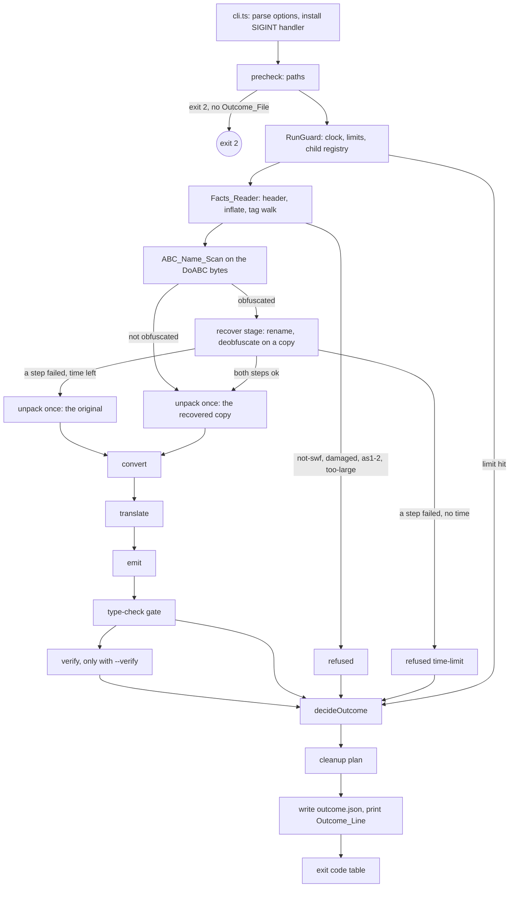
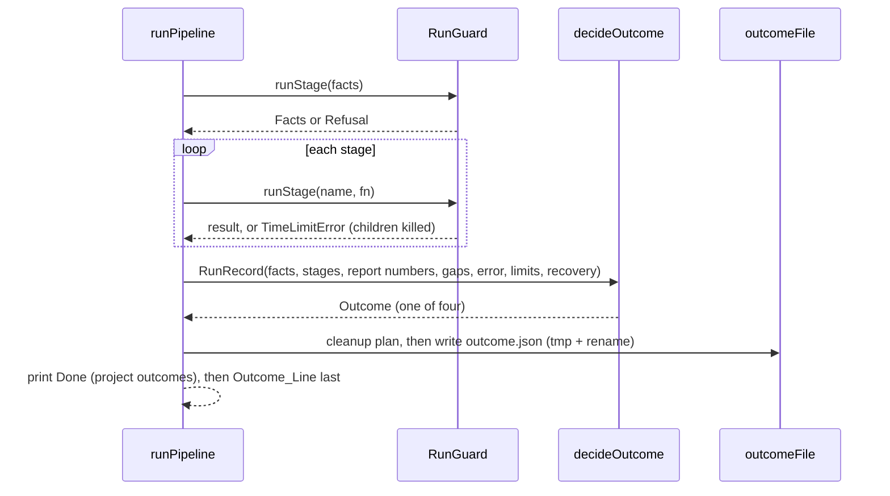

# Design Document

## Overview

This design makes every run of `npm run pipeline` end in one honest Outcome, recovers obfuscated files on a copy, stubs Flash APIs by a general rule, adds a real `flash.geom.Point`, and draws and clicks `DefineButton` and `DefineButton2` symbols. It records decisions and the reason for each. Terms are those of `requirements.md`. Three blocks, three Checkpoints.

| Block | Delivers | Main new code |
|---|---|---|
| A, the contract | Outcome, Outcome_File, Facts_Reader, Run_Limits, exit codes, cleanup, hostile fixtures, the small fixes of Requirement 25 | `src/outcome/`, `src/facts/`, `src/pipeline/guard.ts`, `src/pipeline/processTree.ts` |
| B, recover | ABC_Name_Scan, recovery on a copy before the one Unpack, Flash_API_Table, stubs, `Point` | `src/recover/`, `src/facts/abcNames.ts`, `src/translate/flashApiTable.ts`, `template/shim/stubs/`, `template/shim/Point.ts` |
| C, buttons | Convert, Scene_JSON 4, Runtime, Shim `SimpleButton`, hover events | `src/convert/buttons.ts`, `template/runtime/button*.ts`, `template/shim/SimpleButton.ts` |

### Decisions at a glance

| Question | Decision | Why |
|---|---|---|
| Where the Outcome is decided | One pure function `decideOutcome` over a `RunRecord`; `runPipeline` only collects the record and calls it once | Testable without Java; one place enforces "no fake success" |
| Numbers in the Outcome | Read from the Translation_Report and the Unsupported list after the type-check gate; dropped placements from a new `stats.placementsDropped` | The `[translate]` console line is computed before the gate and disagrees with the report (redball4: 3/18/35 against 3/12/41) |
| What "translated" means | A Candidate_Class that Emit registered (not omitted) AND whose emitted file parses (not the D5 fallback, marked `parseFailed`) and that is clean, loose, an applied override, or kept with untranslated code (status `unsupported`, not loose). An omitted class, and a class whose translated output does not parse (the D5 fallback), never count; the latter are counted apart in `numbers.unparsedClasses`. (Amended at Task 12.3, owner decision: kept-with-untranslated-code classes now count; `numbers.untranslatedCodeClasses` holds them apart from clean, loose and omitted.) | Matches the brief's counts (3 and 15) |
| Facts without FFDec | Own header and tag-length walk (`src/facts/`), about 150 lines, no tag decoding except the DoABC payload for the ABC_Name_Scan | Needs only tag codes, lengths and the ABC constant pool; FFDec stays the only parser of tag content |
| Obfuscation detection | ABC_Name_Scan: walk the constant pool of the `DoABC` or `DoABC2` bytes (strings, namespaces, namespace sets, multinames) and count multiname names that are not legal identifiers. Before the first FFDec call, in pure code | Requirement 14.1. Measured 0.2 s for the whole 10 MB file including inflate and start-up of Node |
| Recovery order | If obfuscated: rename (`typeNumber`), then deobfuscate (`max`), both on a copy, then Unpack once on the recovered copy. Never Unpack the original first | Requirement 16.1. No double Unpack |
| Recovery failure | Fall back to Unpack of the original only if time remains in the run limit; otherwise refused `time-limit` | Requirement 15.3 |
| Compression | `FWS` and `CWS` fully; `ZWS` header-only (no LZMA decoder in Node, no new dependency) | Node `zlib` has no LZMA; a dependency is not added (Decision U7, decided) |
| Damaged detection | Decode with `zlib.inflateSync` and compare the declared length; walk the tags to an `End` tag | Measured: `truncated.swf` throws `Z_BUF_ERROR` and decodes 16 655 of 35 964 bytes |
| Limits | In-process `RunGuard` with an injectable clock, a registry of child process ids, and tree kill; no supervisor process | The web server already kills the whole tree at 180 s; a supervisor would double the machinery. A blocked synchronous stage is Open_Item O1 |
| Windows process tree | `taskkill /PID <pid> /T /F`, moved from `launchChromium.ts` to `src/pipeline/processTree.ts` and used by `spawnFfdec` too | `child.kill()` in `spawnFfdec` ends only the Java process (read in the code) |
| Exit codes | One constant table: converted 0, converted-with-gaps 0, failed 1, usage 2, refused 3 | Requirement 7; `web/server/jobs.ts` reads 0 as success |
| FFDec exit error at Unpack | `refused` `damaged`; the FFDec text goes only to `ffdec-<Reference_Id>.log`. Every error of our own code stays `failed` | Requirement 5.12 and 5.13; D-A2 |
| Stubs | Ship in the Shim; objects returned where Flash returns objects; No_Event_Stubs record `api-stub-no-event:<Class>` | Requirements 17.2, 17.4, 17.7 |
| Buttons | New Scene_JSON symbol type `button`, `formatVersion` 4 written only when a button exists | Goldens of all committed samples stay byte-equal |

## Findings that changed the plan

| # | Finding | Evidence | Effect |
|---|---|---|---|
| F1 | Stage times of the brief's `redball4.swf` on this machine with the old flat limits: unpack 87.7 s, convert 39.9 s, translate 12.3 s, emit and gate 13.4 s, total 153.7 s. With the owner's limits (300 s run, 60 s base, weights) every stage fits its allowance (unpack 88 of 120 s, convert 40 of 60 s). Recovery adds about 34 s and one Unpack of the recovered copy replaces the Unpack of the original, so the expected total is about 190 s. The Unpack time of the recovered copy was not measured (O8) | `npm run pipeline` on `.work/judge-test/redball4.swf`, timestamps per line; `Measure-Command` for rename and deobfuscate | The target is `converted-with-gaps` under the defaults with time to spare (Requirement 6.16). The stage times are reported at Checkpoint 2. The 180 s kill of the web server is below the 300 s default and is the web owner's to align (D-A4, `docs/outcome.md`) |
| F2 | No committed sample holds a button. `unsupported-features.json` of all eleven runs in `.work/after/` has 0 `button` entries, and `swf_summary` of `click_block` and `entity_game` lists no button tag. The only file with buttons is `redball4.swf` (36 `DefineButton2Tag`, no `DefineButtonTag`), which is copyrighted and local. | `swf_summary`, `swf_find_tags`, grep of the reports | Requirement 20.18 compares the committed samples (unchanged) and a generated fixture (D-C7) |
| F3 | `DefineButtonTag` was `UNVERIFIED`. FFDec 26.4.0 accepted a hand-written `DefineButtonTag` item through `-xml2swf` and `-swf2xml` wrote it back as `<item type="DefineButtonTag" actionBytes="" buttonId="900" forceWriteAsLong="false">` with `<characters>` of `BUTTONRECORD`. A v1 record has no `colorTransform`; v2 has one, plus `<actions/>`. | Round trip in `.work/judge-test/design-tmp/` (`b.xml`, `b.swf`, `b2.xml`), `swf_find_tags` on `redball4.swf` for the v2 attributes | Owner decision (Requirement 20.3): this lifts the stop rule; the label is "measured on a generated file" |
| F4 | Ruffle's hit rule for a button is the union of the current visible state child and the hit area. | `avm2_button.rs` at `4a8d396`, `mouse_pick_avm2` | Requirement 20.7 already says so; D-C3 |
| F5 | Our Player dispatches no `mouseOver`, `mouseOut`, `rollOver` or `rollOut`, and the Shim `MouseEvent` has no such constants. | grep of `template/`; `player.ts` has `dispatchMouseMove`, `dispatchMouseDown`, `dispatchMouseUp`, `dispatchClick` only | New work in Block C (D-C4); Requirement 20.10 says so |
| F6 | `-deobfuscate max` alone leaves invalid names. After rename then deobfuscate the class list has `class_N` and `package_N` names. In `redball4`, 27 of 44 Candidate_Classes have an invalid name; in the eleven committed samples 0 of 83. | `swf_list_classes` on `design-tmp/d.swf` and `rd.swf`; name check over `translation-report.json` files | Order is rename, then deobfuscate (D-B3) |
| F7 | Recovery times on this machine: rename 5.1 s, deobfuscate after rename 29.0 s, deobfuscate alone 28.4 s. | `Measure-Command`, three runs | About 34 s for the recovery stage; the weight of the stage is 2 (D-B6) |
| F8 | The Facts_Reader can decode `CWS` with `zlib.inflateSync`. Declared and decoded lengths agree for `redball4` (10 196 790), `clickgoto` (4 944) and `entity_game` (22 225). For `truncated.swf` the declared length is 35 964, the file is 9 000 bytes, and `inflateSync` throws `Z_BUF_ERROR`. | Node 24.18 script over four files | The cut file is detectable from the header and one inflate, without FFDec |
| F9 | FFDec 26.4.0 has `-decrypt`, but it is for HARMAN AIR encryption only. No FFDec option or output was found that names a packed or encrypted web SWF. | `-help`, `-help decrypt` | The `encrypted` Reason_Code has no measured signal (O3) |
| F10 | The web server already kills the whole pipeline process tree on its 180 s limit (`web/server/jobs.ts` uses `killTree` from `web/server/processTree.ts`). | grep | No supervisor process (O1) |
| F11 | `src/pipeline/cli.ts` returns 1 for an Emit refusal (`OUTPUT_DIR_NOT_EMPTY`, `UNSAFE_FORCE_TARGET`) because they are `PipelineError`s caught by the stage loop. Requirement 1.9 says exit 2 and no Outcome_File. | `pipeline.ts`, `REFUSAL_CODES` | These two codes leave the Outcome set and return 2 (D-A9) |
| F12 | `.kiro/steering/tech.md` says Scene_JSON is `formatVersion` 2. The code accepts 2 and 3 and writes 3. | `template/runtime/scene.ts` | Corrected in its own commit (Requirement 25.4) |
| F13 | Ruffle `Point.as` has `copyFrom` and `setTo` besides the members of the older list. | `core/src/avm2/globals/flash/geom/Point.as` at `4a8d396` | Requirement 18.1 now lists them |
| F14 | The Facts class count: `swf_summary` says 224 ABC classes for `redball4`, `swf_list_classes` says 225. | both tools | `abcClassCount` is the number of `.as` files FFDec exports, the same source as `swf_list_classes` (O14) |
| F15 | The ABC constant pool can be walked without FFDec. A parser of the `cpool_info` layout (u30 counts for int, uint, double, string, namespace, namespace set, multiname; multiname kinds `0x07`, `0x0D`, `0x0F`, `0x10`, `0x11`, `0x12`, `0x09`, `0x0E`, `0x1B`, `0x1C`, `0x1D`) ran to the end of the multiname table on 8 files with no unknown kind, and stopped well inside the ABC bytes. Tag 82 (`DoABC2`) has a u32 flags field and a zero-terminated name before the ABC bytes; tag 72 (`DoABC`) has the ABC bytes at once (`mask_reapply` uses tag 72, the other seven tag 82). Multiname names that are not legal identifiers: `redball4` 1 537 of 2 919 (52.6 %); `3_joystick` 0 of 62, `clickgoto` 0 of 97, `click_block` 0 of 21, `entity_game` 0 of 454, `mask_reapply` 0 of 26, `slider_component` 0 of 539, `tweendemo` 0 of 97. The count is the same with an ASCII rule and with a Unicode-letter rule. | `.work/abc-scan/scan.cjs` and `scan2.cjs` (Node, written for this design, not committed) | D-B2. The layout is checked by measurement on real files; the parser written from the layout ran clean, which is the evidence, not a copy of the format document |
| F16 | `FfdecExitError` (code `FFDEC_EXIT`, carries the exit code and the stderr text), `FfdecTimeoutError`, `JavaNotFoundError`, `FfdecNotFoundError`, `NotAs3Error`, `InvalidSwfError`, `MissingExportError`, `XmlVersionError` and `MissingHeaderValueError` already exist in `src/unpack/errors.ts`. | read | D-A2 maps by the existing codes; no new error class is needed for Requirement 5.12 |
| F17 | The `[translate] ok (...)` line is built from `classStatus(c.diagnostics, 0)` before the gate (`src/pipeline/pipeline.ts`, lines 257 to 259). | read | Requirement 25.3 fix (D-A11) |

## Architecture



`runPipeline` keeps its signature (stages and io injected, returns the exit code). Inside, every stage runs through `guard.runStage(name, fn)`, which records name, result and duration and enforces the allowance. The existing progress lines stay. Unpack runs once per run; no path in the diagram unpacks twice.

### Run record and decision



## Components and Interfaces

### Component map

| Area | Files (new or changed) | Requirements |
|---|---|---|
| Outcome | `src/outcome/outcome.ts` (types, `decideOutcome`), `outcomeFile.ts` (serialise, parse, atomic write), `exitCode.ts` (the one table), `reasons.ts` (sentences, scrub), `gaps.ts` (gap kinds, summary), `classifyError.ts` | 1, 2, 4, 5, 7, 10 |
| Facts | `src/facts/readFacts.ts` (pure over a `Uint8Array`), `swfBody.ts` (decode, damage classifier, tag walk), `abcNames.ts` (ABC_Name_Scan, pure) | 3, 5, 14 |
| Limits | `src/pipeline/guard.ts` (RunGuard), `limits.ts` (option, env, default resolver), `processTree.ts` (spawn registry, `killTree`) | 6, 7, 9 |
| Pipeline | `src/pipeline/pipeline.ts` (uses the above), `cli.ts` (options, signals, `SET.json` message fix), `src/pipeline/cleanup.ts` (pure plan) | 1, 5, 6, 9, 25 |
| Unpack | `src/unpack/spawnFfdec.ts` (register child, tree kill), `src/unpack/errors.ts` (unchanged codes) | 5, 6, 25 |
| Recovery | `src/recover/recover.ts` (edge: two FFDec calls on a copy), `src/recover/detect.ts` (pure: verdict from the scan counts) | 14 to 16 |
| API stubs | `src/translate/flashApiTable.ts`, `scripts/gen-api-stubs.ts`, `template/shim/stubs/*.ts` (generated), `template/shim/Point.ts` | 17, 18 |
| Buttons | `src/convert/buttons.ts`, `ffdecXml.ts`, `readUnpacked.ts`, `convertModel.ts`, `template/runtime/scene.ts`, `template/runtime/buttonModel.ts`, `player.ts`, `loader.ts`, `hitTest.ts`, `template/shim/SimpleButton.ts`, `events.ts` | 20, 21 |
| Tests | `test/support/hostileSwf.ts` (byte builder, includes an ABC constant pool builder), `test/support/buttonSwf.ts` (xml2swf fixture), unit, property and e2e files named in Testing Strategy | all |
| Docs | `docs/outcome.md`, steering updates | 2.8, 6.3, 10 |

### Block A: the contract

| # | Decision | Reason | Rejected alternative |
|---|---|---|---|
| D-A1 | `decideOutcome(record): Outcome` is pure and total. The record holds facts (or null), the stage list, a `failure` (a classified error or null), the report numbers (or null), the gap list, the limits and the recovery object. | Requirement 1.8 and Property 1 need a function to test over generated records. | Deciding in the `catch` and `finally` blocks of `runPipeline` |
| D-A2 | Error to Outcome by a table keyed on the error `code` (`classifyError.ts`): `INVALID_SWF` refused `not-swf`; `NOT_AS3` refused `actionscript-1-2`; `FFDEC_TIMEOUT` refused `time-limit`; **`FFDEC_EXIT` thrown by the Unpack stage refused `damaged`** (reason "the file could not be read"; the FFDec stderr text goes only to `ffdec-<Reference_Id>.log`, Requirement 5.12); `JAVA_NOT_FOUND` and `FFDEC_NOT_FOUND` failed (reason says a required component is missing, no tool name); `MISSING_EXPORT`, `XML_VERSION`, `MISSING_HEADER_VALUE` and every other error, including any thrown by our own code (`TypeError`, a bug in Translate, a non-Error value), failed `internal-error`. An `FFDEC_EXIT` thrown by a recovery step is not an Outcome: it is a recovery failure (D-B4). | Requirement 5.12 and 5.13: an FFDec exit is the only error that says the input is unreadable; our own errors must never be called `damaged`. The classifier checks `instanceof FfdecExitError` and the stage name, never the message text | `instanceof` chains in the stage loop; matching on message text |
| D-A3 | Gap kinds counted: `untranslated-class`, `class-omitted`, `untranslated-code`, `unbound-instance`, `unrecoverable-class`, type errors of the gate, and `stats.placementsDropped`. Not counted: `text-metrics`, `filter`, `stroke-style`, `mask`, `morph-shape`. | Requirement 4.2. `placement dropped` is only a message prefix today, so Convert returns the number in `stats`. | A flag `dropped: true` on entries (changes every golden) |
| D-A4 | Stage allowance is `stageLimit × weight`: recover 2, unpack 2, convert 1, translate 1, emit 1, gate 1, verify 3. The run limit is checked at every stage start and by one run timer. Defaults: 20 MiB, 300 s run, 60 s base. `docs/outcome.md` states that the 300 s default exceeds the 180 s per-job kill of `web/server/options.ts`, which the web owner must align; this spec changes nothing under `web/`. | Unpack and recovery each run two FFDec calls of up to 60 s; Verify holds Reference_Frames (120 s), Replay (60 s) and render waits. A flat limit would cut stages shorter than their own per-call limits. The recover weight is an amendment (A1). | A flat limit |
| D-A5 | On a limit: `guard.killAll()` (taskkill tree for every registered pid), the stage promise is abandoned, the Outcome is `refused` `time-limit` with the stage name and the limit in the reason, the cleanup plan runs, and `main` ends with `process.exit(code)` after flushing stdout. | An abandoned async stage must not keep the event loop alive. | Waiting for the stage to settle |
| D-A6 | `Reference_Id` is the first 8 hex digits of `sha256(inputSha256 + "\n" + stage + "\n" + errorName + "\n" + errorMessage)`. The Failure_Log holds the full stack. `ffdec-<Reference_Id>.log` holds the FFDec text of a `damaged` refusal from an FFDec exit; the same id derivation applies with the error name `FfdecExitError`. | Requirement 5.7: derived from the run, reproducible, not clock-only. | Random bytes |
| D-A7 | `main` installs `SIGINT` (and `SIGBREAK` on Windows) handlers that call `guard.abort('signal')`, write a `failed` Outcome with reason `run stopped by signal`, and exit 1. | Requirement 7.4. On Windows Node cannot deliver `SIGTERM` to a handler, so the web server's kill is not catchable (O5). | Handling `SIGTERM` only |
| D-A8 | `outcome.json` is written to `outcome.json.tmp-<pid>` in the output directory, then renamed. If the directory is not writable the Outcome_Line is still printed (Requirement 5.8). | Atomic reader view (Requirement 2.11). | In-place write |
| D-A9 | Emit refusals (`OUTPUT_DIR_NOT_EMPTY`, `UNSAFE_FORCE_TARGET`) return 2 with one `error [pipeline]:` line and no Outcome_File. | Requirement 1.9; F11. | Keep exit 1 |
| D-A10 | `stages[].durationMs` is the only time-dependent field. The determinism test drops it by name (Requirement 11.7). | | |
| D-A11 | Small findings of Requirement 25, each in its own commit with the test the requirement names (table below). | Requirement 25 | A separate cleanup task |

#### Small findings fixed with the file (Requirement 25)

| # | Finding | Fix | Test | Commit when |
|---|---|---|---|---|
| S1 | `spawnFfdec` calls `child.kill()` on a timeout, which ends the Java process only (read in `src/unpack/spawnFfdec.ts`). | Register the child with the guard registry and call `killTree(pid)` on timeout. `killTree` moves to `src/pipeline/processTree.ts` | Process test of Requirement 6.14 and 6.15: a spawned `node` child with a grandchild is gone by pid | The task that first changes `src/unpack/` |
| S2 | In `cli.ts` the message of the `handwritten/SET.json` read error is a double-quoted string, so `${...}` is printed literally (stated in the requirements; `cli.ts` is read again when the task starts). | Print the exception text. The error is a usage-class error, exit 2, `error [pipeline]: <text>` | Unit test with an unreadable `SET.json` | The task that first changes `cli.ts` |
| S3 | The `[translate] ok (...)` line counts statuses before the type-check gate (F17), so it disagrees with the Translation_Report. | Keep the line in place, bracket text included (`[translate] ok (N classes: a clean, b loose, c unsupported)`), and print directly after it one indented line, `  counts taken before the type check; final counts are in translation-report.json`. The numbers after the gate are in the Outcome_File and the report. Amended at Checkpoint 1, owner decision: the first version put `before type check` inside the brackets, on the claim that the web server reads only `^Done: ` and `^error [stage]: `. That claim was wrong: `web/server/stageLines.ts` also parses the `[stage] ok (...)` detail with an anchored pattern for the translate counts, and `test/web/server.e2e.test.ts` failed (Task 5, 1a656b3). The indented line matches no pattern there and is read as `log`. `web/` is not changed. | Unit test of the line text; the existing tests that match the old text are updated in the same commit | The task that first changes that line |
| S4 | `tech.md` says Scene_JSON `formatVersion` 2. | State 3 today and 4 with buttons, and add the new options and the Outcome_File (Requirement 10.4) | A read of the file in the commit review (not machine-tested) | The task that first changes `tech.md` |

#### Facts_Reader

Pure function `readFacts(bytes, limits): FactsResult` where the result is `{ ok: true, facts, body }` or `{ ok: false, reasonCode, facts | null }`. `body` is the decoded SWF body, kept so the ABC_Name_Scan does not decode twice. No file or process access; the caller reads the file.

SWF layout used (confirmed on the four files of F8): bytes 0 to 2 signature, byte 3 version, bytes 4 to 7 uint32 little-endian length of the whole file after decompression (header included), then for `FWS` the body, for `CWS` a zlib stream of the body, for `ZWS` a uint32 compressed length, 5 bytes of LZMA properties and the LZMA stream. The body starts with the frame RECT (5 bits of `Nbits`, then four signed fields of `Nbits` bits, padded to a byte), a uint16 frame rate in 8.8 fixed point, a uint16 frame count, then tag records. A tag record header is a uint16 little-endian: tag code in the upper 10 bits, short length in the lower 6; length 63 means a uint32 length follows.

| Step | Rule | Outcome on failure |
|---|---|---|
| 1 | Fewer than 8 bytes, or a signature other than `FWS`, `CWS`, `ZWS` | refused `not-swf` |
| 2 | File size above `maxSize` | refused `too-large` (checked by the caller before reading the whole file) |
| 3 | `FWS`: body is the rest. `CWS`: `inflateSync(rest, { maxOutputLength: min(declared, MAX_UNCOMPRESSED) })`. `ZWS`: stop here with header-only facts | `Z_BUF_ERROR` or a short result: refused `damaged`. Declared length above `MAX_UNCOMPRESSED` (128 MiB, chosen, not measured): refused `too-large` |
| 4 | Decoded length plus 8 differs from the declared length | refused `damaged` |
| 5 | Parse RECT, rate, count; walk tag records by length; collect tag codes and the byte ranges of tags 72 and 82; require an `End` tag (code 0) at the end | a record that runs past the body, or no `End`: refused `damaged` |
| 6 | `scriptVersion`: `as3` if tag 72 (`DoABC`) or 82 (`DoABC2`) exists; else `as1-2` if tag 12 (`DoAction`) or 59 (`DoInitAction`) exists; else `unknown` | `as1-2` is refused `actionscript-1-2` |

`unknown` goes on to Unpack. A SWF whose `FileAttributes` say AS1 or AS2 stops at Unpack through the existing `NotAs3Error`, which maps to refused `actionscript-1-2` (D-A2). Tag codes were taken from the format specification and FFDec's class ids; a hostile fixture test (Requirement 8.1) covers codes 12, 69, 72 and 82. Unknown tag codes (the `UnknownTag` that `redball4` carries) are walked by length and ignored.

The result separates header facts from FFDec facts (Requirement 3.10): `facts.source` is `{ header: [...], ffdec: ['abcClassCount'] }`. `abcClassCount` is added after Unpack as the number of `.as` files under `scripts/` (F14).

#### Outcome record

```ts
type OutcomeCode = 'converted' | 'converted-with-gaps' | 'refused' | 'failed';
type ReasonCode =
  | 'not-swf' | 'damaged' | 'actionscript-1-2' | 'encrypted' | 'too-large'
  | 'time-limit' | 'nothing-translated' | 'internal-error';

interface Facts {
  signature: 'FWS' | 'CWS' | 'ZWS';
  version: number;
  compression: 'none' | 'zlib' | 'lzma';
  sizeBytes: number;
  declaredLength: number;
  stage: { width: number; height: number } | null;      // null for ZWS
  frameRate: number | null;
  declaredFrames: number | null;
  scriptVersion: 'as3' | 'as1-2' | 'unknown';
  abcClassCount: number | null;                         // after Unpack
  source: { header: string[]; ffdec: string[] };
}

interface OutcomeRecord {
  formatVersion: 1;
  outcome: OutcomeCode;
  reasonCode: ReasonCode | null;                        // null for the two project outcomes
  reason: string;                                       // at most 200 characters, scrubbed
  facts: Facts | null;                                  // null only if the Facts_Reader did not run
  numbers: {
    candidateClasses: number; translatedClasses: number; cleanClasses: number;
    looseClasses: number; untranslatedCodeClasses: number; unparsedClasses: number; unsupportedClasses: number; omittedClasses: number;
    typeErrors: number; droppedPlacements: number; namedLimits: number;
  } | null;                                             // null before Translate ran
  gaps: Array<{ kind: GapKind; count: number; examples: string[] }>;  // examples at most 5
  limits: { maxSizeMiB: number; runLimitS: number; stageLimitS: number; stageWeights: Record<string, number> };
  stages: Array<{ name: StageName; result: 'ok' | 'error' | 'skipped'; durationMs: number }>;
  obfuscated: { detected: boolean; namesScanned: number; invalidNames: number;
                sourceSignals: number | null } | null;  // sourceSignals after Unpack of a recovered file
  recovery: RecoveryRecord | null;
  referenceId: string | null;                           // 8 hex, only for failed
}
```

`numbers` is `null` for a refusal before Translate (Requirement 2.3). `reason` is built from templates in `reasons.ts`; every value that enters a template passes `scrub()`, which cuts anything that looks like a drive or root path, a stack frame (`at ` lines), an environment variable name or FFDec stderr text, and truncates to 200 characters.

`converted-with-gaps` reason (Requirement 4.7): `<N> of <M> classes translated, <E> type errors; most gaps: <kind> (<n>), <kind> (<n>)`. For a recovered run the sentence is prefixed `obfuscated: names renamed, N of M classes recovered; ` and the sum is cut to 200 characters by dropping the gap part first (Requirement 16.4).

#### Limits and process tree

| Item | Design |
|---|---|
| Resolver | `resolveLimits({ options, env })`: option beats variable beats default; a value that is not a positive integer is a usage error (exit 2). Defaults: 20 MiB, 300 s run, 60 s stage base. The size default equals `web/server/upload.ts` |
| Weights | recover 2, unpack 2, convert 1, translate 1, emit 1, gate 1, verify 3 (Requirement 6.2 plus the recover stage, A1) |
| Clock | `interface Clock { now(): number; setTimeout(fn, ms): Handle; clearTimeout(h): void }`; the real one wraps `performance.now` and `setTimeout`; tests pass a fake |
| `runStage` | Starts the stage, records the start time, races it with an allowance timer, checks the run deadline before starting, records `{name, result, durationMs}` |
| Registry | `spawnFfdec` and the Chromium launcher call `registry.track(child)`; `killAll()` calls `killTree` for every tracked pid still alive. The Replay child (`replay.ts`) is tracked the same way. Recovery steps use `spawnFfdec` and so are tracked |
| `killTree(pid)` | Windows: `taskkill /PID <pid> /T /F` without a shell (the code in `launchChromium.ts`, moved and exported). Elsewhere: `process.kill(-pid, 'SIGKILL')` for a detached child, else `child.kill('SIGKILL')` |
| Verify | `verifyStage` receives the guard's registry through the existing `launchChromium` call so Chromium is killed on a limit |
| Per-call bound | Amended at Checkpoint 1, owner decision: each FFDec call is bounded by the remaining stage allowance, not a fixed 60 s. Cause: unpack.ts gave both calls a fixed 	imeoutMs of 60 s, so redball4 ended `refused time-limit` at 60065 ms inside a 120 s allowance. UnpackInput.allowanceMs carries the allowance from 
unPipeline; each call gets what is left, and the timeout names the limit (120 s stage limit). The guard timer stays the outer bound. Open: Reference_Frames in Verify keeps its fixed 120 s (fdecFrames.ts), inside the 180 s verify allowance, so it is not cut early |
| Wait time | Time spent waiting for a `PIPELINE_SLOTS` slot is a test-side wait and never enters the pipeline's clock |
| Time for redball4 | Expected under the defaults: recover 34 s of 120 s, unpack about 88 s of 120 s, convert 40 s of 60 s, translate 12 s, emit and gate 13 s: about 190 s of 300 s. The recovered Unpack time is not measured (O8). The Checkpoint 2 report gives the measured stage times and the share of the run limit |

#### Cleanup plan

`planCleanup({ preExisting, writtenByRun, keep })` is pure and returns the set to delete: `writtenByRun \ preExisting`, minus the Outcome_File, the reports, the Failure_Log and `ffdec-<Reference_Id>.log`. `preExisting` is the listing of the output directory taken after the precheck and before the first write. `writtenByRun` is Emit's file list plus the report files. If Emit throws part-way it has no complete list; Emit gets an optional `onWrite(path)` callback so the pipeline keeps a journal (O6). The work directory (which holds the recovery copy) is removed on `refused` and `failed` unless `--keep-work` or `--work-dir`.

### Block B: recover and stub

| # | Decision | Reason | Rejected alternative |
|---|---|---|---|
| D-B1 | (Replaced.) Recovery runs before the only Unpack. The ABC_Name_Scan (D-B2) decides from the input bytes; if obfuscated, the recover stage makes the copy, renames and deobfuscates, and Unpack runs once on the recovered copy. The original is unpacked only after a recovery failure with time remaining (D-B5). | Requirements 15.3 and 16.1. No double Unpack: the 88 s Unpack is paid once | Unpack the original first, detect from names and sources (the old D-B1), then Unpack again |
| D-B2 | **ABC_Name_Scan** (`src/facts/abcNames.ts`, pure over a `Uint8Array`). Input: the ABC bytes of every `DoABC` (tag 72: the whole payload) and `DoABC2` (tag 82: skip a u32 flags field and a zero-terminated name) tag. Walk the `cpool_info` in order: `int_count` s32 values (u30 count, entries 1 to count-1), `uint_count` u32 values, `double_count` 8-byte values, `string_count` strings (u30 byte length then UTF-8 bytes), `namespace_count` entries (kind byte, u30 name), `ns_set_count` sets (u30 size then that many u30), `multiname_count` entries (kind byte then the data of the kind: `0x07` and `0x0D` two u30 (namespace, name); `0x0F` and `0x10` one u30 (name); `0x11` and `0x12` none; `0x09` and `0x0E` two u30 (name, namespace set); `0x1B` and `0x1C` one u30 (namespace set); `0x1D` two u30 and a list (name, count, `count` type indexes)). Entry 0 of each table is implicit. A multiname name index points into the string table; the scan collects the strings of the multiname names (non-empty) and counts those that do not match the identifier rule `^[\p{L}_$][\p{L}\p{N}_$]*$` (Unicode, flag `u`). Namespace names (package paths, which hold dots) and literal strings are not counted. Verdict: `obfuscated` when `invalidNames / namesScanned >= 0.20` and `invalidNames >= 5`. An unknown multiname kind, a read past the end, or no ABC tag gives `{ obfuscated: false }` with the counts read so far (Requirement 14.4); the damage is Requirement 5's business. | F15: measured on eight real files: 0 of 21 to 539 names in the seven committed files, 1 537 of 2 919 (52.6 %) in the brief's file. 20 % sits far from both; the floor of 5 stops a tiny file with one odd name. The layout is measured, not guessed. | Count in decompiled source (needs FFDec and a second Unpack); scan all strings (literal strings with spaces would count) |
| D-B3 | Commands, read from `java -jar tools/ffdec/ffdec-cli.jar -help renameInvalidIdentifiers` and `-help deobfuscate` (FFDec 26.4.0): `-renameInvalidIdentifiers (typeNumber\|randomWord) <infile> <outfile>`, then `-deobfuscate <level> <infile> <outfile>` with level `traps/2/max` or `deadcode/1`. Used: `typeNumber` and `max`, in that order. `randomWord` is rejected: its names may not be the same on every run (not measured). | Requirement 16.2; F6. Same input gave same names across the two runs measured (O7) | `randomWord`; `-deobfuscate` alone |
| D-B4 | The recover stage works in `<work>/recovery/`: `in.swf` (byte copy of the input), `renamed.swf`, `recovered.swf`. Unpack then reads `recovered.swf`. `args.swfPath` is untouched and Verify reads it (Requirement 15.2). Each of the two FFDec calls has the existing 60 s per-call limit. If a call exits with an error or times out, or the copy cannot be made, the stage ends with `recovery.fallback` and the run goes on as D-B5 says. An `FFDEC_EXIT` here never becomes the Outcome | Requirement 15 and 16.3 | In-place rewrite |
| D-B5 | Fallback: when recovery fails, Unpack the original once, but only if the remaining run time is at least the allowance of unpack (2 × the stage base = 120 s by default); otherwise the Outcome is `refused` `time-limit`. The `recovery` object records `attempted: true`, `fallback: true` and which step failed. There is no keep-if-better rule and no baseline: the recovered file is translated and the Outcome says that it was recovered, not that it improved anything (Requirement 16.5). | Requirement 15.3. A comparison would need a second Unpack, Convert and Translate | Compare with a proxy baseline (the old D-B5); skip recovery when time is short (the old D-B6) |
| D-B6 | The recover stage has Stage_Weight 2, allowance 120 s by default. Measured need: about 34 s (rename 5.1 s, deobfuscate 29.0 s, F7), so the allowance is 3.5 times the measured time, the same weight as unpack (two FFDec calls, each limited to 60 s). It counts in the run limit as its own stage and not inside unpack. | The owner's decision to count recovery as its own stage; same shape as unpack. This amends Requirements 6.2 and 6.10 (A1) | Weight 1 (60 s allowance, 1.8 times the measured time: thin on a slower machine) |
| D-B7 | Unrecoverable classes: after Unpack of the recovered copy, a Candidate_Class whose source still holds `§§push` or `§§pop`. Each is an `unrecoverable-class` entry. The count goes to `recovery.unrecoverableClasses` and `obfuscated.sourceSignals`. | Requirement 16.7. This count stays after Unpack because it needs the decompiled source | Silent omission |

`RecoveryRecord` (Data Models) holds `attempted`, `renamedIdentifiers`, `deobfuscated`, `candidateClasses`, `recoveredClasses`, `unrecoverableClasses` and `fallback`, as Requirement 16.4 lists, plus `skipped` for `not-obfuscated` and `copy-failed`. It has no `kept` and no baseline.

#### Flash_API_Table and stubs

Table entry: `{ qualified: 'flash.media.Sound', policy: 'stub' | 'real' | 'gap', reason: string, members?: MemberSig[] }`. `MemberSig` is `{ name, kind: 'method' | 'getter' | 'setter' | 'field' | 'constructor', static, params: [name, type, default?][], returns, neutral }`. `neutral` is a primitive neutral value (0, empty string, false, null for a nullable primitive-free case, empty array) **or** `{ stubObject: '<Class>' }` for a member that returns an object in Flash. Lookup `policyOf(qualified, member?)` is total: unknown class gives `absent`.

Rule for the policy, applied when adding an entry:
- `stub` when the effect leaves the page (sound output, network, navigation, storage, host calls) and either no return value feeds a computation or the missing result leaves the game visibly waiting, not silently wrong.
- `real` when a small pure class has exact semantics (`Point`).
- `gap` when the return value feeds computation or the class is out of scope.

| Policy | Classes | What the game sees | Can stall a game |
|---|---|---|---|
| `stub` | `Sound`, `SoundChannel`, `SoundTransform`, `SoundMixer` | Silent. `Sound.play()` returns a `SoundChannel` stub object (non-null, Requirement 17.4); `SoundChannel` holds a `SoundTransform` stub. `length` and `position` are 0. `soundComplete` is never dispatched | Yes (No_Event_Stub): a game that waits for `soundComplete` stays waiting. `Sound` and `SoundChannel` |
| `stub` | `URLRequest` (stores `url`, `method`, `data`), `navigateToURL` (no-op), `URLVariables`, `LocalConnection`, `Security`, `ExternalInterface` (`available` false, `call` returns null) | No network, no navigation. `Security.allowDomain` is a no-op | `LocalConnection` (messages never arrive). The others dispatch no event in Flash either |
| `stub` | `URLLoader` | `load` does nothing; `data` is null; `complete`, `ioError` and `progress` are never dispatched | Yes (No_Event_Stub): a loader-gated screen stays visibly waiting |
| `stub` | `Loader` | `load` does nothing; `content` is null; `contentLoaderInfo` is a non-null stub object whose events never fire | Yes (No_Event_Stub): a preloader that waits for `complete` waits forever |
| `stub` | `SharedObject` | `getLocal` returns a non-null object whose `data` is an in-memory `Object` for the life of the page; `flush` returns the empty string; no browser storage | No |
| `real` | `flash.geom.Point` | As Flash | No |
| `gap` | `ByteArray`, `BitmapData` and `Bitmap` data calls, `XML` and `XMLList` (E4X), `Matrix`, `ColorTransform`, `ApplicationDomain`, `getDefinitionByName`, `Capabilities`, `NetConnection`, `NetStream`, `Video`, `Socket`, `XMLSocket`, `FileReference`, `Camera`, `Microphone`, `Context3D` | Not stubbed. The unresolved name stays a visible type error and the Translation_Report names class and member as `flash-api-gap` | Not applicable |

Why `gap`: a neutral value would be silently wrong (bytes, geometry, parsed XML, pixels, reflection results, a device value), or the class is in the out-of-scope list of `product.md`. Members of a `stub` class that are not in its table entry are `absent` and stay visible gaps (Requirement 17.5).

Mechanism (Requirement 17.12): the table is the single source. `scripts/gen-api-stubs.ts` (`npm run gen:api-stubs`) writes `template/shim/stubs/<Class>.ts` from the entries, each member body being `stubCall('<Class>.<member>', neutral)`. `stubCall` adds one Named_Limit `api-stub:<Class>.<member>` the first time (a `Set` in the helper) and returns the neutral value typed by the signature. A `{ stubObject }` neutral returns a lazily created singleton per owner object, constructed through the stub class itself (so `Sound.play().soundTransform` is also non-null). A constructor records `api-stub:<Class>.constructor`. A class in the No_Event column also records `api-stub-no-event:<Class>` at its first use (first constructor or first member call, once per run), with the text that the class dispatches no completion event. `npm run gen:shim-members` then sees the stub classes like any Shim class, so the existing implicit-`this`, import and member-table logic needs no new path. The generated files are committed with the table change and the regenerated `shimMembers.generated.ts`.

Rejected: one generic `Proxy` stub class (no member types, so the type errors the stub exists to remove remain); a hand-written Shim class per stub (duplicates the table).

Shipping (Requirement 17.2, decided): stub classes sit in `template/shim/stubs/` and are exported from `index.ts`, so they ship in every Emitted_Project and Vite drops unused ones. Emit does not generate or filter stubs. The count of "classes whose type check depends on a stub" (Requirement 17.9) is a pure scan of each translated class's resolved Shim imports against the table's `stub` set, written to `numbers` through `namedLimits` and to the Outcome; the Fidelity_Report lists the `api-stub:` and `api-stub-no-event:` limits that the Replay observed, and states which listed stubs can stall a game (the last column above, as data in the table: `canStall: true`).

#### Point

`template/shim/Point.ts`, formulas from Ruffle `core/src/avm2/globals/flash/geom/Point.as` at `4a8d396` (fetched and read in this design):

| Member | Rule |
|---|---|
| constructor `(x = 0, y = 0)` | stores both |
| `length` | `Math.sqrt(x*x + y*y)` |
| `toString()` | `"(x=" + x + ", y=" + y + ")"` |
| `add(v)`, `subtract(v)`, `clone()`, `equals(p)` | new `Point` of the sums, differences, copy; `equals` is `==` on both fields |
| `normalize(t)` | `len = length`; only when `len > 0`: scale by `t / len`; length 0 leaves the point unchanged |
| `offset(dx, dy)` | adds in place |
| `distance(a, b)` | `b.subtract(a).length` |
| `interpolate(a, b, f)` | `new Point(b.x - (b.x - a.x) * f, b.y - (b.y - a.y) * f)`, so `f = 1` gives `a` and `f = 0` gives `b` |
| `polar(len, angle)` | `new Point(len * cos(angle), len * sin(angle))` |
| `copyFrom(p)`, `setTo(x, y)` | in-place assignment |

The Flash_API_Table entry is `real` with no members (the Shim class is the source). `ADDED_APIS.md` lists it with the fixture line.

### Block C: buttons

#### Convert

The FFDec dump names, verified for v2 on `redball4.swf` and for v1 on the generated round trip (F3):

| Tag | Attributes | Children |
|---|---|---|
| `DefineButton2Tag` | `buttonId`, `trackAsMenu`, `reserved`, `forceWriteAsLong` | `<characters>` of `BUTTONRECORD`, `<actions/>` |
| `DefineButtonTag` | `buttonId`, `actionBytes`, `forceWriteAsLong` | `<characters>` of `BUTTONRECORD` |
| `BUTTONRECORD` | `buttonStateUp`, `buttonStateOver`, `buttonStateDown`, `buttonStateHitTest`, `characterId`, `placeDepth`, `buttonHasBlendMode`, `buttonHasFilterList`, `reserved` | `placeMatrix` (a `MATRIX`, twips), `colorTransform` (v2 only, `CXFORMWITHALPHA`) |

`buttons.ts` (pure) turns the records into `{ up, over, down, hit }`, each a `DisplayListEntry[]`: a record joins every state whose flag is true; entries are ordered by `placeDepth`; two records at one depth in one state keep the later one (Named_Limit `button-duplicate-depth`); `name` is empty. Records with `buttonHasBlendMode` or `buttonHasFilterList` are drawn without them and record `button-record-effects`. Button actions (`<actions>`, `actionBytes`) are AVM1 and ignored with a Named_Limit `button-avm1-actions`. `DefineButtonSound` and `DefineButtonCxform` tags are not read (Named_Limit `button-sound`). The code comment and commit body label the `DefineButtonTag` names "measured on a generated file" (Requirement 20.3).

Scene_JSON: new symbol `{ type: 'button', className?, trackAsMenu, states: { up, over, down, hit } }`. `formatVersion` is 4 when the scene holds a button symbol and 3 otherwise; the reader accepts 2, 3 and 4. All committed goldens keep their bytes. `unsupported-features.json` stops listing `button` entries for placements the Runtime now draws; `placementsDropped` falls with them.

#### Runtime and Shim

Read in Ruffle `core/src/display_object/avm2_button.rs` and `core/src/player.rs` at `4a8d396`:

| Behaviour | Source rule |
|---|---|
| State change table | `RollOver` to Over, `RollOut` to Up, `Press` to Down, `Release` to Over, `ReleaseOutside` to Up, `MouseUpInside` to Up, `DragOut` to Over, `DragOver` to Down. Other events do nothing |
| Drawn child | only the child of the current state is parented to the button; the hit area is never a child |
| Pick | the button is hit when the current state child is hit, or `hit_area.hit_test_shape` hits; requires `visible` and `mouse_enabled` |
| Disabled | `filter_clip_event` ignores every event except key presses when `enabled` is false and when `visible` is false |
| Release outside the pressed object | `ReleaseOutside` is sent to the pressed object, then the object now under the pointer gets `RollOver` immediately |
| While the mouse is down | AVM2 movies still send `RollOut` and `RollOver` to the old and new hovered objects, and `DragOut` or `DragOver` to the pressed one |

Decisions:

| # | Decision | Reason |
|---|---|---|
| D-C1 | `SimpleButton` (Shim) extends `InteractiveObject` and holds four state display objects. The loader builds each state as an unparented container of the entries; the button's render list holds the current one. | Matches `Avm2Button`; hit state never enters the render list |
| D-C2 | `buttonModel.ts` is a pure table: `step(state, event) -> state`, the Ruffle table above, plus `hitRegion(button, state)`. The Player calls it; the Player holds no button logic. | Properties 24 and 25 test the table and the integration against a (pressed, hovered) model |
| D-C3 | Hit region = shapes of the current state container union shapes of the hit container, each through the placement transform. With no hit records the hit container is empty, so the shapes of the current state serve (Requirement 20.8). | F4 |
| D-C4 | The Player gains hover tracking: on a pointer move it compares the new Hit_Target with the previous one and dispatches `mouseOut` and `rollOut` at the old, `mouseOver` and `rollOver` at the new, before `mouseMove` handlers run. The Shim `MouseEvent` gains `MOUSE_OVER`, `MOUSE_OUT`, `ROLL_OVER`, `ROLL_OUT`. `mouseOver` and `mouseOut` bubble; `rollOver` and `rollOut` do not. While a button is down the same events fire (AVM2 rule above). | F5. The bubbling split follows Flash documentation, not read in Ruffle (O9) |
| D-C5 | The Hit_Target for any pointer event inside a button is the button itself (`mouseChildren` is false for buttons). | `mouse_pick_avm2` returns `Hit(self)` for a hit inside a state |
| D-C6 | `enabled = false`: no mouse event, and the drawn state returns to Up. | Requirement 20.12. Ruffle only ignores events; whether it resets the state is unread (O10) |
| D-C7 | Fixtures: `test/support/buttonSwf.ts` writes an XML skeleton with shapes, one `DefineButtonTag` and one `DefineButton2Tag`, and runs `-xml2swf`. The generated file is the fixture for the e2e test; unit and property tests use generated Scene_JSON and the FakeBackend. | F2, F3. Nothing copyrighted is committed |
| D-C8 | If the Block C budget (stop threshold 80 credits) is exceeded by a third, deliver up state, hit area and click only. Over and down become Named_Limits `button-state:over`, `button-state:down`, `button-hit-area` (Requirement 20.13). | D-C4 is the largest part of the over state |
| D-C9 | The button behaviour added to the Runtime is recorded in `.kiro/steering/flash-behaviour.md` in the commit that adds it, with its label (read, measured or Open_Item) (Requirement 20.20). | Requirement 20.20 |

Player events for a button: `dispatchClick` is unchanged (press and release on the same Pressed_Target). `buttonMode` and `useHandCursor` stay stored only.

### Block D: several class names for one character id (D-D1, Requirement 26.1 to 26.3)

Evidence. Ruffle at `4a8d396` (`core/src/display_object/movie_clip.rs`, `preload_symbol_class` lines 4261 to 4280 and the load loop 4347 to 4435), read, not measured against a running Ruffle: every SymbolClass pair is kept in tag order and none is de-duplicated; each class is linked to its symbol (`set_class_symbol`, line 4363); the LAST pair for an id sets the class that instantiates the character (`set_avm2_class`, line 4375); an id with no character (id 0) sets the root class only if none is set yet (lines 4400 to 4417); ExportAssets pairs are not used for AS3 classes. FFDec 26.4.0, measured on the generated fixture of task 25.1 (`test/support/symbolClassSwf.ts`) and on two local files: `symbols.csv` is the SymbolClassTag pairs in tag order across all items (repeats kept), then the ExportAssetsTag pairs, unmarked and not de-duplicated, so an export pair cannot be told from a class pair by its line. One local file has 333 lines, 174 distinct and no id with two names (identical repeats); the other has 312 lines, 303 distinct, 105 ids with two names, and 113 export pairs.

| # | Decision | Reason |
|---|---|---|
| D-D1a | `readUnpacked` keeps only the first N lines of `symbols.csv`, where N is the number of pairs the dump's SymbolClassTag items hold (`parseStructure` counts the `tags` items of each SymbolClassTag, `symbolClassPairs`). The rest are ExportAssets pairs and are dropped. `symbolClassPairs()` in `src/convert/classLinks.ts`. | Measured order of the csv. Position is reliable because FFDec writes the two lists as two blocks; the line text is not. With no SymbolClassTag, N is 0. A model that carries no count (a hand-built `TagsModel`) keeps every entry. |
| D-D1b | ExportAssets names are not links and no warning or Named_Limit is added. | Ruffle ignores them for AS3 classes, so nothing the Flash movie does with a class is lost; a name that exists only as an export has no class source to translate. |
| D-D1c | `buildClassLinks()` (`src/convert/classLinks.ts`, pure, never throws) gives one link per id: `primary` is the last pair in tag order (the first for id 0), `aliases` are the other distinct names in first-seen order. Identical pairs count once. | Ruffle's `set_avm2_class` order and root-class rule. |
| D-D1d | `className` of a sprite or button symbol is the primary; `classAliases?: string[]` holds the aliases. The writer emits it only when it is not empty, the readers of 2, 3 and 4 accept it, and `formatVersion` is unchanged (3, or 4 with a button). Every committed golden keeps its bytes. | A new optional field, no version bump (the rule for `className`). |
| D-D1e | Consumers use `symbolClassNames(symbol)` (`template/runtime/scene.ts`: `className` then aliases): the Emit registry (`linkedClassNames`) and the omission list (`linkedSymbols`), the child-name table of the translator (`childNamesByClass`) and its emit closure, the untranslated-class count of the Pipeline, and the Player's constructor-to-symbol map. The unbound-instance check accepts an instance name declared by any linked class of the symbol. | Every name stays linked: each alias class is registered under its own name, is translated like any linked class, and builds the same symbol. |
| D-D1f | Run time: the Player instantiates a placement with the primary class (unchanged). `new Alias()` from script finds the symbol through the map and builds the same children, because each registered constructor of a name of the symbol maps to its id. Whether an alias class extends the primary or is separate does not matter: the lookup walks the prototype chain from `new.target`, so the nearest registered constructor decides. A button symbol's aliases are registered and translated, but only its primary class is used when the Player builds a button (no script construction exists for buttons). | Keeps the Player simple and unchanged for symbols without aliases. |
| D-D1g | Tests: `test/unit/classLinks.test.ts` (convertModel on models built from the fixture facts, the reader, the golden bytes, a Player example on the FakeBackend and the generated fixture end to end), `test/property/classLinks.property.test.ts` (Property 26, task 25.3). | Requirement 26.1 to 26.3. |
## Data Models

```ts
// Scene_JSON 4 (written only when a button symbol exists)
interface ButtonSymbol {
  type: 'button';
  className?: string;
  trackAsMenu: boolean;
  states: { up: DisplayListEntry[]; over: DisplayListEntry[]; down: DisplayListEntry[]; hit: DisplayListEntry[] };
}

interface RecoveryRecord {
  attempted: boolean;
  skipped: 'copy-failed' | 'not-obfuscated' | null;
  failedStep: 'copy' | 'rename' | 'deobfuscate' | null;
  fallback: boolean;                // the original was translated after a failed recovery
  renamedIdentifiers: number;       // names that differ between the scan of the input and of the renamed copy
  deobfuscated: boolean;
  candidateClasses: number;
  recoveredClasses: number;         // translated from the recovered copy (the Recovered_Count)
  unrecoverableClasses: number;     // after Unpack, from the source signals
}

type GapKind =
  | 'untranslated-class' | 'class-omitted' | 'untranslated-code' | 'unbound-instance'
  | 'unrecoverable-class' | 'type-error' | 'dropped-placement' | 'flash-api-gap';
```

`renamedIdentifiers` is measured by running the ABC_Name_Scan on the renamed copy and subtracting `invalidNames`: the scan is pure and the copy is a SWF, so no FFDec output is parsed.

Exit codes (one constant table, read by tests and by `docs/outcome.md`): `converted` 0, `converted-with-gaps` 0, `failed` 1, usage and path errors 2, `refused` 3.

`docs/outcome.md` holds the four examples, the Reason_Codes, the exit-code table, the note that the `abcClassCount` and `swf_summary` numbers can differ by one (O14), and the note that the web server's 180 s kill is below the 300 s default run limit and must be aligned by the web owner (Requirement 6.3). A test extracts each fenced JSON example from the document and compares it with the output of the writer for the same record (Requirement 10.2).

New Named_Limits: `api-stub:<Class>.<member>`, `api-stub-no-event:<Class>`, `obfuscation-recovered`, `button-state:over`, `button-state:down`, `button-hit-area`, `button-duplicate-depth`, `button-record-effects`, `button-avm1-actions`, `button-sound`, `flash-api-gap` (report problem kind, not a runtime limit).

## Correctness Properties

*A property is a characteristic or behavior that should hold true across all valid executions of a system-essentially, a formal statement about what the system should do. Properties serve as the bridge between human-readable specifications and machine-verifiable correctness guarantees.*

Reflection: Requirements 1.1 to 1.3, 1.5 and 4.1 to 4.3, 4.9, 4.11 and 4.12 are one decision property. 1.6 and 1.8 are one fault-injection property. 5.12 and 5.13 are their own classification property, because the same stage fake throws two kinds of error and the Outcomes differ. 3.6 and 3.10 fold into the Outcome properties. 5.1 to 5.4 and 5.10 are one cut-length property. 6.1 and 6.8 are one resolver property. 7.1, 7.2 and 7.5 are one total-mapping property. 14.2 to 14.4 and 14.6 are one detector property and one scan-totality property. 15.3, 16.1 and 16.5 are one recovery-order property (the old keep-if-better property is removed with D-B5). 15.1 and 16.6 stay together. 17.3, 17.4, 17.7 and 17.11 are one stub property. The three `Point` groups stay separate because they need different generators. 20.4 to 20.6 and 20.17 are one state-model property; 20.7, 20.8 and 20.16 are one hit-region property. Requirement 20.1 and 21.x merge with the scene round trip. Requirement 25 gives example tests, not properties.

### Property 1: One Outcome, decided by the numbers

For any run record (facts or none, stage list, report numbers with N translated of M candidates, gap list, type error count, optional classified failure), `decideOutcome` returns exactly one of the four codes. It returns `converted` if and only if there is a project, no gap and 0 type errors; `converted-with-gaps` if there is a project and at least one gap; `refused` with `nothing-translated` if and only if M > 0 and N = 0; never `nothing-translated` when M = 0; and `reasonCode` is null if and only if the outcome is one of the two project outcomes.

**Validates: Requirements 1.1, 1.2, 1.3, 1.4, 1.5, 4.1, 4.2, 4.3, 4.9, 4.11, 4.12**

### Property 2: A fault at any stage still ends in one valid Outcome

For any stage (including the recover stage) at which a stage fake throws (any error class, including non-Error values) and any generated facts, the run returns an exit code from the table, writes an `outcome.json` that parses, carries `facts` whenever the Facts_Reader ran, prints the Outcome_Line as the last line of standard output, and writes the stack text only to the Failure_Log.

**Validates: Requirements 1.6, 1.7, 1.8, 2.5, 3.6, 5.5, 5.7**

### Property 3: Error classification keeps FFDec and our own errors apart

For any error thrown at the Unpack stage, the Outcome is `refused` `damaged` if and only if the error is an `FfdecExitError`; for an `FfdecExitError` the Outcome_File, the Outcome_Line and the `reason` contain no part of its stderr text (the text is in `ffdec-<Reference_Id>.log`); every error that is not an FFDec exit, timeout or missing-tool error, including generated `Error`, `TypeError` and non-Error values, gives `failed` `internal-error`, and no `failed` Outcome has the reason code `damaged`.

**Validates: Requirements 5.12, 5.13**

### Property 4: Outcome_File round trip and canonical bytes

For any generated Outcome record, serialising then parsing gives an equal record, and equal records give equal bytes. A file whose `formatVersion` is not 1 is rejected with a message naming the version. No generated reason, example or gap text that contains a path-like or stack-like string appears unscrubbed in the written file.

**Validates: Requirements 2.1, 2.2, 2.7, 2.9, 2.10**

### Property 5: Gap summary matches the entries

For any list of unsupported entries and report numbers, the `gaps` array has one element per kind that occurs, each with the true count and at most 5 examples, kinds that are Named_Limits only (`text-metrics`, `filter`, `stroke-style`, `mask`, `morph-shape`) never appear, and the array is empty if and only if the Outcome is `converted`.

**Validates: Requirements 2.3, 2.4, 4.2, 4.7**

### Property 6: Reason sentence is bounded and complete

For any numbers and gap summary, the reason of a `converted-with-gaps` outcome is at most 200 characters and contains N, M and the type error count; for a recovered run it also starts with the recovery sentence.

**Validates: Requirements 2.2, 4.7, 16.4**

### Property 7: Exit code is a function of the outcome

For any Outcome, the exit code is 0 for `converted` and `converted-with-gaps`, 1 for `failed`, 3 for `refused`; the table has no other value and equal outcomes give equal codes.

**Validates: Requirements 7.1, 7.2, 7.5**

### Property 8: Facts round trip over generated headers

For any generated SWF header (signature in `FWS`, `CWS`; version 1 to 50; stage rectangle; frame rate; frame count; a valid tag list ending in `End`), `readFacts` returns the signature, version, compression, declared length, stage size, frame rate and frame count that were written, and `scriptVersion` equal to the rule applied to the tag set.

**Validates: Requirements 3.1, 3.2, 3.3, 3.8**

### Property 9: Arbitrary bytes never throw

For any byte string, `readFacts` returns a result and does not throw; if the bytes do not start with `FWS`, `CWS` or `ZWS`, or are shorter than 8 bytes, the reason code is `not-swf`.

**Validates: Requirements 3.5, 3.9**

### Property 10: A cut SWF is never converted

For any valid generated or committed SWF and any cut length from 0 to its length minus 1, the run with stage fakes ends `refused` and never `converted` or `converted-with-gaps`; the reason code is `not-swf` for fewer than 8 bytes and `damaged` otherwise.

**Validates: Requirements 4.5, 5.1, 5.2, 5.3, 5.4, 5.10**

### Property 11: Limit resolution

For any option, environment and default values, the resolved limit is the option when present, else the variable when present, else the default; a value that is not a positive integer yields a usage error and never a limit.

**Validates: Requirements 6.1, 6.8**

### Property 12: Time limit if and only if a duration exceeds its allowance

For any sequence of stage durations (including the recover stage), stage limit, weights and run limit, driven by the fake clock, the run ends `refused` `time-limit` if and only if some stage duration exceeds its weighted allowance or the sum exceeds the run limit; the reason names the stage and the limit that applied, and the written limits equal the resolved limits.

**Validates: Requirements 6.5, 6.10, 6.12, 6.13**

### Property 13: Cleanup removes only what the run wrote

For any pre-existing file set and any set written by the run, the cleanup plan after a refusal or failure is a subset of `written \ preExisting`, contains none of the Outcome_File, reports, Failure_Log or `ffdec-<Reference_Id>.log`, and leaves every pre-existing file.

**Validates: Requirements 4.6, 6.7, 9.2, 9.3**

### Property 14: Determinism of the Outcome_File

For any generated run record, two decisions and writes give equal bytes once `stages[].durationMs` is dropped.

**Validates: Requirements 11.7**

### Property 15: Obfuscation verdict over names

For any generated identifier, the name rule flags it if and only if it has a character outside the identifier alphabet (Unicode letters, digits, `_`, `$`) or starts with a digit. For any list of names, the verdict is deterministic, is `obfuscated` if and only if `invalid / total >= 0.20` and `invalid >= 5`, and is monotone: replacing a valid name by an invalid one never turns `obfuscated` into not obfuscated.

**Validates: Requirements 14.2, 14.3, 14.6**

### Property 16: ABC_Name_Scan reads what a constant pool holds, and never throws

For any generated constant pool (any numbers of ints, uints, doubles, strings, namespaces, namespace sets, and multinames of every kind in the table of D-B2, with names from a generator that mixes valid and invalid identifiers, literal strings that are not used as names, and namespace names with dots), wrapped as a `DoABC` (tag 72) or `DoABC2` (tag 82) payload, the scan returns exactly the number of multiname names and the number of invalid ones that the generator placed, and ignores namespace names and literal strings. For any byte string and any truncation of a valid payload, the scan returns a result, does not throw, and reports `obfuscated: false` when the pool cannot be read to the end of the multiname table.

**Validates: Requirements 14.1, 14.4, 14.5**

### Property 17: Recovery order, one Unpack, and fallback

For any generated run with a fake FFDec whose rename, deobfuscate and unpack calls each succeed or fail, and any remaining time: if the ABC_Name_Scan verdict is not obfuscated, the fake FFDec records no rename and no deobfuscate call and exactly one Unpack call, on the input; if it is obfuscated, the calls are rename on the input copy, then deobfuscate on the renamed copy, then exactly one Unpack, on the recovered copy, and Unpack is never called on the original before the two steps; if a step fails, Unpack is called once on the original if the remaining time is at least the unpack allowance and the run is `refused` `time-limit` otherwise, with `recovery.fallback` true in the first case; in no case are there two Unpack calls.

**Validates: Requirements 15.3, 16.1, 16.3, 16.5, 16.9**

### Property 18: Recovery is deterministic and leaves the input alone

For any generated sources and a fake FFDec that renames by a fixed rule, two runs produce byte-equal translated files and an equal list of renamed names, and the SHA-256 of the input file is the same before and after; the Verify stage receives the input path, not the recovered copy.

**Validates: Requirements 15.1, 15.2, 15.4, 16.6**

### Property 19: Table lookup and stub generation

For any pair (Flash class, member), `policyOf` returns one of `stub`, `real`, `gap`, `absent`. A stub class is generated if and only if the class has policy `stub`; a `gap`, `real` or `absent` pair never produces a stub; and every member of every `stub` entry exists as a member of the generated Shim class in the Shim_Member_Table.

**Validates: Requirements 17.1, 17.2, 17.5, 17.6**

### Property 20: A stub records once, returns a typed value, and flags the stalls

For any stub member and any number of calls from 1 up, the Named_Limit sink holds exactly one `api-stub:<Class>.<member>` entry, every call returns the neutral value of the member's type, a member that returns an object in Flash returns a non-null stub object of that type (with its own members callable), and no call throws; for any class marked as a No_Event_Stub, the sink holds exactly one `api-stub-no-event:<Class>` entry after the first use, and the stub dispatches no event however it is used.

**Validates: Requirements 17.3, 17.4, 17.7, 17.11**

### Property 21: Point algebra

For any finite points `a` and `b`, `a.add(b).subtract(b)` equals `a`; `Point.distance(a, b)` equals `Point.distance(b, a)`; and for any weight `f` from 0 to 1, `Point.interpolate(a, b, f)` lies on the segment from `a` to `b`, with `interpolate(a, b, 1)` equal to `a` and `interpolate(a, b, 0)` equal to `b`.

**Validates: Requirements 18.1, 18.4, 18.7, 18.8**

### Property 22: Point.normalize

For any point not at the origin and any positive thickness, the length after `normalize(thickness)` equals `thickness` within 1e-9 relative error; for the origin the point is unchanged.

**Validates: Requirements 18.1, 18.2, 18.3, 18.9**

### Property 23: Button symbol conversion and scene round trip

For any generated list of `BUTTONRECORD`s, `buttons.ts` puts each record into exactly the states whose flags are set, each state is ordered by depth with no repeated depth, and writing the scene then parsing it gives an equal scene; a scene with no button symbol is written as version 3 and one with a button as version 4, and the reader accepts versions 2, 3 and 4.

**Validates: Requirements 20.1, 20.2, 21.1, 21.2**

### Property 24: Button hit region

For any generated button (states with shapes, placement transform) and any point, a pointer event reaches the button if and only if the point lies inside a shape of the current state container or of the hit container, after the placement transform; with no hit records the current state's shapes alone decide; a point inside only a shape of a non-current visible state does not reach it.

**Validates: Requirements 20.7, 20.8, 20.16, 20.19**

### Property 25: Button state follows the pointer model

For any sequence of pointer moves, presses and releases over a generated button, the drawn state after each step equals the model: Down if the pressed object is the button and the pointer is on it; Over if the pointer is on the button and it is not pressed, or it is pressed and the pointer left it; Up otherwise. A disabled button is always drawn Up and receives no mouse event.

**Validates: Requirements 20.4, 20.5, 20.6, 20.10, 20.12, 20.17**

## Error Handling

| Situation | Behaviour |
|---|---|
| Empty file, text file, bytes below 8 | refused `not-swf`, exit 3, no FFDec process |
| `CWS` stream ends early or declared length differs | refused `damaged` |
| Tag stream runs past the body or no `End` tag | refused `damaged` |
| `DoAction` and no `DoABC` | refused `actionscript-1-2` within the Facts step |
| AS1/AS2 flag in `FileAttributes` (found at Unpack) | refused `actionscript-1-2` |
| File above the size limit, or declared length above 128 MiB | refused `too-large`, before FFDec |
| FFDec call, stage or run over its limit | children killed, refused `time-limit`, project files removed |
| FFDec exits non-zero at Unpack | refused `damaged`, reason "the file could not be read"; FFDec text only in `ffdec-<Reference_Id>.log` |
| FFDec exits non-zero or times out in a recovery step | not an Outcome: `recovery.fallback`, Unpack of the original if time remains, else refused `time-limit` |
| Our own error (a bug, `TypeError`, unknown error value) in any stage | failed `internal-error`, never `damaged` |
| Java or FFDec jar missing | failed, reason says a required component is missing, exit 1 |
| Candidate_Classes greater than 0 and none translated (after recovery) | refused `nothing-translated` |
| Candidate_Classes 0 (timeline-only file) and Emit finishes | `converted`, exit 0 |
| Any other thrown error | failed `internal-error`, `error [pipeline]: internal error, reference <id>` on standard error, stack in `failure-<id>.log` |
| `SIGINT` | children killed, failed `run stopped by signal`, exit 1 |
| Output directory not writable for `outcome.json` | Outcome_Line still printed, exit code of the Outcome |
| Recovery copy cannot be made | continue on the original if time remains, `recovery.skipped = 'copy-failed'` |
| Unparsable Outcome_File `formatVersion` in a reader | rejected with a message that names the version |
| `SET.json` unreadable | `error [pipeline]: <exception text>`, exit 2 (the `${...}` defect fixed, S2) |
| Stub class used, member not in the table | a visible type error and a `flash-api-gap` problem |
| Button with blend mode or filters on a record | drawn without them, Named_Limit `button-record-effects` |

## Testing Strategy

Property-based testing applies: the Outcome decision, error classification, Facts_Reader, ABC_Name_Scan, limit model, cleanup plan, recovery order, stub sink, `Point` and the button model are pure and have a large input space. It does not apply to taskkill behaviour, Chromium pixels, FFDec output, or the generated button SWF end to end; those use example tests and one measurement. Library: `fast-check` 4.10.2 (already a dependency). Minimum 100 runs per property, one test per property, tagged `Feature: robustness, Property N: <title>`.

| Layer | What | How |
|---|---|---|
| `test/property/outcome.property.test.ts` | Properties 1 to 7, 14 | Generated run records and fake stages; temp dirs for the writer |
| `test/property/facts.property.test.ts` | Properties 8 to 10, 16 | `test/support/hostileSwf.ts` builds SWF bytes (header, RECT, tags, `End`, optional zlib) and ABC constant pools without FFDec |
| `test/property/limits.property.test.ts` | Properties 11, 12, 13 | Fake clock, fake child, pure cleanup plan |
| `test/property/recover.property.test.ts` | Properties 15, 17, 18 | Generated names and sources; fake FFDec spawner that records its calls and arguments |
| `test/property/apiStubs.property.test.ts` | Properties 19, 20 | Table and generated Shim classes; Named_Limit sink |
| `test/property/point.property.test.ts` | Properties 21, 22 | Finite doubles; a model built from the Ruffle formulas |
| `test/property/button.property.test.ts` | Properties 23 to 25 | Generated Scene_JSON, FakeBackend, manual clock |
| Unit | exit-2 cases write no file; Outcome_Line last and `Done` before it; existing lines kept; the `[translate]` label (S3); `SET.json` message (S2); AS1/AS2 fixture runs with a fake spawner that must not be called; timeline-only SWF ends `converted` exit 0 and a generated file with candidates and no translated class ends `refused` exit 3 (Requirement 4.12); `encrypted` with a fake FFDec result; `too-large` with a lowered limit; input SHA-256 unchanged; the real scan numbers of F15 on the committed samples (0 invalid names) and on `redball4.swf` when present; docs examples equal writer output | Hostile fixtures built in the test |
| Process | `killTree` ends a spawned `node` child and its grandchild (checked with `process.kill(pid, 0)`), through `spawnFfdec`'s own timeout path (S1); `SIGINT` ends a spawned CLI with exit 1 and an Outcome_File | Real processes, Windows and POSIX branches |
| E2E | each committed sample ends `converted` or `converted-with-gaps`; `truncated.swf` (when present) ends `refused damaged`; `redball4.swf` (when present) under the default limits ends `converted-with-gaps` and the test records stage times; the button fixture (xml2swf) draws up, hover, down and fires `click` in Chromium | Shared_Run_Cache; `redball4.swf` tests skip with a message when the file is absent |

Floors and goldens: `template/` changes (Shim, Runtime) run `test/unit/clickgotoReplay.test.ts` and `test/e2e/overallMatch.e2e.test.ts` (Requirement 17.10). Scene version 4 is written only for a scene with a button, so no golden changes. No timeout is raised and `PIPELINE_SLOTS` stays 3.

Flash behaviour added to the Shim or Runtime goes into `.kiro/steering/flash-behaviour.md` with its label in the same commit: button state table, button pick rule, release-outside rule (read), `Point` formulas (read), hover and roll events (O9), disabled button state (O10).

## Decisions for the owner

All decided. Rows U1 and U2 are changed by the owner's decisions; the others are accepted as recommended.

| # | Question | Decision |
|---|---|---|
| U1 | Default limits | 20 MiB, 300 s run, 60 s base stage with weights recover 2, unpack 2, convert 1, translate 1, emit 1, gate 1, verify 3. The target is `redball4` ending `converted-with-gaps` under the defaults with time to spare; the stage times are reported at Checkpoint 2. The 180 s kill of the web server is the web owner's to align; `docs/outcome.md` says so. The earlier finding that the defaults refuse `redball4` (old F1, old A2) is withdrawn |
| U2 | `converted-with-gaps` exit code and the refusal threshold | Exit 0 for both project outcomes; refusal only for 0 translated of more than 0 candidates (Requirements 4.11, 7.6) |
| U3 | Where stubs live | Ship all in `template/shim/stubs/`; Emit does not filter (Requirement 17.2) |
| U4 | FFDec non-zero exit at Unpack | `refused` `damaged`; FFDec text in `ffdec-<Reference_Id>.log` only; our own errors stay `failed` (Requirement 5.12, 5.13; D-A2) |
| U5 | `DefineButtonTag` verified by a generated file | Yes, labelled "measured on a generated file" (Requirement 20.3) |
| U6 | Hover events | Included in Block C; fall back to D-C8 if the budget is exceeded by a third |
| U7 | `ZWS` files | Header only; no decoder dependency (Requirement 3.7) |
| U8 | `Point.copyFrom` and `setTo` | Added (Requirement 18.1) |
| U9 | Supervisor process | None; an Open_Item (O1, Requirement 7.7) |

## Open_Items

Labels: `read` (read in Ruffle at `4a8d396` in this design), `measured` (run on this machine), `ours-only`, `neither`.

| # | Item | Label | Risk | Next |
|---|---|---|---|---|
| O1 | No supervisor process. A synchronous stage (convert, translate, the in-process type check) that blocks the Node event loop cannot be interrupted by the in-process guard. To a local user this looks like a command that prints no new line and does not answer Ctrl-C; no `outcome.json` and no Outcome_Line exist until the process is killed. Only the web server, which kills the process tree at its job limit, bounds the case. The longest synchronous stretch seen is convert at 39.9 s on `redball4`, which ends by itself. | neither | A local run can hang without a result | Measure the longest synchronous stretch in task 1; add a supervisor only if the owner asks (Requirement 7.7) |
| O2 | The 128 MiB uncompressed cap, the 20 % share and the floor of 5 invalid names of the obfuscation verdict are chosen, not measured against a population. The share sits between 0 % (seven committed files) and 52.6 % (one copyrighted file). | measured (two points) | A legitimate large file refused as `too-large`; a lightly obfuscated file not detected | Revisit with real files |
| O3 | The `encrypted` Reason_Code has no measured signal. FFDec `-decrypt` is HARMAN AIR only. A packed or encrypted web SWF was not available. | measured (help text) | `encrypted` is reachable only through the fake FFDec result in tests | Record the first real case; until then a hostile file ends `damaged` or `failed` |
| O4 | `ZWS` files get header facts only; damage, `scriptVersion` and the ABC_Name_Scan are not available, so a `ZWS` file is never recovered. | measured (no LZMA in Node) | A cut `ZWS` file is found only when FFDec fails (mapped to `damaged`); an obfuscated `ZWS` file is translated without recovery | Revisit if a decoder is ever accepted |
| O5 | `SIGTERM` cannot be handled on Windows, so a kill by the web server is not catchable. | neither (Node documentation, not re-read) | No Outcome_File on that path; the web server writes its own failed state | Check the Node documentation page before the task |
| O6 | Emit has no journal of partly written files. | neither (Emit not read in this design) | A failure inside Emit may leave files the cleanup plan does not know | Read `src/emit/emit.ts` in the first Block A task; add `onWrite` |
| O7 | Two runs of rename and deobfuscate on the same input were not compared byte for byte. | neither | Determinism (Requirement 16.6) is asserted with a fake and not with FFDec | The real-FFDec test hashes two runs when `redball4.swf` is present |
| O8 | The Unpack time of the recovered copy of `redball4` is not measured (the expected 88 s is the time of the original). The expected total of about 190 s is the sum of measured stage times of different runs. | neither | The total may differ; the stage weights may need tuning | Measure at Checkpoint 2 and report per stage (Requirement 19.2) |
| O9 | `rollOver` and `rollOut` do not bubble, `mouseOver` and `mouseOut` do. | neither (Flash documentation from memory, Ruffle event bubbling not read) | Listeners on a parent see different events than Flash | Read Ruffle `core/src/display_object/interactive.rs` event dispatch in the first Block C task |
| O10 | Whether Ruffle resets a button to Up when `enabled` is set to false. | neither | A disabled button may draw Over where Flash draws Up | Read `set_enabled` in `avm2_button.rs` |
| O11 | `DefineButtonTag` (v1) attributes were measured on a file FFDec wrote, not on a wild SWF. | measured (generated) | A wild file may carry a field the generated one did not | Accepted by the owner (U5) |
| O12 | Stubs of the No_Event classes never fire their completion events; a game that waits stays waiting (the stub table lists them: `Sound`, `SoundChannel`, `URLLoader`, `Loader`, `LocalConnection`). | ours-only | Visible, listed as `api-stub-no-event:<Class>` and in the Fidelity_Report | Accepted |
| O13 | Whether `-renameInvalidIdentifiers` followed by `-deobfuscate max` removes the `§§push` and `§§pop` residue is not measured. | neither | Block B may translate few classes | Measure with the default limits (Requirement 16.10) |
| O14 | `abcClassCount` as the number of exported `.as` files differs by one from `swf_summary` on `redball4` (225 against 224). | measured | A reader may compare the wrong number | Documented in `docs/outcome.md` |
| O15 | The ABC constant-pool layout was checked by running a parser on eight real files, not read in the AVM2 specification text in this design. Multiname kinds not seen in those files (`0x0D`, `0x0F`, `0x10`, `0x11`, `0x12`, `0x1C`) are coded from the layout and are covered only by the generated pools of Property 16. | measured (8 files) | A wild file with those kinds may disagree | Read the AVM2 overview chapter on the constant pool in the first Block B task and compare |
| O16 | A game that uses a Unicode letter in a legitimate identifier passes the Unicode rule; one that uses a letter that `\p{L}` does not cover would count as invalid. | neither | A false `obfuscated` verdict for a legitimate file | The share threshold and the floor limit the effect |
| O17 | The mapping of `MISSING_EXPORT`, `XML_VERSION` and `MISSING_HEADER_VALUE` to `failed` is a judgement: a damaged file might trigger `MISSING_EXPORT`. | neither | A damaged input reported as `failed` | Review after the first hostile fixtures that reach FFDec |

## Proposed requirement amendments

`requirements.md` was not edited by this design pass. The table shows what the current requirements already say and what is still to be amended.

| # | Amendment | Status |
|---|---|---|
| A1 | The stage limit is a base multiplied by a weight per stage. The requirements list unpack 2, verify 3 and others 1; this design adds the stage `recover` with weight 2 (D-B6). Requirements 6.2 and 6.10 still say the recovery steps count inside the stage limit of unpack and need the change | Approved, partly applied (6.2 weights); recover weight pending |
| A2 | (Withdrawn.) The old A2 said `redball4` is refused `time-limit` under the defaults. The owner's limits make the target `converted-with-gaps` (Requirement 6.16) | Rejected, replaced by U1 |
| A3 | The hit region is the current state child plus the hit shapes (Requirements 20.7, 20.8, 20.16) | Approved, applied |
| A4 | The Player and Shim gain `mouseOver`, `mouseOut`, `rollOver`, `rollOut` (Requirement 20.10) | Approved, applied |
| A5 | No committed sample holds a button; the check is "samples keep their scores, the generated fixture passes" (Requirements 20.18, 21.1) | Approved, applied |
| A6 | (Withdrawn.) The old A6 made the baseline a proxy. There is no baseline and no keep rule (Requirement 16.5; D-B5) | Rejected, replaced by D-B5 |
| A7 | `abcClassCount` is filled after Unpack (Requirement 3.10; 4.8) | Approved, applied |
| A8 | `ZWS` is header-only (Requirement 3.7) | Approved, applied |
| A9 | Stubs ship in the Shim (Requirement 17.2) | Approved, applied |
| A10 | `SIGINT` handled; `SIGTERM` only where delivered (Requirement 7.4) | Approved, applied |
| A11 | `numbers` may be null for a refusal before Translate (Requirement 2.3) | Approved, applied |
| A12 | `Point.copyFrom` and `setTo` (Requirement 18.1) | Approved, applied |
| A13 | `.kiro/steering/tech.md` corrected and extended (Requirements 10.4, 25.4; S4) | Approved, applied |
| A14 | The recovery object has `attempted`, `renamedIdentifiers`, `deobfuscated`, `candidateClasses`, `recoveredClasses`, `unrecoverableClasses`, `fallback` (Requirement 16.4). The design adds `skipped` and `failedStep` so that a refused run and a copy failure are visible | New, pending |
| A15 | Requirement 14.5 asks for "the counts of each signal"; the design has one signal before Unpack (invalid names: `namesScanned`, `invalidNames`) and one after (`sourceSignals`), recorded in `obfuscated` | New, pending |

## Evidence index

| Topic | Source |
|---|---|
| FFDec options and levels | `java -jar tools/ffdec/ffdec-cli.jar -help renameInvalidIdentifiers`, `-help deobfuscate`, `-help decrypt` (26.4.0) |
| Recovery timings | `Measure-Command` over `.work/judge-test/redball4.swf`, outputs in `.work/judge-test/design-tmp/` |
| Stage timings | `npm run pipeline` on `redball4.swf`, per-line timestamps |
| Class names after recovery | `swf_list_classes` on `design-tmp/d.swf` and `design-tmp/rd.swf` |
| Facts and cut file | Node script over `truncated.swf`, `redball4.swf`, `clickgoto`, `entity_game`; `swf_summary` |
| ABC constant pool and name counts | `.work/abc-scan/scan.cjs` (ASCII rule) and `scan2.cjs` (Unicode rule), run over `redball4.swf` and the seven committed samples with an ABC tag (`.work/` is not committed) |
| Button XML names | `swf_find_tags` on `redball4.swf`; generated round trip `design-tmp/b.xml`, `b2.xml` |
| Ruffle button behaviour | `core/src/display_object/avm2_button.rs` and `core/src/player.rs` at commit `4a8d39661ed8aec97afee1504a4e33080da2efd0` |
| Ruffle `Point` | `core/src/avm2/globals/flash/geom/Point.as` at the same commit |
| Existing code | `src/pipeline/{cli,pipeline,errors}.ts`, `src/unpack/{unpack,spawnFfdec,errors,swfSniff}.ts`, `src/verify/edge/launchChromium.ts`, `src/convert/{convertModel,ffdecXml}.ts`, `template/runtime/{player,scene}.ts`, `web/server/options.ts` |
