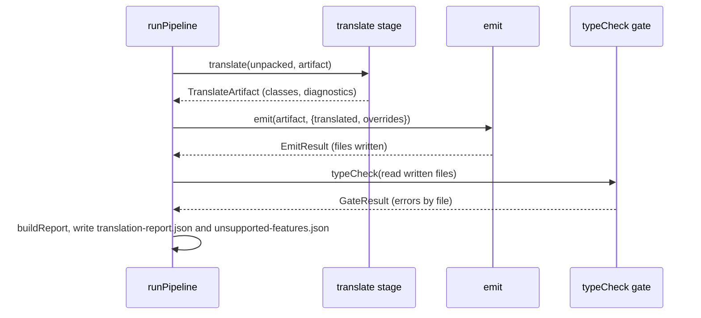

# Design Document: translate

## Overview

The `translate` spec replaces the hand-written `LeftButton` and `RightButton` with a deterministic AS3 to TypeScript Transpiler, and adds a Translate stage, an in-process Type_Check_Gate and a Translation_Report to the Pipeline. The Transpiler is a pure function over the text of one FFDec-decompiled `.as` file. It handles the subset FFDec emits for the Sample_Set (`EventWatcher`, `LeftButton`, `RightButton`, `MainTimeline`). Everything else is kept as a `// AS3:` comment plus a Diagnostic.

Design goals, in priority order:

1. **Nothing is lost silently.** Every non-blank source line ends up translated, structural, a kept comment, or an `// AS3:` comment with a Diagnostic. The accounting is a test property, not a hope.
2. **Deterministic and pure.** Same text in, same text out. The core has no I/O, no clock, no randomness, no locale call, no `typescript` import.
3. **Translated code stays close to the AS3.** Expressions pass through near-verbatim. No regex runs over source lines; a hand-written lexer and a brace-aware statement scanner drive everything.
4. **Verified facts only.** Everything about the repo below was read from the code. Open points are marked **to verify** and are settled by the first task that touches them.

### Facts checked in the repository

- **Fixtures are CRLF and byte-exact.** `.gitattributes` has `test/fixtures/** -text`, and `LeftButton.as` and `EventWatcher.as` contain `\r\n` with whitespace-only lines. Line numbers therefore count blank lines. The Transpiler splits on `\n` and treats a trailing `\r` as part of the line break.
- **`typescript` is 7.0.2, which has no `ts.createProgram`.** Its root export is only `version`/`versionMajorMinor`. The only API is `typescript/unstable/*`, and `dist/api/syncChannel.js` spawns the native binary with `node:child_process`. That breaks "in-process, no child process". See decision D1.
- **Decompiled constructors** call bare `addFrameScript(0,this.frame1,1,this.frame2)` before `super()`. The call is unqualified, so it needs `this.` after the move (not covered by Requirement 3.1).
- **`MainTimeline.as` narrows with `instanceof`.** `else if(!(from instanceof Shape))` then reads `from.name`. If the Shim `Shape` is structurally identical to `DisplayObject`, TypeScript narrows `from` to `never` in that branch and `from.name` fails. The Shim `Shape` therefore declares a member `DisplayObject` lacks (D9).
- **Shim `_step` order per clip** (`template/shim/MovieClip.ts`): advance frame, `_renderFrame`, dispatch `ENTER_FRAME`, enqueue and drain the frame script, then recurse into the children that existed before the tick. `Player.update` calls `root._step()` once per whole frame interval. No `EXIT_FRAME` exists.
- **`Player.createClip`** constructs the class, renders frame 1 (which exposes named children with `Reflect.set` after the constructor returns), then runs the frame-1 script. `ShapeObject` extends `DisplayObject`, so `instanceof Shape` in `MainTimeline.inspect` is false today.
- **tweendemo root** (converted from `test/fixtures/tweendemo`): 48 frames, `l_button@1:6` and `r_button@3:3` present in every frame, plus a tweened `@10:1` that disappears at frame 44. Both samples link `MainTimeline`, `LeftButton`, `RightButton`.
- **Vitest** already aliases `^\.\.\/shim$` to `template/shim/index.ts` (`vitest.config.ts`). Any file importing `'../shim'`, wherever it lives, resolves to the Shim. `.work/` and `out/` are gitignored.

### Key design decisions

| # | Decision | Rationale |
|---|----------|-----------|
| D1 | Add one devDependency, `"typescript-js": "npm:typescript@6.0.3"` (exact, the last JS-based release). Only `src/translate/tsSyntaxCheck.ts` and `src/translate/typeCheckGate.ts` import it. The repo's `typescript` stays 7.0.2 for `npm run typecheck`. | The TS 7 API needs a child process. TS 6.0.3 has `createProgram` and `transpileModule` in-process. The gate runs with no `npm install` at pipeline run time; only the repo setup installs this once. |
| D2 | Lexer plus brace-aware statement scanner; expressions are re-emitted from source slices with token-level edits. No per-line regex. | Multi-line statements, nested braces and strings are handled by structure, not by line patterns. |
| D3 | Line accounting is a list of `LineSpan` records the Transpiler returns next to the text. The property test checks them against a generator that knows its own layout. | Requirement 1.3 needs an observable definition of "accounted". |
| D4 | The parse check is injected: `translate(source, options)` takes `options.syntaxCheck`. The real one wraps `ts.transpileModule` (pure library use, no file system). `translateCore` has no check and no dependency. | Keeps the Transpiler pure and Requirement 1.5 satisfied. Tests can also prove the core never needs the fallback. |
| D5 | On a failed parse check the output becomes the whole file as `// AS3:` comments plus one line-1 Diagnostic. | Output always parses; the class is `unsupported`; nothing is hidden. |
| D6 | Methods used as values are bound once in the declaring class's constructor, right after `super(...)`: `this.m = this.m.bind(this);` | Keeps the prototype method (overrides and `super.m()` work), gives one stable function per instance so `removeEventListener` matches `addEventListener`. See Transpiler section 5. |
| D7 | Fixture_Classes are produced by running the Transpiler at test time into a temp directory under `.work/` and imported through Vitest. | Works with the existing alias; no in-memory plugin to maintain. See section 11. |
| D8 | `EXIT_FRAME` is a separate pass after `root._step()`, driven by `Player.update`. | Requirement 5.2 says after the frame scripts of that Tick; `_step` interleaves children, so a per-clip dispatch inside it would run before later siblings' scripts. |
| D9 | Shim `Shape extends DisplayObject` and declares `readonly graphics: object`. `ShapeObject` extends `Shape`. | Avoids `never` narrowing and makes `instanceof Shape` true for runtime shapes. |
| D10 | `translation-report.json` and `unsupported-features.json` share the canonical JSON writer (`canonicalJson`). | One definition of byte-identical. |

## Architecture

```mermaid
flowchart LR
    U[Unpack] --> C[Convert]
    C --> TS[Translate stage<br/>IO: read scripts/*.as]
    TS --> PT[planTranslate PURE<br/>translate per class,<br/>emit closure]
    PT -->|TranslatedClass[]| E[Emit<br/>planEmit PURE + writer]
    C --> E
    E --> G[Type_Check_Gate<br/>typescript-js in process]
    G --> R[buildReport PURE]
    PT --> R
    R --> OUT[(translation-report.json<br/>unsupported-features.json)]
    E --> P[(Emitted_Project)]
```

### Repository layout (new and changed)

```
src/translate/
  tokenizer.ts       # PURE  lexer: tokens with offset and line
  scanner.ts         # PURE  brace-aware structure scan -> nodes with line spans
  rewrite.ts         # PURE  token-level expression and type rewriting
  emitTs.ts          # PURE  assembles output text + LineSpan[] + Diagnostic[]
  translate.ts       # PURE  translateCore(), translate()
  shimNames.ts       # PURE  AS3-visible Shim names and MovieClip instance members
  planTranslate.ts   # PURE  all classes -> TranslatedClass[], emit closure
  report.ts          # PURE  Class_Status, buildReport, unsupported entries
  tsSyntaxCheck.ts   # imports typescript-js; no I/O
  typeCheckGate.ts   # imports typescript-js; reads node_modules/lib through ts.sys
  translateStage.ts  # IO: reads scripts dir
src/pipeline/        # pipeline.ts, cli.ts, errors.ts changed
src/emit/            # planEmit.ts, emit.ts changed
template/shim/       # events.ts, Sprite.ts, MovieClip.ts, internal.ts, index.ts changed;
                     # Shape.ts, trace.ts, ADDED_APIS.md new
template/runtime/    # player.ts, stageTree.ts changed
test/support/fixtureClasses.ts   # transpile-and-import helper
test/fixtures/{clickgoto,tweendemo}/scripts/EventWatcher.as   # added unedited
handwritten/clickgoto/           # LeftButton.ts and RightButton.ts deleted (.gitkeep stays)
```

### Pipeline sequence



## Components and Interfaces

### 1. Transpiler (`src/translate/translate.ts`)

```ts
export type DiagnosticKind = 'unsupported-construct' | 'loose-type';
export interface Diagnostic { kind: DiagnosticKind; line: number; message: string }   // line is 1-based

export type SyntaxCheck = (tsText: string) => ReadonlyArray<{ line: number; message: string }>;

export interface TranslateOptions {
  shimNames: ReadonlySet<string>;        // AS3-visible names the Shim exports (shimNames.ts)
  shimMembers: ReadonlySet<string>;      // MovieClip instance members callable unqualified
  siblingClasses: ReadonlySet<string>;   // other classes exported next to this file
  syntaxCheck: SyntaxCheck;              // injected parser (D4)
}

export interface LineSpan {
  startLine: number; endLine: number;    // 1-based, inclusive
  kind: 'translated' | 'structural' | 'dropped' | 'comment' | 'unsupported';
}
export interface ClassInfo { name: string; extendsName: string | null }

export interface TranslateResult {
  text: string;                          // LF line endings, one trailing newline, '' for blank input
  diagnostics: Diagnostic[];             // sorted by (line, kind, message), UTF-16 code unit order
  spans: LineSpan[];                     // sorted by startLine; used by tests and the report
  classes: ClassInfo[];                  // classes declared in the file (0 or 1 in practice)
}

export function translateCore(source: string, options: Omit<TranslateOptions, 'syntaxCheck'>): TranslateResult;
export function translate(source: string, options: TranslateOptions): TranslateResult;   // core + parse check
```

`translate` calls `translateCore`, then `options.syntaxCheck(text)`. If it returns any error, the result is replaced by the fallback of D5 (all lines as `// AS3:` comments, one `unsupported-construct` Diagnostic on line 1 saying the output did not parse and quoting the first parser message, `spans` = one `unsupported` span over the file). Blank or whitespace-only input returns `text: ''`, no Diagnostics and skips the check (Req 1.6). Input `\r\n` is normalised to `\n` before lexing, so CRLF and LF inputs give identical results; a lone `\r` inside a line is kept in the line text.

#### 1.1 Lexer (`tokenizer.ts`)

A character-level scanner (no regular expressions on source text). A `Token` is `{ kind, text, start, end, line, endLine }` with kind `id | num | str | regex | punct | comment | bad`. Whitespace is skipped but offsets are kept, so any token range maps back to a source slice and to lines.

- Punctuation uses longest match over the AS3 operator set, including `>>>=`, `...`, `.<` (the start of `Vector.<T>`), `::`, `..`, `===`, `!==`.
- `/` starts a regex literal when the previous significant token is not an identifier, number, string, `)` or `]`; otherwise it is division.
- Strings end at their closing quote or at a newline; an unterminated string becomes a `bad` token to end of line. An unterminated block comment becomes a `bad` token to end of file.
- Comment tokens are kept in the token stream (needed for accounting, section 1.3).

#### 1.2 Statement scanner (`scanner.ts`)

Scans tokens by structure. Three levels, each tracking `()`, `[]`, `{}` depth so a `;` or `}` inside a nested group never ends a node.

| Level | Recognised | Anything else |
|-------|------------|---------------|
| File | `package [name] {`, `import ...;`, `[Meta(...)]`, `class`, closing `}` | `Unsupported` node: consume balanced groups to a `;` at depth 0 or the end of a depth-0 `{...}` block |
| Class body | metadata, modifiers, `var`/`const` fields, `function [get\|set] name(params)[:type] {...}` | same rule, as an unsupported member |
| Statement | block, `if`/`else`, `for`, `for each`, `while`, `do..while`, `return`, `throw`, `break`, `continue`, `var`/`const`, expression statement | the keywords `try`, `switch`, `with`, `delete`, `namespace`, `use`, `include`, `default xml`, a nested `function`, a label, plus E4X markers (`..`, `@`, `::`, `.(`, the names `XML` and `XMLList`) anywhere in the statement's own tokens |

Rules that keep output parseable:

- A statement that is unsupported by its own tokens becomes one `Unsupported` node. For a compound statement (`if`, `for`, ...) the check covers the **header only**; if the header is unsupported the whole compound statement is the node, since it cannot be emitted partly. The unsupported scan for `try` continues over `catch` and `finally` blocks.
- Compound bodies are always emitted in braces (`if (c) {` ... `}`), so an unsupported statement that was an unbraced body still leaves valid syntax.
- A `{` that never closes makes the construct that opened it unsupported from its first line to end of file.
- Every node records `startLine` and `endLine` from its first and last token. Comments inside a node belong to it. A comment on the same line as the end of a node trails it; any other comment between nodes becomes its own `comment` span, emitted whole (so a multi-line block comment is never split).

#### 1.3 Line accounting

`emitTs.ts` records one `LineSpan` per node:

| Kind | Source |
|------|--------|
| `translated` | class, field, method, accessor, statement |
| `structural` | `package` header and its braces, class header lines, closing braces |
| `dropped` | `import` lines (replaced by the generated imports) and metadata lines (Req 2.3) |
| `comment` | comments outside any node, copied verbatim |
| `unsupported` | emitted as `// AS3: <line>` for each source line of the span |

Rules:

- A span covers all its lines; consecutive nodes may share a line (`a(); b();` is two nodes on one line).
- An `unsupported` span emits one comment line per source line, with trailing whitespace trimmed, and one `unsupported-construct` Diagnostic carrying the span's **first** line. This is one Diagnostic per statement, as Requirement 3.5 says, not one per line (Requirement 1.3 read literally would give one per line; see Issues).
- In comment text, `\r`, U+2028 and U+2029 are written as the escapes `\r`, `\u2028`, `\u2029`, because JavaScript ends a `//` comment at any of them.
- Generated text with no source line (the import lines, the `bind` statements, `super();`) belongs to no span and is allowed.

#### 1.4 Expression and type rewriting (`rewrite.ts`)

`emitExpr(tokens)` copies the source text between tokens unchanged and applies the token rules below. Each rule fires on a token pattern and matching parentheses found by depth counting.

| Pattern | Output | Diagnostic |
|---------|--------|------------|
| `int ( X )` | `(X \| 0)`; if X has a depth-0 token of lower precedence than `\|` (`\|\|`, `&&`, `??`, `?`, any assignment, `,`) then `((X) \| 0)` | none |
| `uint ( X )` | `(X >>> 0)`, same wrapping rule | none |
| `int` or `uint` not followed by `(` and not in a type position | statement becomes unsupported | `unsupported-construct` |
| `a is T`, `a instanceof T` | `a instanceof T`; if `T` is `int`, `uint`, `Number`, `String`, `Boolean`, `Object`, `Array` the statement is unsupported (JS `instanceof` is wrong for primitives) | as stated |
| `a as T` | `a as T` with `T` mapped | none |
| `trace ( ... )` | unchanged call; `trace` joins the import list (Req 2.7) | none |
| bare call `name(` where `name` is in `shimMembers` or is a non-static method of this class, not a parameter or local | `this.name(` | none |
| `<chain>.parent.<member>` where `<chain>` is `this` or an identifier chain | `(<chain>.parent as any).<member>` | one `loose-type` per access (Req 3.4) |
| `Vector.<T>` | `T[]` with `T` mapped | none |

Type mapping (Req 2.5): `int`, `uint`, `Number` to `number`; `String` to `string`; `Boolean` to `boolean`; `*` and `Object` to `any`; `Array` to `any[]`; `void` stays; other names are kept. Loose types (Req 2.8): a variable, parameter or field with no annotation or `*` gets `any` and one `loose-type` Diagnostic on its line. `Object` gets none. A function with return type `*` or none returns `void` if no `return` statement in its own body (not nested) carries an expression, with no Diagnostic (Req 2.6); otherwise it returns `any` with one `loose-type`. In `for ( var k : T in ...)` and `for each` heads the annotation is dropped silently (TypeScript forbids it there).

Unqualified calls to members inherited from another translated class (a sibling) are not rewritten; the Type_Check_Gate flags them. This is a known limit, listed under Risks.

#### 1.5 Output of declarations

| AS3 | TypeScript |
|-----|-----------|
| `package { ... }` / `package a.b { ... }` | wrapper removed, contents kept, no namespace (Req 2.1) |
| `import flash.x.Y;` / `flash.x.*;` | all removed; one `import { ... } from '../shim';` listing the names the class body references and `shimNames` contains, sorted by code unit; none if empty (Req 2.2) |
| reference to a name in `siblingClasses` (`extends EventWatcher`, field type `LeftButton`) | one `import { X } from './X';` per name, sorted, after the shim import |
| `[Embed(...)]`, `[SWF(...)]`, any `[Name(...)]` before a class or member | dropped, no Diagnostic (Req 2.3) |
| `public class C extends B` | `export class C extends B` (every class is exported) |
| `public var x:T = e;` | `public x: T = e;` |
| `internal var x:* = 0;` | `x: any = 0;` plus `loose-type` |
| `var x:T;` without initialiser, `T` numeric/boolean | `x: number = 0;` / `x: boolean = false;` (AS3 defaults) |
| `public var x:C;` without initialiser, other `T` | `public declare x: C;` |
| `const x:T = e;` | `readonly x: T = e;` |
| `static`, `override`, `private`, `protected`, `public` | kept; `internal` emitted as no modifier; `final` and `dynamic` dropped |
| `public function C() {...}` (name equals class) | `constructor() {...}` |
| `function get a():T` / `function set a(v:T):void` | `get a(): T` / `set a(v: T)` (no return annotation on setters) |
| accessor pair with different types | both use the getter's type; one `loose-type` on the setter line (Req 3.6) |
| local `var x:T = e` | `var x: T = e` (`var` stays; type mapped) |
| `for each (var x:T in y)` | `for (const x of y)` |
| `...rest` parameter | `...rest: any[]` plus `loose-type` |

`declare` for no-initialiser typed fields matters: the Player exposes named timeline children with `Reflect.set` after the constructor returns, but a field initialiser emitted for `l_button` would run after `super()` returns and could overwrite a child exposed earlier by a base-class `gotoAndStop`. `declare` emits nothing. **To verify** in the first task that Vite's transform in Vitest and `vite build` both accept `public declare x: T;`.

#### 1.6 Constructors (Req 3.1, 3.2)

The scanner finds the constructor and the `super(...)` call statement. Output order is: `super(args)` exactly as written (arguments unchanged), then the `bind` statements (section 5), then every other original statement in its original relative order. If a class with `extends` has no `super(...)` call, `super();` is inserted first. If a class with `extends` needs bindings but has no constructor, `constructor() { super(); ...binds }` is synthesised. A class without `extends` gets `constructor() { ...binds }` when binds exist.

#### 1.7 Method-as-value binding (Req 3.3, decision D6)

A method is a **value-referenced method** when the class body contains `this . name` not followed by `(`, and `name` is a non-static method (not an accessor) declared in this class. For each such method, in declaration order, the constructor gets `this.name = this.name.bind(this);` after `super(...)`.

Why this and not an arrow field (`name = (...) => {...}`):

- A class field is an own property assigned at construction. It shadows the prototype, so a subclass that overrides `name`, or calls `super.name()`, breaks.
- `bind` after `super()` reads `this.name` through the prototype chain at that moment, so the most-derived override is the one bound, and the prototype method stays intact.

Interaction with `removeEventListener`: after the constructor, `this.name` is an own property holding one bound function. `this.addEventListener(T, this.name)` and `this.removeEventListener(T, this.name)` both read that same property, so the Shim's identity-based listener list (`list.includes(listener)`, `indexOf`) matches, and adding twice still registers once. AS3 method closures have the same stable identity. Known edge: if a base class constructor registers `this.m` before a subclass that overrides `m` rebinds it in its own constructor, the listener registered earlier has the old identity. None of the Sample_Set does this; a test pins the behaviour (section Testing).

### 2. Shim names (`src/translate/shimNames.ts`)

```ts
export const SHIM_AS3_NAMES: ReadonlySet<string>;     // Event, EventDispatcher, MouseEvent, DisplayObject,
                                                      // DisplayObjectContainer, Sprite, MovieClip, Shape, trace
export const SHIM_MOVIECLIP_MEMBERS: ReadonlySet<string>; // play, stop, gotoAndPlay, gotoAndStop, addFrameScript,
                                                      // addEventListener, removeEventListener, hasEventListener,
                                                      // dispatchEvent, addChild, removeChild, getChildByName, getChildAt
```

A unit test imports `template/shim/index.ts` and asserts every name in `SHIM_AS3_NAMES` is an export, and every member in `SHIM_MOVIECLIP_MEMBERS` exists on `MovieClip.prototype` (so the lists cannot drift from the Shim).

### 3. Translate stage and planning (`planTranslate.ts`, `translateStage.ts`)

```ts
export interface ScriptSource { className: string; source: string }          // className = file stem

export interface TranslatedClass {
  className: string; fileName: string;                                        // "<ClassName>.ts"
  text: string; diagnostics: Diagnostic[]; spans: LineSpan[];
  extendsName: string | null;
}
export interface TranslateArtifact { classes: TranslatedClass[] }             // emitted set only, sorted by className

/** PURE. Transpiles every source, then keeps the emit closure. */
export function planTranslate(sources: ScriptSource[], scene: SceneJson, syntaxCheck: SyntaxCheck): TranslateArtifact;

/** IO. Reads every .as under unpacked.scriptsDir (recursive, sorted by path), then planTranslate. */
export function translateStage(unpacked: UnpackResult, artifact: ConvertedArtifact): Promise<TranslateArtifact>;
```

`planTranslate`:

1. `siblingClasses` = all file stems; `shimNames`/`shimMembers` from section 2.
2. Translate every source (sorted by className).
3. **Emit closure (Req 4.3):** start with the class names linked in the Scene_JSON (`symbols[*].className`) that have a translated class; repeatedly add `extendsName` of an included class when that name has a translated class. The result is the emitted set. For the Sample_Set: `MainTimeline`, `LeftButton`, `RightButton`, and `EventWatcher` through `extends`.
4. Return the emitted classes sorted by name. Unlinked, non-base classes are not emitted and not reported.

`translateStage` never reads `samples/*/original-source/` (Req 4.1): the only path it receives is `unpacked.scriptsDir`. A duplicate class name across nested directories throws `DuplicateClassError` (stage `translate`). Only flat `scripts/<Class>.as` is verified against FFDec (tech.md); nested package directories are read too but not verified.

### 4. Emitter changes (`src/emit/`)

```ts
export interface EmitOptions { /* existing */ translated: readonly TranslatedClass[]; handwrittenDir: string | null }  // handwrittenDir is the Override_Directory
export interface EmitInput  { /* existing */ translated: TranslatedClass[]; handwritten: HandwrittenClass[] }
export interface EmitResult { outputDir: string; files: string[] }                        // unchanged
export function buildClassesTs(scene: SceneJson, classNames: readonly string[]): string;  // names -> './Name'
```

`planEmit` rules (Req 4.2, 4.3, 5.5):

- `available(name)` = an override file `<name>.ts` exists, or a translated class exists. Source text = override if present, else translated text.
- Files written to `src/<name>.ts` for every emitted translated class (the closure) and for every override whose class is linked or is in the closure. An override file for any other name is ignored and listed in `warnings`.
- `src/classes.ts` registers exactly the Scene_JSON-linked names with `available(name)` (for the Sample_Set `LeftButton`, `MainTimeline`, `RightButton`), sorted by code unit. `EventWatcher` is emitted but not registered.
- The existing `handwritten` input stays and now means Override_Directory. With `handwritten/clickgoto/` holding only `.gitkeep`, zero files are copied (Req 5.5).
- `package.json` is unchanged (still exact versions from `versions.ts`).

Removing the handwritten classes also removes the `typecheck:handwritten` script and `tsconfig.handwritten.json` from the repo: with no `.ts` file under `handwritten/`, `tsc -p tsconfig.handwritten.json` fails with TS18003 (no inputs). Override files are type-checked by the Type_Check_Gate anyway, because they are copied into the Emitted_Project.

### 5. Type_Check_Gate (`typeCheckGate.ts`)

```ts
export interface GateInput {
  files: ReadonlyMap<string, string>;   // the whole Emitted_Project: posix relative path -> text
  repoRoot: string;                     // where node_modules/pixi.js is found
}
export interface GateError { file: string; line: number; column: number; code: number; message: string }
export interface GateResult { errors: GateError[] }          // sorted by (file, line, column, code, message)
export function typeCheckProject(input: GateInput): GateResult;
```

Approach: `ts.createProgram` from `typescript-js` with a custom `CompilerHost`.

- **Virtual root.** The project is mounted at `V = <repoRoot>/__gate__/`, a directory that does not exist on disk. The host answers `fileExists`, `readFile`, `directoryExists`, `getDirectories` and `realpath` for paths under `V` from the `files` map, and delegates every other path to `ts.sys`.
- **Why `pixi.js` resolves with no custom resolver.** From `V/runtime/pixi/pixiBackend.ts`, normal module resolution walks up `V/.../node_modules`, then `<repoRoot>/node_modules/pixi.js`, which is the installed 8.22.0. No `npm install` happens, no child process. The Shim and runtime files come from `files` (they are part of the Emitted_Project), not from `template/` on disk.
- **Options.** Read `tsconfig.json` from `files`, then `ts.convertCompilerOptionsFromJson(json.compilerOptions, V)` and force `noEmit: true`. That gives the emitted settings (`strict`, `moduleResolution: Bundler`, `lib` with DOM, `types: []`, `skipLibCheck`). Root files are the `.ts` files whose first path segment is in the tsconfig `include` list (`src`, `runtime`, `shim`), so `vite.config.ts` (which imports `vite`) is not a root. Default libs come from `ts.getDefaultLibFilePath` of the alias package.
- **Attribution (Req 4.6).** `ts.getPreEmitDiagnostics(program)`; each diagnostic's `file.fileName` minus the `V/` prefix is the project path. Diagnostics with no file or a file outside `V` get the path `""` or `node_modules/...`. The pipeline maps `src/<Class>.ts` to that class and everything else to `otherErrors`.
- **Messages** use `ts.flattenDiagnosticMessageText`, with `V/` and `repoRoot` replaced by `<out>` and `<repo>` so the report has no absolute paths.
- The Pipeline's real `typeCheck` stage reads the written files back from `result.outputDir` into the map, so the check covers the written project. Tests pass an in-memory map.

TypeScript version note: the gate checks with 6.0.3, `npm run typecheck` in the Emitted_Project uses the pinned 7.0.2. A rare disagreement is possible; Requirement 5.6 additionally requires `npm run build` (e2e).

### 6. Translation_Report (`report.ts`)

```ts
export type ClassStatus = 'clean' | 'loose' | 'unsupported';
export interface TypeErrorEntry { line: number; column: number; code: number; message: string; as3Line: number | null }
export interface ClassReportEntry {
  className: string; status: ClassStatus; overridden: boolean;
  diagnostics: Diagnostic[];             // sorted (line, kind); empty when overridden
  typeErrors: TypeErrorEntry[];          // sorted (line, column, code); line is the emitted .ts line
}
export interface TranslationReport {
  formatVersion: 1;
  typeCheck: 'ran' | 'skipped';
  classes: ClassReportEntry[];           // one per emitted class, sorted by className
  otherErrors: GateError[];              // errors in non-class files
}
export function classStatus(diags: readonly Diagnostic[], typeErrorCount: number): ClassStatus;
export function buildReport(classes: readonly ReportClassInput[], gate: GateResult | null): TranslationReport;
export function serialiseReport(r: TranslationReport): string;           // canonicalJson
export function untranslatedCodeEntries(classes: readonly TranslatedClass[], overridden: ReadonlySet<string>): UnsupportedFeatureEntry[];
```

- `classStatus`: any `unsupported-construct` Diagnostic or any type error gives `unsupported`; else any `loose-type` gives `loose`; else `clean` (Req 4.7). An overridden class has no Diagnostics, so its status is `clean` or `unsupported` from type errors alone.
- `as3Line` maps a type error's emitted line back to the AS3 line through `spans` plus the emitted line of each node; `null` when the line is generated or the class is overridden. It is a convenience, never used for status.
- `serialiseReport` is `canonicalJson`: sorted keys, two-space indent, one trailing newline (byte-identical for equal input, Req 4.4).
- **Unsupported-features integration (Req 4.5).** `untranslatedCodeEntries` emits one `{ kind: 'untranslated-code', tag: <ClassName>, message: 'line <n>: <diagnostic message>' }` per `unsupported-construct` Diagnostic of every emitted, non-overridden class. `UnsupportedKind` in `src/convert/model.ts` gains `'untranslated-code'`. The existing `untranslated-class` entry now means: linked class with neither a translated class nor an override.

### 7. Pipeline wiring (`src/pipeline/`)

```ts
export interface PipelineStages {                // gains two members; unpack/convert/emit unchanged
  translate(u: UnpackResult, a: ConvertedArtifact): Promise<TranslateArtifact>;
  typeCheck(outputDir: string, files: readonly string[]): Promise<GateResult>;
}
```

`PipelineStage` in `errors.ts` gains `'translate'`. Order in `runPipeline`:

1. unpack, convert (unchanged).
2. `translate`, printing `[translate] ok (<n> classes: <c> clean, <l> loose, <u> unsupported)`.
3. `emit(artifact, { ..., translated: translateArtifact.classes })`.
4. `typeCheck(result.outputDir, result.files)`; print `[typecheck] ok (0 errors)`, or on stderr `[typecheck] <n> errors: src/Foo.ts (2), runtime/x.ts (1)` (Req 4.7). Type errors do **not** change the exit code (translation problems are reported, not fatal); they set the class status to `unsupported`.
5. Build the report, then write `translation-report.json` next to `unsupported-features.json` in the same places and under the same refusal rule: written after success, and after a failure once Convert completed, except the 5.8/5.10 output-directory refusals, where it goes to stderr. If emit failed, the gate did not run and the report has `typeCheck: 'skipped'`.
6. `unsupported` list = Converter entries + `untranslatedCodeEntries` + `untranslated-class` entries for linked classes with no available source. The existing `untranslatedClasses` helper takes the set of available names (translated or overridden) instead of `handwrittenClasses`.

`PipelineArgs.handwrittenClasses` keeps its meaning (override names) and feeds the `overridden` set. `cli.ts` wires `translate: translateStage` and `typeCheck` (reads files, builds the map, calls `typeCheckProject` with `repoRoot = REPO_ROOT`). The `--handwritten` flag and the default `handwritten/<sample>/` lookup are unchanged.

### 8. Shim additions (`template/shim/`, `template/runtime/`)

Only what the four classes use (Req 5.1):

| Addition | Where | Behaviour |
|----------|-------|-----------|
| `Event.EXIT_FRAME` `'exitFrame'`, `ADDED` `'added'`, `ADDED_TO_STAGE` `'addedToStage'`, `FRAME_CONSTRUCTED` `'frameConstructed'`, `REMOVED` `'removed'`, `REMOVED_FROM_STAGE` `'removedFromStage'`, `RENDER` `'render'` | `events.ts` | distinct strings, different from `'enterFrame'` and `'click'`; only `EXIT_FRAME` is ever dispatched besides the existing two |
| `DisplayObjectContainer.getChildAt(index)` | `Sprite.ts` | returns `_children[index]`; throws `RangeError` when out of range, as AS3 does |
| `Shape` | `Shape.ts` | `class Shape extends DisplayObject { readonly graphics: object = {} }` (D9) |
| `trace(...args)` and `setTraceSink(fn \| null)` | `trace.ts` | default sink `console.log(...args)`; `setTraceSink(null)` restores it; `trace` is exported from `index.ts` with `Shape` and `setTraceSink` |
| `ShapeObject extends Shape` | `stageTree.ts` | so `instanceof Shape` is true for runtime shapes |
| `MovieClip._exitFrame()` and `internal.exitFrame(mc)` | `MovieClip.ts`, `internal.ts` | see below |

**EXIT_FRAME (D8).** In the Shim's `_step` each clip does: advance, render, `ENTER_FRAME`, frame script, then its children. After `root._step()` returns, every ENTER_FRAME listener and every frame script of the tick has run. `Player.update` then calls `exitFrame(root)` once per whole frame step:

```
exitFrame(root):
  clips = pre-order list of every MovieClip under root at this moment (snapshot)
  for clip in clips: if clip is still attached to root: dispatch EXIT_FRAME to it
```

So every MovieClip on the stage receives `EXIT_FRAME` exactly once per tick, after all frame scripts (Req 5.2), playing or stopped. A clip created by an `EXIT_FRAME` listener is not notified this tick. Clicks and `gotoAnd*` calls do not dispatch it. With the fixture classes, `MainTimeline` sets `destroy_me` on tick 30's ENTER_FRAME and calls `stop()` in tick 30's EXIT_FRAME: the root is playing after 29 ticks and stopped after 30 (so also after 31).

`template/shim/ADDED_APIS.md` is a table `| API | Needed by |` with one row per addition, citing the first fixture line that uses it (fixture lines count blank lines): `Event.EXIT_FRAME` (`EventWatcher.as:23`), `Event.ADDED` (`:24`), `Event.ADDED_TO_STAGE` (`:25`), `Event.FRAME_CONSTRUCTED` (`:26`), `Event.REMOVED` (`:27`), `Event.REMOVED_FROM_STAGE` (`:28`), `Event.RENDER` (`:29`), `trace` (`EventWatcher.as:17`), `getChildAt` (`MainTimeline.as:36`), `Shape` (`MainTimeline.as:51`). The row for `setTraceSink` and `_exitFrame` states they support `trace` and `EXIT_FRAME` rather than being used by a class.

### 9. Fixture_Classes loader (`test/support/fixtureClasses.ts`)

```ts
export interface FixtureClasses {
  classes: Record<string, new () => MovieClip>;      // every translated class that is a Scene_JSON class
  results: Map<string, TranslateResult>;
  dispose(): Promise<void>;                          // removes the temp directory
}
export function loadFixtureClasses(sample: 'clickgoto' | 'tweendemo'): Promise<FixtureClasses>;
```

Steps: read `test/fixtures/<sample>/scripts/*.as` (including the added `EventWatcher.as`); call `planTranslate` with the real `tsSyntaxCheck`; `mkdtemp` a directory under `<repo>/.work/fixture-classes/`; write each class as `<dir>/<Class>.ts`; `await import(pathToFileURL(file).href)` each. The files import `'../shim'`, which the existing Vitest alias maps to `template/shim/index.ts`, and `'./EventWatcher'` resolves inside the directory. A unique directory per call avoids races between test files that load the same sample in parallel. `dispose` runs in `afterAll`. The helper calls `setTraceSink(() => {})` in `beforeAll` and restores it in `afterAll` so the test run stays quiet.

**To verify** in the first task, against the real oracle: that Vitest 5.1 transforms and imports an absolute-path `.ts` file under `.work/` (it should; the root is the repo). Fallback if it does not: a small Vite plugin in `vitest.config.ts` with a virtual module `virtual:fixture/<sample>/<Class>` whose `load` runs the Transpiler, with the same helper API.

### 10. Tests that change

- `test/unit/clickOracle.test.ts`: imports `loadFixtureClasses('clickgoto')` instead of `handwritten/...`; `classRegistry` is `{ LeftButton, MainTimeline, RightButton }`, matching what the Pipeline registers. Expected_State rows, positions and assertions stay unchanged (Req 5.7). The first test (`toBeInstanceOf`) uses the loaded classes.
- `test/unit/tweendemoClasses.test.ts` (new): converts `test/fixtures/tweendemo` as `tweendemoConvert.test.ts` does, loads Fixture_Classes, builds a `Player` with a `FakeBackend`, runs one Tick, expects `l_button` and `r_button` at `currentFrame` 1 and not playing; then runs 30 more ticks and expects the root stopped (Req 5.8, 5.2).
- `test/unit/pipeline.test.ts`, `test/e2e/pipeline.e2e.test.ts`: stub `translate` and `typeCheck` stages; the e2e also asserts `translation-report.json` for both samples.

## Data Models

`Diagnostic`, `LineSpan`, `TranslateResult`, `TranslatedClass`, `GateError`, `ClassReportEntry` and `TranslationReport` are defined in the sections above. Additional shapes:

```ts
// translation-report.json (canonical JSON), clickgoto example
{
  "classes": [
    { "className": "EventWatcher", "diagnostics": [], "overridden": false, "status": "clean", "typeErrors": [] },
    { "className": "LeftButton",  "diagnostics": [{ "kind": "loose-type", "line": 19, "message": "member access on parent typed as any" }],
      "overridden": false, "status": "loose", "typeErrors": [] },
    ...
  ],
  "formatVersion": 1,
  "otherErrors": [],
  "typeCheck": "ran"
}
```

Diagnostic messages are short fixed strings built from the construct (for example `statement kind 'try' is not supported`, `declaration has no usable type; emitted as any`, `member access on parent typed as any`), so the same input gives the same message.

`UnsupportedKind` (in `src/convert/model.ts`) gains `'untranslated-code'`. `UnsupportedFeatureEntry` is unchanged; the class goes in `tag` and the line in `message`.

### Expected translation of `LeftButton.as` (illustrates the rules)

```ts
import { Event, MouseEvent, trace } from '../shim';
import { EventWatcher } from './EventWatcher';

export class LeftButton extends EventWatcher {
  constructor() {
    super();
    this.clicked = this.clicked.bind(this);
    this.frame1 = this.frame1.bind(this);
    this.frame2 = this.frame2.bind(this);
    this.addFrameScript(0,this.frame1,1,this.frame2);
    this.addEventListener(MouseEvent.CLICK,this.clicked);
    this.stop();
  }
  public clicked(event: Event): void {
    trace("///(LeftButton clicked...)");
    this.gotoAndStop(2);
    (this.parent as any).r_button.gotoAndStop(1);
  }
  frame1(): void { ... }
  frame2(): void { ... }
}
```

(One `loose-type` Diagnostic, on the `this.parent.r_button` line, so the class is `loose`.) `EventWatcher` is `clean`, `MainTimeline` is `loose` (the `*` variables), satisfying Requirement 5.9.

## Issues found in requirements

None blocks the design. These need a decision or a note:

1. **TypeScript 7 has no in-process compiler API** (Requirements 4.6, 5.6 assume `ts.createProgram`). Resolved by D1. The first task adds the devDependency with `npm install --save-exact --save-dev typescript-js@npm:typescript@6.0.3`; that is an install on the dev machine, not on a pipeline run. Per the git-workflow stop rule, confirm this with the user before the task runs.
2. **Requirement 1.3 vs 3.5.** 1.3 reads as one Diagnostic per source line; 3.5 says one per replaced statement. The design emits one Diagnostic per unsupported span at its first line, and the accounting property checks that every line of the span is inside it. Suggest rewording 1.3 to "per unsupported span".
3. **Requirement 2.2** mentions only the `../shim` import. `MainTimeline`, `LeftButton`, `RightButton` extend `EventWatcher` in the same package, so `./EventWatcher` style sibling imports are required. Added without changing the Requirement 5.5 file set.
4. **Requirement 3.1** says nothing about the bare `addFrameScript(...)` call. After the move it must read `this.addFrameScript(...)` or TypeScript rejects it. Rule in section 1.4.
5. **Requirement 5.2 says 31 Ticks.** The root stops on tick 30 (the 30th `ENTER_FRAME` sets `destroy_me`, the same tick's `EXIT_FRAME` stops it). Tests assert playing after 29, stopped after 30, so the 31-tick wording holds.
6. **Requirement 4.7 does not set an exit code** for type errors. Design: exit 0, errors printed and recorded.
7. **Requirement 5.5** needs `typecheck:handwritten` removed rather than "exit 0": `tsc -p` with no inputs exits non-zero (TS18003). Removed together with `tsconfig.handwritten.json`.
8. **`Shape` structure** (D9) is not in Requirement 5.1's wording ("a `Shape` class extending `DisplayObject`"); the `graphics` member is the minimum that keeps `MainTimeline.as` type-checking.

## Correctness Properties

*A property is a characteristic or behavior that should hold true across all valid executions of a system: essentially, a formal statement about what the system should do. Properties serve as the bridge between human-readable specifications and machine-verifiable correctness guarantees.*

Only the Transpiler's three required properties are written as properties. Everything else in the prework is an example, integration or smoke test (Testing Strategy). Reflection: determinism (1.2) is independent of accounting (1.3, 1.4) and parse-or-report (1.5); 1.4 is the unsupported half of 1.3 and 3.5 is covered by generators that place unsupported statements inside method bodies, so no separate properties.

### Property 1: Translation is deterministic

*For any* AS3 text (generated from the supported grammar with unsupported statements, blank lines and comments mixed in, plus arbitrary token soup) and any options, `translate` run twice returns byte-identical `text` and equal `diagnostics` in the same order (same kind, line and message), and running it on the CRLF form of the same text returns the same `text` and `diagnostics` as the LF form.

**Validates: Requirements 1.1, 1.2**

### Property 2: Every source line is accounted for

*For any* generated program in which every statement and member carries a unique marker string and the generator records the first line of each unsupported statement, and *for any* token soup: (a) every marker appears in the output exactly once, either in translated code or inside a `// AS3:` comment; (b) there is exactly one `unsupported-construct` Diagnostic per unsupported statement, carrying that statement's first source line, and none other; (c) every non-blank source line lies inside at least one returned `LineSpan`, and every span lies within `1..N`; (d) for each `unsupported` span, each non-blank source line of the span appears as a `// AS3: ` comment line in order.

**Validates: Requirements 1.3, 1.4, 3.5**

### Property 3: Output parses or the failure is reported

*For any* input (the grammar generators of Property 2 and token soup), the `translate` output parses with the real TypeScript parser with zero syntax errors, checked by an independent `ts.transpileModule` call in the test, or the Diagnostics contain an `unsupported-construct` on line 1 stating that the output does not parse. *For any* input from the supported-plus-unsupported grammar, `translateCore` output already parses, so the line-1 fallback never fires on it. Blank-only input returns empty text and no Diagnostics.

**Validates: Requirements 1.5, 1.6, 3.5**

## Error Handling

| Condition | Behaviour | Req |
|-----------|-----------|-----|
| Unrecognised construct, unclosed brace, lexer `bad` token | span kept as `// AS3:` comments, one Diagnostic; processing continues | 1.4 |
| Output fails the injected parse check | whole file becomes comments, one line-1 Diagnostic, class `unsupported` | 1.5 |
| `int`/`uint` used in a way the rule cannot rewrite | that statement unsupported | 2.5 |
| Scripts directory missing or unreadable | `ScriptsDirError` (stage `translate`), exit 1 | 4.1 |
| Two scripts declare the same class name | `DuplicateClassError` (stage `translate`), exit 1 | 4.1 |
| Gate throws (internal TypeScript error, unreadable `node_modules/pixi.js`) | `TypeCheckGateError` (stage `pipeline`); report written with `typeCheck: 'skipped'` | 4.6 |
| Gate reports type errors | summary on stderr, class status `unsupported`, outputs still written, exit code unchanged | 4.7 |
| Emit fails after translate | report with `typeCheck: 'skipped'`; on 5.8/5.10 refusals the report goes to stderr like `unsupported-features.json` | 4.4 |
| Override file for a class that is neither linked nor a base | ignored, one warning | 4.2 |
| Linked class with no translated class and no override | `untranslated-class` entry, plain `MovieClip` at runtime | 4.5 |
| Listener registered for an event the Shim never dispatches | accepted, called 0 times | 5.1 |
| `getChildAt` out of range | `RangeError` | 5.1 |

`TypeCheckGateError` uses stage `pipeline` because the gate runs after emit and is not a translate failure. All new errors extend `PipelineError` and name the path or class.

## Testing Strategy

### Libraries and runner

Vitest (`npm test -- --run`) and fast-check, as in `vertical-slice`. Each of the three properties is one `fc.assert` test with at least 100 runs (shared `test/property/config.ts`), tagged `// Feature: translate, Property <n>: <title>`. No property-testing code is hand-rolled. The independent parser in Property 3 is `typescript-js`'s `transpileModule`, called in the test, not through `tsSyntaxCheck`.

### Generators (`test/property/gen/genAs3.ts`)

- `genProgram`: builds a package, optional imports and metadata, a class with fields, accessors and methods whose bodies are lists of statements drawn from: supported forms (assignments, calls, `var` with types, `if`/`for`/`for each`/`while` with braced and unbraced bodies, `int()`/`uint()`, `is`/`as`, `trace`, `this.parent.x`), unsupported forms (`try`, `switch`, `with`, `delete`, nested `function`, E4X `..`), blank lines, comments (line and multi-line block) and mixed `\n`/`\r\n`. Each statement contains a unique marker string; the generator records marker, first line and whether it is unsupported.
- `genSoup`: random sequences of AS3 tokens, brackets and keywords with no structure, including unbalanced braces and unterminated strings and comments, and Unicode (U+2028/2029) in comments and strings.

### Unit and example tests

| Area | Tests |
|------|-------|
| Lexer | regex vs division, `Vector.<int>`, strings, unterminated string and comment |
| Scanner | brace and paren depth, `;` in nested groups, `try/catch/finally` span, unbraced bodies get braces |
| Rewrites | table-driven: `int`/`uint` with `\|\|`, `?:`, assignment, nested; `is` on primitive type; `.parent.` chains; bare `addFrameScript`; accessor mismatch; setter without return type |
| Golden | the four fixture classes (`EventWatcher`, `LeftButton`, `RightButton`, `MainTimeline`) translate to checked-in `.ts` files under `test/fixtures/translate/`, with expected Diagnostics (`MainTimeline` loose-type count, no unsupported) |
| Constructor | `super` moved first; `super()` inserted; binds placed after `super`; synthesised constructor |
| Binding | translated `EventWatcher`-style class: `addEventListener(T, this.m)` then `removeEventListener(T, this.m)` leaves zero listeners; override in a subclass binds the override; `this` is correct when the Shim calls the listener bare |
| Purity guard | grep test: `tokenizer`, `scanner`, `rewrite`, `emitTs`, `translate`, `shimNames`, `planTranslate`, `report` import no `node:*`, no `typescript-js`, and use no `Date`, `Math.random`, `localeCompare` |
| Shim names | `SHIM_AS3_NAMES` ⊆ exports of `template/shim/index.ts`; `SHIM_MOVIECLIP_MEMBERS` ⊆ `MovieClip.prototype` |
| Shim | all `Event` constants pairwise distinct; `getChildAt` in/out of range; `trace` default and replaced sink; ADDED_APIS.md rows match exports and the cited fixture line contains the API token; `EXIT_FRAME` once per clip per tick, after all frame scripts, playing and stopped clips alike; listener for `ADDED` etc. called 0 times |
| Planning | emit closure (base added, chain of two, unlinked class skipped); `buildClassesTs` for clickgoto lists exactly `LeftButton`, `MainTimeline`, `RightButton`; override wins; override for an unrelated name ignored with a warning |
| Report | `classStatus` truth table; type errors raise status to `unsupported`; two builds are byte-identical; `otherErrors` collects non-class files; `untranslatedCodeEntries` per Diagnostic; `untranslated-class` for a linked class with no source |
| Gate | clean fixture project gives 0 errors with no network and no child process; injected error in `src/LeftButton.ts` is attributed to LeftButton, one in `runtime/player.ts` to `otherErrors`; `pixi.js` resolves; messages contain no absolute path; `node_modules/pixi.js/package.json` version equals `PIXI_VERSION` |
| Fixture project | no Java: translate the clickgoto and tweendemo fixture scripts, `planEmit` with the real `template/` files and the fixture Scene_JSON, run the gate, expect 0 errors for both (Req 5.6, 5.8) |
| Click oracle, tweendemo | as in section 10 |
| Repo | `handwritten/clickgoto/` has no `.ts`; `package.json` has no `typecheck:handwritten`; the oracle and tweendemo tests import nothing under `handwritten/` |

### Integration and end-to-end

`test/e2e/pipeline.e2e.test.ts` (needs Java and FFDec, throws if missing, as before) runs the Pipeline on both samples and checks: `src/` contains `EventWatcher.ts`, `LeftButton.ts`, `MainTimeline.ts`, `RightButton.ts`; `src/classes.ts` registers exactly three names; `translation-report.json` lists four classes with no `unsupported`; `typeErrors` and `otherErrors` empty; `npm run build` exits 0 (Req 5.5, 5.6, 5.8, 5.9). Two runs into two directories compare byte for byte, including `translation-report.json`.

### What each requirement's test is

| Requirement | Main tests |
|-------------|-----------|
| 1 | Properties 1 to 3, purity guard |
| 2 | Rewrites, golden |
| 3 | Constructor, binding, rewrites, Properties 2 and 3 |
| 4 | Planning, report, gate, pipeline unit tests, e2e |
| 5 | Shim, ADDED_APIS, fixture project, click oracle, tweendemo, e2e |

## Component index for task execution

The git-workflow rule reads one component per task. Each entry names the heading above and its files; "needs" lists what must exist first.

| # | Component (heading) | Files | Needs |
|---|---------------------|-------|-------|
| T1 | `typescript-js` dependency (decision D1, Issue 1) and `tsSyntaxCheck` | `package.json`, `src/translate/tsSyntaxCheck.ts` | user confirmation |
| T2 | Shim additions (section 8, except `_exitFrame`) and `ADDED_APIS.md` | `template/shim/*`, `template/runtime/stageTree.ts` | none |
| T3 | EXIT_FRAME pass (section 8, D8) | `MovieClip.ts`, `internal.ts`, `player.ts` | T2 |
| T4 | 1.1 Lexer | `tokenizer.ts` | none |
| T5 | 1.2 Statement scanner and 1.3 Line accounting | `scanner.ts`, `emitTs.ts` | T4 |
| T6 | 1.4 Expression and type rewriting, 1.5 Output of declarations, 2. Shim names | `rewrite.ts`, `shimNames.ts` | T5, T2 |
| T7 | 1.6 Constructors and 1.7 Method-as-value binding, `translate()` | `translate.ts` | T6, T1 |
| T8 | Generators and Properties 1 to 3 | `test/property/gen/genAs3.ts`, property tests | T7 |
| T9 | Fixture `EventWatcher.as` copies, golden tests | `test/fixtures/*`, `test/fixtures/translate/*` | T7 |
| T10 | 3. Translate stage and planning | `planTranslate.ts`, `translateStage.ts` | T7 |
| T11 | 5. Type_Check_Gate | `typeCheckGate.ts` | T1 |
| T12 | 6. Translation_Report | `report.ts`, `model.ts` | T10, T11 |
| T13 | 4. Emitter changes | `planEmit.ts`, `emit.ts` | T10 |
| T14 | 7. Pipeline wiring | `pipeline.ts`, `cli.ts`, `errors.ts` | T12, T13 |
| T15 | 9. Fixture_Classes loader and 10. Tests that change; delete handwritten classes and `typecheck:handwritten` | `test/support/fixtureClasses.ts`, tests, `package.json` | T3, T9, T10 |
| T16 | Fixture project test (no Java), e2e update | `test/unit`, `test/e2e` | T11, T13, T15 |

## Open Questions and Risks

| # | Item | Why it matters | Plan |
|---|------|----------------|------|
| R1 | `typescript-js` alias (D1) needs user approval and an install. | Without it the gate cannot run in process. | Task T1 stops and asks first. Fallback if refused: the gate runs `tsc` as a child process, which contradicts Requirement 4.6 and must be a user decision. |
| R2 | Vitest importing an absolute `.ts` path under `.work/` (section 9). | The oracle tests depend on it. | Verify in T15 with the real oracle; fallback is the virtual-module plugin. |
| R3 | `public declare x: T;` and `this.m = this.m.bind(this)` acceptance by the TS gate, Vite transform and `vite build`. | Core of the output shape. | Verify in T7 on the fixtures through the gate and the oracle; if `declare` fails in any tool, use `x!: T` and accept the overwrite risk noted in section 1.5. |
| R4 | Unqualified calls to members inherited from sibling classes are not rewritten. | A class calling `setup()` bare would fail the gate. | The gate flags it and the class is `unsupported`. Not hit by the Sample_Set. |
| R5 | Rebinding an overridden method (section 1.7 edge). | Identity of a listener registered by a base constructor. | Pinned by a test; revisit with the LLM repair spec. |
| R6 | Gate uses TypeScript 6.0.3, the Emitted_Project pins 7.0.2. | Rare disagreement on diagnostics. | e2e `npm run build` is the backstop (Requirement 5.6). |
| R7 | Nested package directories under `scripts/` are unverified. | FFDec layout for packaged classes is not in tech.md. | Flat layout is the only verified one; nested is read, class name is the file stem. |
| R8 | Per-tick `EXIT_FRAME` pass walks the tree twice. | Cost on large stages. | Fine at this scope; the pass is a simple snapshot. |
| R9 | Fixture `EventWatcher.as` is copied from `.work/ffdec-capture/scripts/`. | Must stay byte-exact (CRLF). | Copy as bytes; `.gitattributes` already stores fixtures `-text`. |
