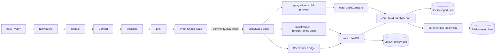
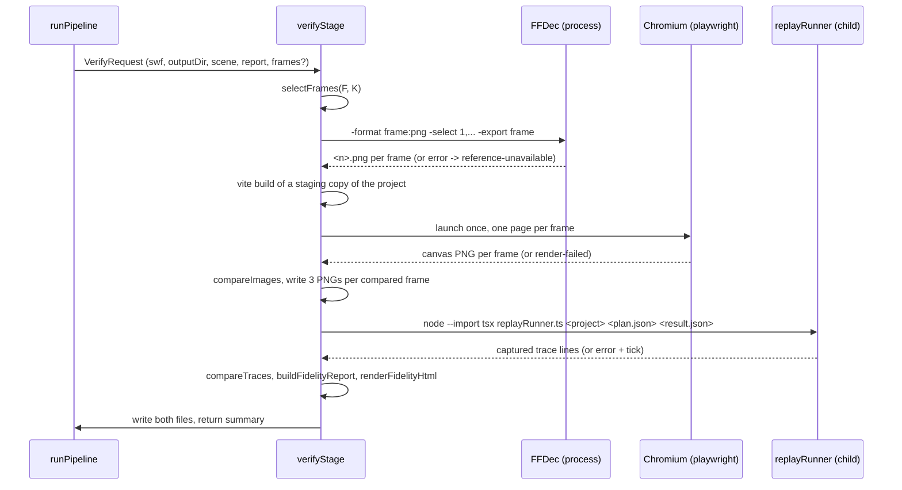

# Design Document: verify

## Overview

The `verify` spec adds an opt-in Verify_Stage (`--verify`) to the Pipeline. It measures how faithful an Emitted_Project is to the original SWF in two independent ways and writes a Fidelity_Report (`fidelity-report.json`) and a static `fidelity-report.html` next to `translation-report.json`.

- **Visual fidelity.** Reference_Frames come from FFDec (`-format frame:png`, no ActionScript runs). Rendered_Frames come from the built Emitted_Project, loaded in headless Chromium in Timeline_Only_Mode. A hand-written pixel diff with a fixed Anti_Aliasing_Tolerance gives one `matchPercent` per frame.
- **Behaviour fidelity.** The translated classes are driven by the recorded Reference_Input in a child Node process, every `trace` call is captured, and the capture is compared line by line (LCS alignment) with the Reference_Trace.
- **Gap closing.** The Shim is changed so the `clickgoto` trace matches as far as the evidence in `reference/output.txt` allows. Whatever still differs is reported, never excluded.

Design goals, in priority order:

1. **No weakened comparison.** Nothing is normalised, skipped or special-cased to raise a score. Every part that does not run is recorded as `not-compared` with a reason.
2. **Pure core, thin edge.** All decisions (frame choice, pixel metric, trace comparison, replay planning, report, HTML) are pure functions under `src/verify/core/` with no `node:*` import. File, process and browser work is in `src/verify/edge/`.
3. **Deterministic output.** Same inputs give byte-identical `fidelity-report.json` and `fidelity-report.html`. No timestamp, absolute path, duration or browser build string enters either file.
4. **Opt-in and non-fatal.** Without `--verify` no verify code is loaded. With it, a failing browser, FFDec call or replay is a recorded entry, not a pipeline failure.
5. **Verified facts only.** Everything about the repo below was read from the code or the reference files. Inferences are marked **inferred** and **to verify**.

### Facts checked in the repository

- **`reference/output.txt` has 676 lines and covers 31 frame steps (0 to 30).** `MainTimeline` stops the root and removes its listeners in step 30, so step 31 (`num_frames = 32` means steps 0 to 31) prints nothing. Lines use `\n` only (no `\r`).
- **`reference/input.json` has 30 entries, not 35** (Requirements, Introduction, says 35). That gives 21 Input_Groups (20 closed by `Wait`, the last one is just `MouseUp`). See Issues found in requirements, item 1.
- **The `clickgoto` SWF has a 3-frame root.** `l_button` (symbol 6) and `r_button` (symbol 3) have 2 frames each and a different shape per frame. F = 3 for `clickgoto`, F = 48 for `tweendemo`.
- **`Event` has only `type`, `target`, `currentTarget`.** No `bubbles`, `cancelable`, `eventPhase`, `toString()`. `EventDispatcher.dispatchEvent` does not bubble; `Player.dispatchClick` walks `_parent` by hand and overrides `target` with `Object.defineProperty`.
- **`MovieClip._step()` today** advances and renders its own frame, dispatches `ENTER_FRAME`, runs its own frame script, then steps the children that existed before the tick (parent first). `exitFrame(root)` in `internal.ts` dispatches `EXIT_FRAME` pre-order (parent first), and `test/unit/exitFrame.test.ts` pins that order.
- **`Player.createClip`** constructs the class, calls `_renderFrame()` (which creates children recursively), enqueues and drains the frame-1 script. Child scripts therefore run before the parent's. The root has `name === ''`.
- **Translated classes import `'../shim'`** (`src/translate/rewrite.ts:123`). In an Emitted_Project that resolves to `<project>/shim/index.ts`. In Vitest it is aliased to `template/shim/index.ts` (`vitest.config.ts`, exact match `^\.\.\/shim$`).
- **`test/support/fixtureClasses.ts`** transpiles fixture `.as` files into `.work/fixture-classes/<sample>-xxxx/` and `await import(pathToFileURL(...))` them inside Vitest. It builds the Scene_JSON from `test/fixtures/<sample>/` (captured FFDec output), so no Java is needed.
- **The emitted `package.json` has `"type": "module"`** and pins `pixi.js` 8.22.0, `vite` 8.3.8, `typescript` 7.0.2 (`src/emit/versions.ts`). The repo's own devDependencies pin the same pixi.js and vite versions.
- **`src/unpack/spawnFfdec.ts`** already runs `java -jar <jar> ...args` without a shell, strips ANSI, times out, and throws `FfdecExitError` on a non-zero exit. The frame export reuses it.
- **`canonicalJson(value, rootPath)`** (`src/pipeline/canonicalJson.ts`) imports only a type-level error class from `template/runtime/scene` and no `node:*` module, so Verify_Core may import it.
- **`parseArgs` in `cli.ts`** builds `options` conditionally, so absent flags leave no key. `test/unit/cli.test.ts` compares with `toEqual`; new flags must follow the same pattern.
- **`vitest.config.ts`, `tsconfig.json`** include `src/**` and `test/**`; `tsconfig.template.json` includes `template/**` with the DOM lib.
- **`playwright` and `pngjs` are not installed yet.** This design installs nothing.

### Click timing confirmed against `reference/output.txt`

Requirement 6.10 asks for the tick on which each click takes effect. The Reference_Trace shows one frame step per tick, and a click is applied after that step's `exitFrame` pass and its `/// (Container ...)` inspect lines. The input array was split into Input_Groups (a group ends at and includes a `Wait`):

| Click | Entries (0-based) | MouseUp group = tick | Position | Button | `clicked` line | Preceding `//MainTimeline` script line |
|-------|-------------------|----------------------|----------|--------|----------------|------------------------------------------|
| 1 | MouseDown 2 (group 2), MouseUp 4 (group 3) | 3 | (150, 275) | LeftButton | 67 | 60 (step 3, frame 1) |
| 2 | MouseDown 8 (group 6), MouseUp 10 (group 7) | 7 | (420, 280) | RightButton | 153 | 146 (step 7, frame 2) |
| 3 | MouseDown 15 (group 11), MouseUp 17 (group 12) | 12 | (150, 275) | LeftButton | 284 | 275 (step 12, frame 1) |
| 4 | MouseDown 19 (group 13), MouseUp 21 (group 14) | 14 | (420, 280) | RightButton | 343 | 336 (step 14, frame 3) |
| 5 | MouseDown 27 (group 19), MouseUp 29 (group 20) | 20 | (150, 275) | LeftButton | 496 | 487 (step 20, frame 3) |

Groups are: `0:{0}`, `1:{1}`, `2:{2,3}`, `3:{4,5}`, `4:{6}`, `5:{7}`, `6:{8,9}`, `7:{10,11}`, `8..10:{12},{13},{14}`, `11:{15,16}`, `12:{17,18}`, `13:{19,20}`, `14:{21,22}`, `15..18:{23},{24},{25},{26}`, `19:{27,28}`, `20:{29}`.

Result, stated before the Replay is implemented:

- **Reference step k is Replay tick k.** Group k is applied in tick k, after that tick's frame step (and its `exitFrame` pass). The first click trace (line 67) is in tick 3, directly after step 3's inspect lines (64 to 66).
- **A Click is delivered when its MouseUp is applied.** MouseDown (a different tick) delivers nothing. All five pairs are `MouseDown` in the tick before `MouseUp`, same position, so each gives exactly one Click.
- **Step 0 is construction, not an advance.** `MainTimeline` frame-1 script is at line 10 and no `enterFrame` precedes it (the first `enterFrame` is line 19, step 1). The Player constructor already builds and runs frame 1, so Replay tick 0 does **not** advance the clock or call `update()`. Ticks 1 to 31 each do one advance and one `update()`. This is the tick model of Requirement 6.3 (tick 0 is construction, no frame step); a rule that ran a frame step in tick 0 would make every click take effect one step early.
- **Root frame at a step n is `(n mod 3) + 1`.** Steps 3, 7, 12, 14, 20 print frames 1, 2, 1, 3, 3 (lines 60, 146, 275, 336, 487), which confirms one frame step per tick with no skipped or doubled step.
- **`num_frames = 32` gives ticks 0 to 31.** Tick 31 produces no trace in the reference (listeners removed in step 30), so the Replay is expected to print nothing in tick 31 as well.

### Per-frame event order seen in `reference/output.txt` (input to the Shim gap work)

`T` stands for the clip trace line `<name> (frame <currentFrame>):<event>`. Clips are `l_button`, `r_button`, root `root1`, in display-list order, children before the root.

**Step 0, construction (lines 1 to 18):**

1. `added` then `addedToStage` for each clip, child by child, root last (lines 1 to 6). Every line has `eventPhase=2`; there is no bubbled `added` on `root1` for its children.
2. `frameConstructed` for `l_button`, `r_button`, `root1` (7 to 9).
3. Frame-1 scripts, root first: `//MainTimeline frame 1`, `///LeftButton Frame 1`, `///RightButton Frame 1` (10 to 12).
4. `exitFrame` for the three clips (13 to 15), then the three `/// (Container: ...)` lines from `MainTimeline.exit_frame_controller` (16 to 18). That controller is registered after `EventWatcher`'s trace listener, so its lines follow the root's own `exitFrame` line.

**Step n >= 1 (step 1 is lines 19 to 34; the backward-loop step 8 is lines 174 to 195):**

| Phase | What happens | Evidence |
|-------|--------------|----------|
| A. advance | Every playing clip with more than one frame moves to its next frame (wrap to 1). If the clip moved **backwards** (wrap or a goto to an earlier frame), each timeline child that is not retained is removed and `removed` (bubbles, phase 3 at ancestors) reaches the parent chain: `l_button (frame 1): removed`, `root1 (frame 2): removed` (174, 175). The container count then shows `l_button with 0 children` (180). | 174 to 175, 180 |
| B. enterFrame | `enterFrame` to every clip, **children first** in display order, root last. The root already shows its new frame. The root's `enter_frame_controller` lines follow the root's trace line. | 19 to 24, 176 to 181 |
| C. construct | Backward moves: `added` for the new timeline child (`l_button (frame 1): added`, `root1 (frame 3): added`, phase 3, 182 to 183). Then `frameConstructed` to every clip, children first, with the new frames. | 25 to 27, 182 to 186 |
| D. frame scripts | For each clip whose frame changed this step, root first, then children in display order: `//MainTimeline frame 3`, `///LeftButton Frame 1`, `///RightButton Frame 2`. Stopped buttons print nothing. | 28, 187 to 189 |
| E. exitFrame | `exitFrame` to every clip, children first, then the three `/// (Container: ...)` lines. | 29 to 34, 190 to 195 |

Observations the Shim work depends on:

- **Forward changes are silent.** A button going from frame 1 to frame 2 swaps its child shape (shape 4 to shape 5, different symbol, same depth) with no `removed`/`added` lines and no gap in the container count (step 9, lines 196 to 208: `l_button` goes from frame 1 to 2 and shows `with 1 children` at line 202, while only `r_button`, moving 2 to 1, shows `removed`/`added`). Only the backward move (frame 2 to 1) shows the events. The root wrapping from 3 to 1 shows none, because its two children are the same symbols at the same depths in both frames (retained).
- **Retained means same depth and same symbol**, which is what `MovieClip._renderFrame` already tests.
- **Click output** (closed by G7, section 8). The first click block is lines 67 to 88 (22 lines) and shows exactly this, read from `output.txt`:
  - 67 `///(LeftButton clicked...)`, 68 `///this.gotoAndStop(2);` (handler traces).
  - 69 to 78 (10 lines): the cycle for the first goto, `l_button` 1 to 2. `frameConstructed` for `l_button (frame 2)`, `r_button (frame 1)`, `root1 (frame 1)` (69 to 71), the frame script `///LeftButton Frame 2` (72), `exitFrame` for the same three clips (73 to 75), then the three `/// (Container: ...)` lines (76 to 78) that `MainTimeline.exit_frame_controller` prints when `root1` receives `exitFrame`. No `enterFrame`, no clip advances, and the root stays on frame 1.
  - 79 `///this.parent.r_button.gotoAndStop(1);` is the handler's second trace line. It comes after the first cycle, so the cycle runs when the first `goto` call returns, not at the end of the handler.
  - 80 to 88 (9 lines): the cycle for the second goto, where `r_button` is **already** on frame 1 (the target equals the current frame). The same `frameConstructed` x3 (80 to 82), `exitFrame` x3 (83 to 85) and Container x3 (86 to 88), with **no frame script** (no `///RightButton Frame 1`), no `removed`/`added`.
  - Both cycles list the clips children first (`l_button`, `r_button`, `root1`), with the frames each clip has at that moment.
  - The third click block (lines 284 to 310, 27 lines) shows the same two cycles with one difference: the second goto moves `r_button` from frame 2 backwards to frame 1, so its call prints `removed` and `added` (297 to 300, both bubbling to `root1`, `eventPhase=3`) **before** the cycle (301 to 310), and that cycle does run the frame script (304 `///RightButton Frame 1`). The first goto of that block (`l_button.gotoAndStop(2)`, forward, lines 286 to 295) prints no `removed`/`added`.
  - So per goto call: always one cycle; the frame script runs only when the frame changed. Evidence is the clickgoto sample only; the blocks at lines 67 and 284 were read in full, the other three click blocks were not checked line by line (the task that implements G7 does that, see section 8).

### Key design decisions

| # | Decision | Rationale |
|---|----------|-----------|
| D1 | Verify_Core is `src/verify/core/*.ts`: pure, no `node:*`, no `Date`, `Math.random`, `localeCompare`, `toLocale*`, no PNG or browser library. Edge is `src/verify/edge/*.ts`. | Requirement 11.8; the three required tests need only core. |
| D2 | **Replay runs in a child Node process** (`node --import tsx replayRunner.ts`) that imports everything from the Emitted_Project directory: `runtime/player.ts`, `shim/trace.ts`, `src/classes.ts`. `tsx` is already a devDependency. | One module graph (project `shim/` used by both Player and classes) in the CLI and in Vitest, no clash with the Vitest `../shim` alias, a fresh module cache per Replay (Requirement 6.13), a hard kill on a runaway script. See section 6. |
| D3 | **Rendering loads a build of the Emitted_Project made with the repo's own Vite and PixiJS**, in a staging copy under `<repo>/.work/`, so no `npm install` and no network. Versions are asserted equal to the pins in `src/emit/versions.ts`. | Requirement 3.5 says "built Emitted_Project". `.work/` is gitignored, and Node resolution walks up to the repo's `node_modules`. |
| D4 | **No sockets.** The page is served by `page.route()` fulfilling requests for `http://verify.local/**` from the build directory. | "Zero network calls" (Requirement 12.5) holds literally, and module scripts and `fetch` work (they do not on `file:`). |
| D5 | **The page hands over the canvas pixels itself** (`canvas.toDataURL('image/png')` stored in `window.__swfResurrect`) instead of a Playwright screenshot. | Exactly stage-size pixels at resolution 1, independent of CSS centring and device pixel ratio. Requirement 3.5's "capture only the stage canvas at stage size, DPR 1" is met. |
| D6 | Hand-written pixel diff. Compare on RGB after flattening both images onto the stage background; per-pixel distance is max channel difference; tolerance values `strict = 8`, `edgeMax = 128`, `edgeContrast = 48`. | Requirement 12.2: no diff library. Flattening makes FFDec's alpha handling irrelevant (**to verify** whether FFDec writes transparent PNGs). |
| D7 | `matchPercent` comes from one integer division with half-up rounding to hundredths, clamped so a frame with any differing pixel never reports 100. | Platform-independent text. |
| D8 | Trace comparison is LCS on lines with a fixed backtrack rule, after trimming the common prefix and suffix, capped at 25,000,000 table cells. Over the cap the behaviour part is `not-compared` (`trace-too-large`), not approximated. | A deterministic alignment; honest limit. |
| D9 | `FakeBackend` moves to `src/verify/edge/fakeBackend.ts`; `test/support/fakeBackend.ts` becomes a one-line re-export. | The runner lives under `src/` and must not import from `test/`. All existing test imports keep working. |
| D10 | `pngjs` has no bundled typings. A local `src/verify/edge/pngjs.d.ts` declares the few members used. `@types/pngjs` is **not** added (it would be a New_Dependency needing approval). | Requirement 12.1. |
| D11 | Timeline_Only_Mode is `Player` with an empty `classRegistry` and a `ManualClock`, stepped N-1 times. It lives in a new `template/src/timelineOnly.ts`; `main.ts` gets one branch. | It reuses the Player stepping code, so a script-free player is the same code path as the real one. |
| D12 | The Shim is changed in the order the Reference_Trace shows (section 8). The one expectation in `test/unit/exitFrame.test.ts` that pins pre-order changes to children-first. **Approved by the user** (Requirement 8.9). | The Reference_Trace is the oracle. |
| D14 | A script `gotoAndStop`/`gotoAndPlay` called outside every frame-step phase runs one Goto_Extra_Cycle when it returns; inside a step, the initial build or another cycle it does not (section 8, G7). The cycle is optional behind a `cycle` member of the construction context, so clips built without a Player keep today's behaviour. | Requirement 8.11; keeps every existing shim test unchanged. |
| D13 | Report text never contains a raw error message with a path. A pure `sanitizeDetail` keeps the first line, replaces absolute paths with `<path>` and caps the length. | Requirement 9.4. |

## Architecture



### Repository layout (new and changed)

```
src/verify/
  core/                    # PURE: no node:*, no Date, Math.random, localeCompare
    constants.ts           # FORMAT_VERSION, AA_TOLERANCE, DEFAULT_FRAME_COUNT, MAX_LCS_CELLS, DIFF_MARK, KNOWN_BEHAVIOUR_GAPS
    frameSample.ts         # selectFrames
    pixelDiff.ts           # RgbaImage, flattenOnto, compareImages, buildDiffImage, hundredths helpers
    traceFormat.ts         # formatTraceCall, splitTraceLines
    traceCompare.ts        # compareTraces (LCS), score, First_Divergence
    replayPlan.ts          # parseReferenceInput, parseNumFrames, planReplay
    svgBounds.ts           # shape bounds from SVG width/height (for hit testing in the Replay)
    sanitize.ts            # sanitizeDetail
    limits.ts              # knownVisualLimits(scene, unsupported)
    report.ts              # types, buildFidelityReport, compareProblems, serialiseFidelityReport
    html.ts                # escapeHtml, renderFidelityHtml
  edge/
    versions.ts            # PLAYWRIGHT_VERSION, PNGJS_VERSION, FFDEC_VERSION (pinned strings)
    png.ts                 # pngjs decode/encode <-> RgbaImage
    pngjs.d.ts             # local typings
    ffdecFrames.ts         # frame:png export via spawnFfdec
    buildProject.ts        # staging copy + vite build
    renderFrames.ts        # playwright: route, load, wait, read canvas
    replay.ts              # spawns the runner, reads its result
    replayRunner.ts        # child entry point (runs under tsx)
    fakeBackend.ts         # moved from test/support
    verifyStage.ts         # orchestration and all file writes
template/src/
  timelineOnly.ts         # NEW: query parsing, boot in Timeline_Only_Mode
  main.ts                 # one branch added
template/shim/            # events.ts, DisplayObject.ts, Sprite.ts, MovieClip.ts, internal.ts, ADDED_APIS.md
template/runtime/player.ts
src/pipeline/             # cli.ts, pipeline.ts changed
test/support/fakeBackend.ts          # becomes a re-export
test/support/emitFixtureProject.ts   # NEW: fixtures -> emitted project in a temp dir (no Java)
```

### Verify_Stage sequence



## Components and Interfaces

### 1. Frame sampling (`core/frameSample.ts`)

```ts
/** F >= 1 integer. requested is K from --verify-frames (undefined = 8). */
export function selectFrames(frameCount: number, requested?: number): number[];
```

Rule: `k = min(F, max(requested ?? 8, 2))` when `F >= 2`; the result for `F === 1` is `[1]`. Frame `i` (0 <= i < k) is `1 + floor((2*i*(F-1) + (k-1)) / (2*(k-1)))`, i.e. round-half-up of the even spacing, in integers only. Because `k <= F`, the spacing `(F-1)/(k-1)` is at least 1, so the list is strictly increasing; `i = 0` gives 1 and `i = k-1` gives `F`.

`F` is the root symbol's `frameCount` in the Scene_JSON, so no extra FFDec call is needed. A request of `K = 1` with `F >= 2` cannot contain both frame 1 and frame F, so it is raised to 2 (Issues found in requirements, item 5). Examples: `F = 3` gives `[1, 2, 3]`; `F = 48` gives `[1, 8, 14, 21, 28, 35, 41, 48]`; `F = 32, K = 8` gives `[1, 5, 10, 14, 19, 23, 28, 32]`.

### 2. Pixel diff (`core/pixelDiff.ts`)

```ts
export interface RgbaImage { width: number; height: number; data: Uint8Array } // RGBA8, length 4*w*h
export type Rgb = readonly [number, number, number];

export const AA_TOLERANCE = { strict: 8, edgeMax: 128, edgeContrast: 48, neighbourhood: '3x3' } as const;

export interface FrameDiff {
  differingPixels: number;
  totalPixels: number;
  matchHundredths: number;      // integer 0..10000, see rounding rule
  mask: Uint8Array;             // 1 = differing, one byte per pixel
}
export type CompareResult =
  | { ok: true; value: FrameDiff }
  | { ok: false; error: { kind: 'size-mismatch'; a: { width: number; height: number }; b: { width: number; height: number } } };

export function flattenOnto(img: RgbaImage, background: Rgb): RgbaImage;
export function compareImages(reference: RgbaImage, rendered: RgbaImage, background: Rgb): CompareResult;
export function buildDiffImage(flatReference: RgbaImage, mask: Uint8Array): RgbaImage;
export function roundedHundredths(part: number, whole: number): number;   // see below
export function meanHundredths(values: readonly number[]): number;
```

**Flatten.** For each channel `c` with alpha `a` over background `bg`: `floor((c*a + bg*(255-a) + 127) / 255)`; the result is opaque. `background` is the Scene_JSON `stage.backgroundColor` (`#rrggbb`) parsed by the caller. Both images are flattened inside `compareImages`, so a caller cannot forget it.

**Pixel distance.** `dist(p, q) = max(|Rp-Rq|, |Gp-Gq|, |Bp-Bq|)` (integer, symmetric).

**Anti_Aliasing_Tolerance** (recorded in the report):

- `strict = 8`: a pair with `dist <= 8` is equal (colour rounding, gamma and blend rounding between two rasterisers).
- Edge rule: a pair with `8 < dist <= edgeMax = 128` is **also equal** when the pixel is an *edge pixel* in the reference **or** in the rendered image. A pixel is an edge pixel in an image when at least one of its 3x3 neighbours (clipped at the image border, excluding itself) has `dist > edgeContrast = 48` to it in that same image.
- A pair with `dist > 128` always differs. A pair with `8 < dist <= 128` that is not an edge pixel in either image differs.

The rule is symmetric in the two images ("edge in A or edge in B"), identical images never differ (`dist = 0`), and a shape drawn in the wrong place differs because it changes large flat regions, not only edges. The three constants are initial values to be reviewed at the browser checkpoint; any change is made in `constants.ts` with the report's recorded tolerance, and scores computed with different constants are not comparable.

**Rounding rule.** `roundedHundredths(part, whole) = floor((20000*part + whole) / (2*whole))` (round half up of `10000*part/whole`, integer arithmetic; with images up to 8192 x 8192 the product stays under 2^53). For a frame, `part = totalPixels - differingPixels`, `whole = totalPixels`. Then: if `differingPixels > 0`, the result is `min(result, 9999)`; if `differingPixels = totalPixels`, it is 0. `matchPercent = matchHundredths / 100`; JSON prints the shortest round-trip text of that double (`99.37`), which is the same on every platform. `meanHundredths` sums the integers in frame order and returns `floor((2*sum + n) / (2*n))`. Overall_Match is that value divided by 100, or `null` for `n = 0`.

**Diff_Image.** Same size as the compared images. A pixel in `mask` is `(255, 0, 255, 255)` (magenta). Every other pixel is the flattened Reference_Frame pixel at half brightness: each channel `c >> 1`, alpha 255.

**Size mismatch.** `compareImages` returns `{ ok: false, error: { kind: 'size-mismatch', a, b } }` naming both sizes; it never returns a `FrameDiff` then.

### 3. Reference frames (`edge/ffdecFrames.ts`)

```ts
export async function exportReferenceFrames(input: {
  swfPath: string; jarPath: string; frames: readonly number[]; workDir: string; spawner?: FfdecSpawner;
}): Promise<Map<number, RgbaImage | { missing: string }>>;
```

Runs `java -jar <jar> -format frame:png -select <comma list> -export frame <workDir> <swf>` through `spawnFfdec` (ANSI stripping is already there; timeout 120 s), then reads `<workDir>/<n>.png` per frame with `pngjs`. A non-zero exit (`FfdecExitError`), a missing jar, no Java, or a missing PNG gives a `reference-unavailable` problem for each affected frame; other frames are unaffected. A decoded size different from the Scene_JSON stage size gives `size-mismatch` for that frame. **To verify** in the first edge task, with the real jar: the exact `-select` list syntax (comma separated) and that file names are `<n>.png` for 1-based frame numbers, as the requirements state; the task stops and asks if either differs.

### 4. Timeline_Only_Mode (`template/src/timelineOnly.ts`, `template/src/main.ts`)

```ts
export interface TimelineOnlyOutcome { ready: boolean; frame: number; png: string | null; error: string | null }
declare global { interface Window { __swfResurrect?: TimelineOnlyOutcome } }

/** '?timelineOnly=<n>' -> n; no parameter -> null; present but not an integer >= 1 -> NaN. Pure. */
export function parseTimelineOnly(search: string): number | null;

export async function runTimelineOnly(
  loaded: LoadedScene, backend: PixiBackend, frame: number,
): Promise<void>;
```

`main.ts` changes by one branch right after `loadScene` succeeds:

```ts
const only = parseTimelineOnly(window.location.search);
if (only !== null) { await runTimelineOnly(loaded, backend, only); return; }
```

Everything after it is the current code, so a page without the parameter boots exactly as before. `runTimelineOnly`:

1. If `only` is `NaN` or larger than the root `frameCount`, set `window.__swfResurrect = { ready: false, error: '...' }` and show the error; return.
2. Create the `Application` with `resolution: 1`, `autoDensity: false`, `preserveDrawingBuffer: true`, `autoStart: false`, the stage size and background; append the canvas.
3. `new Player({ scene, backend, clock: new ManualClock(), classRegistry: {}, shapeBounds })`. With an empty registry every clip is a plain `MovieClip`: no class constructor, no `addFrameScript`, no listener of translated code runs. (`Player` logs a `console.warn` per linked class; the renderer ignores warnings.)
4. `for (i = 1; i < frame; i++) { clock.advance(player.frameIntervalMs); player.update(); }`. Each `update()` is one whole frame step: the root moves one frame, every nested clip moves one frame and loops at its last frame, and a clip placed later starts on its frame 1 when it appears. This is what "a script-free player shows at root frame N" means, using the same stepping code as the real run. If `player.root.currentFrame !== frame` afterwards, report an error instead of drawing.
5. `app.stage.addChild(player.rootNode); app.render();` then `window.__swfResurrect = { ready: true, frame, png: app.canvas.toDataURL('image/png'), error: null }`.
6. The existing `boot().catch` sets `window.__swfResurrect = { ready: false, error }` when the parameter was present, so the renderer sees a failure at once instead of waiting 10 s.

No pointer wiring and no `requestAnimationFrame` loop exist in this mode.

### 5. Headless renderer (`edge/buildProject.ts`, `edge/renderFrames.ts`)

`buildProject(projectDir)`:

1. `mkdtemp(<repo>/.work/verify-)`, copy `projectDir` (no `node_modules`, no `dist`) into it. Node resolution from there reaches the repo's `node_modules`, which holds `pixi.js` 8.22.0.
2. `import { build } from 'vite'` and `build({ root: staging, configFile: false, base: './', logLevel: 'silent', build: { outDir: <staging>/dist, emptyOutDir: true } })`.
3. A unit test asserts `PIXI_VERSION` and `VITE_VERSION` in `src/emit/versions.ts` equal the repo's `package.json` pins, so the staging build uses the versions the emitted project pins. The build is not the user's `npm run build` byte for byte; it is the same sources, Vite and PixiJS versions.
4. The staging directory is deleted at the end of the stage (also on failure).

`renderFrames(distDir, frames, stage)`:

- `playwright.chromium.launch({ headless: true })` once. `newContext({ viewport: { width, height }, deviceScaleFactor: 1 })`.
- For each frame (ascending), a new page: `route('http://verify.local/**')` fulfils the request from `distDir` (path normalised and checked to stay inside `distDir`; a small MIME map for `html js json svg css map`; anything else 404). Record `pageerror` and `console` messages of type `error` (warnings are ignored).
- `goto('http://verify.local/index.html?timelineOnly=<n>')`, then `waitForFunction(() => window.__swfResurrect?.ready || window.__swfResurrect?.error, { timeout: 10_000 })`.
- On `ready`, decode the `png` data URL with `pngjs` to an `RgbaImage`. On `error`, a `pageerror`, a timeout or any other exception: a `render-failed` problem for that frame with `sanitizeDetail(message)`; continue with the next frame.
- If the launch itself fails (browser not installed, sandbox error), every frame gets `render-failed` with the sanitised launch error, and the stage carries on with the Replay (Requirement 11.5). The browser is always closed in a `finally`.
- **Pinning.** The Chromium build is the one `playwright` at the exact `PLAYWRIGHT_VERSION` downloads (`npx playwright install chromium`, run once by the user or the implementing task). `edge/versions.ts` holds the same version string; a unit test compares it with `package.json`.
- **To verify** in the first render task: headless Chromium provides WebGL for PixiJS (SwiftShader). If it does not, the frames are recorded as `render-failed` and the launch arguments are adjusted before anything else changes.

### 6. Replay (`core/replayPlan.ts`, `edge/replay.ts`, `edge/replayRunner.ts`)

#### Plan (pure)

```ts
export type PlanProblem =
  | { kind: 'unpaired-mouse-event'; index: number }
  | { kind: 'unsupported-input'; index: number; detail: string }
  | { kind: 'unused-input'; index: number };

export interface ReplayPlan {
  tickCount: number;
  clicks: Array<{ tick: number; x: number; y: number; downIndex: number; upIndex: number }>;
  problems: PlanProblem[];
}
export function parseNumFrames(tomlText: string | null): number | null;      // key num_frames = <int>
export function planReplay(inputJson: string, numFrames: number | null): ReplayPlan | { error: string };
```

- **Parsing.** `JSON.parse`; a non-array or invalid JSON returns `{ error }` (behaviour part becomes `not-compared`, reason `invalid-input-json`). An entry type other than `Wait`, `MouseDown`, `MouseUp`, a `btn` other than `Left`, or a mouse entry without a numeric `pos` pair gives `unsupported-input` and is treated as `Wait`.
- **Groups.** Walk the entries; a group ends at and includes a `Wait`; the last group may end at the end of the array. Group `k` belongs to tick `k`.
- **Click pairing.** Keep `pendingDown` (index and position) or none. On `MouseDown`: if one is pending it becomes `unpaired-mouse-event`; the new one is pending. On `MouseUp`: if a `MouseDown` is pending at exactly the same `[x, y]`, emit a Click in the current group's tick and clear it; otherwise the `MouseUp` is `unpaired-mouse-event`, and a pending `MouseDown` (different position) is also `unpaired-mouse-event` and cleared. A `MouseDown` still pending at the end is unpaired. This is Requirement 6.4 and 6.5 and the Glossary definition of Click ("no other MouseDown or MouseUp between").
- **Tick count.** `numFrames` when given, else the number of groups. Groups beyond `tickCount` are ignored and one `unused-input` is recorded at the index of the first ignored entry. Ticks beyond the last group are plain ticks.
- `clickgoto` result (checked against the table above): five clicks at ticks 3, 7, 12, 14, 20; no problems; 21 groups, 32 ticks.

#### Loading the translated classes (Requirement 6.11 and 6.12)

`fixtureClasses.ts` transpiles into `.work/` and relies on Vitest's `../shim` alias. That does not work for the CLI, which runs under `tsx` without the alias, and in Vitest it would load `template/shim` while a Player from the emitted project would use `<project>/shim`, giving two Shim copies. The Replay therefore uses a **child process over the Emitted_Project itself**:

```
node --import tsx <repo>/src/verify/edge/replayRunner.ts <projectDir> <planJson> <resultJson>
cwd = <repo root>   // so that `tsx` resolves from the repo's node_modules
```

- Spawned with `child_process.spawn(process.execPath, [...], { shell: false })` (no shell, no new dependency: `tsx` 4.23.15 is already in `package.json`). A 60 s timeout kills the child; the result is then a `replay-error` problem with the fixed text `timed out after 60 s` and the trace captured so far is lost (the runner flushes the result file only at the end or on a caught error, see below).
- The runner imports, by file URL, from `<projectDir>`: `runtime/player.ts`, `runtime/clock.ts`, `runtime/loader.ts`, `shim/trace.ts`, `shim/internal.ts` and `src/classes.ts`. `classes.ts` imports `./LeftButton` etc., which import `../shim` and resolve to `<projectDir>/shim/index.ts`, the same module instances the Player uses. `tsx` handles the extensionless and directory-index specifiers of the emitted sources. **To verify** in the first replay task. Fallback if `tsx` does not resolve `'../shim'` in the emitted files: Vite's `createServer({ middlewareMode, appType: 'custom' }).ssrLoadModule(...)` from the already installed `vite`, with the same runner logic and no new dependency.
- The runner builds `FakeBackend` (the moved file), fills `backend.shapeBounds` from each `assets/<id>.svg` with the pure `svgBounds` (SVG `width`/`height` in `px` positioned at `-origin`, as `clickOracle.test.ts` does; these are the shape-origin-space bounds, the same rectangle the real `loadShape` returns). Shape origin: Convert flattens the FFDec `<g transform="matrix(1,0,0,1,tx,ty)">` wrapper (`flattenSvgWrapper` in `template/runtime/svgFlatten.ts`) so the emitted SVG paths are in shape-origin space, and keeps `(tx, ty)` as `origin` in Scene_JSON. `PixiBackend.loadShape` flattens too (idempotent), returns the Pixi local bounds unshifted, and `createShape` adds no offset, so the result does not depend on whether the renderer honours the wrapper (Pixi 8.22 ignores it), then calls the project's `loadScene(readFromProjectDir, backend)`.
- **Sequence.**

```ts
const lines: Array<{ tick: number; text: string }> = [];
let tick = 0;
setTraceSink((...args) => { for (const t of splitTraceLines(formatTraceCall(args))) lines.push({ tick, text: t }); });
const player = new Player({ scene, backend, clock: new ManualClock(), classRegistry, shapeBounds });
for (tick = 0; tick < plan.tickCount; tick++) {
  if (tick === 0) exitFrame(player.root);                    // step 0 = construction + its exit-frame pass
  else { clock.advance(player.frameIntervalMs); player.update(); }
  for (const c of plan.clicks.filter((c) => c.tick === tick)) player.dispatchClick(c.x, c.y);
}
```

  The sink is installed before `new Player`, because the constructor already runs frame-1 scripts. In a `finally` the runner calls `setTraceSink(null)`. An exception is caught around the loop and written as `{ error: { tick, message } }` together with the lines so far (Requirement 6.15). Output goes to the result file, not stdout, because translated code may use `console.log`.
- **Determinism.** `ManualClock` only, no `Date`, no `Math.random` in the runner. A fresh process per Replay means no state leaks between two Replays (Requirement 6.13).
- **Click delivery.** `Player.dispatchClick(x, y)` hit-tests the shim tree with the shape bounds and now dispatches once on the hit object with real bubbling (section 8, G6). Whether each of the five clicks hits the intended button is **to verify** by the clickgoto test: the lines `///(LeftButton clicked...)` must appear in ticks 3, 12, 20 and `///(RightButton clicked...)` in ticks 7, 14.

#### Trace formatting (`core/traceFormat.ts`)

`formatTraceCall(args)` is `args.map(String).join(' ')`, the AS3 `trace` format (arguments separated by one space); an `Event` argument prints through its `toString()`. `splitTraceLines(text)` splits on `\n`, removes one trailing `\r` per line, and drops the final empty element produced by a terminating newline. It is applied to the Reference_Trace file text and to each captured call.

### 7. Trace comparison (`core/traceCompare.ts`)

```ts
export interface TraceLine { line: number; text: string }         // 1-based
export interface Divergence { index: number; reference: string | null; captured: string | null }
export type TraceComparison =
  | { kind: 'compared'; referenceLineCount: number; capturedLineCount: number; matched: number;
      missing: TraceLine[]; extra: TraceLine[]; traceScore: number; firstDivergence: Divergence | null }
  | { kind: 'too-large'; referenceLineCount: number; capturedLineCount: number };

export function compareTraces(reference: readonly string[], captured: readonly string[]): TraceComparison;
```

- **Equality** is byte equality of the two strings (after the `\r` removal in `splitTraceLines`); no other normalisation.
- **Alignment.** Trim the common prefix and suffix. On the remaining middle `a` (reference) and `b` (captured) of lengths `n` and `m`, if `(n+1)*(m+1) > 25,000,000` return `too-large`. Otherwise fill the suffix table `L[i][j]` (`Uint32Array`) and walk forward from `(0, 0)`: equal lines are matched; otherwise if `L[i+1][j] >= L[i][j+1]` the reference line is `missing`, else the captured line is `extra`. Leftover lines at either end are missing/extra. This gives one fixed alignment, ascending line numbers in both lists, and `matched` equals the LCS length.
- **Score.** `traceScore = roundedHundredths(matched, max(refCount, capCount)) / 100`, with the same clamp as the frame metric (never 100 unless the traces are identical); both empty gives 100.
- **First_Divergence.** The lowest 1-based index `i` where `reference[i-1] !== captured[i-1]`, where a missing line (one trace shorter) is `null`; `null` when the traces are identical.
- Lists have no length limit in the report.

### 8. Shim gap work (`template/shim/`, `template/runtime/player.ts`)

The gaps, with what the evidence shows and where it is fixed. G1 to G7 are all in scope.

| Gap | Change | Evidence |
|-----|--------|----------|
| G1 Event text (8.1, 8.2) | `Event` gets `bubbles`, `cancelable`, `eventPhase` (1, 2 or 3). `bubbles` defaults to true for `added`, `removed`, `click`, false otherwise; `cancelable` is false; the constructor takes optional overrides. `toString()` returns `[Event type="<type>" bubbles=<bool> cancelable=<bool> eventPhase=<n>]`. `MouseEvent` inherits the text (its richer Flash format is out of scope). | every event line |
| G2 Root name (8.3) | `Player` sets `root.name = 'root1'` right after creating the root and before any event. | `root1 (...)` everywhere |
| G3 `added` / `addedToStage` (8.4) | `DisplayObjectContainer.addChild` dispatches `added` on the child, then `addedToStage` on the child and its descendants when the parent chain ends at the Player's root (`root._isStageRoot`, set by the Player; clips outside a Player are never "on stage"). Timeline attachment uses internal `announceAdded` with the same two events. | lines 1 to 6 |
| G4 `frameConstructed` (8.5) | New phase C of the tick (below) and of the initial build. | lines 7 to 9, 25 to 27 |
| G5 Phase order (8.6) | `MovieClip._step()` becomes the five phases of the table above over a pre-tick snapshot of the clips in its subtree: A advance and removal events, B `enterFrame` (children first), C `added` events then `frameConstructed` (children first), D frame scripts (root first, only clips whose frame changed), and `exitFrame` stays a separate children-first pass called by `Player.update` after `_step`. `internal.exitFrame` changes from pre-order to post-order. Clips created during the tick are not in the snapshot (the existing test "children that existed before the tick" holds). | table above |
| G5b Initial build | `Player.createClip` stops draining scripts. After the whole tree is built, the Player runs: `added` + `addedToStage` per clip post-order (dispatched **at the target only**, no bubbling, because Flash has not yet run the ancestors' constructors during the initial build), then `frameConstructed` post-order, then frame-1 scripts pre-order (root first). The Replay then runs one `exitFrame(root)` for tick 0. | lines 1 to 18 |
| G6 Bubbling and timeline events | `DisplayObject.dispatchEvent` delivers at the target (`eventPhase` 2) and, when `bubbles`, walks `_parent` delivering to each ancestor with `eventPhase` 3 and `currentTarget` set; `target` stays the origin. `Player.dispatchClick` calls it once instead of walking the parents. For timeline frame changes: a **backward** move removes every non-retained child in phase A with `removed` (and `removedFromStage` on the removed subtree when it was on stage) and adds the new ones in phase C with `added`/`addedToStage`; a **forward** same-depth, different-symbol replacement is silent and atomic in phase A (observed). Forward removal with no replacement and forward addition at a new depth dispatch `removed` and `added` as Flash does for RemoveObject/PlaceObject; **inferred**, not exercised by the sample, so unobserved in the Reference_Trace. A script `gotoAndStop`/`gotoAndPlay` that moves backward does the same removal and addition at once (observed, lines 296 to 300 on the third click). `removeChild` dispatches `removed` (then `removedFromStage` when on stage). `detachChild` in `internal.ts` stops calling the public `removeChild`, so the timeline controls when events fire. | lines 174 to 183, 196 to 205 |
| G7 Goto_Extra_Cycle (8.11, 8.12) | After a script-called `gotoAndStop`/`gotoAndPlay` that runs outside the frame step's own phases, the Player runs one Goto_Extra_Cycle when the call returns. Details, guard and revert rule in "G7: Goto_Extra_Cycle" below. | lines 67 to 88, 284 to 310 |

#### G7: Goto_Extra_Cycle

**What the reference shows** (lines read, see "Click output" in the facts above): one cycle per goto call, started when the call returns; the cycle is `frameConstructed` to every MovieClip on the stage children-first, then the queued frame scripts (only for a clip whose frame changed), then `exitFrame` to every MovieClip children-first (the root's `exitFrame` listener prints the Container lines). It runs when the target frame equals the current frame (lines 80 to 88: cycle without script). Lines 68 to 78 and 79 to 88 are the two cycles of the first click; Requirement 8.11 cites "68 to 80" and "79 to 84", which are off by the handler trace lines (Issues, item 13).

**Mechanism.**

- `ConstructionContext` gets an optional member `cycle?: ClipCycle` with `readonly busy: boolean` and `runGotoCycle(): void`. The Player supplies it; test rigs that build clips without a Player do not, so their `goto` stays as today (enqueue and drain at once, no extra events).
- `MovieClip.goto` (after validation, `frame` set and `_renderFrame()` called, which already dispatches the G6 `removed`/`added` for a backward move):
  - `cycle === undefined` or `cycle.busy`: today's code, `enqueue` and `drain`.
  - otherwise: `enqueue(this, target)` **only when the frame changed** (`target !== previousFrame`), no drain, then `cycle.runGotoCycle()`. The script is run by the cycle's drain, after `frameConstructed`.
- `Player.runGotoCycle()` works on the whole stage tree from `root`, whichever clip called goto: `frameConstructed(root)` (new `internal.frameConstructed`, snapshot of the MovieClips under the root, post-order, dispatched to those still attached), then `scripts.drain()`, then `exitFrame(root)` (post-order, as G5). No `enterFrame`, no clip advances. A throw inside leaves the Player usable (the busy counter is restored in `finally`).

**Guard (exact rule).** The Player keeps a counter `busy`. It is incremented on entry to the Player constructor body (initial build, `added`/`frameConstructed` events and frame-1 scripts), to `Player.update()` (all phases A to E and the `exitFrame` pass, so frame scripts of phase D and every listener running in phases B, C and E), and to `runGotoCycle()` itself, and decremented in `finally`. `busy` is true exactly while one of these is on the call stack. A goto called while `busy` is true starts no cycle. A goto called while it is false, which is only the case for code reached from `dispatchClick` (click handlers) or from user code that calls the clip API between `update()` calls, starts one. `dispatchClick` does not increment `busy`.

**Nested gotos.**

- *Sequential* (two gotos in one handler, observed at lines 68 and 79): each call returns, then runs its own cycle, so the second goto's trace line appears after the first cycle.
- *Inside a cycle* (a frame script or an `exitFrame`/`frameConstructed` listener running in the cycle calls goto): `busy` is true, so no new cycle starts. That goto behaves as it does inside a frame step today (frame change, `enqueue` and `drain` at once). Its own `frameConstructed`/`exitFrame` are not dispatched by this cycle; the next frame step covers them. **Inferred**: no sample line shows a goto inside a cycle.
- *Inside the frame step* (phase D scripts, or listeners in B, C, E): same rule, no cycle; the step's own later phases deliver `frameConstructed` and `exitFrame` for the new frame. The existing behaviour (script runs at once) is unchanged.

**Revert rule (Requirement 8.12).** The G7 task is made on its own set of files and measured with the clickgoto Replay: record the Trace_Score and the `matched` count before the task (after G1 to G6) and after. If the score after is not higher than before, or an existing behaviour test breaks and cannot be fixed within the task's scope without changing an expectation other than the one named in Requirement 8.9, the implementer undoes that task's own uncommitted edits in the Shim and Player (never `reset`, `amend` or force), keeps the new tests that document the gap as skipped with a reason, adds the string `goto-extra-cycle` to `KNOWN_BEHAVIOUR_GAPS` in `core/constants.ts`, and states in the final summary that G7 was reverted and why. No Reference_Trace content is special-cased.

**Known behaviour gaps in the report.** `KNOWN_BEHAVIOUR_GAPS: readonly string[]` in `core/constants.ts` is empty while G7 is in place. The edge passes it to `buildFidelityReport` as `knownBehaviourGaps`; the builder sorts it by code unit, removes duplicates and writes it into `behaviour.knownBehaviourGaps` for both `compared` and `not-compared` behaviour parts, so the field is always present. A test ties the constant to the Shim: with the constant empty the clickgoto Replay must contain the cycle lines at the click ticks (below), so the constant cannot claim "no gap" while the cycle is missing.

**Expected ceiling.** The earlier estimate of about 86 percent assumed G7 was out of scope and no longer applies. With G1 to G7 the expected ceiling is higher, and it is **not measured**. The remaining differences, if any, are not predicted here (for example the three click blocks that were not read line by line, the right-button handler, and the inferred events listed above). The first measurement is made in Task 15.1; the floor in the Replay test comes from that measurement (Requirement 13.5) and Requirement 8.7 reports the achieved score and the remaining `missing` and `extra` counts.

Every addition is listed in `template/shim/ADDED_APIS.md`: `Event.bubbles`, `Event.cancelable`, `Event.eventPhase`, `Event.toString` (needed by `EventWatcher.as:17`, which concatenates the event), `DisplayObject._deliver` / bubbling `dispatchEvent` (needed by the bubbled `added`/`removed` lines at `EventWatcher.as:24`, `:27`), `_isStageRoot` (supports `addedToStage`, `EventWatcher.as:25`), the new phase behaviour of `frameConstructed` (`EventWatcher.as:26`), and for G7 the internal `ConstructionContext.cycle` / `ClipCycle` and `internal.frameConstructed` (needed by the `this.gotoAndStop(2)` and `this.parent.r_button.gotoAndStop(1)` calls in `LeftButton.clicked`; the implementing task cites the fixture line numbers, which count blank lines). Existing behaviour covered by tests stays. Two expectations change, both named in Requirement 8.9: the pre-order expectation in `test/unit/exitFrame.test.ts` (approved, children-first), and the statement that `gotoAnd*` dispatches no `EXIT_FRAME`. A search of `test/` found no test asserting that statement; it exists as prose in the translate spec (`.kiro/specs/translate/design.md`, "Clicks and `gotoAnd*` calls do not dispatch it", and the optional, unchecked task 4.2 in its `tasks.md`). So the change is a new test (below) and a note in `ADDED_APIS.md`; the translate spec files are not edited here.

### 9. Fidelity_Report (`core/report.ts`)

```ts
export interface FidelityInputs {
  sample: string;
  stage: { width: number; height: number };
  background: string;                       // '#rrggbb'
  frameSample: readonly number[];
  frames: ReadonlyArray<FrameOutcome>;      // any order; the builder sorts
  limits: readonly VisualLimit[];
  behaviour: BehaviourInput;
  knownBehaviourGaps: readonly string[];    // KNOWN_BEHAVIOUR_GAPS from core/constants.ts, e.g. ['goto-extra-cycle'] after a G7 revert
  problems: readonly Problem[];
  translation: TranslationReport;           // copied: typeCheck + class names/status/overridden
}
export function buildFidelityReport(i: FidelityInputs): FidelityReport;
export function serialiseFidelityReport(r: FidelityReport): string;   // canonicalJson(r, 'fidelityReport')
export function compareProblems(a: Problem, b: Problem): number;
```

`buildFidelityReport` is pure and has no I/O. Ordering is total: frames ascending by frame number; image paths are derived from the frame number (`verify/frames/<NNNN>-reference.png`, `-rendered.png`, `-diff.png`, `NNNN` zero-padded to at least 4 digits); problems sort by `(frame, kind, index, message)` with a missing `frame` after all numbers, a missing `index` as -1, and strings by code unit; `knownVisualLimits` by `(kind, id, message)`; `knownBehaviourGaps` by code unit with duplicates removed; classes by name (as in the Translation_Report).

JSON shape (`formatVersion` 1), with keys written sorted by `canonicalJson`:

```json
{
  "behaviour": {
    "capturedLineCount": 650,
    "extra": [{ "line": 12, "text": "..." }],
    "firstDivergence": { "captured": "...", "index": 7, "reference": "..." },
    "knownBehaviourGaps": [],
    "matched": 600,
    "missing": [{ "line": 3, "text": "..." }],
    "referenceLineCount": 676,
    "replay": { "clicks": 5, "inputGroups": 21, "ticks": 32 },
    "status": "compared",
    "traceScore": 85.8
  },
  "formatVersion": 1,
  "problems": [{ "detail": "...", "frame": 2, "kind": "render-failed" }],
  "sample": "clickgoto",
  "stage": { "height": 400, "width": 550 },
  "tolerance": { "background": "#ffffff", "edgeContrast": 48, "edgeMax": 128, "neighbourhood": "3x3", "strict": 8 },
  "tools": { "ffdec": "26.4.0", "playwright": "<pinned>", "pngjs": "<pinned>" },
  "translation": { "classes": [{ "className": "LeftButton", "overridden": false, "status": "loose" }], "typeCheck": "ran" },
  "visual": {
    "comparedFrames": 3,
    "frameSample": [1, 2, 3],
    "frames": [
      { "differingPixels": 12, "frame": 1, "images": { "diff": "verify/frames/0001-diff.png", "reference": "verify/frames/0001-reference.png", "rendered": "verify/frames/0001-rendered.png" }, "matchPercent": 99.99, "status": "compared", "totalPixels": 220000 },
      { "frame": 2, "reason": "render-failed", "status": "not-compared" }
    ],
    "knownVisualLimits": [{ "id": 6, "kind": "colour-offset", "message": "..." }],
    "notComparedFrames": 1,
    "overallMatch": 99.99,
    "status": "compared"
  }
}
```

- `visual.overallMatch` is `null` (not 0) when no frame was compared, and `visual.status` is then `not-compared`.
- `behaviour` is `{ "status": "not-compared", "reason": "no-reference-trace" }` when `reference/output.txt` is missing (the `tweendemo` case); other reasons: `no-reference-input`, `invalid-input-json`, `trace-too-large`, `replay-failed` (the runner could not produce any result). No `traceScore` is written for a `not-compared` part.
- `behaviour.knownBehaviourGaps` is a sorted list of strings, present in both the `compared` and the `not-compared` form and empty (`[]`) when no gap is known. The only value defined today is `goto-extra-cycle`, written when the G7 revert rule was applied (section 8). It lists Shim gaps, not trace lines: lines that still differ are always reported as `missing`/`extra`.
- `problems` kinds: `reference-unavailable`, `size-mismatch`, `render-failed` (per frame); `unsupported-input`, `unpaired-mouse-event`, `unused-input` (per input index); `replay-error` (with `tick` and `detail`). Each frame problem also appears as that frame's `reason` in `visual.frames`.
- `detail` text always passes through `sanitizeDetail`: first line only, absolute Windows (`X:\...`) and POSIX (`/a/b...`) paths replaced by `<path>`, at most 200 characters.
- `tools` holds pinned strings only (`FFDEC_VERSION = "26.4.0"`, `PLAYWRIGHT_VERSION`, `PNGJS_VERSION` from `edge/versions.ts`, copied into the inputs by the edge). No browser build string, duration or timestamp exists anywhere in the object.
- `knownVisualLimits` (`core/limits.ts`, Requirement 5.6): one entry per scene placement with non-zero colour offsets (`colour-offset`, sprite id), one per skewed matrix (`skewed-matrix`, using `decomposeMatrix` from `template/runtime/stageTree.ts`), and one per Unsupported_Feature_List entry of kind `text`, `button`, `filter`, `mask`, `video`, `morph-shape` (`unsupported-feature`, with the entry's id/message). Duplicates by `(kind, id, message)` are removed.

### 10. Static HTML (`core/html.ts`)

`renderFidelityHtml(report): string` derives everything from the report object. No script, no external resource, no `<link>`, inline `<style>` only, images by relative path, `<meta charset>` and `lang="en"`.

```
<h1>Fidelity report: <sample></h1>
<section aria-labelledby="summary">   table: Overall match, compared / not compared frames, Trace score (or "not compared (reason)"),
                                      First divergence, tolerance values, tools
<section aria-labelledby="visual">    one <figure> row per compared frame: frame number, matchPercent, state text,
                                      three  (also rendered, diff)
                                      not-compared frames as a list with the reason
                                      known visual limits as a list
<section aria-labelledby="behaviour"> counts, first divergence (two lines), <ol> missing, <ol> extra (all lines, with line numbers),
                                      "Known behaviour gaps": a list of the ids, or the text "none" (shown for
                                      compared and not-compared behaviour alike)
<section aria-labelledby="problems">  table of every problem entry (kind, frame/index/tick, detail)
<section aria-labelledby="translation"> class name, status, overridden
```

- **State text.** A frame shows `PASS (no differing pixels)` when `differingPixels = 0`, else `DIFFERENCES (<n> pixels)`; behaviour shows `PASS (traces identical)` or `MISMATCH (<missing> missing, <extra> extra)`. Colour (class `ok`/`bad`) is added to the text, never alone. The threshold is "zero", not a quality bar.
- **Escaping.** Every string taken from the report goes through `escapeHtml` (`&`, `<`, `>`, `"`, `'` to `&amp;`, `&lt;`, `&gt;`, `&quot;`, `&#39;`), including attribute values. Numbers are printed with `toFixed(2)` (locale-free).
- Image `alt` text names the frame and the kind: `Frame 3 reference`, `Frame 3 rendered`, `Frame 3 pixel difference`.
- Same report object gives the same string.

### 11. Pipeline and CLI integration (`src/pipeline/`)

```ts
// pipeline.ts
export interface VerifyRequest {
  swfPath: string; outputDir: string; sampleName: string; referenceDir: string;
  ffdecJarPath: string; scene: SceneJson; unsupported: UnsupportedFeatureEntry[];
  translationReport: TranslationReport; frames?: number;
}
export interface VerifySummary { overallMatch: number | null; traceScore: number | null; jsonPath: string; htmlPath: string }
export interface PipelineStages { /* existing */ verify?(req: VerifyRequest): Promise<VerifySummary> }
export interface PipelineArgs { /* existing */ verify?: { frames?: number } }
```

- **Flags.** `--verify` (boolean) and `--verify-frames <n>` (string, validated with `/^[1-9][0-9]*$/`). `parseArgs` returns `{ ok: false, exitCode: 2 }` with the usage text when `--verify-frames` is given without `--verify` or with any other value. `CliOptions` gains `verify?: true` and `verifyFrames?: number`, set only when present. `USAGE` lists both flags.
- **When it runs.** In `runPipeline`, after the type-check gate in the same `try`, only if `args.verify` is set and `stages.verify` exists. `sampleName = basename(dirname(resolve(swfPath)))` (the same rule as `defaultHandwrittenDir`) and `referenceDir = join(dirname(resolve(swfPath)), 'reference')`. The translation report is built with the existing `reportOf(...)` from the same inputs the later write uses.
- **Lazy loading.** `cli.ts` wires `verify: async (req) => (await import('../verify/edge/verifyStage')).verifyStage(req)`. Without `--verify` the module (and `playwright`, `pngjs`) is never loaded and no `fidelity-report.*` or `verify/` is created.
- **Output line.** `[verify] overall match 98.75%, trace score 85.80% -> <out>/fidelity-report.json, <out>/fidelity-report.html`, with `not-compared` in place of a missing number.
- **Exit code.** A low match or trace mismatch changes nothing. An exception from `verify` (only the report write can throw; every other failure is a recorded entry) prints `error [verify]: ...`, sets exit code 1, and the existing report writing still runs.

### 12. Dependencies (Requirement 12.2)

| Need | Choice | New dependency beyond the two approved? |
|------|--------|------------------------------------------|
| Headless renderer | `playwright` (Apache-2.0), exact version at install time; its pinned Chromium build is downloaded by `npx playwright install chromium` | No (Approved_Dependency) |
| PNG decode and encode | `pngjs` (MIT), exact version at install time, typed by a local `pngjs.d.ts` | No (Approved_Dependency; `@types/pngjs` deliberately not added) |
| Pixel diff | hand-written in `core/pixelDiff.ts` | No |
| Build of the project for rendering | repo's `vite` 8.3.8 and `pixi.js` 8.22.0 (already devDependencies) | No |
| Replay loader | repo's `tsx` 4.23.15 (already a devDependency) | No |
| FFDec frames | existing `spawnFfdec` | No |

Installs are exact versions, no range operator. The implementing task runs them (they are not run by this design).

### 13. Test support

- `test/support/emitFixtureProject.ts` builds an Emitted_Project in a temp directory without Java: it reads `test/fixtures/<sample>/` (as `fixtureClasses.ts` does), runs `convertModel` and `planTranslate`, writes the SVGs, and calls the real `emit()` with `templateDir = <repo>/template`. It returns `{ projectDir, scene, dispose }`.
- `test/support/fakeBackend.ts` becomes `export * from '../../src/verify/edge/fakeBackend';`.

## Data Models

```ts
// core/report.ts
export type ProblemKind =
  | 'reference-unavailable' | 'size-mismatch' | 'render-failed'
  | 'unsupported-input' | 'unpaired-mouse-event' | 'unused-input' | 'replay-error';

export interface Problem { kind: ProblemKind; frame?: number; index?: number; tick?: number; detail?: string }

export type FrameOutcome =
  | { frame: number; status: 'compared'; matchPercent: number; differingPixels: number; totalPixels: number }
  | { frame: number; status: 'not-compared'; reason: 'reference-unavailable' | 'size-mismatch' | 'render-failed' };

export interface VisualLimit { kind: 'colour-offset' | 'skewed-matrix' | 'unsupported-feature'; id?: number; message: string }

export type BehaviourInput =
  // knownBehaviourGaps is added to both forms by buildFidelityReport (from FidelityInputs.knownBehaviourGaps)
  | { status: 'not-compared'; reason: 'no-reference-trace' | 'no-reference-input' | 'invalid-input-json' | 'trace-too-large' | 'replay-failed' }
  | { status: 'compared'; comparison: Extract<TraceComparison, { kind: 'compared' }>;
      replay: { ticks: number; inputGroups: number; clicks: number } };

export interface FidelityReport {
  formatVersion: 1;
  sample: string;
  stage: { width: number; height: number };
  tools: { ffdec: string; playwright: string; pngjs: string };
  tolerance: { background: string; strict: number; edgeMax: number; edgeContrast: number; neighbourhood: '3x3' };
  visual: {
    status: 'compared' | 'not-compared';
    frameSample: number[];
    frames: VisualFrame[];
    comparedFrames: number;
    notComparedFrames: number;
    overallMatch: number | null;
    knownVisualLimits: VisualLimit[];
  };
  behaviour: BehaviourReport;  // the JSON example in section 9; `knownBehaviourGaps: string[]` in both statuses
  problems: Problem[];
  translation: { typeCheck: 'ran' | 'skipped'; classes: Array<{ className: string; status: ClassStatus; overridden: boolean }> };
}
```

```ts
// edge/replayRunner.ts protocol (JSON files, written canonically)
interface ReplayPlanFile { tickCount: number; clicks: Array<{ tick: number; x: number; y: number }> }
interface ReplayResultFile {
  lines: Array<{ tick: number; text: string }>;
  ticksRun: number;
  error: null | { tick: number; message: string };
}
```

`ReplayResultFile.lines` keeps the tick of each line for tests (the clickgoto test checks the ticks of the `clicked` lines); the Fidelity_Report does not store ticks per line.

Constants (`core/constants.ts`): `FORMAT_VERSION = 1`, `DEFAULT_FRAME_COUNT = 8`, `AA_TOLERANCE` (section 2), `DIFF_MARK = [255, 0, 255, 255]`, `MAX_LCS_CELLS = 25_000_000`, `MAX_DETAIL_CHARS = 200`, `KNOWN_BEHAVIOUR_GAPS: readonly string[] = []` (gets `'goto-extra-cycle'` only through the G7 revert rule). Edge constants: render timeout 10,000 ms, replay timeout 60,000 ms, FFDec timeout 120,000 ms.

## Issues found in requirements

None blocks the design. These need a decision or a note:

1. **Input entry count.** The Introduction says `input.json` has 35 entries; the file has 30 (21 Input_Groups). The design uses the file. Suggest rewording to "30 entries".
2. **Requirement 6.3 and tick 0. Resolved.** Requirement 6.3 now says tick 0 is construction with no clock advance and no `Player.update()`, and ticks k >= 1 advance and update. The design already worked that way (tick 0 also calls `exitFrame(root)` once, because the reference prints the first `exitFrame` pass at lines 13 to 18). That `exitFrame` call in tick 0 is a design detail the requirement does not mention.
3. **Requirement 3.7 and "byte-identical to the Pipeline before this spec".** Requirement 8 changes `template/shim/*` and Requirement 3 changes `template/src/main.ts`, so the emitted project necessarily differs from before this spec. The design reads 3.7 as: the emitted project is the same with and without `--verify`, and `--verify` only adds `fidelity-report.*` and `verify/` outside the project sources. Suggest rewording.
4. **Requirement 8.6 versus 8.9. Resolved, approved by the user.** The Reference_Trace shows `exitFrame` children first (lines 13 to 15, 29 to 31); `test/unit/exitFrame.test.ts` pinned parent-first (`['root', 'a', 'b']`). The one expectation changes to children-first (`['b', 'a', 'root']`), and Requirement 8.9 names it. Every other existing test stays.
5. **Requirement 1.1 versus 11.3 for `--verify-frames 1`.** A one-frame sample cannot contain both frame 1 and frame F when F >= 2. The design raises K = 1 to 2 for F >= 2 and prints no extra message.
6. **Requirement 6.2 names `FakeBackend`.** It lives in `test/support/`. The design moves it to `src/verify/edge/fakeBackend.ts` with a re-export so the runner under `src/` does not import from `test/`.
7. **Requirement 3.5 says "capture".** The design reads the canvas pixels with `toDataURL` instead of a Playwright screenshot (same pixels, no layout or DPR influence).
8. **Requirement 13.5 floor.** The floor value is not known until the Replay runs. The task that first measures it records the constant; the design makes no numeric prediction. The earlier "about 86 percent" ceiling assumed G7 was out of scope and is withdrawn; the expected ceiling is higher and unmeasured, to be measured in Task 15.1.
9. **Requirement 2.1 and the `-select` syntax.** The frame export was verified by hand, but the exact `-select` list syntax is not written down. The first edge task checks it with the real jar and stops if it differs.
10. **G7 (Goto_Extra_Cycle). Resolved: in scope** (Requirements 8.11, 8.12). Design in section 8: optional `cycle` member in the construction context, a `busy` guard on the Player, the rule for nested gotos, and the revert rule with `knownBehaviourGaps`. Two points rest on little evidence and are marked **inferred** there: a goto inside a cycle, and that a same-frame goto queues no frame script (only the 80 to 88 block shows it).
11. **Unobserved timeline events.** Forward `removed` without replacement and forward `added` at a new depth are not exercised by `clickgoto` or checked by any reference. They follow Flash semantics and are marked **inferred**.
13. **Requirement 8.11 line numbers.** It cites lines 68 to 80 and 79 to 84. In `output.txt` the first goto's cycle is lines 69 to 78 (line 68 is the handler's trace line), line 79 is the handler's second trace line, and the same-frame cycle is lines 80 to 88. The behaviour is as the requirement says; only the numbers differ. Suggest rewording to "lines 69 to 78 and 80 to 88".
14. **Requirement 8.9 and the "no `EXIT_FRAME` on `gotoAnd*`" expectation.** A search of `test/` finds no test with that assertion. It exists only as prose in `.kiro/specs/translate/design.md` and in the optional, unchecked task 4.2 of the translate `tasks.md`. So no existing test has to change for it; the design adds a new test for the cycle and leaves the translate spec files alone. Suggest rewording 8.9 to say so.
15. **Same-frame goto and the frame script.** The reference shows no frame script for `r_button.gotoAndStop(1)` when `r_button` is already on frame 1 (lines 80 to 88). The current Shim enqueues the script on every goto. The design changes this only on the Player path (when the construction context has a `cycle`), so existing rig-based tests are unaffected. This goes beyond the literal text of Requirement 8.11, which speaks of the cycle only.
12. **Flattening on the stage background.** Whether FFDec's PNG is transparent or already filled is **to verify**; flattening on the Scene_JSON background makes the comparison correct in both cases.


## Correctness Properties

*A property is a characteristic or behavior that should hold true across all valid executions of a system: essentially, a formal statement about what the system should do. Properties serve as the bridge between human-readable specifications and machine-verifiable correctness guarantees.*

Only Verify_Core is written as properties: it is pure, its input space is large, and its outputs have invariants (identity, symmetry, conservation, determinism). The browser, FFDec, the child process and the Shim phase order are example or integration tests (Testing Strategy). Reflection from the prework: the four frame-sample criteria collapse into one property; the trace criteria 7.1, 7.4 and 7.7 collapse into one model-based conservation property, with identity and the one-line metamorphic case kept apart as cheap guards; the six replay-planning criteria give two planner properties; the HTML content criteria 10.2 to 10.5 give one property. **Properties 2, 3 and 14 are the three required tests** (Requirement 13.1); all others are optional.

### Property 1: Frame sample is well formed and deterministic

*For any* frame count F >= 1 and any request K that is absent or an integer >= 1, `selectFrames(F, K)` returns a strictly increasing list of integers in `1..F` that contains 1 and F, has length `1` when `F = 1` and `min(F, max(K ?? 8, 2))` otherwise, has consecutive gaps that differ by at most 1, and two calls with the same arguments return equal lists.

**Validates: Requirements 1.1, 1.2, 1.3, 1.4, 1.5**

### Property 2: Pixel diff identity (required)

*For any* RGBA image A (any size from 1x1 to 24x24, any alpha) and any background colour, `compareImages(A, A, bg)` returns `ok` with `differingPixels = 0`, `matchHundredths = 10000` and an all-zero mask.

**Validates: Requirements 4.2**

### Property 3: Pixel diff symmetry (required)

*For any* pair of RGBA images A and B of equal size, including pairs where B is A with each channel perturbed by a bounded random amount and pairs of independent random images, `compareImages(A, B, bg)` and `compareImages(B, A, bg)` return equal `differingPixels`, `totalPixels`, `matchHundredths` and masks.

**Validates: Requirements 4.3**

### Property 4: Tolerance contract and totals

*For any* image A, and any B obtained from A by changing every channel of every pixel by at most `AA_TOLERANCE.strict` (clamped to 0..255, alpha 255), the result has `differingPixels = 0`; and *for any* pair of equal-size images, `totalPixels = width * height` and `0 <= differingPixels <= totalPixels`.

**Validates: Requirements 4.1, 4.8**

### Property 5: Match percentage range and rounding

*For any* pair of equal-size images, `0 <= matchHundredths <= 10000`, `matchHundredths < 10000` when `differingPixels > 0`, and, for any integers `0 <= part <= whole`, `whole >= 1`, `roundedHundredths(part, whole)` equals the BigInt round-half-up of `10000 * part / whole`.

**Validates: Requirements 4.4, 4.7**

### Property 6: Size mismatch is an error value

*For any* two images whose width or height differ, `compareImages` returns `ok: false` with `kind: 'size-mismatch'` naming both sizes, and never a `FrameDiff`.

**Validates: Requirements 4.5**

### Property 7: Diff image follows the marking rule

*For any* flattened reference image and any mask of the same pixel count, `buildDiffImage` returns an image of the same size in which every masked pixel is `(255, 0, 255, 255)` and every other pixel is `(r >> 1, g >> 1, b >> 1, 255)` of the reference pixel.

**Validates: Requirements 4.6**

### Property 8: Trace comparison conserves lines and matches a reference LCS

*For any* two line lists A (reference) and B (captured) of up to 40 lines drawn from a small alphabet (so repeated lines occur) and optionally ending in `\r`, `compareTraces` returns `matched` equal to the LCS length computed by a brute-force dynamic program in the test, `matched + missing.length = |A|`, `matched + extra.length = |B|`, `missing` and `extra` line numbers strictly ascending and in range with `text` equal to the source line, and `traceScore` equal to `roundedHundredths(matched, max(|A|, |B|)) / 100`; lines that differ in any character other than one trailing `\r` never match.

**Validates: Requirements 7.1, 7.2, 7.4, 7.7**

### Property 9: Identical traces compare perfectly

*For any* line list A, `compareTraces(A, A)` gives `matched = |A|`, empty `missing` and `extra`, `traceScore = 100` and `firstDivergence = null`; the same holds for A against its CRLF form.

**Validates: Requirements 7.5, 7.6**

### Property 10: One inserted or dropped line costs one entry

*For any* line list A and any position, inserting one line that does not occur in A gives `matched = |A|`, no `missing` and exactly one `extra`; removing one line of A (compared against A) gives `matched = |A| - 1`, one `missing` and no `extra`.

**Validates: Requirements 7.3**

### Property 11: Click pairing and accounting

*For any* generated Reference_Input (entries of `Wait`, `MouseDown`, `MouseUp` with positions drawn from a small set, with some unsupported types and non-`Left` buttons), `planReplay` yields clicks that equal those of a straightforward sequential model (a `MouseUp` whose nearest preceding mouse entry is a `MouseDown` at the same position); every mouse entry is either part of exactly one click or listed once as `unpaired-mouse-event`, so `2 * clicks + unpaired = mouse entries kept`; every unsupported entry is listed as `unsupported-input` and counts as `Wait`.

**Validates: Requirements 6.4, 6.5, 6.6**

### Property 12: Click ticks and tick count

*For any* generated Reference_Input and `numFrames` that is absent or an integer >= 1, each click's tick equals the Input_Group index of its `MouseUp`; `tickCount = numFrames` when given and the group count otherwise; and when groups exceed `tickCount`, no click has `tick >= tickCount` and one `unused-input` names the first ignored entry index.

**Validates: Requirements 6.3, 6.7, 6.9**

### Property 13: Event text has the Flash format

*For any* event type string and any `bubbles`, `cancelable` flags and `eventPhase` in 1..3, `new Event(...).toString()` equals `[Event type="<type>" bubbles=<bool> cancelable=<bool> eventPhase=<n>]`.

**Validates: Requirements 8.1**

### Property 14: Report serialisation is deterministic (required)

*For any* generated report inputs (frame outcomes in any order, with compared, `reference-unavailable`, `size-mismatch` and `render-failed` cases; limits; a compared or not-compared behaviour part with random missing/extra lists; problems of every kind; random class statuses), building the Fidelity_Report twice from the same inputs and serialising both gives byte-identical text.

**Validates: Requirements 9.1, 9.3**

### Property 15: Report round trip

*For any* generated report inputs, `serialiseFidelityReport(JSON.parse(text))` equals `text`, where `text = serialiseFidelityReport(buildFidelityReport(inputs))`.

**Validates: Requirements 9.7**

### Property 16: Report is total, ordered and complete

*For any* generated report inputs and any permutation of the `frames`, `problems` and `limits` arrays, the serialised report is identical; `visual.frames` is ascending by frame; `comparedFrames + notComparedFrames` equals the Frame_Sample length; `overallMatch` is `null` exactly when no frame is compared and otherwise equals `meanHundredths` of the compared frames divided by 100; and `visual` and `behaviour` each carry a `status`, with a `reason` whenever it is `not-compared`; and `behaviour.knownBehaviourGaps` is present in both statuses, sorted and free of duplicates, whatever the order and repetition of the input.

**Validates: Requirements 5.3, 5.4, 5.5, 8.12, 9.6, 9.8**

### Property 17: Detail text carries no absolute path

*For any* string made of random text with Windows paths (`C:\a\b`), POSIX paths (`/usr/x/y`) and newlines embedded, `sanitizeDetail` returns a single line of at most 200 characters that contains no drive-letter path and no `/` followed by a path segment of two or more components.

**Validates: Requirements 9.4**

### Property 18: HTML contains the required content and no active or remote content

*For any* generated report, `renderFidelityHtml` contains for each compared frame three `` elements with relative `src` values under `verify/frames/` and `alt` text naming the frame and kind, the frame's match percent, the Overall_Match, the Trace_Score or `not compared`, every `missing` and `extra` line number, every class name and status, every known behaviour gap id (or the text `none` when the list is empty), and every problem kind present; and it contains no `<script`, no `http:` or `https:` and no `src` or `href` value starting with `/`.

**Validates: Requirements 8.12, 10.2, 10.3, 10.4, 10.5**

### Property 19: HTML escapes report text

*For any* report whose trace lines, class names and problem details contain `<`, `>`, `&`, `"` and `'`, the rendered HTML contains none of those strings as raw markup (every occurrence of such a character from report text appears as an entity), and unescaping the entities of an escaped string returns the original.

**Validates: Requirements 10.6**

### Property 20: HTML rendering is deterministic

*For any* generated report, rendering the HTML twice gives byte-identical text.

**Validates: Requirements 10.8**

## Error Handling

Principle: a failure is data. Every row ends with the Fidelity_Report and Fidelity_HTML written, the process exit code unchanged, and a stated reason; nothing is hidden and no score is replaced by 0.

| Situation | Handling | Recorded as |
|-----------|----------|-------------|
| `--verify-frames` without `--verify`, or a value that is not `/^[1-9][0-9]*$/` | `parseArgs` returns `{ ok: false, exitCode: 2 }` with the usage text before any stage runs | usage error on stderr |
| Java missing, jar missing, FFDec non-zero exit or timeout | `exportReferenceFrames` catches it; every sampled frame is unavailable | `reference-unavailable` per frame (`detail` sanitised), frames excluded from Overall_Match |
| One frame PNG missing after exit 0 | that frame only | `reference-unavailable` for that frame |
| Reference PNG size differs from the stage size | frame excluded | `size-mismatch` (`detail` names both sizes) |
| Vite build of the staging copy fails | all frames fail with the sanitised build error; Replay still runs | `render-failed` per frame |
| Chromium not installed or cannot launch | all frames fail; the browser handle is closed in `finally` | `render-failed` per frame with the sanitised launch error |
| Page error, `__swfResurrect.error`, or no ready flag in 10 s | that frame fails, the page is closed, next frame continues | `render-failed` for that frame |
| Rendered PNG size differs from the stage size | frame excluded | `size-mismatch` |
| `reference/output.txt` missing | no Replay | behaviour `not-compared`, reason `no-reference-trace` |
| `output.txt` present, `input.json` missing | no Replay | behaviour `not-compared`, reason `no-reference-input` |
| `input.json` not valid JSON or not an array | no Replay | behaviour `not-compared`, reason `invalid-input-json` |
| Unknown entry type, `btn` other than `Left`, malformed `pos` | entry treated as `Wait` | `unsupported-input` (index) |
| `MouseDown`/`MouseUp` without a partner at the same position | no click for it | `unpaired-mouse-event` (index) |
| More Input_Groups than ticks | surplus ignored | `unused-input` (index of the first ignored entry) |
| Translated code throws during the Replay | the runner catches it, writes the lines so far and `{ tick, message }`; the comparison uses the partial trace | `replay-error` (tick, sanitised message) |
| Child process crashes, cannot start, or exceeds 60 s | no lines available | behaviour `not-compared`, reason `replay-failed`, plus `replay-error` (fixed text, exit code or `timed out after 60 s`) |
| Trace comparison middle larger than 25,000,000 cells | not approximated | behaviour `not-compared`, reason `trace-too-large` |
| `fidelity-report.json` or `.html` cannot be written | `verifyStage` throws; the pipeline prints `error [verify]: ...` and exits 1; `translation-report.json` is still written | stderr, exit code 1 |
| Image PNG files cannot be written under `verify/frames/` | the stage throws as above (the report would point at missing files) | exit code 1 |
| Staging or temp directory cleanup fails | ignored (`rm` with `force`), never affects the result | nothing |

Sanitising (`sanitizeDetail`) applies to every free-text `detail` taken from an exception, a process, or a page: first line only, absolute Windows and POSIX paths replaced by `<path>`, at most 200 characters.

## Testing Strategy

Dual approach: property-based tests for Verify_Core, example tests for edges and integration, optional end-to-end for the real browser and FFDec.

- **Property library.** `fast-check` 4.10.2 (already a devDependency) with the shared `fcConfig` (`numRuns: 100`). Each property is one `fc.assert(fc.property(...))`, tagged with a comment `// Feature: verify, Property <n>: <title>`. Nothing is implemented from scratch.
- **Where.** Core properties in `test/property/` (`frameSample`, `pixelDiff`, `traceCompare`, `replayPlan`, `eventText`, `fidelityReport`, `fidelityHtml`); generators in `test/property/gen/` (`genImage.ts`, `genTrace.ts`, `genReportInputs.ts`, `genReferenceInput.ts`).

### Required tests (Requirement 13.1)

Exactly three tests gate commits; every other test is optional (Requirement 13.2) and its failure is not a commit condition (13.4).

1. **Report determinism property** (`test/property/fidelityDeterminism.property.test.ts`, Property 14). Generates report inputs, builds the Fidelity_Report twice from the same inputs, serialises both and compares the text byte for byte (Requirement 13.3).
2. **Pixel diff identity and symmetry** (`test/property/pixelDiff.property.test.ts`, Properties 2 and 3). Generated images, including near-identical pairs so the edge rule takes part in the symmetry check (Requirement 13.3).
3. **clickgoto Replay test** (`test/unit/clickgotoReplay.test.ts`). Uses `test/support/emitFixtureProject.ts` to emit the project from `test/fixtures/clickgoto` into a temp directory, runs the real `replay.ts` (child process over that project) with `samples/clickgoto/reference/{output.txt,input.json,test.toml}`, and asserts:
   - the plan has 21 groups, 32 ticks and clicks at ticks 3, 7, 12, 14, 20 (the confirmed timing);
   - the captured `///(LeftButton clicked...)` lines are in ticks 3, 12, 20 and `///(RightButton clicked...)` in ticks 7, 14;
   - while `KNOWN_BEHAVIOUR_GAPS` is empty, the tick of the first click contains, directly after `///this.gotoAndStop(2);`, the `frameConstructed` x3, `///LeftButton Frame 2`, `exitFrame` x3 and Container x3 lines of the Goto_Extra_Cycle (reference lines 69 to 78), and after `///this.parent.r_button.gotoAndStop(1);` the same cycle without a frame script (lines 80 to 88). When the constant holds `goto-extra-cycle` this assertion is skipped with that reason;
   - two Replays of the same project give equal lines (Requirement 6.13), and the `reference/` directory hash is unchanged (6.14);
   - `traceScore >= TRACE_SCORE_FLOOR`, a constant in the test equal to the score achieved at the end of this spec (Requirement 13.5). The floor is recorded by the task that first measures it, is only ever raised (13.6), and the task's summary states the score and the remaining `missing` and `extra` counts (8.7).

### Optional tests

- **Core properties:** 1, 4 to 13, 15 to 20 above.
- **Unit and example tests:** `parseArgs` cases for `--verify` and `--verify-frames`; pipeline tests with stub stages (verify not called without the flag, called after the gate with it, summary line, exit code unchanged, write failure exits 1, `playwright`/`pngjs` not loaded without the flag); `parseTimelineOnly`; Timeline_Only_Mode on the clickgoto scene with an empty registry and FakeBackend (frame positions, no trace output); `exportReferenceFrames` with a fake spawner (argument vector, missing PNG, size mismatch); `svgBounds`; `limits`; `versions.ts` equals `package.json` pins and equals `src/emit/versions.ts` for pixi and vite; a static test that greps `src/verify/core/*.ts` for `node:`, `Date`, `Math.random`, `localeCompare`, `toLocale`, `playwright`, `pngjs`; Shim event-order tests (event log on a two-level scene for each phase of section 8, `added`/`addedToStage` for attached and loose parents, backward and forward timeline moves, bubbling with `eventPhase` 3); the changed `exitFrame` expectation (children first, approved); Goto_Extra_Cycle tests in a new `test/unit/gotoExtraCycle.test.ts` using a Player with the FakeBackend and an event/trace log: (a) a goto from a click handler gives `frameConstructed` x N, the queued script, `exitFrame` x N, children first, once per call; (b) two gotos in one handler give two cycles with the second handler trace line between them; (c) a goto to the current frame gives the cycle and no frame script; (d) a backward goto prints `removed`/`added` before the cycle; (e) a goto from a frame script (phase D), from an `enterFrame`, `frameConstructed` or `exitFrame` listener (phases B, C, E), from a frame-1 script during construction, and from a script running inside the cycle gives no extra cycle (event log equals the log without the goto's cycle); (f) a throwing handler leaves `busy` at 0, so the next click still runs its cycle; (g) a clip built without a Player context (the existing rig) dispatches no extra events on goto. The new test file replaces the missing "no `EXIT_FRAME` on `gotoAnd*`" assertion (Issues, item 14); `report` tests for `knownBehaviourGaps` (empty list present, `goto-extra-cycle` listed, sorted, deduplicated) and an HTML test for the "none" text.
- **End to end (optional, needs Java, Chromium, `tools/ffdec`):** `npm run pipeline -- samples/clickgoto/test.swf <dir> --verify` and the same for `tweendemo`; asserts both report files exist, `tweendemo` behaviour is `not-compared` with `no-reference-trace`, the report is byte-identical on a second run, and every frame is either compared or has a reason. The Browser checkpoint task (Requirement 14) runs these two commands for the user.
- **Existing tests.** Everything else keeps passing, including the Click_Oracle rows (Requirement 8.9); `npm run typecheck`, `npm run typecheck:template` and `npm test -- --run` must pass before each commit, as the git workflow requires.

PBT applies to this feature because the core is pure functions with universal invariants. It does not apply to the browser capture, the FFDec call, the child process or the Shim phase order, which use example and integration tests as listed.
