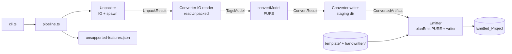
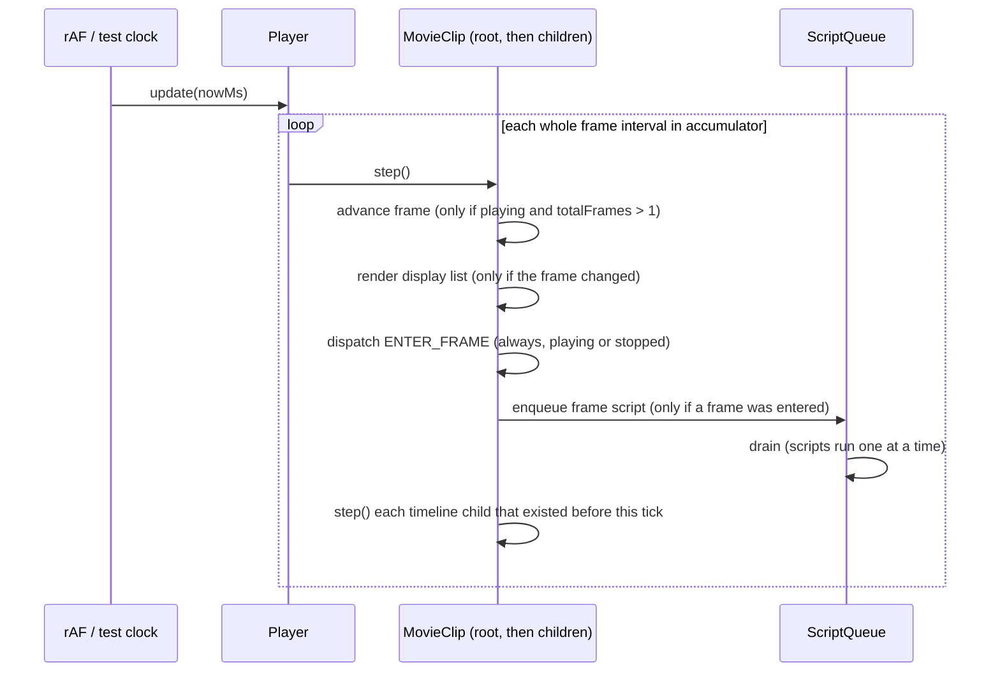

# Design Document: vertical-slice

## Overview

The vertical slice is a command-line Pipeline that takes one AS3 `.swf` and writes a runnable Vite + TypeScript + PixiJS project. It runs three stages in order: Unpack (FFDec as a separate process), Convert (FFDec output to Scene_JSON plus SVG files) and Emit (a deterministic, template-based project writer). The Emitted_Project contains a PixiJS timeline Runtime, a small Flash API Shim, and, for the Click_Sample, a hand-translated Click_Handler (`LeftButton`, `RightButton`).

Design goals, in priority order:

1. **Testable without Java or a browser.** Everything that carries logic is a pure function or sits behind a small interface: tags model to Scene_JSON, emit planning, force-safety checks, the timeline engine, the Shim, hit testing. FFDec, the file system and PixiJS are thin adapters.
2. **Deterministic output.** Same input gives byte-identical output: canonical JSON, code-unit sorting, LF line endings, no clocks, no random values, no absolute paths in output.
3. **Honest reporting.** Anything detected but not handled goes into the Unsupported_Feature_List. Nothing is dropped silently.
4. **Verified facts only.** FFDec commands and XML layout come from `.kiro/steering/tech.md` ("FFDec (checked by hand, 2026-11-11)"). Anything beyond that is marked **to verify** and is confirmed in the first implementation task, against a real dump of `samples/clickgoto/test.swf`.

### Sample facts used as the acceptance oracle

From `samples/clickgoto/PROVENANCE.md`: stage 550 x 400 px, 24 fps, root timeline of 3 frames. Shapes 1, 2, 4, 5. Sprite 6 (`LeftButton`, instance `l_button`, depth 1, at 143.5, 270) and sprite 3 (`RightButton`, instance `r_button`, depth 3, at 415, 272.5), two frames each. Root linked to `MainTimeline`.

Expected_State:

| Action           | `l_button`                         | `r_button`                         |
|------------------|------------------------------------|------------------------------------|
| Start            | stopped, frame 1                   | stopped, frame 1                   |
| Click `l_button` | `gotoAndStop(2)`: stopped, frame 2 | `gotoAndStop(1)`: stopped, frame 1 |
| Click `r_button` | `gotoAndPlay(2)`: playing from 2   | `gotoAndPlay(1)`: playing from 1   |

### Key design decisions

| # | Decision | Rationale |
|---|----------|-----------|
| D1 | Converter split into IO reader and pure `convertModel` | All property tests (10.1 to 10.3) run without Java or disk. |
| D2 | Scene_JSON types and `parseScene` live in the emitted-project template (`template/runtime/scene.ts`); the pipeline imports them from there | One definition. The round-trip property exercises the same parser the browser uses. |
| D3 | SVG well-formedness check and origin-offset extraction happen in the IO reader, not the pure part | The IO reader already needs an XML parser for the structure dump. The pure part stays free of XML libraries. The extraction rule is a separate pure string function with its own example tests on real SVG fixtures. |
| D4 | Runtime core is PixiJS-free; PixiJS sits behind a `RenderBackend` interface | Timeline, Shim, hit testing and the Expected_State oracle test run in Vitest with a fake backend. |
| D5 | Hit testing is done by the core using shape bounding boxes, not by PixiJS events | Deterministic, testable, and independent of how the SVG is drawn. Trade-off: non-rectangular shapes accept clicks in their empty corners (see risks). |
| D6 | Click events bubble from the hit object to its ancestors | In the Click_Sample the listener is on the sprite, but the thing under the pointer is a child shape. |
| D7 | Linked class instantiation uses a construction context set before `new Cls()` | AS3 constructors take no arguments, and `addFrameScript(...)` / `stop()` are called inside the constructor, so timeline data must exist by the time `super()` returns. |
| D8 | Converter writes to a staging directory; the Emitter copies assets into the output directory | Requirements 3.1, 4.1 and 5.1 (updated) have the Converter write to the Staging_Directory, because Requirement 5.8 forbids touching a non-empty output directory before the Emitter has checked it. |
| D9 | Emit is planned as a pure function (`planEmit`) that returns an in-memory file list, then written by a thin writer | Determinism (5.7) becomes a property test with no disk. |
| D10 | PixiJS shapes are drawn as vector `Graphics` from SVG text, behind `ShapeFactory`; texture rasterisation is the fallback | Crisp scaling on phones, no raster resolution choice. Pixi's SVG support is partial, so it is isolated (risk R4). |

## Architecture



Stage contracts (Requirement 9.3). Each stage module imports only the types of its own input and output artifact.

| Stage | Input artifact | Output artifact |
|-------|----------------|-----------------|
| Unpack | `UnpackInput` (swf path, work dir, ffdec location) | `UnpackResult` (paths + header values read from the dump root element) |
| Convert | `UnpackResult` | `ConvertedArtifact` (staging paths + Scene_JSON value + unsupported entries) |
| Emit | `ConvertedArtifact` + `EmitOptions` | `EmitResult` (output dir, file list) |

### Repository layout

Matches `.kiro/steering/structure.md`: pipeline stages are separate modules, the emitted layout is `runtime/ shim/ src/ assets/`. The emitted `runtime/` and `shim/` are authored once, as real TypeScript under `template/`, so Vitest tests the exact files that get emitted.

```
package.json  tsconfig.json  tsconfig.template.json  vitest.config.ts
src/
  pipeline/   cli.ts  pipeline.ts  errors.ts  unsupported.ts
  unpack/     unpack.ts  spawnFfdec.ts  ansi.ts  swfSniff.ts
  convert/    model.ts            # TagsModel (plain types)
              readUnpacked.ts     # IO: disk -> TagsModel
              ffdecXml.ts         # the ONLY file that knows FFDec XML element/attribute names
                                  # (also exports the pure readDumpHeader(xmlText), used by the Unpacker)
              symbolsCsv.ts  svgOrigin.ts  classProps.ts
              convertModel.ts     # PURE: TagsModel -> ConvertResult
              resolveTimeline.ts  # PURE: placement resolution
              sceneJson.ts        # canonical serialiser
              writeConverted.ts   # IO: staging dir
              errors.ts
  emit/       planEmit.ts  emit.ts  forceSafety.ts  versions.ts  packageJson.ts
template/                         # copied into the Emitted_Project
  index.html  vite.config.ts  tsconfig.json  package.json.tmpl
  src/main.ts  src/classes.ts.tmpl
  runtime/    scene.ts  player.ts  clock.ts  stageTree.ts  hitTest.ts  backend.ts  pixi/*.ts
  shim/       index.ts  events.ts  DisplayObject.ts  Sprite.ts  MovieClip.ts  Shape.ts  internal.ts
handwritten/
  clickgoto/  LeftButton.ts  RightButton.ts
samples/      (unchanged; the pipeline never reads original-source/)
test/         unit/  property/  e2e/  fixtures/
tools/ffdec/  (gitignored, third party)
```

`package.json` for the pipeline pins exact versions of `typescript`, `vitest`, `fast-check`, `fast-xml-parser`, `tsx` (chosen with `npm view` in the scaffolding task). `npm test -- --run` maps to `vitest --run`.

### Runtime frame tick (sequence)



## Components and Interfaces

### 1. Unpacker (`src/unpack/`)

```ts
export interface UnpackInput {
  swfPath: string;
  workDir: string;              // created by the pipeline (mkdtemp) before the stage runs
  ffdecJarPath: string;         // default: <repo>/tools/ffdec/ffdec-cli.jar
  javaCommand?: string;         // default "java"
  timeoutMs?: number;           // default 60_000
}

// Read from the ROOT ELEMENT of the swf2xml dump by readDumpHeader (ffdecXml.ts); no separate FFDec call.
export interface SwfHeader {
  widthPx: number;              // stage rect width in twips / 20
  heightPx: number;             // stage rect height in twips / 20
  frameRate: number;            // frames per second
  frameCount: number;           // root timeline frames
}

export interface UnpackResult {
  workDir: string;
  shapesDir: string;            // <workDir>/shapes (absolute)
  structureDumpPath: string;    // <workDir>/structure.xml
  symbolClassPath: string;      // <workDir>/symbolClass/symbols.csv
  scriptsDir: string;           // <workDir>/scripts
  header: SwfHeader;
  xmlVersion: { major: number; minor: number };
}

export function unpack(input: UnpackInput): Promise<UnpackResult>;
```

The Unpacker runs exactly two FFDec invocations (Requirement 2.1). It imports one small pure function from `src/convert/ffdecXml.ts`, `readDumpHeader(xmlText): { xmlVersion, header }`, which reads `_xmlExportMajor`/`_xmlExportMinor`, the Frame_Rate, the root frame count and the stage rectangle from the root element. This keeps every FFDec element and attribute name in one file; the Unpacker has no XML knowledge of its own. `readDumpHeader` is covered by example tests on a captured root-element fixture and throws `MissingHeaderValueError` (below). The Converter reader calls the same function, so the two stages cannot disagree.

FFDec invocations (verified in tech.md). Always `spawn(javaCommand, ['-jar', jar, ...args], { shell: false })` with an argument array, so no path is ever interpreted by a shell.

| Order | Command | Purpose |
|-------|---------|---------|
| 0 | none (fs) | Validate path, readability, first 3 bytes in {`FWS`,`CWS`,`ZWS`} |
| 1 | `-swf2xml <swf> <workDir>/structure.xml` | Structure dump. Version check, AS3 check and header values (Frame_Rate, root frame count, stage rectangle) read it. |
| 2 | `-export shape,script,symbolClass <workDir> <swf>` | `shapes/<id>.svg`, `scripts/<Class>.as`, `symbolClass/symbols.csv`. |

The order puts the cheap rejections (invalid SWF, AS3, XML version, missing header values), which all read the dump from invocation 1, before the export, as Requirements 2.6, 2.9 and 2.10 need ("stop before exporting"). Each process has its own 60 s limit.

Behaviour per requirement:

- **2.7**: check the file exists, is readable and starts with `FWS`/`CWS`/`ZWS` before any process starts. Error `InvalidSwfError(path)`.
- **2.3**: `fs.access(ffdecJarPath)` before the first spawn. Error `FfdecNotFoundError(expectedPath)`. The work dir is not touched. If `java` itself is missing the spawn fails with `ENOENT`; that maps to `JavaNotFoundError` ("Java 17+ is required", see tech.md).
- **2.4**: non-zero exit gives `FfdecExitError(code, stderrText)`. Stderr is ANSI-stripped.
- **2.5**: a timer kills the child (`child.kill()`; the child is `java` itself so no process tree is needed) and rejects with `FfdecTimeoutError(60)`. The timer is cleared on exit.
- **2.6 AS3 check**: read the first 64 KiB of `structure.xml` and look for the FileAttributes tag with its ActionScript 3 flag. Element and attribute names: **to verify against the real XML dump during the first task** (expected near the head of the tag list). No FileAttributes tag, or the flag unset, gives `NotAs3Error`.
- **2.9**: read `_xmlExportMajor` / `_xmlExportMinor` from the root element (verified names). Supported major is a constant `SUPPORTED_XML_MAJOR = 4` in `ffdecXml.ts`. Anything else gives `XmlVersionError(found, supported)`. A different minor with the same major is accepted and logged as a warning.
- **2.8**: after exit 0, check that `shapesDir`, `structure.xml`, `symbols.csv` and `scriptsDir` exist. Error `MissingExportError(names[])` lists every missing one. A SWF with zero shapes may leave `shapes/` absent (**to verify**); in that case the Unpacker treats a missing `shapes/` as an error only if the structure dump declares shapes. That check needs the XML, so it moves to the Converter reader (`MissingExportError` from `readUnpacked`). The Unpacker still reports the missing path.
- **ANSI stripping** (`ansi.ts`): `text.replace(/\u001B\[[0-?]*[ -/]*[@-~]/g, '')`, applied to every captured stdout/stderr before parsing or error text.
- **2.2 / 2.10 header values**: after invocation 1 and the version and AS3 checks, `readDumpHeader` reads Frame_Rate, root frame count and the stage rectangle from the root element. Width and height in pixels are the rectangle extent in twips (max minus min) divided by 20. The exact attribute names for all of these are **to verify against the real dump in the first task** (see the table in section 2); they are not guessed here. A missing, non-numeric or non-finite value gives `MissingHeaderValueError(names[])` naming each missing value (`frameRate`, `frameCount`, `stageRect`), thrown before the export runs.

### 2. Converter IO reader (`src/convert/readUnpacked.ts`)

```ts
export function readUnpacked(unpacked: UnpackResult): Promise<TagsModel>;   // IO, no logic beyond parsing
```

Responsibilities:

1. Read `structure.xml` and parse it with `fast-xml-parser` using `preserveOrder: true` (tag order is semantically significant: placements, labels and `ShowFrameTag` form the timeline). Parsing to the typed model happens in `ffdecXml.ts`; no other file mentions an XML element or attribute name.
2. Read `symbols.csv` with `parseSymbolsCsv` (`<id>;"<Class>"`, id 0 is the root).
3. List `shapes/*.svg`, read each as UTF-8, normalise nothing, check well-formedness with the same XML parser (`MalformedSvgError(file)`), extract the origin offset (`extractSvgOrigin`).
4. For every class named in the symbol-class map, read `scripts/<Class>.as` if present and extract declared property names (`classProps.ts`: `\bvar\s+([A-Za-z_$][\w$]*)`, skipping `[Embed(...)]` metadata lines). A missing source gives `properties: null`.
5. Assemble `TagsModel`.

#### Verified XML facts (tech.md) and the shape of the adapter

Verified:

- `PlaceObject2Tag` items with `depth`, `characterId`, `name`, `placeFlagMove`, and a `matrix` child in twips (divide by 20 for pixels).
- `DefineSpriteTag` with `subTags`.
- Frames end at `ShowFrameTag`.
- Root element carries `_xmlExportMajor` / `_xmlExportMinor` (4.2 today). FFDec warns the structure is not final.

Header values (Frame_Rate, root frame count, stage rectangle) are read from the same root element by `readDumpHeader`. The background colour is read from `SetBackgroundColorTag`, white `#ffffff` when that tag is absent.

To verify against the real XML dump during the first task (the adapter will not guess these; each has a fixture-based test once confirmed):

| Item | What the design assumes, until verified |
|------|-----------------------------------------|
| How a tag item states its kind | An attribute on each item naming the tag (tech.md calls them "`PlaceObject2Tag` items"). |
| Placement flags other than `placeFlagMove` | Sibling flags for "has character", "has matrix", "has colour transform", "has name", "has clip depth". The adapter must know which fields are optional. |
| Matrix children | Scale, rotate/skew and translate fields; whether fixed-point values are already decoded floats. `MatrixModel` stores decoded floats `a b c d` and integer twips `tx ty`. |
| Colour transform child on a placement | Multiplier and offset fields; fixed-point scale of multipliers (expected 1/256). `ColorTransformModel` stores decoded floats. |
| `PlaceObject` / `PlaceObject3Tag` | Same semantics as `PlaceObject2Tag`, plus a filter list on `PlaceObject3Tag`. Handled by the same adapter function if the field names match. If a SWF contains them and the adapter does not know the fields, it records an `unsupported` observation of kind `other-tag` instead of misreading. |
| `RemoveObject` / `RemoveObject2Tag` | A depth (and for `RemoveObject`, a character id). |
| Frame labels | A `FrameLabelTag` (or similar) with a name, applying to the frame ended by the next `ShowFrameTag`. |
| Root element: Frame_Rate | Name of the root attribute (or child) holding the frame rate, and whether it is a plain number or fixed-point. Not invented here. |
| Root element: root frame count | Name of the root attribute holding the root timeline frame count. |
| Root element: stage rectangle | Names of the rectangle's min/max fields (x and y, in twips) and whether they are attributes or children. Width and height px = (max minus min) / 20. |
| `SetBackgroundColorTag` | RGB field names. Absent tag: stage background defaults to white `#ffffff`. |
| Declared sprite frame count | A frame-count attribute on `DefineSpriteTag`. |
| Shape definition tags | Which tag names define shapes (`DefineShapeTag` and variants) and carry `shapeId`/`characterId`. |
| Morph shapes | Tag names such as `DefineMorphShapeTag` / `DefineMorphShape2Tag`. |
| Unsupported kinds | Tag names for text (`DefineTextTag`, `DefineEditTextTag`), sound (`DefineSoundTag`, `SoundStreamHead*`), button (`DefineButton*Tag`), video (`DefineVideoStreamTag`). A table in `ffdecXml.ts` maps tag name to kind. |
| Filters and masks | Filter list on `PlaceObject3Tag`; clip depth on a placement. |
| Bitmap/font definitions | Names and whether they need an `other-tag` observation. |

The IO reader never infers rules from tags it does not recognise. Unrecognised **definition** tags (tags that introduce a character id) become an `other-tag` observation so nothing disappears silently.

### 3. Converter pure part (`src/convert/convertModel.ts`)

```ts
export function convertModel(model: TagsModel): ConvertResult;   // throws ConvertError subclasses

export interface ConvertResult {
  scene: SceneJson;                       // validated
  svgFiles: SvgFile[];                    // sorted by numeric id
  unsupported: UnsupportedFeatureEntry[]; // sorted, total order
  warnings: string[];                     // sorted; printed to stderr
  stats: { svgWritten: number; morphSkipped: number; declaredShapes: number };
}
export interface SvgFile { fileName: string /* "<id>.svg" */; content: string }
```

No `fs`, no `child_process`, no clock, no randomness, no locale-dependent calls (`localeCompare` and `Date` are banned in this directory by an ESLint-free test that greps the sources for `from 'node:fs'`, `Date`, `Math.random`, `localeCompare`).

#### Steps

1. **Validate model shape** (ids are non-negative safe integers, lists are arrays, twips are integers). Failure gives `MalformedFrameDataError`.
2. **Index**. `shapes` by id, `sprites` by id, `symbolClasses` by id (duplicates: last wins is wrong, so duplicates are an error `MalformedFrameDataError('symbolClass', id)`), `observedUnsupported` by character id.
3. **Shapes** (Req 3). For every id in `declaredShapeIds`: asset must exist and `svg` must be a non-empty string, else `ShapeExportError(id)`. Morph shapes (declared as morph in the model) produce no SVG and one entry. Output `svgFiles` sorted by id, content with `\r\n` and lone `\r` rewritten to `\n` (only normalisation applied to FFDec's bytes, for cross-platform determinism).
4. **Symbols**. For every sprite (and the root as id `0`): resolve its timeline with `resolveTimeline` (below), attach `className` iff `symbolClasses` has the id.
5. **Reference check** (Req 4.7). After resolution every `symbolId` in every entry must be a key of the Symbol_Table, or have been dropped as unsupported (Req 3.8, dropped placements). Otherwise `UnknownSymbolError(symbolId, spriteId, frame, depth)`.
6. **Cycle check**. A sprite that (transitively) places itself gives `SymbolCycleError(path[])`. The runtime would recurse forever.
7. **Unsupported entries**: observations, morph shapes, filters, masks, unbound instance names (Req 8.7).
8. **Assemble** `SceneJson`, run `validateScene` (the same function the runtime uses), return.

#### Placement resolution (`resolveTimeline.ts`)

Input: an ordered `TimelineOp[]` for one timeline. Output: `frames: DisplayListEntry[][]`, `labels`.

State: `Map<depth, Placed>` where `Placed = { symbolId, matrix, colorTransform, name }`.

```
frame = 1 ; pendingLabels = []
for op in ops:
  place:
    if op.clipDepth is set or op.hasFilters:
        record dropped-placement entry (sprite, frame, depth, kind mask|filter) ; remove any entry at that depth ; continue
    if op.characterId is set and refers to an unsupported character (text, sound, button, video, morph shape):
        record dropped-placement entry (sprite, frame, depth, kind of the character) ; remove any entry at that depth ; continue
    if op.move and no characterId and the entry at that depth was dropped earlier: continue (no second entry for the same placement)
    if !op.move:
        require op.characterId, else MalformedFrameDataError(sprite, frame, 'place without character')
        state[depth] = { symbolId: op.characterId,
                         matrix: op.matrix ?? identity,
                         colorTransform: op.colorTransform ?? identity,
                         name: op.name ?? '' }
        (if the depth was occupied, this replaces it and records a warning)
    else if op.characterId is set:                      # move + character = replace character, keep rest
        require state[depth], else MalformedFrameDataError
        state[depth] = { symbolId: op.characterId,
                         matrix: op.matrix ?? old.matrix,
                         colorTransform: op.colorTransform ?? old.colorTransform,
                         name: op.name ?? old.name }
    else:                                               # move only = update properties
        require state[depth], else MalformedFrameDataError
        state[depth] = { ...old, matrix: op.matrix ?? old.matrix,
                         colorTransform: op.colorTransform ?? old.colorTransform,
                         name: op.name ?? old.name }
  remove:  state.delete(op.depth)     # removing an empty depth is a no-op plus warning
  label:   pendingLabels.push(op.name)
  showFrame:
    frames.push( sorted-by-depth snapshot of state, each tx/ty converted twips -> px )
    for each pending label: labels.push({ name, frame })
    pendingLabels = [] ; frame += 1
ops after the last showFrame: ignored with a warning
```

Properties of the output:

- Every frame lists every instance present in that frame and no other (Req 4.10): the snapshot is the full state.
- Entries are sorted by ascending depth (Req 4.3); depth is unique within a frame.
- "Same depth, same symbol id" identity is a runtime concern; the converter's job is to give absolute state per frame so the runtime can compare consecutive frames.
- The frame count of a sprite and of the root is the number of `showFrame` ops, never the declared `frameCount` attribute (FINDINGS.md, Task 2.3: FFDec keeps the stored attribute even when the tag list disagrees). When `declaredFrameCount` is present and differs from the counted value, the counted value is used and a warning naming the sprite, the declared value and the counted value is recorded. It is not an error.
- A sprite with zero `showFrame` ops becomes one empty frame plus a warning; ops after the last `showFrame` belong to no frame and are dropped with a warning. This was only verified on a hand-edited dump, so the rule is a tolerant fallback, not a confirmed FFDec behaviour.
- A counted frame count above 65535 is `MalformedFrameDataError`.
- Duplicate label name within a sprite: the first occurrence wins, a warning is recorded. Labels sorted by `(frame, name)` by code unit.

#### Twips to pixels

`px = twips / 20`, computed once, in `resolveTimeline`, for matrix `tx`, `ty`. Matrix scale/skew `a b c d` are unitless and copied. Bounds origin offsets already arrive in pixels from the SVG wrapper (the SVG is in px; see below). `-0` is normalised to `0` after every division. Division by 20 of an integer yields the nearest double; `JSON.stringify` prints the shortest string that round-trips, so formatting is stable across runs and platforms.

#### Bounds origin offset

Where: **IO reader**, function `extractSvgOrigin(svgText): { x: number; y: number } | null` in `svgOrigin.ts` (pure string function, tested alone). It finds the outermost `<g transform="matrix(a, b, c, d, tx, ty)">` wrapper and returns `(tx, ty)` when `a, b, c, d` are numerically `1, 0, 0, 1`. Real FFDec 26.4.0 output reads `matrix(1.0, 0.0, 0.0, 1.0, 42.5, 40.5)`, so the parser accepts decimal forms such as `1.0` and optional whitespace after commas, and compares numbers, not text (FINDINGS.md, Task 2.2 item 5). The runtime draws the SVG at `(-tx, -ty)` (FINDINGS.md, Task 2.3, confirmed). If the wrapper is absent or has a different transform it returns `null` and the model carries `origin: null`; the pure part then uses `(0, 0)` and records a warning.

Meaning of the value. tech.md: the wrapper shifts the shape so its bounds start at (0, 0), and "the shape's own origin is at (tx, ty) inside the SVG; the runtime must offset by that". So `origin` is the position of the shape's local (0, 0) inside the SVG picture. The Shape_Symbol stores it as `origin: { x: tx, y: ty }`. To make the placement matrix apply to the shape's own origin, the runtime positions the drawn SVG at `(-origin.x, -origin.y)` inside the shape node. Requirement 6.4 says "offset each Shape_Symbol drawing by its bounds origin offset"; this design pins the sign convention (subtract) and the first task checks it on the Click_Sample by comparing against the placements `PROVENANCE.md` lists (for example `l_button` at 143.5, 270).

Reason it is in IO: it needs only a regex over text that the IO reader already holds, and keeping it out of `convertModel` means `ShapeAssetModel` is the whole contract and the generators in property tests supply `origin` directly.

#### Deterministic serialisation (`sceneJson.ts`)

```ts
export function serialiseScene(scene: SceneJson): string;   // canonical text
export function parseScene(text: string): SceneJson;        // from template/runtime/scene.ts; throws SceneParseError
```

Canonical rules:

- Object keys sorted ascending by UTF-16 code unit at every level (symbol-table keys sort as strings, so `"10"` precedes `"2"`; this is intentional and stable).
- Arrays keep their order (frames, entries, labels carry meaning).
- Two-space indentation, `\n` line endings, exactly one trailing newline.
- Numbers: finite only, `-0` normalised to `0`, printed by `JSON.stringify` (shortest round-trip form). `NaN`/`Infinity` are rejected by `validateScene`.
- Strings: `JSON.stringify` escaping.

#### Errors (`src/convert/errors.ts`)

```ts
export abstract class PipelineError extends Error {
  abstract readonly stage: 'unpack' | 'convert' | 'emit' | 'pipeline';
  abstract readonly code: string;
}
export class UnknownSymbolError extends ConvertError {
  constructor(readonly symbolId: number, readonly spriteId: number, readonly frame: number, readonly depth: number);
}
export class ShapeExportError extends ConvertError { constructor(readonly symbolId: number, readonly reason: 'missing' | 'empty'); }
export class MalformedSvgError extends ConvertError { constructor(readonly fileName: string); }
export class MalformedFrameDataError extends ConvertError {
  constructor(readonly spriteId: number | 'root', readonly frame: number | null, readonly item: string);
}
export class SymbolCycleError extends ConvertError { constructor(readonly path: number[]); }
export class MissingExportError extends PipelineError { constructor(readonly names: string[]); }
```

Every message names the id / sprite+frame, so `error.message` satisfies Requirements 3.4, 3.5, 4.7, 4.9.

### 4. Converter writer (`src/convert/writeConverted.ts`)

```ts
export interface ConvertedArtifact {
  stagingDir: string;                       // <workDir>/converted
  scenePath: string;                        // <stagingDir>/assets/scene.json
  svgPaths: string[];                       // absolute, sorted by id
  scene: SceneJson;                         // kept in memory for the Emitter (class registry)
  unsupported: UnsupportedFeatureEntry[];
  stats: ConvertResult['stats'];
}
export function convertStage(unpacked: UnpackResult): Promise<ConvertedArtifact>;   // readUnpacked -> convertModel -> write
```

Write order: all SVGs ascending by id, then `scene.json` last, through a temp file and `rename` so a partial scene file never exists (Req 4.7, 4.9). The pure step runs **before** any write, so a conversion error leaves the staging dir without `scene.json` and without SVGs. This also satisfies Requirement 3.4 (previously written SVGs stay) trivially: malformed SVGs are detected while reading, before anything is written. Where the pipeline needs SVG well-formedness to fail after some SVGs were written, none are.

### 5. Emitter (`src/emit/`)

```ts
export interface EmitOptions {
  outputDir: string;
  force: boolean;
  swfPath: string;                 // only used for the force-safety check
  cwd: string; homeDir: string;    // injected for testability
  templateDir: string;             // <repo>/template
  handwrittenDir: string | null;   // e.g. <repo>/handwritten/clickgoto
}
export interface EmitInput { artifact: ConvertedArtifact; templates: TemplateFile[]; handwritten: HandwrittenClass[] }
export interface TemplateFile { path: string; content: string }                       // posix relative path
export interface HandwrittenClass { className: string; fileName: string; source: string }
export interface EmittedFile { path: string; content: string }                        // posix relative path

export function planEmit(input: EmitInput, svgContents: SvgFile[]): EmittedFile[];  // PURE, sorted by path
export function emit(artifact: ConvertedArtifact, options: EmitOptions): Promise<EmitResult>;
export function checkForceTarget(resolvedOut: string, ctx: ForceContext): ForceRefusal | null;   // PURE
```

`planEmit`:

- Copies every template file unchanged, except `package.json.tmpl` and `src/classes.ts.tmpl`, which are generated.
- Generated `package.json`: built from an object with keys inserted in sorted order, `JSON.stringify(..., null, 2)`, scripts `dev` (`vite`), `build` (`vite build`), `typecheck` (`tsc --noEmit`). Dependencies `pixi.js` plus dev dependencies `typescript`, `vite` with **exact** versions from `src/emit/versions.ts`. Chosen and verified with `npm view pixi.js version` / `npm view vite version` / `npm view typescript version` in a scaffolding task (not guessed here). A unit test asserts each version matches `^\d+\.\d+\.\d+$`. Package `name` is the constant `swf-resurrect-output`.
- Generated `src/classes.ts`: for each handwritten class whose `className` is linked in the Symbol_Table, an `import` and an entry in `classRegistry`. Classes without a handwritten translation are simply absent; the runtime then uses a plain `MovieClip`.
- `assets/scene.json` content is `serialiseScene(scene)`; `assets/<id>.svg` come from `svgFiles`.
- Output sorted by path (code-unit order), all line endings `\n`. Nothing depends on time, the absolute output path, or `readdir` order (inputs are sorted before use).

`emit`:

1. Resolve `outputDir` with `path.resolve`, then `realpath` on the deepest existing ancestor and re-append the missing segments.
2. If the directory has entries and not `force`: throw `OutputDirNotEmptyError(outputDir)`. Nothing modified (Req 5.8).
3. If `force`: `checkForceTarget(resolved, ctx)`; refusal throws `UnsafeForceTargetError(outputDir, reason)` and deletes nothing (Req 5.10).
4. Plan files in memory first. A planning error therefore never touches the disk.
5. If `force` and the directory exists: for each direct entry run `fs.rm(entry, { recursive: true, force: true })`. `fs.rm` does not follow symbolic links, so a link inside the directory is removed, not its target. The directory itself stays (Req 5.9).
6. Write files in sorted order with `mkdir -p` per file. On a write failure, best-effort remove the files already written by this run, then throw `EmitWriteError(path, cause)`. The stage reports failure, so a partial project is never reported as success (Req 5.11).

`checkForceTarget(resolved, ctx)` refuses when `resolved`, after case folding on Windows, equals or is an ancestor of any of: a filesystem root (`path.parse(p).root === p`), `ctx.homeDir`, `ctx.cwd`; or `resolved` is an ancestor-or-equal of `dirname(ctx.swfPath)` (a directory containing the input SWF). Reasons are enumerated strings (`filesystem-root`, `home-directory`, `current-directory`, `ancestor-of-current-directory`, `contains-input-swf`). Home equality rather than ancestry: Requirement 5.10 lists "the current user's home directory", not its ancestors. Ancestors of the home directory are also ancestors of the cwd in practice, and any other case is a filesystem root. The check is pure over strings, so a property test generates path trees.

Unsupported-features file: the Pipeline writes `unsupported-features.json` (`{ "entries": [...], "formatVersion": 1 }`, canonical JSON) into the output directory after a successful emit, and also after a failure that happens once Convert has completed, but only when the failure is not the output-directory refusal itself (5.8 or 5.10). In the refusal case the list is printed to stderr instead, because Requirement 5.8 forbids modifying that directory.

### 6. Runtime (`template/runtime/`)

Pixi-free core, plus one adapter.

```ts
// scene.ts (also imported by the pipeline)
export interface SceneJson { /* see Data Models */ }
export function parseScene(text: string): SceneJson;
export function validateScene(scene: unknown): asserts scene is SceneJson;

// clock.ts
export interface Clock { now(): number }                       // ms, monotonic
export class ManualClock implements Clock { advance(ms: number): void; now(): number }

// backend.ts  (the ONLY surface PixiJS implements)
export type NodeHandle = unknown;
export interface RenderBackend {
  loadShape(symbolId: number, svgText: string, origin: { x: number; y: number }): Promise<ShapeBounds>;
  createContainer(): NodeHandle;
  createShape(symbolId: number): NodeHandle;
  addChildAt(parent: NodeHandle, child: NodeHandle, index: number): void;
  removeChild(parent: NodeHandle, child: NodeHandle): void;
  setTransform(node: NodeHandle, t: { x: number; y: number; scaleX: number; scaleY: number; rotationDeg: number }): void;
  setAlpha(node: NodeHandle, alpha: number): void;
  setVisible(node: NodeHandle, visible: boolean): void;
  setColorMultiplier(node: NodeHandle, r: number, g: number, b: number, a: number): void;
  destroyNode(node: NodeHandle): void;
  showError(message: string): void;                          // on-page error text (Req 6.6 to 6.8)
}
export interface ShapeBounds { x: number; y: number; width: number; height: number }   // in shape-origin coordinates

// player.ts
export interface PlayerOptions {
  scene: SceneJson; backend: RenderBackend; clock: Clock;
  classRegistry: Record<string, new () => MovieClip>;
  shapeBounds: ReadonlyMap<number, ShapeBounds>;             // result of loading all shapes
  maxCatchUpFrames?: number;                                 // default 5
}
export class Player {
  constructor(options: PlayerOptions);
  readonly root: MovieClip;
  update(): void;                                            // reads clock, runs whole frame steps
  dispatchClick(stageX: number, stageY: number): void;       // hit test, then bubble
  readonly frameIntervalMs: number;                          // 1000 / frameRate
}
```

**Tick loop.** `update()` reads `clock.now()`, adds the elapsed time to an accumulator and, while `accumulator >= frameIntervalMs - 1e-9`, subtracts one interval and runs one `root.step()`. The epsilon stops a fractional interval such as `1000/24` from losing a frame to floating-point error. `maxCatchUpFrames` bounds a catch-up burst after a stalled tab (extra time is dropped). A fixed-step accumulator keeps the interval average at `1/Frame_Rate` over 60-frame windows (Req 6.2) irrespective of how irregular `requestAnimationFrame` is. The Pixi adapter calls `player.update()` from a `requestAnimationFrame` callback using `performance.now()` as the clock; tests use `ManualClock`.

**Frame step** (Req 6.10 to 6.12, 7.9, 7.12):

```
step(mc):
  entered = false
  if mc.playing and mc.totalFrames > 1:
      mc.setFrame(next frame, wrapping to 1 after totalFrames) ; renderFrame() ; entered = true
  dispatch ENTER_FRAME to mc's listeners (registration order)    # playing OR stopped
  if entered: scripts.enqueue(mc, mc.currentFrame) ; scripts.drain()
  for child in snapshot(timeline children of mc that existed before this tick and still attached): step(child)
```

A stopped clip, or a single-frame clip, does not change frame (Req 6.12) and runs no frame script, but it still receives `ENTER_FRAME` once per tick, as in Flash (Req 7.9). The traversal visits every clip on the stage, so a stopped parent does not hide its playing children, and a stopped child still gets its event. The trade-off is that a listener on a stopped clip runs on every tick; this is what Flash does and what translated game code expects. A single-frame clip never "enters" a frame again, so its frame 1 script runs once, at creation.

**Frame-script queue** (Req 7.12 to 7.14). One `ScriptQueue` per Player.

```
enqueue(mc, frame): pending.push({ mc, frame })
drain(): if draining return ; draining = true
         while pending not empty: take first; fn = mc.frameScripts.get(frame) ; if fn run it
         draining = false
```

A `gotoAndPlay`/`gotoAndStop` called from inside a running script renders the target frame immediately (state is updated at once, Req 7.5/7.6) but only enqueues the target script; it runs after the current script returns (Req 7.14). Outside a script (for example from a click handler) `drain()` runs it right away, after the render (Req 7.13). The function is looked up when the entry is dequeued, so `addFrameScript` replacing a script is honoured.

**Display-list reconcile** (Req 6.4, 6.5, 6.9). `MovieClip.renderFrame()` compares the new frame's entries with the clip's timeline-managed children (a `Map<depth, Child>` kept apart from children added by script):

```
for each depth in old but not in new:             remove child (destroy node, delete instance-name property)
for each entry in new:
    old = children.get(depth)
    if old and old.symbolId == entry.symbolId:    # same depth, same id: SAME display object
        if matrix changed vs old.lastMatrix:        apply it
        if colour transform changed:                apply it
        if name changed:                            rename and re-expose property
    else:
        if old: remove old
        create child via symbol (class instantiation for linked sprites), apply matrix/ct/name
        insert at index = position by depth (ascending depth = lower index = drawn below)
```

Only properties that changed in the *Scene_JSON* are re-applied, so values set by scripts persist while the timeline is not changing them (the listeners and assigned properties persist per Req 6.9).

**Matrix decomposition.** `x = tx`, `y = ty`, `scaleX = hypot(a, b)`, `scaleY = sign(det) * hypot(c, d)`, `rotation = atan2(b, a)` in degrees. Skew that cannot be expressed this way is approximated and reported once through `console.warn`.

**Instance creation** (Req 6.1, 6.11, 8.4, 8.6). Creating a sprite instance:

```
ctx = { player, symbol, symbolId }
Cls = symbol.className && classRegistry[symbol.className]  or MovieClip
mc = withConstructionContext(ctx, () => new Cls())      # ctor runs; base MovieClip reads ctx; ctor may call stop() / addFrameScript(...)
mc.renderFrame()                                        # frame 1: creates and recursively binds children
for each named child: Reflect.set(mc, name, child)      # try/catch: failure leaves the property unset (8.6)
scripts.enqueue(mc, 1) ; scripts.drain()                # frame 1 script, after binding (8.4)
```

Children are created recursively inside `renderFrame()`, so a parent's frame-1 script (and constructor body after `super()`) sees ready children when it runs at the end, while each child's own constructor runs before the child's children exist, matching AS3 constructors that only touch themselves.

**Hit testing** (`hitTest.ts`, pure). `hitTest(root, x, y): DisplayObject | null` walks children from the highest depth down. For each visible object it maps the stage point to the object's local space with the inverse of its 2D transform (composed from x, y, scale, rotation), then:

- Shape: hit if the local point lies inside `bounds` (rectangle in shape-origin coordinates, from `ShapeBounds`).
- Container: test children topmost first, return the first hit; a container has no area of its own.

`dispatchClick(x, y)`: `target = hitTest(...)`. If `null`, nothing is delivered and nothing changes (Req 8.5). Otherwise dispatch `MouseEvent.CLICK` on `target` and then up the `parent` chain; each registered listener is called once per click (Req 7.10, 8.2), with `event.target` set to the hit object and `event.currentTarget` to the dispatching ancestor.

**Shape bounds in the adapter.** After drawing the SVG the adapter measures its local bounds and returns them shifted into shape-origin coordinates: `{ x: b.x - origin.x, y: b.y - origin.y, width, height }`.

**Pixi adapter** (`runtime/pixi/`, the only file importing `pixi.js`). Assumes PixiJS 8.x APIs (`Application.init`, `Graphics.svg`). The exact version is pinned after `npm view`; API names are verified in the scaffolding task.

- `loadShape`: builds a `Graphics` from the SVG text and stores it by id; failure calls `showError("SVG asset <id>.svg failed to load")`, which stops playback before it starts (Req 6.7).
- `createShape(id)`: a `Container` holding a clone of the template drawing at `(-origin.x, -origin.y)`.
- Colour transform: multiplier RGB maps to `tint`, multiplier A maps to `alpha`; offsets are not supported and are reported once at runtime (filters/blend modes are out of scope).
- Stage: `Application` with width, height and background from Scene_JSON; the canvas is the click target (`pointerdown` converts to stage coordinates and calls `dispatchClick`).
- Boot (`src/main.ts`): `fetch('assets/scene.json')` then `parseScene`; on failure `showError("Scene_JSON failed to load")` and no frame renders (Req 6.6). Missing SVG for an entry: skip the entry, show an error naming it, continue (Req 6.8).

### 7. Shim (`template/shim/`)

Public surface (Requirement 7), exported from `shim/index.ts`:

```ts
export class Event { static readonly ENTER_FRAME = 'enterFrame'; constructor(readonly type: string); target: EventDispatcher | null; currentTarget: EventDispatcher | null }
export class MouseEvent extends Event { static readonly CLICK = 'click'; }
export class EventDispatcher {
  addEventListener(type: string, listener: (e: Event) => void): void;
  removeEventListener(type: string, listener: (e: Event) => void): void;
}
export class DisplayObject extends EventDispatcher {
  x: number; y: number; scaleX: number; scaleY: number;
  rotation: number;                                  // degrees
  get alpha(): number; set alpha(v: number);         // clamped to [0, 1]
  visible: boolean;
  get width(): number; set width(v: number);
  get height(): number; set height(v: number);
  get parent(): DisplayObjectContainer | null;
  name: string;                                       // default ''
}
export class DisplayObjectContainer extends DisplayObject {
  get numChildren(): number;
  addChild<T extends DisplayObject>(child: T): T;     // appended at highest index
  removeChild<T extends DisplayObject>(child: T): T;
  getChildByName(name: string): DisplayObject | null; // direct children only
}
export class Sprite extends DisplayObjectContainer {}
export class MovieClip extends Sprite {
  play(): void; stop(): void;
  gotoAndPlay(frame: number | string): void;
  gotoAndStop(frame: number | string): void;
  get currentFrame(): number;                         // 1-based
  get totalFrames(): number;                          // >= 1
  get currentLabels(): ReadonlyArray<{ name: string; frame: number }>;
  addFrameScript(...pairs: Array<number | (() => void)>): void;   // 0-based index, function, ...
}
```

Behaviour notes:

- **Event dispatch** snapshots the listener array at the start of a dispatch and calls every listener in the snapshot. Interpretation of Requirement 7.8 ("from the next dispatch onward, including when called from within a dispatch of the same event"): removal takes effect for the **next** dispatch; a listener removed during the current dispatch is still called in it. Registration order is preserved; adding the same listener twice registers it once.
- **Frame arguments**: a string is resolved against the labels; a number must be an integer in `1..totalFrames`. Otherwise the call leaves `currentFrame` and the playing state unchanged and logs one `console.warn` containing the invalid value (Req 7.7). `addFrameScript` index outside `0..totalFrames-1` registers nothing and warns once with the value (Req 7.15). An odd number of arguments, or a non-function second item, also warns and ignores the pair.
- **`gotoAndStop(n)`** sets the frame, renders it, stops (Req 7.5). **`gotoAndPlay(n)`** sets the frame, renders it, plays; the next tick moves to `n + 1` (wrapping), so "playing from 2" for a 2-frame clip shows frame 2 now and frame 1 next tick (Req 7.6).
- **Per-instance state** (Req 7.16): state lives on the instance; nothing in `play/stop/goto*` touches `parent` or siblings.
- **Instance names** (Req 7.17): on reconcile, a named child is exposed with `Reflect.set(parent, name, child)`, `child.name = name`, and removed with `Reflect.deleteProperty` when the child is removed (only if the property still points at that child). `parent` is a real getter on the child, so `this.parent.r_button.gotoAndStop(1)` works in translated code.
- **Dimensions**: `width`/`height` come from the backend bounds of the node times the scale; they are read-mostly in the slice (a setter adjusts scale).
- **Internal API** (`shim/internal.ts`, not re-exported from `index.ts`): `withConstructionContext`, `attachChild`, `detachChild`, `renderFrame`, `step`. The Runtime uses it; translated code does not see it.
- Outside a construction context (`new MovieClip()` in user code) a clip has one empty frame, `totalFrames` 1.

### 8. Hand-translated Click_Handler (`handwritten/clickgoto/`)

`LeftButton`/`RightButton` extend `MovieClip` directly: `EventWatcher` is test instrumentation (see the Provenance_Note) and the decompiled `super()` call to it is dropped, along with `trace(...)` calls and `[Embed(...)]` metadata. Names come from the real decompiled sources (verified when the first task unpacks the sample; `original-source/` is only a human reference).

```ts
import { Event, MouseEvent, MovieClip } from '../shim';

interface ClickStage extends MovieClip { l_button: MovieClip; r_button: MovieClip }

export class LeftButton extends MovieClip {
  constructor() {
    super();
    this.addEventListener(MouseEvent.CLICK, this.clicked);
    this.stop();
  }
  clicked = (_event: Event): void => {
    this.gotoAndStop(2);
    (this.parent as unknown as ClickStage).r_button.gotoAndStop(1);
  };
}

export class RightButton extends MovieClip {
  constructor() {
    super();
    this.addEventListener(MouseEvent.CLICK, this.clicked);
    this.stop();
  }
  clicked = (_event: Event): void => {
    this.gotoAndPlay(1);
    (this.parent as unknown as ClickStage).l_button.gotoAndPlay(2);
  };
}
```

`clicked` is an arrow-function field so the listener keeps its `this`, as an AS3 method closure does. The files are two separate modules (`LeftButton.ts`, `RightButton.ts`). They contain no `_loc<N>_` identifiers (Req 8.1). The pipeline emits them only when a handwritten directory is given and a matching class is linked; a linked class with no translation (`MainTimeline` here) becomes an `untranslated-class` entry in the Unsupported_Feature_List.

The handwritten directory is selected by `--handwritten <dir>`; when absent, the pipeline looks for `handwritten/<name of the SWF's parent directory>/` beside the repo's `handwritten/` folder (so `samples/clickgoto/test.swf` finds `handwritten/clickgoto/`). A SWF from anywhere else simply has none (Req 1.6).

### 9. Pipeline CLI (`src/pipeline/`)

```
npm run pipeline -- <swf> <outDir> [--force] [--work-dir <dir>] [--keep-work]
                    [--ffdec <jar>] [--handwritten <dir>]
```

Arguments parsed with `node:util` `parseArgs` (no dependency).

```ts
export interface PipelineStages {                // injectable for tests
  unpack(i: UnpackInput): Promise<UnpackResult>;
  convert(u: UnpackResult): Promise<ConvertedArtifact>;
  emit(a: ConvertedArtifact, o: EmitOptions): Promise<EmitResult>;
}
export function runPipeline(args: PipelineArgs, stages: PipelineStages, io: { out(s: string): void; err(s: string): void }): Promise<number>; // exit code
```

| Exit code | Meaning |
|-----------|---------|
| 0 | all three stages succeeded |
| 1 | a stage failed (stdout/stderr name the stage) |
| 2 | usage error or invalid path (Req 9.5): SWF missing/unreadable, output dir not creatable/writable, no stage was run |

Output. Progress on stdout: `[unpack] ok`, `[convert] ok (<n> svg written, <m> morph skipped)`, `[emit] ok`, final `Done: <absolute output dir>`. Failure on stderr: `error [<stage>]: <message>`; later stages are not run (Req 9.4). The pipeline makes no LLM call and no frame comparison (Req 9.7): there is no code for either in the slice.

Path pre-check (Req 9.5): SWF is accessed with `R_OK`; the output dir is checked by `fs.access(nearestExistingAncestor, W_OK)` without creating anything. The work directory is `fs.mkdtemp(os.tmpdir()/swf-resurrect-)` unless `--work-dir` is given; it is deleted at the end unless `--keep-work`.

Unsupported list. The pipeline owns `unsupported: UnsupportedFeatureEntry[]`: the Converter's entries plus pipeline-level `untranslated-class` entries (linked classes with no handwritten translation). Written as described in Emitter section 5.

### 10. FFDec GPLv3 stance

FFDec (JPEXS Free Flash Decompiler) is GPLv3. This project calls it only as a separate process (`java -jar tools/ffdec/ffdec-cli.jar`), never links against it, never copies its code, and does not commit it (`tools/ffdec/` is gitignored; the zip release is fetched by hand from github.com/jindrapetrik/jpexs-decompiler). The README will disclose it as a third-party dependency. Whether FFDec may ship inside the hosted container image is **deferred** to the `hosting` spec (tech.md open item). Nothing in the slice depends on the answer.

## Data Models

### TagsModel (IO reader output, pure converter input)

All plain data; JSON-serialisable; no classes, no `Map`, no `Date`.

```ts
export interface TagsModel {
  xmlVersion: { major: number; minor: number };
  header: SwfHeader;                         // from the swf2xml dump root element (readDumpHeader)
  background: { r: number; g: number; b: number } | null;   // null = tag absent -> #ffffff
  root: TimelineModel;                       // symbol id 0; declaredFrameCount = header.frameCount
  sprites: SpriteModel[];                    // any order; converter sorts by id
  declaredShapeIds: number[];                // character ids of shape definition tags (non-morph)
  morphShapeIds: number[];                   // character ids of morph shape definition tags
  shapeAssets: ShapeAssetModel[];            // one per file found under shapes/
  symbolClasses: SymbolClassEntry[];         // from symbols.csv
  classSources: ClassSourceModel[];
  unsupported: UnsupportedObservation[];     // tags seen but not handled
}

export interface TimelineModel { declaredFrameCount: number | null; ops: TimelineOp[] }
export interface SpriteModel extends TimelineModel { id: number }

export type TimelineOp =
  | { kind: 'place'; depth: number; characterId?: number; move: boolean;
      matrix?: MatrixModel; colorTransform?: ColorTransformModel; name?: string;
      clipDepth?: number; hasFilters?: boolean }
  | { kind: 'remove'; depth: number; characterId?: number }
  | { kind: 'label'; name: string }
  | { kind: 'showFrame' };

export interface MatrixModel { a: number; b: number; c: number; d: number; txTwips: number; tyTwips: number }
export interface ColorTransformModel { mul: [number, number, number, number]; add: [number, number, number, number] }  // r g b a

export interface ShapeAssetModel {
  id: number;
  svg: string | null;                        // null = no file; "" = zero-byte file
  origin: { x: number; y: number } | null;   // from extractSvgOrigin; px
}
export interface SymbolClassEntry { id: number; className: string }     // id 0 = root
export interface ClassSourceModel { className: string; properties: string[] | null }   // null = source file absent

export type UnsupportedKind = 'text' | 'sound' | 'button' | 'filter' | 'mask' | 'video'
                            | 'morph-shape' | 'unbound-instance' | 'untranslated-class' | 'other-tag';
export interface UnsupportedObservation { kind: UnsupportedKind; tagName: string; characterId?: number }
```

### Scene_JSON

Defined in `template/runtime/scene.ts`.

```ts
export interface SceneJson {
  formatVersion: 1;
  stage: { width: number; height: number; backgroundColor: string /* "#rrggbb" */; frameRate: number };
  rootSymbolId: number;                       // 0
  symbols: Record<string, ShapeSymbol | SpriteSymbol>;   // key = decimal symbol id
}
export interface ShapeSymbol { type: 'shape'; file: string /* "<id>.svg" */; origin: { x: number; y: number } }
export interface SpriteSymbol {
  type: 'sprite';
  className?: string;                         // omitted when not linked (Req 4.12)
  frameCount: number;                         // 1..65535 (root); equals frames.length
  frames: DisplayListEntry[][];               // frames[i] is frame i + 1
  labels: Array<{ name: string; frame: number }>;   // frame is 1-based; sorted by (frame, name)
}
export interface DisplayListEntry {
  depth: number;                              // unique per frame; ascending
  symbolId: number;                           // key into symbols
  matrix: [number, number, number, number, number, number];                  // a b c d tx ty; tx, ty in px
  colorTransform: [number, number, number, number, number, number, number, number]; // rMul gMul bMul aMul rAdd gAdd bAdd aAdd
  name: string;                               // "" = no instance name
}
```

`validateScene` checks: `formatVersion`, finite numbers with no `-0`, `frames.length === frameCount`, root frame count in 1..65535, every `symbolId` is a key in `symbols`, entries sorted by ascending unique depth, label frames within range, shape `file` equals `"<key>.svg"`, `rootSymbolId` refers to a sprite. Asset existence on disk (Req 4.7) is checked by the writer, which has the file list.

### UnsupportedFeatureEntry

```ts
export interface UnsupportedFeatureEntry {
  kind: UnsupportedKind;
  id?: number;                      // SWF character id when known
  tag?: string;                     // tag name when known
  message: string;
  context?: { spriteId: number; frame: number; depth: number };   // set on dropped placements (Req 3.8)
}
```

Sort key `(kind, id ?? -1, tag ?? '', context.spriteId ?? -1, context.frame ?? -1, context.depth ?? -1, message)` by UTF-16 code unit. File format: `{ "entries": [...], "formatVersion": 1 }`, canonical JSON, empty `entries` array when nothing was found.

Entries produced, by source:

| Source | Entry |
|--------|-------|
| Morph shape declared (Req 3.3) | `morph-shape`, id, "morph shapes are unsupported" |
| Observation of text/sound/button/video/filter/mask tag (Req 3.7) | one entry per observation, kind + tag name + id |
| Placement with filter list or `clipDepth` (Req 3.8) | Placement dropped; one `filter` / `mask` entry per dropped placement with `context` (sprite, frame) and depth |
| Placement of an unsupported character, morph shapes included (Req 3.8) | Placement dropped; one entry per dropped placement, in addition to the character's own entry, with kind, `context` (sprite, frame) and depth |
| Named instance with no matching declared property in the linked class source (Req 8.7) | `unbound-instance`, "instance `<name>` has no property in class `<Class>`" |
| Linked class without a handwritten translation | `untranslated-class` (added by the Pipeline) |
| Unrecognised definition tag | `other-tag` |

### Click_Sample expected Scene_JSON (shape, for the first task to check)

Symbols `"0"` (root, `className: "MainTimeline"`, 3 frames, entries at depth 1 symbol 6 name `l_button` and depth 3 symbol 3 name `r_button`), `"3"` and `"6"` (sprites, 2 frames, one shape each frame), `"1"`, `"2"`, `"4"`, `"5"` (shapes). Matrix translations in px (143.5, 270 and 415, 272.5).

## Issues found in requirements

### Resolved (requirements updated)

These conflicts were confirmed by the user and `requirements.md` now matches the design.

- **Staging directory (was 4.1 vs 5.8).** The Converter writes to the Staging_Directory and the Emitter copies the output into `assets/` (Requirements 3.1, 4.1, 4.7, 5.1; D8).
- **Dropped placements (was 3.7 vs 4.7).** Placements of unsupported characters, and placements carrying an unsupported mask or filter, are dropped, with one Unsupported_Feature_List entry per dropped placement naming sprite, frame, depth and kind (Requirement 3.8). A reference to an id that is genuinely unknown stays fatal (Requirement 4.7).
- **Unsupported list on refusal (was 9.6 vs 5.8).** When the Emitter refuses a non-empty directory or an unsafe `--force` target, the list goes to standard error and nothing is written to the output directory (Requirement 9.9).
- **Header source (was item 4).** The Frame_Rate, root frame count and stage rectangle come from the root element of the swf2xml dump (Requirements 2.2, 2.10). The design makes no `-header` call; the Unpacker runs exactly two FFDec invocations. `readDumpHeader` in `ffdecXml.ts` does the reading.
- **ENTER_FRAME (was item 7).** Requirement 7.9 now dispatches `ENTER_FRAME` to every MovieClip, playing or stopped, as Flash does. The design follows it with no deviation.

### Notes

3. **Requirement 3.1 vs the verified export.** Tech.md verifies `-export shape,...` but not whether it also writes morph shapes (they have a separate `morphshape` export type). The design never requests the morph export and finds morph shapes from the structure dump (tag names to verify). If `shape` turns out to export them, the Converter must ignore those files.
4. **Requirement 3.4.** "Leave previously written SVG files in place" assumes validation happens while writing. The design validates while reading, before writing, so nothing is written in that case.
5. **Requirement 7.8 wording.** "From the next dispatch onward, including when called from within a dispatch" is read as snapshot semantics (removal affects the next dispatch only).
6. **Requirement 6.4 sign.** The bounds offset is applied as a subtraction (tech.md: the shape origin is at (tx, ty) in the SVG). Stated here so tests assert it.
7. **Requirement 7.10.** A click hits a child shape while the listener is on its parent sprite. The design bubbles the click, which the requirement does not say explicitly.
8. **Requirement 10.5 cost.** The end-to-end test runs `npm install` per emitted project (network, minutes). The design allows one shared install per test run (identical pinned dependencies). Not a conflict, noted for the schedule.

## Correctness Properties

A correctness property is a characteristic or behavior that should hold true across all valid executions of a system: a formal statement about what the system should do. These statements bridge human-readable specifications and machine-verifiable correctness guarantees.

Testing by properties applies here because the slice has a large pure core: the tags-model converter, canonical serialisation, the timeline engine, the Shim, hit testing, emit planning and path-safety checks. It does not apply to FFDec itself, PixiJS drawing, `npm install`/`vite build`, or file-system side effects; those get example and integration tests (see Testing Strategy).

**Property reflection.** The prework found these overlaps, merged before writing:

- 4.2, 4.3, 4.4, 4.5, 4.12 all check fields of `convertModel` output against its input: merged into one metadata property (Property 5).
- 4.10, 4.3's ordering rule and 4.11 (twips) are all checked by one model-based comparison against an independent replay (Property 4).
- 3.1, 3.2, 3.3 and 3.6 are one conservation property over shapes (Property 6).
- 7.5 to 7.7, 7.16 and 6.12 describe the same `MovieClip` state machine: one model-based property (Property 15).
- 7.10, 8.2 and 8.5 are one click-delivery property (Property 19).
- 6.2, 6.3, 6.10 and 6.11 share a stepping model (Property 13).
- 6.4, 6.5, 6.9 and 7.17 are all facts about display-list reconciliation (Property 14).
- Properties for 4.7 and 3.5 share a generator (Property 3). 4.8 and its order-independence variant are merged (Property 2).
- 10.x are suite requirements, covered by the properties below plus the e2e test; they get no property of their own.

### Property 1: Scene_JSON round trip

*For any* valid Scene_JSON value (generated with shape and sprite symbols, labels, class names, nested sprite references, finite numbers), `parseScene(serialiseScene(s))` is deeply equal to `s`, and `serialiseScene(parseScene(serialiseScene(s)))` is byte-identical to `serialiseScene(s)`.

**Validates: Requirements 4.6, 10.1**

### Property 2: Conversion is deterministic and independent of list order

*For any* tags model, running `convertModel` twice yields byte-identical serialised scene text, identical SVG file contents and an identical set of file names; and permuting the order of `sprites`, `shapeAssets`, `declaredShapeIds`, `morphShapeIds`, `symbolClasses`, `classSources` and `unsupported` yields the same output.

**Validates: Requirements 4.8, 10.2**

### Property 3: Every referenced symbol resolves or the converter errors naming it

*For any* tags model in which display-list placements may reference ids that are missing, and shapes may have missing or zero-byte SVG text, `convertModel` either returns a scene in which every `symbolId` is a key of the Symbol_Table and every Shape_Symbol has an SVG file in the output, or throws an error whose message contains the offending symbol id (and, for a dangling reference, the sprite id and frame).

**Validates: Requirements 4.7, 3.5, 10.3**

### Property 4: Frame display lists equal an independent replay of the placement operations

*For any* well-formed timeline operation list (place, move, replace, remove, label, showFrame), each frame in `resolveTimeline` output equals the state obtained by an independent reference replay (array-based, written separately from the implementation): it lists exactly the instances present at that frame, ordered by strictly ascending depth, with `tx`/`ty` equal to the twips value divided by 20 and `-0` normalised to `0`.

**Validates: Requirements 4.3, 4.10, 4.11**

### Property 5: Symbol-table metadata mirrors the model

*For any* tags model that converts successfully: the stage fields equal the header and background (default `#ffffff`); the root frame count is the model's frame count in 1..65535; each sprite has `frameCount === frames.length`; labels are exactly the label operations mapped to their 1-based frame, with no entry for unlabelled frames; a sprite has `className` if and only if the symbol-class map links its id; each Shape_Symbol has `file === "<id>.svg"` and the model's origin (or `(0, 0)` when none).

**Validates: Requirements 4.2, 4.4, 4.5, 4.12**

### Property 6: Shape conversion conserves shapes

*For any* tags model with declared shape ids and morph shape ids, `svgFiles` contains exactly one file named `<id>.svg` for each declared non-morph shape and none for morph shapes; `stats.svgWritten + stats.morphSkipped` equals the number of declared shapes plus morph shapes; each SVG file's content equals the model text with only line endings normalised to `\n`.

**Validates: Requirements 3.1, 3.2, 3.3, 3.6**

### Property 7: Unsupported features are reported, never silently dropped

*For any* tags model, the Unsupported_Feature_List contains exactly one entry per unsupported-tag observation (carrying kind and id), one `morph-shape` entry per morph id, and one `unbound-instance` entry for each named instance of a class-linked sprite whose class source exists and declares no property of that name (naming the instance and the class); every placement that references an unsupported or morph character, or carries a mask or filter, is absent from the output frames and has exactly one entry naming its sprite, frame, depth and kind, and no entry at that depth remains in the affected frame; and conversion still produces a scene.

**Validates: Requirements 3.3, 3.7, 3.8, 8.7**

### Property 8: Malformed frame data is reported with its location

*For any* timeline in which a move or remove targets an empty depth, or a place carries no character, `convertModel` throws an error whose message contains the sprite id (or `root`) and, where one exists, the frame number.

**Validates: Requirements 4.9**

### Property 9: Provenance validation accepts exactly the valid notes

*For any* generated Provenance_Note text, the validator accepts it if and only if the author is non-empty, the source URL is an absolute `http`/`https` URL, and the licence is an allow-listed identifier or an `OR` expression with at least one allow-listed term; for the Click_Sample, it additionally requires a parseable Expected_State with frames in `1..totalFrames` and playing/stopped states. A failure message names the file and the missing or invalid field.

**Validates: Requirements 1.2, 1.4, 1.5, 10.9, 10.10**

### Property 10: Unpack parsers are correct on any input

*For any* text with ANSI escape sequences inserted at arbitrary positions, `stripAnsi` returns the original text. *For any* list of `(id, className)` entries whose class names contain no quote or semicolon, `parseSymbolsCsv(formatSymbolsCsv(entries))` equals the list. *For any* byte buffer, `isSwfSignature` is true if and only if the first three bytes are `FWS`, `CWS` or `ZWS`.

**Validates: Requirements 2.2, 2.7, 4.12**

### Property 11: Emit planning is deterministic

*For any* converted artifact and template set, `planEmit` called twice, with inputs presented in different list orders, or for different output directories, yields identical relative paths and byte-identical contents, sorted by path with `\n` line endings.

**Validates: Requirements 5.7**

### Property 12: Force safety refuses exactly the unsafe targets

*For any* generated working directory, home directory, input-SWF path and candidate output path, `checkForceTarget` refuses if and only if the candidate (after normalisation and case folding on Windows) is a filesystem root, equals the home directory, equals or is an ancestor of the working directory, or equals or is an ancestor of the directory holding the SWF; and returns `null` for every other candidate.

**Validates: Requirements 5.10, 10.11**

### Property 13: Stepping advances exactly one frame per interval and loops

*For any* frame rate, any sequence of positive clock increments, any scene with N frames per sprite and nesting, and any play/stop configuration: the number of whole steps run equals `floor(total elapsed / interval)` (bounded by the catch-up cap); a playing clip with N > 1 frames shows frame `((k) mod N) + 1` after k steps counted from its start frame, wrapping from N to 1; a single-frame clip stays on frame 1; a newly created instance starts on frame 1 and playing.

**Validates: Requirements 6.2, 6.3, 6.10, 6.11, 10.4**

### Property 14: Rendered display list reconciles with the scene and preserves identity

*For any* scene and any sequence of frame changes, after each render the timeline-managed children of every clip are exactly the entries of the current frame, ordered by ascending depth, with the transforms decomposed from their matrices; an entry whose `(depth, symbolId)` equals the previous frame's keeps the same display object, so listeners and script-assigned properties persist; an entry that disappears leaves no object behind and its instance-name property is removed; a named child is reachable as `parent[name]` and `child.parent === parent`. An entry whose shape bounds are missing is skipped, the others still render, and the error names the missing asset.

**Validates: Requirements 6.4, 6.5, 6.8, 6.9, 7.17**

### Property 15: MovieClip frame and play-state transitions follow a reference machine

*For any* clip with `totalFrames` frames and labels, and any sequence of `play`, `stop`, `gotoAndPlay(x)`, `gotoAndStop(x)` and ticks, where `x` is a valid frame, an existing label, an out-of-range number or an unknown label: after each operation `(currentFrame, playing)` equals a reference state machine; an invalid `x` leaves both unchanged and produces exactly one warning containing `x`; operations on one clip never change the frame or state of its parent or sibling clips.

**Validates: Requirements 6.12, 7.3, 7.5, 7.6, 7.7, 7.16**

### Property 16: Event dispatch follows registration order and snapshot semantics

*For any* sequence of `addEventListener`, `removeEventListener` and dispatch operations (including removals made from inside a listener), each dispatch calls exactly the listeners that were registered at its start, in registration order, each once; a listener removed before a dispatch starts is not called. Each tick delivers `ENTER_FRAME` exactly once to every MovieClip on the stage, whether it is playing or stopped, and to each of its registered listeners in registration order.

**Validates: Requirements 7.4, 7.8, 7.9**

### Property 17: Frame scripts run once, in order, and never re-entrantly

*For any* set of `addFrameScript` registrations (valid and invalid indices, repeated indices) and any sequence of ticks and `gotoAnd*` calls, including calls made from inside scripts: each frame entry runs the registered script exactly once, after the frame's display list is rendered and after `ENTER_FRAME` listeners; the script for a given 0-based index `i` runs on frame `i + 1`; the last registration for an index wins; a script triggered from inside a running script starts only after the running script returns; an out-of-range index registers nothing and warns once with the value; and for linked classes, named instances are bound before the frame-1 script runs.

**Validates: Requirements 7.11, 7.12, 7.13, 7.14, 7.15, 8.4**

### Property 18: DisplayObject and Sprite invariants

*For any* numeric `alpha` value, the getter returns it clamped to `[0, 1]`; *for any* sequence of `addChild`/`removeChild` calls, `numChildren` equals the size of a reference list, `addChild` appends at the highest index, `getChildByName` returns `null` when no direct child has that name, and `parent` is `null` exactly when the object is not on a display list.

**Validates: Requirements 7.1, 7.2**

### Property 19: Clicks reach exactly the listeners on the hit chain

*For any* display tree of shapes and sprites with listeners, and any stage point: the topmost visible object whose shape bounds contain the point is found, and each click listener registered on it and on its ancestors is invoked exactly once, in registration order, target first then ancestors; when no object contains the point, no listener is invoked and no clip changes frame.

**Validates: Requirements 7.10, 8.2, 8.5**

## Error Handling

All pipeline errors derive from `PipelineError` with `stage`, a stable `code`, and a message that names the offending item. The CLI prints `error [<stage>]: <message>` to stderr and exits non-zero (Requirement 9.4).

### Unpack

| Condition | Error | Message includes | Req |
|-----------|-------|------------------|-----|
| Path missing, unreadable, or bad signature | `InvalidSwfError` | input path, "not a valid SWF" | 2.7 |
| `ffdec-cli.jar` missing | `FfdecNotFoundError` | expected location | 2.3 |
| `java` missing (`ENOENT`) | `JavaNotFoundError` | "Java 17+ required" | tech.md |
| FFDec exit code non-zero | `FfdecExitError` | exit code, ANSI-stripped stderr | 2.4 |
| FFDec over 60 s | `FfdecTimeoutError` | "60 second limit" | 2.5 |
| No AS3 (FileAttributes flag or tag absent) | `NotAs3Error` | "only AS3 is supported" | 2.6 |
| Export missing after exit 0 | `MissingExportError` | each missing export | 2.8 |
| `_xmlExportMajor` not supported | `XmlVersionError` | found and supported versions | 2.9 |
| Root element lacks a readable Frame_Rate, root frame count or stage rectangle | `MissingHeaderValueError` | each missing value | 2.10 |

### Convert

| Condition | Error | Message includes | Req |
|-----------|-------|------------------|-----|
| SVG not well-formed XML | `MalformedSvgError` | file name | 3.4 |
| SVG missing or zero bytes | `ShapeExportError` | character id | 3.5 |
| Placement references unknown id | `UnknownSymbolError` | symbol id, sprite, frame, depth | 4.7 |
| Move or remove at empty depth, place without character, frame count mismatch, bad XML structure | `MalformedFrameDataError` | sprite id, frame, item | 4.9 |
| Sprite places itself | `SymbolCycleError` | id path | design |
| Duplicate symbol-class id | `MalformedFrameDataError` | id | design |

Non-fatal items go to the Unsupported_Feature_List (kinds in Data Models) or to `warnings` (empty-depth removal, replace at occupied depth, missing SVG origin wrapper, duplicate label, ops after last `ShowFrameTag`, same-major/different-minor XML version).

On any Convert error no `scene.json` is written (the pure step runs before any write, and the scene is renamed into place last).

### Emit

| Condition | Error | Req |
|-----------|-------|-----|
| Output directory non-empty and no `--force` | `OutputDirNotEmptyError` (directory untouched) | 5.8 |
| `--force` and unsafe target | `UnsafeForceTargetError` (directory name + reason; nothing deleted) | 5.10 |
| File write fails | `EmitWriteError` (path + cause); best-effort cleanup of this run's files; non-zero exit | 5.11 |

### Pipeline

| Condition | Result | Req |
|-----------|--------|-----|
| SWF path missing/unreadable, output not creatable/writable | exit 2, message names the path, no stage runs | 9.5 |
| Stage failure | exit 1, `error [<stage>]`, later stages skipped | 9.4 |
| Failure after Convert | `unsupported-features.json` still written unless the failure is a 5.8/5.10 refusal (then printed to stderr) | 9.6 |

### Runtime (browser)

| Condition | Behaviour | Req |
|-----------|-----------|-----|
| `scene.json` fails to load or is not valid JSON/Scene_JSON | on-page error naming Scene_JSON, no frames rendered | 6.6 |
| SVG fails to load/parse | on-page error naming the asset, playback not started | 6.7 |
| Entry references an SVG that is not loaded | entry skipped, on-page error naming the asset, other entries render | 6.8 |
| Named instance cannot be bound to a class property | property left unset, loading continues | 8.6 |
| Invalid frame/label to `goto*` | state unchanged, one `console.warn` with the value | 7.7 |
| Invalid `addFrameScript` index | nothing registered, one `console.warn` with the value | 7.15 |
| Skewed matrix | approximated through decomposition, one `console.warn` | design |
| Colour-transform offsets | ignored, one `console.warn` | design |

## Testing Strategy

### Libraries and runner

- **Vitest** (run as `npm test -- --run`, never watch mode) for all tests.
- **fast-check** for every property. Each property has one test, with `numRuns: 100` at minimum (configured once in a shared `test/property/config.ts`), a tag comment `// Feature: vertical-slice, Property <n>: <title>` and the `Validates` list. On failure fast-check prints the shrunk counterexample and the seed (Requirement 10.7); tests use `fc.assert(..., { numRuns, verbose: 1 })`.
- Versions of `vitest`, `fast-check`, `fast-xml-parser`, `typescript`, `tsx` are pinned exactly after `npm view` in the scaffolding task. No property-testing code is hand-rolled.

### Why PBT is used, and where it stops

Used for: Properties 1 to 19 (pure converter, canonical JSON, parsers, emit planning, path safety, timeline engine, Shim, hit testing). Not used for: FFDec invocation (integration), PixiJS drawing and SVG loading (manual browser smoke plus fake-backend tests of the logic around it), `vite build` / `tsc` of emitted projects (integration), and file-system side effects (example tests on temp directories).

### Generators (`test/property/gen/`)

- `genTagsModel({ danglingRefs, badShapes })`: consistent ids, sprites that place only earlier-defined sprites or shapes (no cycles by construction), op streams built from a state machine so that move/remove always hit occupied depths (the malformed variant corrupts one op).
- `genScene`: built from a generated model through `convertModel`, plus a direct generator for Property 1 that covers `-0` normalisation (mapped away), large frame counts and unicode class names.
- `genTimelineOps`, `genClipConfig` (frames, labels, scripts), `genOpSequence` (play, stop, goto, tick, add/remove listener), `genDisplayTree` (shapes with bounds, nested containers, listeners), `genPathContext` (segments from a small alphabet so ancestor and equality cases occur often).

### Unit and example tests

| Area | Tests |
|------|-------|
| Unpacker | Fake spawner: argument arrays for the three invocations, exit-code errors, timeout with fake timers, missing jar (spawner never called), missing exports, XML version mismatch, AS3 detection on XML head fixtures, `readDumpHeader` on a captured root-element fixture (valid, and each value missing in turn) |
| Reader | `extractSvgOrigin` on a real FFDec SVG fixture and on SVG without the wrapper; `classProps` on a real decompiled class fixture including the `[Embed(...)]` line; the XML adapter on a real `structure.xml` fixture (tracked fixture, captured in the first task) |
| Converter | Click_Sample TagsModel fixture gives the documented Scene_JSON (symbols 0, 1, 2, 3, 4, 5, 6; matrices 143.5/270 and 415/272.5); writer leaves no `scene.json` after an error |
| Emitter | Required files present; `tsconfig` strict; dependency versions exact (`^\d+\.\d+\.\d+$`); `--force` absent leaves a populated directory byte-identical; `--force` empties contents but keeps the directory and does not follow symlinks; injected write failure |
| Runtime | `ManualClock`: N frames (2..10), exact one frame per interval, wrap to 1 (Req 10.4); scene load failure; SVG load failure; missing asset |
| Click oracle | Fixture TagsModel for the Click_Sample goes through `convertModel` and a `Player` with a fake backend and the real `LeftButton`/`RightButton`. Expected values come from `parseExpectedState(PROVENANCE.md)`. Steps: start state; click at `l_button`'s origin plus a point inside its bounds; check both instances; reset; click `r_button`; check. "Playing from 2" is checked as `currentFrame === 2 && playing`, then one tick gives frame 1. |
| Repository | Provenance test walks `samples/**.swf`; fails if there is no Click_Sample; no `_loc<N>_` in `handwritten/`; no LLM client in dependencies (Req 9.7) |
| Pure-directory guard | grep test: `src/convert/convertModel.ts`, `resolveTimeline.ts`, `sceneJson.ts` and `src/emit/planEmit.ts` import no `node:fs`, `node:child_process`, and use no `Date`, `Math.random`, `localeCompare` |

### Integration and end-to-end

- `test/e2e/pipeline.e2e.test.ts` (Req 10.5, 10.8): `beforeAll` asserts that Java, `tools/ffdec/ffdec-cli.jar` and each Sample_SWF exist, and **throws** with a message naming the missing dependency otherwise (never `skip`). It runs the Pipeline on every `samples/**/*.swf` into a temp directory, then runs `npm install --no-audit --no-fund`, `npm run typecheck` and `npm run build` in each emitted project, and requires exit code 0 for all. Timeout is 10 minutes. Identical pinned dependencies let the test install once into a shared cache directory and link it into each project.
- The e2e also runs the Pipeline twice into two directories and compares the trees byte for byte, closing the loop on FFDec output determinism (risk R6).
- A manual browser smoke (documented, not automated in this slice; the `verify` spec owns headless rendering): `npm run dev` in the emitted project, check that the two buttons render, click each and compare with Expected_State.

### What each requirement's test is

| Requirement | Main tests |
|-------------|-----------|
| 1 | Property 9, repository provenance test |
| 2 | Unpacker unit tests, Property 10, e2e |
| 3 | Properties 3, 6, 7; reader tests |
| 4 | Properties 1 to 5, 8; writer tests |
| 5 | Property 11, Property 12, emitter tests, e2e |
| 6 | Properties 13, 14; runtime tests |
| 7 | Properties 15 to 18 |
| 8 | Property 17, 19; click oracle |
| 9 | Pipeline orchestration tests with stub stages |
| 10 | Suite configuration; e2e dependency check |

## Open Questions and Risks

| # | Item | Why it matters | Plan |
|---|------|----------------|------|
| R1 | FFDec XML structure is not final (tech.md warning). Element and attribute names beyond tech.md (listed in "Verified XML facts") are unconfirmed. | The adapter could misread tags. | First task dumps the real XML for the sample, records fixtures, confirms each "to verify" item, and fails loudly on an unrecognised major version. All XML knowledge stays in `ffdecXml.ts`. |
| R2 | `PlaceObject` / `PlaceObject3Tag` / `RemoveObject2Tag` variants. The sample may use only `PlaceObject2Tag`. | Other SWFs would be mis-resolved. | Adapter handles variants it has fixtures for; otherwise emits `other-tag` observations. Add fixtures from a second sample later. |
| R3 | SVG origin extraction and sign (D3). The wrapper `matrix(1,0,0,1,tx,ty)` might be absent, scaled, or differ per FFDec version. | Shapes drawn offset. | Check against the known placements of `l_button` and `r_button`; `null` origin defaults to `(0, 0)` plus a warning. |
| R4 | PixiJS SVG loading. `Graphics.svg()` supports a subset of SVG; gradients, bitmap fills and clip paths in FFDec output may degrade. Assets loaded as textures rasterise at a fixed resolution instead. | Visual fidelity; error handling in 6.7. | The sample uses plain rectangles. `ShapeFactory` isolates the choice; switch to texture rasterisation if the vector path fails on later samples. |
| R5 | Hit testing uses bounding boxes (D5). | Clicks in the empty corners of round or thin shapes are accepted. | Fine for the Click_Sample (rectangles). Revisit when a game sample needs precise hits; could query Pixi geometry through the backend. |
| R6 | FFDec output determinism (SVG ids, attribute order, embedded timestamps, line endings). | Requirement 4.8 and 5.7 rely on identical SVG bytes. | Line endings normalised in the pure part. The e2e double-run compares trees; if FFDec output varies, normalise in the reader. |
| R7 | Empty `shapes/` for SWFs with no shapes (does FFDec create the folder?). | False `MissingExportError`. | Verify; reader treats absent folder as empty when the dump declares no shapes. |
| R8 | PixiJS version and API (assumed 8.x). | Adapter code; Requirement 5.3 needs an exact pin. | `npm view pixi.js version` in the scaffolding task; verify `Application.init`, `Graphics.svg`. |
| R9 | Scripted children (`addChild`) mixed with timeline children. | Depth ordering between the two groups. | Scripted children are drawn above timeline children in insertion order. Not exercised by the Click_Sample. |
| R10 | FFDec GPLv3 inside a hosted container. | Distribution obligations. | Deferred to the `hosting` spec (tech.md open item). The slice only spawns an external process. |
| R11 | `maxCatchUpFrames` (default 5) drops time after long stalls. | Slightly slower playback after a hidden tab. | Acceptable; Requirement 6.2 is about normal playback. |
| R12 | Decompiled class shape of linked sprites (`addFrameScript` in the constructor, `[Embed]` lines) is read only for property names in the slice. | Translation is by hand here. | The `translate` spec automates this. First task captures the decompiled `LeftButton.as`/`RightButton.as`/`MainTimeline.as` as fixtures. |
